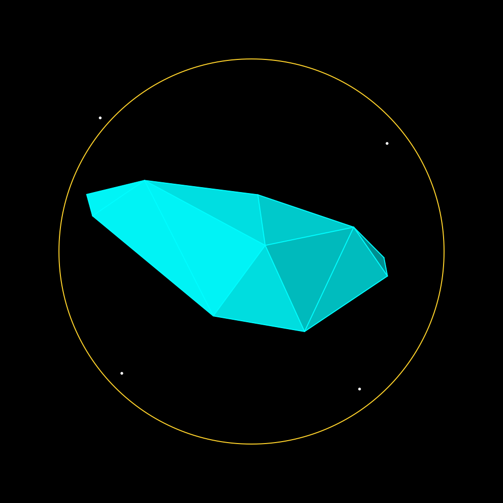
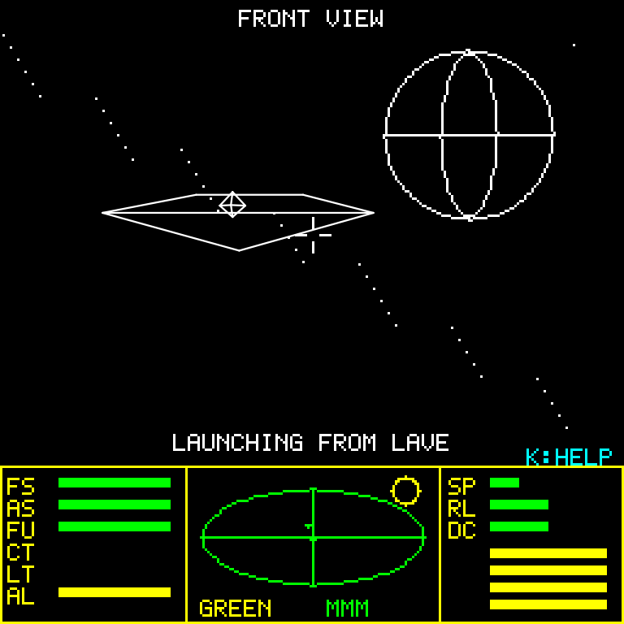
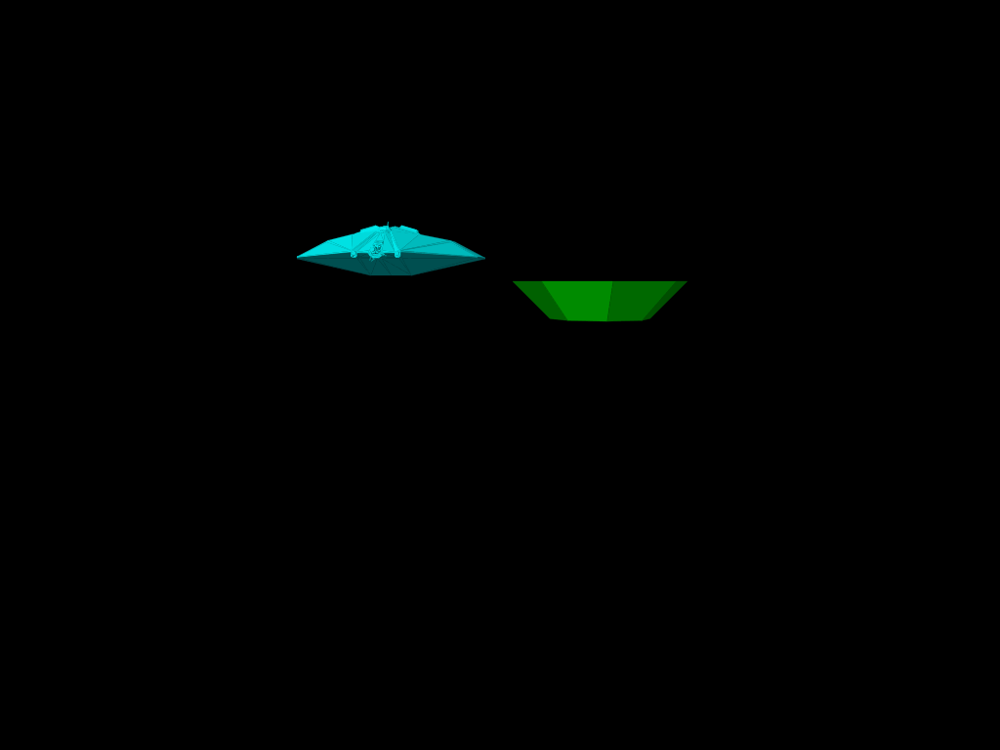
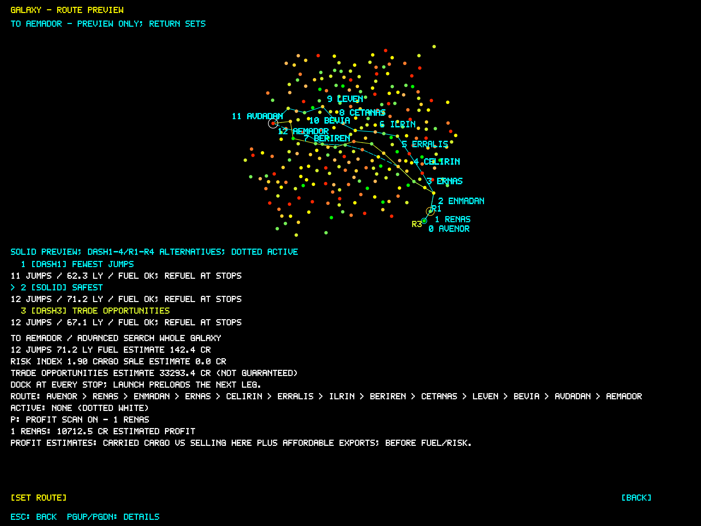
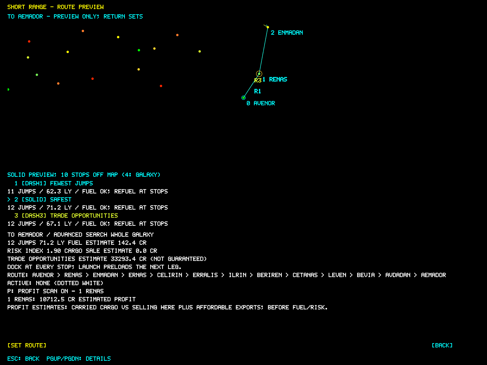

<!-- markdownlint-disable MD013 -->
# XYZZY Elite - Right-On Commander for Mac

<!-- markdownlint-disable MD033 -->
<p>
  
  <a href="https://github.com/stephenlclarke/elite/actions/workflows/ci.yml"></a>
  <a href="https://github.com/stephenlclarke/elite/actions/workflows/unit-tests.yml"></a>
  <a href="https://github.com/stephenlclarke/elite/actions/workflows/dependency-review.yml"></a>
  <a href=".github/dependabot.yml"></a>
  <a href="https://github.com/stephenlclarke/elite/security"></a>
  <a href="https://github.com/stephenlclarke/elite/releases/latest"></a>
  <a href="https://github.com/stephenlclarke/homebrew-tap/blob/main/Casks/elite.rb"></a>
  <a href="LICENSE"></a>
  <a href="https://sonarcloud.io/summary/new_code?id=stephenlclarke_elite"></a>
  <a href="https://sonarcloud.io/summary/new_code?id=stephenlclarke_elite"></a>
  <a href="https://sonarcloud.io/summary/new_code?id=stephenlclarke_elite"></a>
  <a href="https://sonarcloud.io/summary/new_code?id=stephenlclarke_elite"></a>
  <a href="https://sonarcloud.io/summary/new_code?id=stephenlclarke_elite"></a>
  <a href="https://sonarcloud.io/summary/new_code?id=stephenlclarke_elite"></a>
  <a href="https://sonarcloud.io/summary/new_code?id=stephenlclarke_elite"></a>
  <a href="https://sonarcloud.io/summary/new_code?id=stephenlclarke_elite"></a>
  <a href="https://sonarcloud.io/summary/new_code?id=stephenlclarke_elite"></a>
  <a href="https://sonarcloud.io/summary/new_code?id=stephenlclarke_elite"></a>
  <a href="https://sonarcloud.io/summary/new_code?id=stephenlclarke_elite"></a>
  
</p>
<br clear="left" />
<!-- markdownlint-enable MD033 -->

A native Swift macOS space trading game presented by XYZZY as the Right-On Commander version. Its historical reference is the BBC Micro 6502 Second Processor Executive version of Elite. It uses keyboard flight controls, shaded ship panels by default, a colour cockpit scanner, procedural galaxies, and the original-style bitmap font requested for this remake. The published 1.4.0 app starts normal games as Commander Jameson with a standard Cobra Mk III and 100 credits; its XYZZY identity is Commander Clarke. Current development builds use the L337 title and start fresh games as Commander Rowan Calder at Avenor in an SH025 with 720 CR and full fuel. Restoring a save preserves its commander identity. In current source, entering XYZZY preserves that name, refits a Cobra Mk III with maximum hardware and grants 1,000,000 CR on first activation; shaded panels default on, with white and coloured wireframes selectable. These development changes are not claimed for the published download or Homebrew release.

This development line targets the current model. Existing saves are disposable; backward compatibility with earlier saves, content formats, internal APIs and namespaces is not a delivery requirement. Current-format save/load and transaction correctness remain required.

The [completion ledger](docs/COMPLETION-LEDGER.md) is the current player-facing milestone roadmap, complete mission inventory and owned work queue. It separates prepared source, usable local builds and published delivery, and uses focused unit tests with broader checks batched after several deliveries.



<!-- markdownlint-disable MD033 -->
<p align="center">
  
</p>
<!-- markdownlint-enable MD033 -->

## Build and run

Requires macOS 14 or newer and Swift 6.0 or newer (Xcode or the Command Line Tools).

```sh
git clone git@github.com:stephenlclarke/elite.git
cd elite
make run
```

The Run action builds and opens `dist/Elite.app`. You can also open that app from Finder after building it. SwiftPM resolves the pinned TOMLDecoder dependency automatically. A fresh current development game opens with XYZZY credits and a rotating ship, then the L337 title screen. The published 1.4.0 app uses the Right-On Commander title. Rotating startup ships use shaded panels independently of your saved flight display preference. Press Space to enter the commander screen and 0 to launch. Restoring the last saved commander waits at the title screen before continuing that commander; opening a save during play goes straight to status. The title and opening credits show the app version, repository and full source commit SHA. Finder/Run builds embed their build identity; a bare SwiftPM executable explicitly reports unavailable commit metadata.

## Licence

Original code and documentation: [MIT](LICENSE), copyright 2026 Stephen Clarke. Imported ship models retain their individual CC-BY-NC-SA-3.0, CC-BY-NC-SA-4.0, CC-BY-SA-3.0 or author-declared public-domain terms. Included NonCommercial artwork limits commercial use. BBC-derived blueprint and original game material are excluded from MIT; the BBC reference supplies no reuse licence, so this is not a claim that the complete game is cleared for redistribution. See [licensing and third-party notices](NOTICE.md) and [model attribution and fidelity](docs/SHIP-SHOWROOM.md). Full licence texts and original credits are included in the built app.

## First flight in current development builds

The normal 720 CR starter has no targeting core or Docking fitting. Fly and dock manually using the station compass, or buy the Basic → Advanced → Docking targeting-computer chain while docked with **3**; only then can **Tab** select a station and engage AUTO. Buying a higher model requires the preceding paid entitlements. See the [targeting-computer guide](docs/TARGETING-COMPUTERS.md).

Passenger journeys require two actual fitted, working Passenger Berths with life support. Their base price is 1,000 CR each before shop discounts, so the starter balance cannot buy both immediately. A passenger request or reply does not itself board anyone. See [passenger equipment and controls](docs/CONTROLS.md#station-tasks-and-mission-dialogs).

Current development also includes **Orbital outlook**: after separate consent and fitting two working cabins, take the same two people from Avenor to Renas, measure three ordered marker views, then return them for care and a one-time 870 CR payment. Select the requested marker with Tab; each view needs 12 uninterrupted measured flight seconds in valid front-view, range and aim conditions. Pause freezes progress; cold loading preserves completed views and resets an unfinished view. These additions are not claimed for the published 1.4.0 app.

## Controls

In the current development source, station AUTO defends and evades while continuing toward the docking approach at the fastest safely brakeable speed. Defensive aiming and limited lateral evasion share the ship's existing thrust limits; station clearance, doorway attitude and spin take priority near entry. Outside the station clearance and stopping boundary, uncovered active laser fire keeps AUTO defending or returns it to defence; current station cover or cleared pressure permits docking alignment again. Under active fire it seeks an exterior route around the station toward cover instead of stopping at the exposed staging point. AUTO can face that cover route to protect a weaker forward shield bank, while fitted weapons retain their normal firing rules. It uses actual fitted combat laser mounts and finite owned missiles, preserves the selected station and weapon locks, and follows native law and obstruction checks. A military ECM-confirmed return-fire order still requires a missile response; laser fire does not replace it. Automatic missiles require a writable bound commander save, and failed publication preserves ammunition while docking and other defence continue. Existing explicit unlimited-ammunition mode remains supported.

Start with **numbers, arrows, Return, Escape and K**. Numbers open game areas, arrows move the selection, Return chooses, Escape goes back one level, and K shows help for the current activity. Click visible actions or use the **Screens**, **Game** and **Flight** menus for everything else.

| Keys | At a station | In space |
| --- | --- | --- |
| 0 | Launch | Front view |
| 3 | Equipment | Right view |
| 1 / 2 | — | Rear / left view |
| 4 / 5 | Charts with full planet information | Galactic / short range chart |
| 6 | Ship showroom | System data and planet view |
| 7 / 8 / 9 | Market / status summary / inventory | Prices / status summary / inventory |

For keyboard flight, **arrows steer**, **Space accelerates**, **Delete brakes**, **Return uses the selected tool**, **W cycles Combat Laser / Mining Laser / Salvage Cutter / EMP Pirate Blaster**, **F cycles Ships / Mining / Salvage / All target filters**, and **Tab selects a target**. Selecting the station engages automatic docking with a suitable targeting computer; Q returns to manual control. The trackpad controls are below.

Escape never launches an escape pod. Use **Flight > Launch Escape Pod** or **Command-Shift-E** deliberately. Help and pause close before the screen beneath them; search closes before its browser. Mission dialogs return without transferring anything when you press Escape.

Status names the current main orbital or RRS dock. In flight it reports “Not docked”; an unknown dock is reported as unavailable rather than assumed to be the main station.

Everything essential works on a built-in MacBook keyboard. Delete means its normal backspace key; scrolling also works with the trackpad or arrows. **Option-Up / Option-Down** moves a page at a time, and **Command-Delete** clears an active search. No function keys, keypad or dedicated paging keys are required. Held flight inputs clear when you change screens, pause or lose focus.

Press P on charts or the navigation screen to toggle the automatic top-five profit scan, enabled by XYZZY. Ranked gold markers show profitable destinations within current jump range; navigation lists conservative estimates based on cargo, cash and local stock, before fuel and risk.

W, Return, E, Q, Tab and F now share one [generated flight-action authority](docs/FLIGHT-CONTROLS.generated.md) for key dispatch, scoped help and Flight menu labels. Station and mission confirmation keep their own context.

The [complete control guide](docs/CONTROLS.md) groups specialist flight actions, charts, missions, showroom, Mac commands and XYZZY options by activity. In-game K help follows the same scheme.

### Trackpad flight

Place the pointer over the game before touching the trackpad. Touch gently; no click or repeated swipe is needed. Controls repeat on every game update while your fingers remain on the pad.

| Fingers | Action |
| --- | --- |
| Two | Steer without changing speed: up/down pitches, left/right rolls |
| One | Slow down along the current heading, stopping at zero speed |
| Three | Accelerate along the current heading, stopping at maximum speed |
| None | Centre the yoke, stop pitch/roll and cruise at the current speed |

Two-finger steering uses the midpoint of your fingers relative to the centre of the physical trackpad. Hold off centre to keep turning; return to the centre to stop turning and cruise. A small central dead zone prevents drift. Changing finger count switches modes immediately, so dropping from three fingers to two holds the speed you have reached. One- and three-finger speed changes keep the yoke centred.

Four-or-more contacts or an invalid contact suppress trackpad input until every finger lifts, including when switching Spin Hold mode.

Trackpad flight operates in cockpit views with manual control. Pause, help, docking, the docking computer, other screens, lost focus and cancelled gestures clear its input. Keyboard flight remains available. macOS Mission Control and three-finger dragging may intercept touches; assign system gestures to four fingers or disable three-finger dragging if three-finger acceleration does not register. Physical three-finger delivery depends on those system settings.

### Spin Hold prototype

Press V, or choose **Game → Toggle Spin Hold**, to enter the explicit spin mode. Draw a deliberate one-finger circle around the physical trackpad's centre to select clockwise or anticlockwise roll. Every recognised circle commands a gentle 12 degrees/second, independently of how quickly you draw it. CW and CCW are defined from the pilot's forward cockpit view. Pure roll preserves the forward heading.

| Fingers, in Spin Hold | Action |
| --- | --- |
| One, held still | Gradually reduce roll-speed magnitude to zero, without reversing |
| Two | Hold roll speed; move together to aim using pitch and yaw |
| Three | Gradually increase roll-speed magnitude to the cap |
| None | Keep the set spin speed, allowing your hand to lift and reposition |

The HUD shows Spin Hold state, CW/CCW direction, an arrow and actual degrees/second. It shows the target separately while the ship is changing rate, plus circle-recognition and speed-adjustment feedback. Press B, or choose **Game → Stop Spin**, to command a smooth stop and return to normal controls. V also exits smoothly. An opposite circle commands the other direction through a gradual stop and reversal. Help, pause, other screens, focus loss, cancelled gestures, docking and the docking computer cancel spin immediately. Browsing Mission Gallery freezes and restores Spin Hold and AUTO instead.

Keyboard alternatives are [ for anticlockwise, ] for clockwise, and held - / = or + to slow / speed up. In Spin Hold, Left/Right provide yaw and Up/Down provide pitch. Space accelerates and Delete brakes forward cruising speed. The original X/S pitch and slash braking aliases remain available. Normal-flight trackpad gestures retain the separate forward-speed mapping above; Spin Hold fingers control roll speed instead.

Prototype defaults are 12 degrees/second initially, 6 degrees/second of rate adjustment per second, a 60 degrees/second cap and a 24 degrees/second-per-second response limit. Contact counts must remain stable for 120 ms before changing rate. Circles need at least 300 degrees of consistent motion, 16 samples and 85% direction consistency, at a normalized radius of 0.12-0.46 around the pad centre; jumps over 45 degrees between samples are rejected. Two-finger aiming starts from a fresh reference whenever the count changes, with a 2% dead zone and full deflection after 25% of pad travel. These are tunable prototype values, not findings from player testing. Native touch hardware and macOS gesture interaction still require an on-device check; no global gesture settings are changed by the game.

In the current development source, a new commander prepares `~/.xyzzy/elite/commander.json` as its destination when that path is free; this creates no save file. After a failed restore, Start New uses a separate `new-commander-…/commander.json` folder under `~/.xyzzy/elite/`, preserving the selected file or missing path. Only a successful save remembers the new location for the next launch. Save As chooses another destination. Saving is atomic, and the first write at a new destination refuses any file that has appeared there in the meantime. Loading validates the entire commander before replacing actor state. Save, Reload and Open run in the order you choose them; failed saves or loads preserve your Commander and active save location. Invalid Commander JSON inputs and inputs larger than 4 MiB are refused. This startup correction is awaiting final quality/release acceptance and is not claimed for the published 1.4.0 app.

Current development mission calendars charge 600 seconds per launch and `distance² * 3600` seconds per completed jump, using the original worlds’ Cartesian light-year coordinates. Generated contract deadlines use this game calendar, including travel time. This calendar unit correction awaits integrated quality acceptance.

## Original BBC naval missions

The original two BBC Second Processor missions are enabled, including the Executive build. They begin automatically when you dock and qualify; there is no acceptance menu or deadline. An incoming message appears for two seconds before the briefing. Return or Space advances the pages; Escape closes the message after the incoming-message delay. K opens the relevant key guide; Command-P pauses the briefing or game.

The Constrictor Hunt starts in galaxy 1 or 2 at 256 combat points. Read the selected planet data on docked charts 4/5, or use 6 in flight, for the original clue trail; clue visits are optional. The stolen ship appears at Orarra in galaxy 2. It has 252 energy, ECM, four missiles and bomb immunity. Ordinary lasers cannot damage it; a military laser inflicts five damage per hit, a quarter of its normal 23 points rounded down. Returning to a station after its removal awards 5,000 credits and 256 combat points once. The Executive source also treats the target leaving the local space bubble as mission completion; this historical quirk is retained.

Thargoid Plans starts on docking in galaxy 3 after the Hunt is finished and your tally reaches 1,280. Report to Nerith (G03-S083), collect the encoded plans, then dock at Veyara (G03-S036). Visiting Veyara before collection does nothing. The plans occupy no cargo space and survive commander save/load. Carrying them enables the original 56-in-256 Thargoid ambush predicate at eligible spawning checks, with a mothership and Thargon companion. Motherships can release six additional drones when damaged; surviving drones stop fighting after the last mothership is destroyed. Delivery replaces a standard energy unit with the naval unit and adds 256 combat points once, with no cash payment. Energy recharge follows the original 1:2:3 ratio for an unupgraded, standard and naval unit. Outside PLUGH, the naval unit is a mission reward; maximum XYZZY hardware includes it.

Mission flags retain the original TP low-nibble states and default to unstarted in older saves. [Source profile and fidelity boundaries](docs/BBC-EXECUTIVE-MISSIONS.md) records the selected revision, source quirks, tests and the remaining differences in the native simulation and briefing presentation.

## XYZZY

Type `xyzzy` in the game to become Commander Clarke in the canonical Cobra Mk III and open the secret menu. On first activation you receive 1,000,000 CR, with finite cash accounting, maximum supported hardware, four additional fuel units (35 LY total capacity), an Advanced navigation module, a full missile rack, fuel, shields and energy. The 21-LY stock Advanced jump cap and remaining fuel still limit each jump. Unlimited missiles, fuel replenishment, cargo, auto-trade, speech, AUTO targeting, automatic ECM and Military retaliation start enabled; shaded panels are selected. Current development source fits Naval lasers, the Elite Shield Module, Military targeting and the Advanced energy module (legacy Naval Energy Unit), while Mining capability, ECM and scoops are retained.

Auto-trade immediately sells and restocks when activation happens while docked, so the initial grant can be spent immediately. Cash then changes through ordinary purchases, sales, fuel and rewards. Reopening XYZZY or loading a save never replenishes cash; re-entry retains switch choices and restores the Cobra Mk III with maximum hardware. C repeats this free refit without granting cash or running auto-trade; excess cargo enables unlimited capacity to preserve it. Old XYZZY saves with unlimited cash receive the finite starting balance once, then persist the migration; finite old balances and ordinary commanders are preserved. Old unlimited-jump flags cannot bypass current jump limits. Location and mission progress remain intact. A new game starts as Jameson again.

| Key | Option |
| --- | --- |
| 0 | Cycle white wireframe → coloured wireframe → shaded panels → white wireframe |
| 1 | Fit at least the Docking targeting tier, preserving any higher tier |
| 2 | Fit maximum hardware and restore shields, energy, fuel and missile rack |
| 3 | Unlimited missiles |
| 4 | Unlimited fuel |
| 5 | Show current fuel/nav jump limit; no unlimited-distance override |
| 6 | Auto-trade |
| 7 | Optional speech using the Mac's synthesiser |
| 8 | Unlimited cargo capacity |
| 9 | Show actual cash balance; first XYZZY activation starts with 1,000,000 CR |
| A | AUTO target assist |
| B | Military ECM-confirmed return fire |
| C | Restore Cobra Mk III and maximum hardware for free; preserve cash, cargo and mission progress |
| E | Automatic ECM |
| L | Reset legal status to Clean (saved with your commander) |
| F | Fit fuel scoops |

Normal games, XYZZY activation and saves without a display choice default to shaded panels. Explicit saved white or coloured wireframe choices are preserved. White wireframe draws the flight scene, including planet and sun outlines, in monochrome; coloured wireframe uses the same outline geometry with hull and celestial colours. Shaded panels draw opaque faces with directional lighting, textured planets and a filled sun/corona. The current development source additionally samples approved diffuse textures for SH169 Sunray and SH170 Military Stingray only; other hulls retain their authored materials. See the [selected texture contract and attribution](docs/SHIP-TEXTURES.md). The textured-surface repair is source-integrated and renderer export/currentness passed; focused native targeting, visual and performance acceptance remain pending. This is not an all-hull texture or published 1.4.0 claim. Planet data previews follow the selected mode; chart and cockpit information colours stay legible. The chosen display is saved with the commander. Key 4 controls fuel replenishment. Jump distance always obeys fuel cells, current fuel and the navigation computer; the paused-game @ shortcut has been removed.

Press K, use Command-K, or choose **Help → Player Key Guide** for the controls relevant to your current activity. The guide covers flight, station screens, trading, equipment, charts, pause, the title/demo and XYZZY. At an RRS waystation or headquarters, the station guide names the dock and marks unavailable shops, trading and ship exchange while retaining their screen shortcuts. Arrow keys change pages; Escape or K closes it. The simulation pauses while the guide is open and resumes on the same screen.

Auto-trade runs when enabled while docked and on subsequent docking. It sells tradable cargo while retaining marked mission items, refuels, and buys profitable exports for the selected destination. If the target is the current system, it chooses a reachable route using profit, distance and government risk. Pricing follows the original economy calculation; it evaluates all possible destination market fluctuations and buys only goods with a positive conservative margin. Slaves, narcotics and firearms are included when profitable, and illegal cargo affects legal status on launch. Cash and local stock always constrain XYZZY purchases; hold capacity is unlimited while its switch is on. Auto-trade pays for a full tank before buying exports when fuel replenishment is off; insufficient cash stops export purchases with an explanation. Unlimited cargo cannot be disabled while the hold exceeds the normal bay capacity; sell excess cargo first.

## Cockpit and AUTO assistance

The flight view uses the full window width and native resolution, with antialiased wireframes and small point stars. Resize the window or enter full screen using the green window button. The original bitmap font stays at a compact readable size. Instruments are labelled Front shield, Rear shield, Fuel, Cabin temp, Laser heat, Altitude, Speed, Roll, Pitch and Energy; signed controls have a centre marker and neutral label. Status names are explicit. The system planet and sun occupy actual flight space; the HUD shows their bearings in the current view. The central scanner expands with the window, while supporting bars have a maximum width so they stay compact in full screen.

A controlled development-source flyby comparison improved median draw intervals from about 17.7 ms to 16.66 ms in compact and fullscreen windows. The [measured frame-pacing report](docs/NATIVE-FRAME-PACING.md) records the protocol, evidence and limits; this is not a published-release or every-gameplay 60 FPS guarantee.

The missile rack shows one icon per finite missile, `None` for an empty rack, or one icon with the literal `~` for unlimited missiles. Armed and Unarmed are written as well as coloured.

Missiles travel through space after launch; launching does not instantly destroy the selected ship. The shared projectile limit must admit the missile before ammunition is spent. Missiles hit the nearest intersected hull or celestial body, so a station can block a shot. Standard missiles travel at 792 native units per second and expire at 6,000 units or 24 seconds; a lost target ends the flight without awarding a kill. Newly simulated shielded ships absorb the missile's 250 damage with their actual shields and hull. Original energy-only mission ships retain their one-missile destruction rule, including the Constrictor. The attack retains the actual launcher even if that craft leaves the scene. ECM counts only missiles that the player's activation really destroys.

In the development induction route, Enron's utility crew authorizes three original external handoffs after Enmadan receives the original rescue crew. **Tab** selects these mission contacts even without a targeting computer; it grants no automatic flight. With one selected in the front view, **Return** opens the maintenance review and a second **Return** confirms arming. Return serves maintenance for that contact. Keep the actual unobstructed front surface 50–150 m away, relative speed at most 1 m/s and aim within 2° for 20 qualifying unpaused seconds per module. Work pauses outside that envelope and partial progress survives saving/loading. **Q** or **Escape** stops maintenance. Each completed repair consumes its own crew-owned kit with the control change. After all three, dock at the actual Enron main orbital, press **B**, and separately review/confirm crew receiving. **K** shows the contextual maintenance keys. This source still awaits integrated native acceptance.

After Enron receiving in the development induction, dock at Avenor and use **B** to compare **Pooled windows** and **Protected reservations**. Arrows choose the policy; **Return** reviews it and Confirm records it. **Escape/Back** leaves it unchanged. The review shows six service-window units per clinic/workshop/seed operator, a protected minimum of two, surplus-only pooling or exact owner-release terms, and the fixed persistent epoch. This records the stage 11 policy choice and its eighteen original owner/epoch capacity units. Earlier saved choices can review the still-unissued original allocation at actual Avenor; loading never creates another issue. Use **B** at Renas G01-S185, Enmadan G01-S000 and Enlirin G01-S162 to review and separately Confirm each original owner’s selected-policy consent. In protected mode, choose a named free surplus window and separately review/Confirm its owner release; consent alone releases nothing. Arrow selection, Return review/Confirm and Escape/Back apply to each exact unit. After clinic consent, **B** at Renas separately reviews/Confirms its one original batch of six new1t samples and a narrow Avenor read-only delegation. Its stock row reviews a current reachable Renas-to-Navidor itinerary at320+85L CR with1800-flight-second integrity starting only at later actual pickup. Quotes consume no samples/windows, grant no cargo or fuel and are captured when the review opens. Each original sample now has a separate booking row: review/Confirm reserves the exact sample, one eligible clinic-owned capacity window and1t real hold space together, within the independent three-active-contract limit. The complete reachable route and price freeze at booking; its individual hops are not mandatory. Before pickup, a separate cancellation returns the same unchanged warehouse sample, window and hold space once, without cash or success. Carrier exit releases still-existing warehouse stock; known source destruction records failed stock without replenishment. A separate Renas pickup review/Confirm replaces the reserved tonne with that same carried sample and starts its exact1,800-second qualifying-flight timer. At living Navidor, review/Confirm reception with time remaining to receive the original and pay the frozen quote once. Pause stops flight time; saves/loading retain the timer and quality. Cancelling after pickup keeps the original cargo, window and clock until actual Renas owner return; return releases the window and tonne without cash or fresh stock. Native expiry or attained carrier loss records failure and closes the original reservation without replenishment or payment. The real-source Avenor audit and later accreditation remain separate work; three signatures or a source issue alone do not complete stage12.

After the workshop's charter consent, use **B** at actual **Enmadan, G01-S000** to review/Confirm its one batch of six new unique2t failed serials. This is separate from the induction cassette and old W02/W03 stock. Select an original serial, **Return** to review its currently reachable complete Enmadan-to-Renas-to-Enmadan quotation, then Confirm to reserve its workshop-owned window and two real hold tonnes within the shared three-active limit. Price is **430+90L CR** for all quoted outward and return legs; the player may fly any reachable route. A separate pickup row collects that same serial. At **Renas, G01-S185**, review/Confirm service of the original failed unit, then return it to original Enmadan receiving for its frozen payment once. The workshop unit is nonperishable and untimed, with no hidden timer. Before pickup, cancellation returns unchanged warehouse stock, window and space; after pickup, cancellation keeps the actual serial, condition,2t cargo and window until real owner return or recorded loss. Cancelled returns archive the original condition without payment or fresh stock. **Escape/Back** keeps the current custody. This source-complete development loop still needs independent hosted/native/build qualification and grants no Avenor audit, stage12, accreditation or clue.

After seed-custodian consent, use **B** at actual **Enlirin, G01-S162** to review/Confirm one new batch of six unique3t seed lots for **Lareria, G01-S091**. These lots are separate from the induction key/ark stores and generic W03 stock. Select a lot, **Return** to review, then separately Confirm its original stock/window/three real hold tonnes within the shared three-active limit. The current reachable itinerary freezes **510+95L CR**, hazard0, without compulsory hops or free fuel. Separate actual pickup starts the original **7,200 qualifying-flight-second** integrity timer and replaces reserved space with that same3t cargo. Pause stops flight time; save/load and reopening retain the same serial, deadline and quality. Actual living Lareria receiving with positive integrity pays the frozen quote once. Before pickup, cancellation returns unchanged warehouse stock/window/space; after pickup it retains original cargo/window/deadline until actual Enlirin return or recorded terminal failure. Returned issued lots are archived, never replenished with a fresh allowance. Native expiry or attained carrier loss closes the original without replacement or payment. **Escape/Back** preserves custody. This author-owned development feature still needs hosted review/qualification and a later accessible build; it grants no audit/stage12, accreditation or clue.

After all three owner signatures, return to actual **Avenor, G01-S007**, open **B**, select **Avenor / review original charter capacity audit**, and press **Return**. A real issued still-available lot and its owner's read-only delegation must exist. Separate Confirm checks the current reachable quote and records the same acceptance policy refusing a named protected minimum window for Pooled, or an unreleased surplus window for Protected. Stock, windows, cargo and cash stay unchanged; the three-active limit is not used as audit proof. **Back/Escape** records nothing. This completes the development source's stage12 charter record; Veil certification and Senn's final payment/accreditation/clue remain separate later reviews. Hosted tests and an accessible build must qualify this new path before playable completion is claimed.

After stage12, use **B** at original **Avenor** and select **Veil / review original network certification**. **Return**, then separate Confirm, checks the original intact clinic reception, serviced cassette owner return, seed-ark receiving and key return, two living rescue crew and original recorder reception, all three repaired utility handoffs, and the chosen charter audit. Later operator service jobs do not substitute for those original induction records. **Back/Escape** records nothing. Veil records stage13 once and pays nothing; Senn's final receiving remains separate. This new development path still needs hosted/native/build qualification.

After Veil certifies the original network, use **B** at actual **Avenor** and select **Senn / review final accreditation and7600CR**. **Return**, then separate Confirm, pays **7,600 CR once**, completes the induction under the chosen charter, records the single Exchange completion clue and grants the same commander's advanced-service entitlement atomically. **Back/Escape** changes nothing; stale contact, missing originals or credit overflow refuse the whole transaction. Existing original service contracts can still finish or cancel afterward without another Senn reward or clue. Their finite stock, owned windows and the shared three-active limit remain. Basic W01-W05 paths remain available; advanced offered variants read this same verified entitlement. W06 remains separate unfinished work. This is development source awaiting hosted execution, independent review and a later usable build.

With a fitted targeting computer, press **Tab** repeatedly to select eligible ships. All ships actually visible in the front renderer come first, nearest first, followed by offscreen ships nearest first if your tier supports them. IDs break distance ties. Stations follow the ship groups at Docking tier and above. The default Ships filter excludes cargo canisters, asteroids and missiles. Front visibility uses the same mesh projection and clipping as rendering even from a rear or side view, including partly visible hulls. A cycle keeps its order while ships move; membership, equipment or viewport changes reconcile unvisited targets, and wrapping starts a fresh snapshot. A cyan lock marker and offscreen cue identify the target. AUTO faces and tracks ordinary ships at unchanged cruising speed, with Spin Hold available. **Q** or manual steering disengages.

The yellow station compass shows distance, left/right bearing and up/down elevation in every cockpit view, including when the station is offscreen, behind you or outside scanner range. It works without a targeting computer. The selected station takes priority; otherwise it points to the main station, or the nearest live station if no main station exists. Its bearings are relative to the view you are looking through. The cyan combat target marker remains separate.

Station AUTO completes docking without further input. For the original main station, it faces safe approach waypoints around a 400-unit safety sphere and brakes at the entrance axis 1,000 units out. The current development RRS guidance scales clearance to the station mesh radius plus 400 units, and stages at that clearance radius plus 1,000 units. It then turns toward the doorway and matches rotational phase and rate. The final approach visibly closes on the station in the forward view and controls acceleration and braking. It holds or retreats if alignment is inadequate and enters through the rendered doorway using the simulation's docking and collision checks. The HUD and voice announce Approaching, Aligning, Matching spin, Final approach and Docked. Q, manual controls, Spin Hold, pause or focus loss cancels; controlled forward cruise is retained on manual cancellation. Tab selects stations after eligible ships and engages full guidance. Guidance owns trackpad and held throttle while docking. The old standalone Docking Computers item has been removed; older saves migrate to at least Docking tier without downgrading a higher tier. These native guidance thresholds are prototype choices. Tests cover front/behind, tilted/off-axis and away-facing starts, both spin directions and high initial speed; starting inside station geometry is not a supported safe starting condition.

On long station approaches, AUTO uses the fitted hull’s speed capability and bounded acceleration, then brakes early enough to stop at the external approach waypoint. Alignment and doorway entry keep their conservative speed limits, including gradual braking from inherited momentum.

Solid station collisions stop the ship and cause impact damage. Fly around structural arms and align with a clear doorway; the rescue station has a real open passage, with fit limited by its narrower inner bore.

Development source also handles continued debris contact against multiple native hull faces. Responses conserve linear momentum and lose energy, and thin crossing edges can supply a collision certificate between samples. An uncertain continuation rolls back the step. This change has focused geometry and impulse unit coverage; it is not yet included in the linked development preview.

Development source adds swept debris impacts with finite station mass, real station resource damage and retained translational momentum. Current station positions, doorway checks and departures derive from that motion while authored anchors stay fixed. The new station impact, coast and persistence cases are authored but await central execution; this is not a release or campaign-completion claim. See [station inertia](docs/PR-native-station-inertia.md).

## Ship showroom and secret ports

6 opens the showroom with 171 rotating ship models and 162 flyable hull adaptations, including the [Liberator DSV2](docs/LIBERATOR.md) with three radial nacelles, detailed pale panels and its green aft engine. Search Liberator or DSV2 to review its 415,000 CR hull price and trade-in. Browse with arrows, Return, Tab and Escape; secondary actions are visible buttons. Sort A-Z or by native power, compare **BETTER / WORSE / SAME** game values with the same carried fit. The prominent **Switch ship - review trade** action shows price, trade-in and resulting cash before opening the compatibility review. Return opens specifications, then the trade review; Tab switches panes. **Currently flying** identifies your owned hull. Purchases change actual flight characteristics and persist in saved games. Cargo, paid equipment, fuel and mission property transfer intact; incompatible exchanges are blocked with an explanation. Development source retains unsupported portable fittings and excess installed missile rounds in owned storage when changing to a smaller hull. Stored equipment keeps its identity and history; returning to a larger hull does not refit spares automatically. Cargo, fuel and passenger/cabin capacity still have to fit. All definitions, geometry and named material palettes load from individual [ship TOMLs](Sources/EliteCore/Resources/Ships). The 93 revised project hulls have family-specific silhouettes and design-appropriate detail; Thargoids keep smooth organic forms. Imported geometry and all gameplay values are preserved. See the [per-ship design review](docs/SHIP-DESIGNS.md), [complete animated ship catalogue](docs/SHIP-CATALOGUE.md), [showroom guide](docs/SHIP-SHOWROOM.md) and [conversion/generation rules](docs/SHIP-FILES.md).

Each galaxy has a hidden **PLUGH** port. Ask for station rumours with U while docked to follow the local clue; discovery is saved separately per galaxy. Reach it through ordinary fuel/nav-limited travel and dock normally. It stocks all commodities and supported equipment, including reward hardware, at a documented 25% discount while retaining cash and fitting limits. See [discovery, prices and travel rules](docs/PLUGH.md).

## Targeting computers and target information

See the [targeting-computer player guide](docs/TARGETING-COMPUTERS.md) for core prices, prerequisites, controls and ECM rules, plus the independent Mining/Salvage modules and work tools implemented in the current development source. F cycles work-target filters, W selects the tool and Return uses it. These additions still require integrated native and quality acceptance; this is not a claim that they shipped in version 1.4.0.

Upgrades are cumulative, with one effective installed tier. The current development shop requires recorded prerequisite purchases; Mining and Salvage modules are separate fittings and require a fitted Basic-or-higher core. Prices are in credits; Basic and Military use twice their matching laser prices, with graduated intermediate prices following the requested laser-related scale. Equipment rows use a compact font and a right-aligned credit column inside a centred table capped at 680 points, keeping names and prices close in full screen.

| Computer | Price (CR) | Added capability |
| --- | ---: | --- |
| Basic | 800 | Acquire front-visible ships and face the selected ship |
| Advanced | 2,000 | Also acquire known offscreen ships |
| Docking | 4,000 | Also target stations and complete automatic docking |
| Identification | 6,000 | Live zoomed target camera, model and status |
| Pirate | 10,000 | Cargo, origin and destination information |
| Military | 12,000 | Shields, laser heat, fuel, missiles, ECM and ECM-confirmed retaliation |

The upper-right target panel is expanded by default in full screen and compact in a window; I changes it. Its live ship rendering copies the actual target pose without moving the flight camera. Lower tiers receive only a minimal target identifier. Ship missile counts and ECM equipment/activity come from simulation state. Pirate and Military tiers disclose recorded NPC cargo and routes, plus the selected craft's tracked front/rear shields, fuel and laser heat. Unrecorded legacy facts remain Unknown; generated and inferred routes are labelled. Long readings wrap and Option-Up/Down pages the panel. Ordinary NPC state survives save/load, docking and camera culling without replenishing spent missiles, fuel, heat, hull energy or shields. Offscreen craft coast and cool/recharge during actual flight simulation time; cruising does not burn jump fuel. Legacy mission craft retain their original energy-only combat profile. Stations show entrance, rotation and range information instead of ship armament.

Military identifies the actual craft that launched a player-targeted missile. Outside station AUTO it establishes a weapons lock without taking over steering or Spin Hold; during station AUTO it identifies the source while preserving the docking destination and existing weapon lock. After that missile is confirmed destroyed by the player's ECM, it can fire one retaliatory missile per attacker per activation. It waits for the ECM field and the one-second missile cooldown, consumes normal ammunition unless unlimited, and requires a living source and forward missile lock. Missing ammunition, invalid source/lock or disabled equipment cannot produce a success announcement. Pending return fire expires after three game seconds. U clears pending return fire and disarms; XYZZY B toggles it. Outside station AUTO, automatic ECM still requires its existing XYZZY switch and fitted equipment; manual ECM can also confirm retaliation. Station AUTO activates fitted ECM against incoming missiles using the normal energy cost, without changing that option.

## Trading colours

The unified Market (7) shows prices, stock and holdings together. Click Buy/Sell or press Tab to choose a mode, then Return or Buy one/Sell one trades a unit. Left sells one and Right buys one. Keys 1/2 have no docked action; the Screens menu exposes the single Market entry. Commander Status (8) summarises readiness, location, cash and legal standing; Inventory (9) contains cargo, mission property and the full equipment/laser list.

The development source adds the **EMP Pirate Blaster**, a separate forward fitting costing 3,000 CR at TL9. W selects it; hold Return for its ten seconds of simulation-time charging. An actual ECM activation cancels the charge. The fitted normal energy grade supplies pulse power 32/48/64/80 and mesh-tested reach 3,000/4,500/6,000/7,500 flight units. Release rechecks the actual target, fitting and occlusion, then spends 8 electrical power, 18 heat and a 1.5-second cooldown once for the whole pulse. The struck shield absorbs first; overflow drains electrical reserve without hull damage. Nearby visible targets, including the player, receive a weaker target-centred splash within one-third of that reach. Only zero electrical power disables propulsion and ordinary weapons; drift and spin remain, and emergency bombs or an owned escape pod remain available. XYZZY grants one EMP fitting alongside its four Naval lasers.

Actual human crew are conserved through independently sampled ejection times, protected occupied pods and cutter capture of remaining crew during the original 30-second disabled window. Unsafe actor slots keep crew aboard. Repeated hits do not extend the deadline. Surviving crew can resume their current damaged craft after the deadline and positive earned electrical recharge; an unoccupied derelict remains salvageable. Unlawful EMP remains aggression. Custody still has its explicit 32-hull/256-person limits. Orange disabled/salvage cues and red active threats remain separate from white wireframe geometry. Ordinary saves use version 26; the development native alien-storage path uses version 27 with a small authenticated page-tree reference and older-format downgrade guards. The unvalidated native alien development path now stages a genuine scoop in the physical frame and saves the complete original source and custody before removing its object. Inventory exposes separate alien module fitting, storage and matching upgrades at an authenticated PLUGH main-station dock; refitting costs 0 CR and preserves current charge. Fitted counts and additive percentages fold into the resolved normal equipment once, with physical energy-module count used separately for EMP. Acquisition, writer failure/retry, actual PLUGH docking and refitting regression source has been added but has not yet executed. A recovered native alien artefact can be reverse engineered at the authenticated PLUGH main station for 1,500 CR. The service consumes that original and creates one stored Alien Seeker Missile prototype, with a permanent source and paid receipt. Research unlocks PLUGH repeat purchases at 45 CR after its existing discount (60 CR base). Load stored rounds through Inventory; finite standard and alien rounds share the same pylons, and firing consumes the selected physical round. The alien seeker retains its 1.25x missile speed and damage and distinct mesh. Stored research and paid receipts survive consumption and cold saves. This development path still requires PR review and hosted validation before release. Fresh uncapped wreck/cutter continuation and complete native alien acceptance remain in progress. Twelve revised EMP core tests passed under the thread sanitizer; older custody/native tests, genuine alien module fitting and full quality/release acceptance remain open. This development description is not a version 1.4.0 release claim.

The development mining fields now use sparse rings centred on the actual sun, at twice the sun–planet distance. System details and chart belt markers use the same presence rule as flight and miners. Chunks contain 1, 5, 10, …, 50 native commodity units; minerals/alloys use tonnes and gold/platinum use kilograms. Chunk size and durability scale with quantity. Coloured wireframes and shaded materials show ore composition; white wireframe stays white and mineable HUD/glow cues stay orange. Existing saved legacy fields, depleted rocks, partial damage and pending ore retain their identities and yields. A full pending-ore queue refuses the final extraction before spending firing energy or heat. Freshly extracted native pods spread out for safe admission; existing saved pods retain their positions and motion. Automatic recovery waits up to 60 game seconds for safe admission and reports finished only when that source has no pending ore. A blocked result keeps the remaining ore. Q cancels an admission wait or guidance while preserving current momentum. Earlier source, save and admission changes passed fifteen focused sanitizer tests. Current recovery changes have separate focused checks; full mission, sanitizer and quality acceptance remain pending.

Wreck signals point toward the nearest surviving derelict site. Abandoned wrecks retain their motion and damage when culled or saved, and destroyed wrecks stay destroyed. W selects the manual work tool; the fitted forward Mining Laser or Salvage Cutter operates through held Return. Cutter work is limited to accessible abandoned sections, and released material must enter the scoop area with fitted Fuel Scoops and enough hold space. Work guidance in this branch is undergoing integrated validation. **F** cycles Ships, Mining, Salvage and All; **Tab** selects an eligible target. Mining and Salvage require their own fitted module as well as a targeting core; Military does not supply either specialty. Large abandoned targets use an accessible surface hold, with W available to override the tool selected after stable alignment. Surface holds retain a verified visible approach direction on the moving target, so an oblique face does not redirect the ship across a hull corner; every requested motion still requires exact swept hull clearance. Work-frame orientation transfers use the represented camera frame’s inverse to preserve canonical model spin without accumulating camera-basis scale error. Return operates the selected tool; the computer never fires it automatically. Q, manual steering/throttle, changing the filter or incoming damage cancels guidance while preserving momentum. Release Return/A before using a work tool again after cancellation. Depleted wreck sections remain valid hold parents, and collecting a passing fragment does not redirect the ship away from its parent.

The unvalidated native salvage candidate now retains fresh Thargoid wrecks, original inspections and cutting cycles in version-27 pages before the ordinary lifetime pools. Every batch needs a complete cutting budget; failed publication retains completed work for retry. Known pre-inspection work and mining damage survive without inventing old material or dates. Saved sites rebuild deterministically for return visits, with exact retained wreck motion and current actor custody. For an exactly imported human EMP source, culling clears the native and archived hull bindings together before removal; a mismatched join retains both records and the body. Compatibility test sources compare original version-27 page encodings before no-write load and continuation, including two successive eight-lot human import batches; these are authored format fixtures, not historical production archives or a new human intake path. Integrated execution and quality acceptance remain pending; see the [native cutting handoff](docs/PR-native-paged-wreck-cutting.md).

After releasing work guidance, Delete (or one finger in ordinary trackpad flight) brakes the complete current motion to rest. Releasing the brake cruises at the retained velocity; Space or three fingers adds forward thrust within the ship's speed and acceleration limits. Neutral steering preserves the released momentum. Spin mode keeps its existing angular finger controls.

Small salvage lots retain the 16-unit half-extent aperture limit. Genuine current-bound ordinary ore and NPC cargo canisters retain the original ordinary capture rules and their full native geometry; this exception is tied to the exact ledger-issued payload and does not apply to unknown or oversized salvage. Automatic collection still requires fitted scoops, the actual forward scoop position, relative aperture speed no greater than 15 native units/second, valid custody/protection and sufficient cargo space. Approach and braking use the real hull meshes and current obstacles. A refused motion cannot power the ship through an obstacle; existing momentum continues. Collected targets are removed before the next braking proof.

The development showroom's **Source notes** includes an **Original source** profile for every exact SH001–SH171 identity. Use the previous/next profile controls to read retained names, roles, access policy, complete authored specifications and provenance; original names and roles are searchable. These source profiles retain unresolved values and staged blockers. Active hull prices, fittings, geometry and physical calibration continue to follow each hull's delivered runtime adaptation. Comparison badges use the same displayed tenth precision, including halfway rounding, so equal-looking native values show SAME. Nonfinite numeric values remain unavailable.

Development **Source notes > Physical source: Burro** adds SH029's exact approved native LOD in authored metres. Its raw envelope is 20.00 × 10.04 × 34.09 m, with a conservative clearance radius measured from the authored rotation origin. This profile shows a separately normalized read-only preview; the physical calculations use the untouched native coordinates. The full original specifications remain in their own profile. This is a physical-source slice awaiting hosted units/review, with fitting, flight activation and actual docking clearance still pending. Development **Physical source: Haflinger** likewise binds original SH061 to its authenticated retained mesh using the explicit project calibration of **20 metres per source unit**, giving **41.536 × 35.70 × 80.00 m**. The source did not declare SI units; this calibration is labelled separately from original statistics and display normalization. It supplies the seed-ark physical prerequisite and keeps full player activation, actual ark admission and docking verification pending. The registered-ark source now prepares one key-bound Haflinger fit and an explicit finite manifest of 40 custodian seed tonnes and six crew identities. Native admission, actual departure/arrival and retained crew/cargo now have the separately described development provider; actual cradle receiving now has the separate Lareria review described below. Source preparation itself grants no escort progress. The fuel-service model separately preserves a finite 1,000-CR custodian escrow, actual supplier quote/stock terms and once-only debit/refill calculations, including refusal history. The development service now joins actual full-hull NPC docking to a persistent 100-LY ark-only reserve at each real main station. Paid transfers reduce that reserve and the custodian escrow together, fill the same ark only for its next hop, and retain receipts/refusals through loading and visits. Actual native berth launch retains its crew, seed and spent condition. This source awaits hosted units/review and formal journey qualification; it grants no player cash or automatic arrival top-up.

Development Showroom previews show an unknown eligible original hull as a flat white silhouette. Your commander's recorded native encounter reveals its white wireframe; your current owned hull keeps its shaded material preview. Both comparison previews use the same rotation. Names, complete specifications and Source notes remain readable at every stage. Browsing grants no discovery, blueprint or purchase rights. This display change awaits hosted units and review and is outside the linked preview/release.

Inventory (9) shows fitted and held equipment, its origin, and recovered technology. Tab selects a visible action; Return or clicking its button applies it. Physical devices can be fitted or stored while docked; required shield, energy and navigation systems stay fitted until replaced. Compatible recovered scalar upgrades and recovered Mining Module, Salvage Module, Fuel Scoops, ECM and Salvage Cutter devices offer **Fit now**, including in space. The two targeting modules need a fitted targeting computer core and remain independent; a Military core alone grants neither. A device needs a supported vacant fitting, and collection leaves it in the salvage hold until you choose to fit it. Its original recovery record, quality and condition remain available after fitting, storage and compatible hull transfer. Left/Right chooses the fitting destination or upgrade statistic, and arrows, scrolling or Option-Up/Option-Down browse the list. Scalar upgrade previews show native before/after values, resulting grade and the next grade thresholds. Fitting consumes that recovered source once, without adding a paid purchase or refilling ship resources. After navigation, resize or reload, wait for the new controls to draw before applying an action. Use Save for ordinary progress. In the development source, accepted fitting changes also save automatically when native or mission state requires it; failed writing refuses the change and preserves the previous save.

The Market uses consistent category colours: green Agricultural, cyan Consumer, yellow Industrial, blue Materials and orange Restricted cargo. A labelled legend explains the colours. Slaves, narcotics and firearms are the restricted goods in the implemented launch-legal-status rules. Category colours do not predict profit or imply that other goods are buyable. Separate Action text states BUY, SELL, NO STOCK, NO CASH, HOLD FULL, NONE HELD, RESERVED or DOCK TO TRADE, alongside price, stock and hold counts. Arrows or scrolling browse every commodity; category colours also appear in Inventory.

## Navigation, fuel storage and charts

Equip Ship groups every supported item under Fuel Storage, Lasers, Shield Modules, Targeting Computers, Navigation Computers, Energy Systems, Defence & Ordnance, Electronic Weapons, Cargo & Collection, Travel, Emergency Equipment and Passenger Facilities. Yellow headings cannot be selected or bought. Item names are indented, prices/statuses are right aligned, arrows skip headings, and clicking or trackpad scrolling browses the list. Unavailable items show their required tech level; Naval/Elite grants remain visible without a fictitious purchase price. Selection follows item identity when sections reorder the display.

Every hull carries a real Basic Hyperspace Drive. Intermediate (5,000 CR, displayed tech level 10) and Advanced (15,000 CR, tech level 13) drives require the preceding fitted drive and its paid purchase history. Their charge times are 10, 5 and 1 seconds; fitted navigation upgrades multiply that time once. Ship and celestial hyperspace mass-lock distances scale to 100%, 80% and 60%. In-system jump safety, fuel use and navigation range still apply. XYZZY grants the Advanced drive. Existing equipment migration preserves owned items, paid history, cargo and fuel; modular-drive saves use the versioned save format. Alien salvage has a 5% chance to yield a physical Alien Hyperspace Drive. Scoop it, then fit it for 0 CR at the authenticated PLUGH main-station workshop through Inventory. The fitted drive activates hyperspace immediately and removes hyperspace mass lock; stored devices and fittings on another hull do not. Fuel, range, electrical-disable, ordinary drive and in-system jump safety requirements still apply. This development path requires the PR review and validation gates before release.

### Passenger cabins

At a main orbital station, open **Equipment (3)** and select a layout under **Passenger Facilities**. **Return** buys one complete physical cabin. Every fitted cabin uses **5t of cargo space and one equipment unit**, regardless of grade or occupancy. Each passenger has a separate place and identity. The shop shows fitted/stored cabin counts, occupied/reserved/free places and life-support/stasis condition; insufficient cash or physical fitting space prevents purchase.

| Cabin | Places | Initial base price |
| --- | ---: | ---: |
| Packed Stasis Cabin | 20 densely packed stasis pods | 1,000 CR |
| Economy Cabin | 8 | 2,500 CR |
| Standard Cabin | 4 | 5,000 CR |
| Luxury Cabin | 2 | 10,000 CR |
| Single Stateroom | 1 | 20,000 CR |
| Double Stateroom | 2 | 20,000 CR |

These prices and intermediate capacities are initial project balance defaults, before station discounts. Packed stasis transport is a cargo-hold module, with no walk-around living quarters, and requires explicit stasis consent. Other grades support awake travel and cryopods, including long-journey stasis in staterooms. Existing native passengers retain their awake/private-cabin promises: two places in one shared cabin do not satisfy a promise of two separate cabins. Occupied or reserved cabins cannot be stored; compatible hull exchanges preserve all cabin, place and passenger identities. Current saves include the complete physical layout; no old cabin-save migration is supplied.

With Passenger Berth selected, **S** stores an empty fitted cabin and **R** refits an empty stored cabin. Storage/refitting preserves the same owned cabin and charges no second purchase price. A used or reserved cabin cannot be removed; refitting needs sufficient space. Repeated held keys do not repeat the action. **K** shows these cabin keys when Passenger Berth is selected. These keys apply to the selected cabin row, so ordinary flight and other station controls keep their existing meanings.

Cabin changes require a commander save location and save each accepted purchase, storage or refit. If saving fails, cash, cabin custody, fitting and the previous save remain intact. These controls are in the current development source; the focused cabin methods pass, while full quality/release acceptance remains pending. They are not claimed as part of the published 1.4.0 release.

Each Fuel Storage Unit costs **2,000 CR** and adds 7 LY of capacity. Up to four additional units fit: total capacity is 7, 14, 21, 28 or 35 LY. The row shows the fitted count and maximum; fitting an empty unit never grants free fuel. Shop and auto-trade refuelling use the installed capacity. Saves without a unit count retain the original 7-LY tank.

| Navigation computer | Price (CR) | Single-jump cap | Destination search range |
| --- | ---: | ---: | --- |
| No fitted module | Unavailable normally | 7 LY fallback | Route planning unavailable |
| Basic | Included foundation | 7 LY | Installed fuel capacity + 7 LY |
| Intermediate | 3,000 | 14 LY | Installed fuel capacity + 14 LY |
| Advanced | 9,000 | 21 LY | Entire current galaxy |

These are stock module values. Compatible recovered upgrades accumulate on the same component and can improve its actual reach, spool time or fuel cost; the effective fitted statistics govern travel. Actual reach is the lesser of the fitted reach and current fuel-supported distance; fuel capacity cannot bypass that reach. Search uses installed capacity, so an empty tank does not shrink search range. This applies in XYZZY too: its 35-LY tank and stock Advanced module permit at most 21 LY per jump. Normal jumps debit distance-based fuel; the optional XYZZY fuel switch replenishes the tank during updates. Original distances are quantised in 0.4-LY steps.

On either chart, M cycles Economy, Government and Technology colour modes with a labelled red-to-green legend. Short-range planets are filled discs sized from their radius; the current system has a cyan ring and the selected system a white ring and crosshair. Click to select. The galaxy selector or [ / ] browses all eight galaxies without travelling. O returns to the current location. Crosshair, system data and planet preview follow the viewed galaxy; H/N require the current galaxy for actual travel/route selection. Slash opens the viewed galaxy's searchable list of its 256 original planets and any discovered PLUGH, with case-insensitive filtering, arrows, Return, Escape, scrolling and Clear. Chart search consumes text input without firing weapons or steering.

Docked charts 4 and 5 include economy, government, technology, population, productivity, radius, mission clues and a generated planet view. Option-Up/Option-Down scroll long data panels. There is no separate docked system-data page; 6 opens the ship showroom. In flight, 6 retains the separate System Data screen. Planet views are original deterministic illustrations with oceans, land, clouds, poles, atmosphere and shaded day/night lighting; they rotate slowly without changing simulation randomness. Lave has a blue-green palette. They are not imported textures or claims of canonical surface geography.

The short-range chart distinguishes dotted green search range, dashed yellow maximum equipment reach and solid cyan fuel-limited reach. When fuel and maximum reach coincide, the legend states that explicitly. Advanced search is labelled as the entire galaxy, with Z cycling maximum-jump, search-fit and actual-fuel zoom; offscreen boundaries remain described in the legend.

Press N on a chart to compare Fewest Jumps, Safest and Trade Opportunities routes. A Best Cargo Sale detour is offered when its estimated return exceeds direct destination sales. Identical paths combine labels; all paths use legal hops, current fuel for the first leg, and station refuelling to installed capacity thereafter. Risk reflects government, and trade/cargo figures are conservative market estimates rather than guaranteed profits or guaranteed affordable refuelling. An empty tank must be refuelled before planning. Tonne-trade estimates reserve space for fitted cabins, mission cargo and retained salvage, including when those fittings restrict unlimited cargo to the real hold. Ordinary sellable cargo can make room at an intermediate station; kilogram and gram trades retain their normal separate behavior.

The route panel previews each candidate graphically on the chart you opened, both galactic and short-range. Up/Down or clicking a candidate changes only the preview; Return or **Set route** commits that candidate. **Back** or Escape cancels the preview and preserves the active plan. The local chart clips legs to its viewport and marks offscreen continuation; 4/5 switches the preview between galaxy and local scales. Setting a route does not launch, jump or dock. A successfully validated Set route cancels an existing jump countdown before selecting the new next hop, with an explicit status message. Dock at each stop; launching preloads the next system and announces it, and H starts each jump manually. N inspects the stored route. C clears it in the route panel; an explicit new travel destination, off-route arrival or galactic jump clears it too. Pure galactic-map preview browsing retains the route. Route progress survives save/load, and auto-trade evaluates the next planned leg without replacing it. Route browsing pauses flight.

The following previews are generated by the game renderer with `make readme-media`, using the real Lave-to-Tibedied route alternatives and an ordinary seven-LY fuel tank.





## Shields, Naval lasers and voice

Current shield components use **Basic → Basic II → Intermediate → Intermediate II → Advanced → Advanced II → Elite** grades. One physical component occupies the shield slot. Compatible recovered upgrades add improvements to that same component and can promote its grade; they are consumed once, retain accumulated progress and do not refill shields. The [module guide](docs/EQUIPMENT-MODULES.md) explains stock values, energy/navigation grades, progression and legacy compatibility.

| Shield grade | Stock price (CR) | Front/rear capacity versus hull base | Stock recharge versus hull base |
| --- | ---: | ---: | ---: |
| Basic | Included foundation | 1 | 1 |
| Basic II | 300 | 1.5 | 1 |
| Intermediate | 600 | 1.8 | 1 |
| Intermediate II | 750 | 2 | 1 |
| Advanced | 4,500 | 2.3 | 1 |
| Advanced II | Elite-rank legacy reward; PLUGH stock | 6.9 | 1 |
| Elite | XYZZY / recovered-upgrade progression; no ordinary shop row | 9.2 | 1 |

The Elite combat-rank reward retains its legacy Capital identity and supplies the stock Advanced II component; Elite component grade is a separate progression threshold. Old laser-named saved boosters retain their real statistics and provenance: for example, a legacy Mining booster keeps its 5× capacity rather than being reduced to the new 1.8× Intermediate stock value. Purchase history, stored ownership and fitted grade are distinct. A weaker purchase is stored instead of replacing a stronger fit. Recharge upgrades affect actual shield recharge independently of energy-system regeneration.

Basic, Intermediate, Advanced and Elite energy modules provide stock recharge ratios of 1:2:3:4 while retaining the hull's base energy capacity. Basic is included; sequential stock upgrades cost 1,500 CR, 4,500 CR and 13,500 CR before station discounts. Advanced requires displayed TL12 and Elite TL14; Naval rewards and PLUGH acquisition remain available. XYZZY supplies the Elite energy unit. Applied compatible upgrades can improve capacity/recharge and promote the same owned component. The original naval mission's saved item identity and reward remain intact.

The Cobra Mk III has independent Front, Left, Right and Rear laser mounts; other hulls use their TOML facing masks. Unsupported mounts cannot accept a purchase or transferred laser. A new Jameson has a front Pulse Laser and three empty mounts. Equip Ship always shows all four fittings; Left/Right or clicking a mount chooses where the selected laser is installed. Return purchases one installation at its listed price and replaces only that mount. Fitted status and confirmations name the chosen destination. Each cockpit view fires its own mounted laser, with its own damage and firing interval; an empty mount cannot fire. Heat and energy remain shared ship resources. Commander Status and Inventory list all four mounts, and arrows, scrolling or Option-Up/Option-Down expose every equipment row. Legacy global laser saves resolve to one effective front laser, preserving other equipment without inventing paid side lasers. XYZZY grants Naval lasers on all four mounts, including migration of old XYZZY saves, and retains Mining as specialised equipment. Naval damage is a chosen native default of 64 per hit, or 16 against the Constrictor's quarter-damage shield; heat/energy cost and rapid firing use the existing laser mechanics. Outside PLUGH, Naval lasers and Advanced II shields (legacy Capital) remain grant/reward equipment. PLUGH has documented native shop prices for these rewards.

A locked target destroyed by the player displays and voices **Target destroyed - your kill** once. Actual player laser, missile and energy-bomb damage carries kill attribution; unrelated destruction, range loss or despawn announces Target lost without awarding a player kill. Manual switching does not announce a loss, and rank/bounty feedback remains separate.

Every gameplay notification uses a shared event queue for its on-screen text and voice, including combat congratulations, warnings, navigation, docking, equipment, rewards and naval-message events. Combat rank promotion emits Right on, Commander. Repeated snapshots never repeat speech; urgent warnings are prioritised and backlog is coalesced. Missile identification, ECM confirmation and actual return-fire launches use the same queue without duplicate generic announcements. Speech preferences remain respected: XYZZY 7 or paused colon toggles voice. Continuous HUD readings and entire menu screens are not spoken automatically.

Automatic ECM requires active XYZZY mode, its E switch, fitted ECM and enough energy. It respects the 32-update field cooldown. Speech announces **Missile Detected**, **ECM Activated**, then the actual count of missiles destroyed by that activation, with singular/plural wording. It never announces a successful zero count or credits enemy ECM. Repeated speech waves are queued and coalesced. Secret key 7 controls speech; flight key E still activates ECM manually. Fuel Scoops are fitted by default and can be refitted with secret F. Pass a cargo canister below the forward nose within 85 native units to collect it; a full finite hold leaves it in space. Inactive Thargons can be scooped as Alien Items. Native canisters currently contain one Food unit. Flight space also contains the system planet and a visible sun. With owned Fuel Scoops fitted to the active hull, cruise nose-first through the outer solar corona to replenish fuel up to the installed tank capacity. Stored scoops and the legacy equipment-name list do not supply collection; invalid fractional fuel inputs are refused before integer conversion. Solar fuel comes from the sun, not the planet. Watch Cabin temp: closer approaches heat the cabin, backing away lets it cool, and overheating or hitting either surface destroys the ship. Sun/planet bearings and solar collection/thermal warnings appear on the HUD. Unlimited fuel remains independently controlled by 4.

## Station mission campaign

A main station can dispatch its real police ships when it receives a current unlawful-assault report against a clean commander inside its protection zone, including in anarchy. This does not create routine anarchy patrols or guarantee rescue.

The station mission campaign is now playable alongside the two BBC naval missions. Dock at **Torneden in Galaxy 2** for automatic enrolment, with no score prerequisite or deadline. Follow the Gallery objectives through Kortar, Sararden, Darvan, Kranenrik and Dradar. Bolts' destruction earns 20 kg gold directly; the final Dradar report pays 9,500 CR and clears your bounty once. Any killer counts for the two unique mission targets.

Mission dialogs use **Confirm / Back**: arrows choose, Return selects, Escape backs out, and buttons can be clicked. **Game > Mission Contacts** reopens an eligible contact; **K** shows the handoff keys. Sararden needs one free tonne for a marked firearm. It stays reserved during sales and auto-trade until its Darvan transfer. Saved targets retain identity, damage and finite missiles across visits; repeat contacts cannot repeat rewards.

This is an Oolite expansion adaptation with documented custody, wanted-level and witness-callback repairs. Its S.T.E targets currently use the native Cobra mesh and simplified combat. See the [pinned source profile and fidelity limits](docs/BLACKJACK-BULLION.md). [The implementation queue](docs/MISSION-IMPLEMENTATION.md) distinguishes research packets from playable campaigns.

## Install on macOS

The signed, Apple-notarized universal app supports **Apple silicon and Intel Macs running macOS 14 or later**. Choose Homebrew or download the app directly; neither method requires Xcode or Swift.

### Install with Homebrew

With [Homebrew](https://brew.sh/) installed:

```sh
brew install --cask stephenlclarke/tap/elite
open -a Elite
```

To update, quit Elite and run:

```sh
brew update
brew upgrade --cask stephenlclarke/tap/elite
```

To uninstall:

```sh
brew uninstall --cask stephenlclarke/tap/elite
```

The [published tap cask](https://github.com/stephenlclarke/homebrew-tap/blob/main/Casks/elite.rb) currently provides version 1.3.1; the [GitHub release](https://github.com/stephenlclarke/elite/releases/tag/v1.4.0) provides 1.4.0. [Tap PR #9](https://github.com/stephenlclarke/homebrew-tap/pull/9) contains the verified 1.4.0 update and remains pending a completed clean review and required approval. The release badge reports the GitHub release; the Homebrew badge links to the published cask and does not claim that both versions match.

Uninstalling preserves saved commanders and mission packs in `~/.xyzzy/elite/`. See [Homebrew distribution](docs/HOMEBREW.md) for the maintained cask, checksums and release synchronization.

### Download from GitHub Releases

1. Open the [latest GitHub Release](https://github.com/stephenlclarke/elite/releases/latest).
2. Under **Assets**, download `Elite-<version>-universal.zip`. The same app supports Apple silicon and Intel.
3. Extract the ZIP and move **Elite.app** into **Applications**.
4. Open **Elite** from Applications.

To update a manually installed copy, quit Elite and replace it in Applications with the app from the latest release. Saved commanders and mission packs remain in `~/.xyzzy/elite/`.

Each release includes a matching `.sha256` checksum, build/signing `.json` manifest and notarization report. The manifest identifies the binary's source commit and verification results. See [macOS distribution](docs/MACOS-DISTRIBUTION.md) for package verification and signing details.

For development builds, use the separate [Build and run](#build-and-run) instructions.

Signed local development candidates, their exact source identities and validation limits are recorded in the [completion ledger](docs/COMPLETION-LEDGER.md). Start a candidate by activating the game window and pressing **Space** or **Return**. Development features below are separate from the published 1.4.0 app; full project quality and public/notarized release gates remain pending.

Version 1.4.0 adds graphical route alternatives on both charts, with explicit preview, Set route and Back controls. Its signed, notarized app identifies binary source checkpoint `36fa5cfef1e781f68dcb1fdbf7dae1e1e1f76224`; the release tag also includes the later archive and documentation commit. See the [packaging verification](docs/MACOS-DISTRIBUTION.md).

## Add mission packs

The Constrictor hunt, Thargoid plans delivery and Blackjack's Bullion now load their campaign stages, conditions, messages and rewards from bundled TOML packs. Their original/native behaviour and older saved progress are preserved.

Choose **Commander > Install Mission Pack...**, select a validated `.toml`, then open **Game > Mission Gallery**. At an eligible main station, **Game > Mission Contacts** or **B** opens its Confirm/Back dialog. Installing supported content does not require rebuilding the app. Packs are stored in `~/.xyzzy/elite/mission-packs/`; manual copying there takes effect at next launch. The optional [Lave courier example](docs/mission-packs/courier.toml) demonstrates a new two-stage parcel delivery and once-only 50 CR reward.

For **schema 2 Lua missions**, choose **Commander > Install Mission Pack...** and select the complete pack folder. Folder content is stored in `~/.xyzzy/elite/script-packs/`; legacy TOML files retain their separate library. The `--validate-mission-pack` command accepts either a legacy file or a schema 2 folder. Folder validation checks content and reports unsupported capabilities and declared dependencies; runtime availability still depends on the commander and installed content. See [Schema 2 Lua mission authoring](docs/SCRIPT-MISSION-PACKS.md). On this development branch, bundled script content includes the generated courier jobs and native L337 contract packs, including consented freight supply. The [completion ledger](docs/COMPLETION-LEDGER.md) distinguishes integrated source from delivered app content. Other authored examples require explicit installation.

Development builds also discover the bundled generated courier jobs during normal startup. Open station **Contracts** to review a data or package delivery, or use **Mission Gallery** to inspect its requirements. A save destination is required before accepting a job; the app prepares one for a new commander, and Save As chooses another. Discovery alone accepts nothing and creates no save or user folder. Additional script-pack directories belong in `~/.xyzzy/elite/script-packs/`. Installed versions retain their exact content identity so older saved consignments can still resolve their original pack.

Development source also bundles **orbital evacuation** at Avenor's original main station. **Game > Station Contracts** opens the normal board. Request individual consent before boarding the same four named people; boarding requires four fitted, working, compatible cabins. Actual Renas care settles once, while cancellation at the source returns the people without payment. Focused native tests cover custody, fitting, loss, save tampering and composed missions; the signed candidate's offer/detail UI remains unverified as described above.

Development source now includes **consented orbital survey** on the Station Contracts board at Avenor. Accept permission, fit a targeting computer and visit the three registered Renas markers in order. In front view, keep each marker within 2 degrees and 250–1,500 surface flight units, with a clear view, for 12 continuous seconds. Interruptions reset unfinished observation; completed measurements survive saving. Return to actual Avenor reception for the once-only 730 CR payment and first family clue. This job uses no cargo, cabins or deposit. Its focused native tests and pack validation pass; it is included in candidate1.4.1087, whose visible board/mission flow remains unverified.

The installable [generated procurement candidate](docs/mission-packs/generated-procurement/README.md) is procurement-only: acquire ordinary goods through the real market, retain partial deliveries and Confirm the final handoff at the destination main station. It is not bundled by default. This development source is uncompiled and unexecuted, pending review, validation and integration; it is not a feature of the v1.4.0 release.

See the [schema, capabilities, save compatibility and validation commands](docs/MISSION-PACKS.md). Missing/changed packs suspend intact progress and reserved cargo. Packs remain unavailable while their declared capabilities or exact dependencies are missing; the research queue is not automatically playable.

### Development RRS document assignments

The composed development source adds **RRS / Sealed documents** (Rescue Stations scenario 2). Choose and save a commander first, physically dock at an RRS waystation, then open **Game > Station Contracts**. If its legal/reputation/hour gates offer the assignment, select it with arrows and Return, choose **Confirm** with Left/Right, then Return or click to accept. Reading, Back and Decline create no packet. The protected digital packet uses zero cargo tonnes and cannot be sold, jettisoned or stored.

Launch from that RRS station and dock at the same system's **original main orbital station**. Open Station Contracts and explicitly Confirm the debrief: delivery pays **30 CR and RRS reputation +2**, once. There is no deadline, and intermediate docking in the same system is allowed. Leaving the system, changing galaxy, abandonment or actual destruction of the original main station fails the assignment with **0 CR and reputation -10**, once. Temporarily missing or unproved destination evidence keeps delivery unavailable rather than inventing an arrival.

RRS stations provide this board, with no general market, refuelling, equipment shop or auto-trade service. The headquarters board is an explicit project extension. Mission Gallery shows the assignment and its retained outcome read-only; acceptance and debrief happen in Station Contracts. Other RRS scenarios remain queued. These controls describe source-composed development work awaiting focused runtime and full quality acceptance; they are not claimed for the published 1.4.0 app. See [implementation status](docs/MISSION-IMPLEMENTATION.md) and the [qualified evidence ledger](docs/WHOLE-APP-REMEDIATION.md).

## PELL identified salvage return (development)

This original project mission follows **Avenor → Renas → Avenor**. It is integrated in development source, with focused native tests and independent review; the complete manual UI journey is not yet verified.

1. Save your commander, fit a targeting core, Salvage targeting module and Fuel Scoops, free two real hold tonnes, and provide enough fuel/range for the return route.
2. Dock at Avenor's main station, open **Game > Station Contracts**, select **PELL / accept depot retrieval permission**, then choose Confirm with Left/Right and Return. Acceptance reserves two tonnes for the two original serials; it pays nothing.
3. Travel to Renas. Use **F** to select the Salvage target filter and **Tab** to select the registered packages and engage collection guidance. Recover both original packages from the depot cradle; destroying the cradle or collecting unrelated cargo cannot substitute for them.
4. Return in the same collecting ship and dock at the original Avenor depot. In Station Contracts, Confirm **PELL / return original depot property** to receive **880 CR once**. Pickup alone never pays.
5. To abandon the assignment, return to that owner and Confirm **PELL / return held property and cancel**. Surviving held originals are returned unpaid; lost property is not replenished. Mission property cannot be sold, stored or jettisoned as ordinary cargo.

## SENN flight-recorder recovery (development)

This original project mission follows **Cedamar → Celalen → Cedamar**. Its focused native tests and independent review pass; the complete manual UI journey remains unverified.

1. Save your commander, fit a targeting core, Salvage targeting module and Fuel Scoops, free one real hold tonne and fuel the return route.
2. Dock at Cedamar’s main station, open **Game > Station Contracts**, select **SENN / accept depot retrieval permission**, then Confirm with Left/Right and Return.
3. At Celalen, use **F** for the Salvage filter and **Tab** to select the original **CDR-001**. Identify it in front view within 2 degrees and 250–1,500 surface flight units. Identification leaves it at its cradle; a later safe scoop collects that same original.
4. Return in the same collecting ship to Cedamar’s archive. Confirm **SENN / return original depot property** on Station Contracts for **650 CR once** and the record-recovery clue. Identification and pickup pay nothing.
5. To cancel, Confirm **SENN / return held property and cancel** at the owner. Held property returns unpaid, the reserved hold tonne is released, and the finite original is never replenished.

## Remote utility relief (development source)

Remote utility relief is implemented in development source, with focused native checks and independent review complete. It is not yet included in a published release. It uses the existing Avenor main-station source and actual RRS headquarters in galaxy 1/system 237. Two finite batches each contain four original tonnes, with no passenger berths, deposit, hazard premium or deadline.

Use Station Contracts to review and Confirm collection, carry those originals to the headquarters, Confirm installation, then separately Confirm the current resident engineer's inspection. Only that verified reception pays the frozen **610 CR + 110 CR per quoted reachable route leg**, once, and retains the existing field-relief clue. Installation alone pays nothing. Later route legs assume refuelling; advanced, hazardous and timed variants remain unavailable. Returned or lost originals never replenish; installed station property and successful clue history survive later player ship or target loss as applicable. If the headquarters is destroyed while materials remain aboard, a later escape or ship loss retires those originals without changing the earlier failed mission receipt or paying a reward.

The focused tests use controlled source/target scenes with actual native docking and receipt generation. They do not establish flight of the quoted route, a complete manual app journey or release acceptance. See [adapter scope and validation](docs/PR-wayfarer-field-relief.md).

Development source also includes **measured extraction** at Avenor's mining office. Reserve twelve hold tonnes, extract the finite field-five mineral source with Mining targeting and a mining work tool, and recover all twelve protected originals using Fuel Scoops. At Renas, Confirm processing into twelve linked graded products, then separately Confirm reception for **890 CR** and the family clue, once. Processing pays nothing. Lost originals cannot be replaced with ordinary minerals; surviving failed property returns unpaid to its Avenor owner. Model, save-envelope and pack-parser units pass; the full twelve-original flight journey remains unverified. This source is not yet included in the linked development preview.

Development source adds **Flight and reception practice** on **Game > Station Contracts** at an actual original main station. Review and Confirm with the usual arrows/Return controls, then launch with your current commander, carrier and fitting. In front view, face the issuing berth within 2 degrees at 1,000–1,500 centre flight units while closing toward it with clear sight. A real positive flight interval records the approach; pause does not advance it. Return through that same station’s actual safe doorway, then separately Confirm reception. This untimed lesson needs no cargo, cabins, deposit or payment; its first verified reception records the family clue once. Completed approach evidence survives saving; cancellation or an escape/lost carrier closes the attempt without a clue. There is no replacement trial commander or save reset. Source composition and units are awaiting independent verification; this is not included in the linked preview or published release.

Development Equipment details compare offered and actually fitted shield, energy and navigation values against their own authored Basic template (100%). Shield front/rear capacity and recharge remain separate; lower navigation time/fuel percentages mean lower costs. Retained component improvements appear in the fitted readout. This display does not change prices, prerequisites or the rule that weaker purchases stay stored.

Development source includes the **Glass Meridian opening**. After actually visiting three different systems and identifying two ship types with Identification-tier targeting, dock at Avenor and open **Game > Station Contracts**. Select **Venn / review Glass Meridian commission**, read the terms, then Confirm with arrows/Return. Mission Gallery directs an unaccepted opening to that actual station-board review. Your current commander and fitting remain in use.

At Renas, select either certified clock beacon, **sedan-clock-a** or **sedan-clock-b**, in front view. Keep it within 2 degrees and 250–1,500 surface flight units with clear native nearest-hit sight for 12 continuous seconds. Both are required, in either order. Pause freezes dwell; interruption or loading restarts an unfinished reading. Completed readings persist. A destroyed unread device is replaced through native admission with a new identity while its loss history remains; a completed measurement remains valid. Clock destruction grants no ship-kill point. The opening occupies no hold and pays no reward or clue. After both readings, stage 3 adds the original disabled **Harrier at Navidor**, 25 km above the planet surface toward the star. Its detached original recorder starts 80 m to the right. With fitted **Fuel Scoops**, approach the recorder slowly through the centred underside scoop aperture; native measured contact recovers it once. Inventory shows its **8 kg protected custody**, combined with other stored mass before cargo-tonne rounding. It cannot be sold, discarded, refitted or replaced. Recorder destruction, carrier destruction while aboard, or escape ends this attempt; unloading and revisiting do not create replacements. Harrier destruction after separation does not destroy or duplicate the detached recorder. **Stages 4–9 remain locked**, including the advertised 4,800 CR final settlement. The full Harrier visual uses a mission-only 65 m calibration and a conservative closed convex collision envelope; concave recesses are filled for contact safety. This is development source awaiting hosted units and review, outside the linked preview/release.

Development source records your first actual native main-berth commodity sale, including manual single-unit sales and auto-trade batches. It retains the original commodity quote and the real cargo, stock and cash changes through saves; reaching the cash cap does not erase a valid sale. This supplies an induction prerequisite for the future Wayfarer Exchange opening. Earlier unrecorded sales are not inferred from your current hold or balance. The record itself grants no reward, accreditation or clue; the separately described induction opening uses this prerequisite. Hosted units and source review are pending.

Development source adds the **Wayfarer Exchange opening** on **Game > Station Contracts**. At Avenor, review **Senn / review Exchange induction** after an ordinary completed delivery or recorded commodity sale, with one free tonne. Confirm keeps your current commander, ship and fitting. At Renas main orbital, review the unique sealed clinic crate and its declared **Navidor, G01-S164** receiving destination before Confirm pickup.

The crate includes independent cooling and reserves **1t**. Its explicitly authored allowance is **1,800 seconds (30 minutes) of armed flight after pickup**. Preparation is untimed; normal pause stops flight time, while saves, loading and reopening retain the same deadline. At zero remaining allowance the sample is spoiled. Escape or carrier destruction records the original's loss and releases its reservation; no replacement stock is created. At **Navidor main orbital**, review and Confirm reception while the original crate still has cooling time remaining. Reception consumes that original tonne and retains its seal, cooling and quality record. At **Enmadan main orbital workshop**, review and Confirm collection of the original failed **1t return cassette** for Renas's repair desk. Collection requires one free tonne and has no deadline; the cassette remains workshop property. A later carrier loss removes its reservation while preserving the successful clinic receipt. At **Renas main orbital repair desk**, review and Confirm service of the same failed cassette and its owner's receiving record. The native service retains its original serial, changes its recorded condition from failed to operational, returns it to the Enmadan workshop owner and releases the mission tonne. It cannot create a second unit or repeat the return. At **Enlirin main orbital seed vault**, review the custodians' consent and Confirm the loan of their unique **1t vault key** for **Lareria, G01-S091**. One free tonne is required. The untimed key remains custodian property, cannot be sold/fitted/released as your equipment, and is restricted to the seed ark's receiving cradle. The seed cargo itself stays aboard the ark. If the key is lost with your carrier, its outstanding loan and earlier receiving records remain; no replacement or return is invented. At Enlirin, the development branch also offers a separate **original ark launch review**. Confirm registers the one custodian Haflinger, forty original seed-tonne identities, six crew and a separate 1,000-CR fuel escrow. Departing the berth allows actual native actor admission; its own 9-LY drive, 13-LY fuel tank and 12-second spool control native wormhole hops along a route within both ships’ ranges. Shields and spent condition persist on the same registered actor. The development branch now connects intermediate real NPC docking, paid refuelling and same-hull native relaunch. Each main station has a distinct once-issued 100-LY ark-service reserve; stock, escrow and hull fuel publish together, while exhaustion records an honest wait. The ark source has passed hosted units and independent source review; formal native journey qualification remains pending. At **Lareria main orbital**, separately review the original ark’s actual receiving record and Confirm return of the **same original vault key**. Every owned native hop must have arrived, the original ark must have entered that living facility’s real berth, and the player must be docked there with the original key. The transaction receives all forty original seed-tonne units with six crew alive, returns the key and its carried tonne, and records **stage 7**. Unused fuel escrow returns to the seed custodians; the player receives no cash, clue or accreditation. After a proved original-ark destruction, return to **Enlirin main orbital** for a separate custodian rebrief and Confirm the **one initial reserve**: a distinct Haflinger, forty distinct seed tonnes, six distinct crew and its own finite 1,000-CR escrow. The destroyed hull, seed and crew stay lost, and unused prior escrow returns to the custodians. The same original borrowed key must still be aboard; loss cannot mint a new key. Station fuel reserves stay depleted. Consuming this single reserve prevents a third launch; further stock needs a separate authored source. New commissions reserve this stock once, and older commissions bind it only through the actual rebrief, with no load/reopen grant. Recovery grants no payment or milestone progress. The recovery source has passed hosted units and independent review. **Stages 9–14 and final accreditation remain unavailable.** These eight stages grant no payment, accreditation or clue; the advertised 7,600 CR belongs to the full final stage. The new stage8 pickup awaits hosted units/review and is outside the linked preview/release. W01's separate 2,700-second allowance is unchanged.

In development source, **stage8** recovers the original Cevilis custody recorder identifying two original crew and their Enmadan shelter. The empty disabled Burro tender and separate marked Burro launch use the authenticated original metre geometry. Live flight at **Cevilis G01-S211** registers the source once; ordinary native clearance/admission retains damage and original crew identities. Relative to the main station's non-spinning reference, the tender is at **X+60km/Y+20km/Z0**, the recorder **100m forward from the tender**, and the marked launch **300m right from the tender**. Outside local range or blocked placement stays pending. Regenerate its exact Burro source asset with `make induction-crew-log-model`.

Fit **Fuel Scoops** and keep **one free tonne**. Bring only the original recorder into the lower forward scoop at **X0/Y-45m/Z+55m**, within the **16m aperture half extents** and **15m/s relative-speed limit**. Optional Salvage targeting guides that same actual scoop. Pickup protects exactly **1t** as mission cargo and records stage8; it cannot be sold, fitted, substituted or collected twice. Both people stay in their marked launch, with no player cabin requirement or free hull/equipment grant. Legitimate hull exchanges move its current custody while keeping the original pickup hull and scoop receipt. A later real carrier loss releases the tonne but retains the original pickup/loss history, with no reissue. New Cevilis source registrations also issue a separate finite **1,000-CR NPC rescue fuel escrow** and plan one **uncrewed Burro reserve** with its own future1,000-CR issue. An existing unfunded source needs actual Cevilis custodian rebrief/Confirm after original recorder pickup; loading or reopening grants no funds. Actual rescue fuel service will share the existing depleted station100-LY reserve with the arks. No replacement people or recorder are included. At **Cevilis main orbital**, separately review/Confirm the **original marked-launch escort**. Consent keeps its same two crew and actual retained fuel. On departure, approach its real source; it clears nearby bodies through ordinary flight before its own **12-second powered native wormhole spool** and actual fuel-spending aperture crossings. Native mass lock still applies; keep clear of the launch. Follow its actual recorded destination for destination admission. It stops when a later hop needs fuel. **Intermediate rescue dock/fuel service and Enmadan survivors/recorder receiving remain unavailable**, so this does not complete stage9; stage8 grants no payment, clue or accreditation. These changes await hosted units and independent review and are outside the linked preview/release.

## Mission Gallery

Choose **Game > Mission Gallery** in space or at a station to inspect all currently implemented missions, including locked and completed ones. Wide windows show the list and details side by side; narrow windows open a detail page. Use arrows and Return, click a mission, and scroll with the trackpad or Option-Up/Option-Down. Tab switches between list and details; Escape returns to the list, then to the previous screen.

The gallery shows Active, Available, Complete and Failed counts, prerequisites, briefing, destination, rewards, next step and a chronological timeline with Complete, Current, Upcoming or Locked states. The two BBC missions each have three required milestones; the station campaign has seven. Unlock scores and optional clues are separate; no travel percentage or invented historical events are shown. Destination spoilers are labelled.

Browsing is read-only. Flight time, movement, combat, AUTO and Spin Hold freeze while the gallery is open. Closing restores the exact prior screen and paused state and clears held weapon, keyboard and touch input. A pending naval briefing must be completed before opening the gallery. Older commander saves remain compatible.

In current development builds, **T** or **Game > Try Selected Mission** starts an eligible isolated trial. Owned assignments open **Try Campaign** review: arrows select Back or Try campaign, then Return/click confirms a fresh root campaign with its assignments. Return in campaign details opens links; arrows and Return/click follow them. **R** or **Game > Retry Selected Mission** retries/resumes an eligible saved suspended entry once its exact content is available. **Game > Restart Mission Trial** restarts the authored trial; **Game > Return to Commander** restores the live commander and save context. Return/Space at a trial loss also restarts. Trial saves remain separate. These source-integrated controls have focused validation; final composed quality/release acceptance remains pending and they are not claimed for the published 1.4.0 app. The [control guide](docs/CONTROLS.md) also distinguishes script choices and repeatable answers from legacy Confirm/Back dialogs.

Development Showroom details now retain owner-scoped fleet collection status and the first native encounter location. Visible targeting of an explicitly catalogue-backed native actor records an encounter; Identification-tier targeting records identification after clear physical line of sight. Eligible player-attributed destruction earns the catalogue’s collection or blueprint milestone; station milestones use actual doorway docking evidence. Profile actors that borrow a model, incidental removal and other NPCs’ kills supply no blueprint. Current saves preserve these records. Native station collection depends on that station having an actual original catalogue identity; pending hull activation, silhouette gating and paid fabrication remain separate work.

## Architecture

The [original fleet preparation notes](docs/ORIGINAL-FLEET-STAGING.md) describe the staged 171 definitions and complete indexed hull delivery, raw ship reference and authenticated original texture/UV loader. Fleet activation remains separate from this source integration. Development source activates the original **SH029 Burro** with its authored 52t hold, 13-LY fuel tank, 9-LY drive, five missile pylons and four laser facings. Its approved metre geometry, materials and UVs supply the player and physical hull meshes. Blueprint fabrication still requires the existing discovery and manufacturing rules. Historical Corsair source profiles remain available; other staged hulls retain their own activation requirements. Per-hull decal anchors and flight/docking acceptance remain pending. The renderer preserves authored material colours and emission when approved original grey surface maps supply relief; focused Display, native/bitmap and Retina parity checks pass. This renderer correction does not activate the staged fleet or establish per-hull visual and performance acceptance. See the [palette correction and validation limits](docs/PR-original-texture-palette-fidelity.md).

Development source now uses the authenticated 2,048-world original catalogue for native flight, Cartesian light-year charts and routes. Station trades use original buy and sell quotes, with changed stock retained in the commander across departures and current-format saves. [Live world scope and validation limits](docs/ORIGINAL-WORLD-RUNTIME.md) describe the separate fleet, equipment and later economic-epoch work.

`EliteCore` contains the deterministic simulation, original galaxy and commodity calculations, commander persistence, raster graphics and sound synthesis. `GameRuntime` is a Swift actor owning the game and controls. The Mac app sends commands to that actor and draws immutable snapshots on the main actor. Ships and markets are value types within the simulation actor, avoiding a task per object and preserving update order. The window loop is cancelled on close; losing focus clears held controls. Buying and fitting use [typed actor transactions](docs/EQUIPMENT-ACTOR-BOUNDARY.md) bound to the displayed action, with atomic results and stale-request checks.

Station Gossip includes **Most Wanted**, a current-galaxy board of up to ten actually observed, eligible NPC careers and a wanted player. Arrows or clicks select a row; Return opens details, Escape returns, G shows the full station gossip, and P explicitly previews a route to a valid last report. Reports retain their observed location, heading and time; they are not live GPS or promises that an NPC travelled to its reported destination. Purple marks currently joined listed craft on the scanner, world cues and target panel; hostile danger remains active, disabled/recoverable objects keep orange priority and incoming missiles remain red. Rewards are the actual native bounties and are paid only by the existing lawful death settlement, with no board bonus. Recorded literal ship kills are separate from combat-rank gifts; earlier history is Unknown. Focused acceptance covers careers, persistence, native settlement, cues and real AppKit key/pointer interactions at compact and large logical window sizes. Actual macOS full-screen Space transitions, full CI and release acceptance remain pending.

`EliteMac` is the native AppKit window, keyboard adapter, drawing and audio/speech output. Flight rendering uses a responsive full-width native-resolution viewport and compact cockpit, including Retina displays and window resizing. All native screens, including system data, demo, title, missions, help and XYZZY, use responsive layouts and the same fixed 1.25-point bitmap scale. Window size, full screen and Retina backing scale do not enlarge the logical glyphs. Ship, map and scanner geometry still uses the available space. Curves and lines are antialiased; the original bitmap font remains sharp with nearest-neighbour scaling. Persistent stars move through three-dimensional space with the ship's speed, pitch and roll, using subpixel positions and small round points without diagonal tails. Changing throttle cannot teleport the starfield. Shaded faces clip against the near plane and viewport and draw from back to front. Display preferences, star motion and contextual help remain value state owned by the game actor. Speech and sound are independent native reproductions, not recordings or ROM playback.

## Validation and SonarQube

```sh
make unit-ci
make coverage-check
make threads
make address
make leaks
make ci
make readme-media
make sonar
```

Coverage is measured across every Swift source file, including the Mac adapter, with an 80% minimum and no source exclusions. Tests cover original Lave/Zaonce/Diso galaxy fixtures, market invariants, economy-based and illegal auto-trading, resource limits, counted fuel storage, finite XYZZY cash, grouped equipment, route planning, combat, navigation, native key translation, frame conversion, actor concurrency and commander save validation. Wireframe regressions check flat, outward-facing hull surfaces, every projected silhouette segment across 7,200 hull orientations, and unclipped title-screen rotations. `make threads` runs Thread Sanitizer; `make address` runs Address Sanitizer; `make leaks` runs a repeated actor, mission and native frame lifecycle probe under macOS `leaks`, saving evidence in `reports/leaks.txt`. These tools detect problems in exercised paths and do not prove the absence of defects in every possible session.

`Tools/distribution/check_readme_downloads.py --readme README.md --repo stephenlclarke/elite` checks public release-link reachability. Its result does not establish signing, notarization or installation readiness.

The [composed native validation report](docs/COMPOSED-NATIVE-VALIDATION.md) records the fresh original two-cycle salvage/save-reload acceptance, strict observer precision, geometry parity and renderer evidence at its tested source. Full quality-gate and release results require their own evidence and final-head checks.

During code completion, the Isolated Unit Tests workflow runs a fixed, named model/codec/geometry/impulse selection on development code pushes, pull requests and main. `make unit-ci` runs the same selection and retains the exact commit, command, log and nonempty xUnit result in `reports/isolated-units/`. It rejects missing methods, skipped units and failures. The selection excludes Game/GameRuntime journeys and whole mixed suites. MBA reviews the code and GitHub results; development continues while review is pending. The legacy `quality` workflow and required branch-protection check remain unchanged, including their broad coverage/sanitizer/leak commands. Those are separate merge/release obligations: adding unit CI does not waive them or claim they passed. SonarQube analysis runs only on committed `main`, verifies the remote main branch and Previous version new-code definition, then uses the exact 40-character commit SHA as `sonar.projectVersion`. It rejects untracked maintained source before coverage and checks the clean branch and pinned commit again before publishing. Ignored build outputs remain allowed. Analysis fails if the token or required settings are missing. Configure `SONAR_TOKEN` locally; the repository's Actions secret is already configured. Badges above link to the project's SonarQube metrics.

Hosted quality runs retain the original `make ci` output, toolchain and source fingerprints, owned-process exit observations, and attributed macOS crash reports in the `elite-quality-evidence` artifact, including failed runs. The capture runs `make ci` once with its inherited environment and keeps failures as failures; it does not retry tests or waive sanitizer, leak or review gates. Only crash originals matched to observed process identity, launch time and executable are retained. The pinned Actions use Node 24 and require Actions Runner 2.327.1 or newer; GitHub-hosted runners provide the runtime.

## Dependency maintenance

[Dependabot configuration](.github/dependabot.yml) checks Swift packages and SHA-pinned GitHub Actions daily at 09:00 Europe/London after it reaches `main`. Routine minor/patch updates are grouped by ecosystem, with at most five open version-update PRs per ecosystem; major updates remain separate. Dependency PRs run the existing quality checks and the read-only [Dependency Review workflow](.github/workflows/dependency-review.yml). Maintainers request `@codex review`, address actionable findings and repeat review until clean before merging with required checks passed; there is no automatic merge or review bypass.

The dependency graph, Dependabot alerts and security updates are enabled in GitHub. GitHub documents [Swift 5/6 version and security update support](https://docs.github.com/en/code-security/reference/supply-chain-security/supported-ecosystems-and-repositories), but vulnerability findings depend on recognized dependencies and published advisories. The initial dependency-graph export on 15 October 2026 lists the Actions but omits TOMLDecoder, so Swift advisory coverage is not yet verified for this repository. [SHA-pinned Actions do not receive Dependabot vulnerability alerts](https://docs.github.com/en/code-security/reference/supply-chain-security/dependency-graph-supported-package-ecosystems); scheduled version updates still refresh their pins. The workflow badge reports check results, the Dependabot badge describes the schedule, and the security badge links to GitHub's public security overview; none certifies that all dependencies are vulnerability-free.

## Public repository protections

`main` requires a pull request, an up-to-date branch and the successful `quality` check from GitHub Actions. The rules apply to administrators, require resolved review conversations and linear history, and block force pushes and branch deletion. Stephen is the only account with write access. Approving reviews are optional while there is only one maintainer; a second maintainer can be added before requiring independent approval.

Every project PR, including Homebrew tap updates, follows the same review cycle: request `@codex review`, fix all actionable findings, and request review again until it completes cleanly. Final-head checks and any required independent approval must pass before a protected merge. A review-service error leaves review outstanding; administrator bypass is not used.

Actions use read-only repository tokens, cannot approve pull requests, and run only the three approved GitHub actions (checkout, upload-artifact and dependency-review-action), pinned to full commit SHAs. Every external contributor's workflow run needs approval. Secret scanning, push protection, dependency alerts and security updates are enabled. [Security reporting](SECURITY.md) explains how to report a vulnerability privately.

The SonarQube project is public so its metrics and badges are readable. Analysis and project administration remain restricted to the Owners group; anonymous visitors have no write permissions.

Automatic analysis is disabled, including on the legacy duplicate `stephenlclarke_elite2` project. The authoritative project is `stephenlclarke_elite`, linked by the badges above; its main-only scanner verifies this setting before analysis.

The README screenshot and animated tape are generated from deterministic scenes using the same drawing commands as the live game, following the Pacman and Defender README media convention. Regenerate both with `make readme-media`.

## Fidelity and references

The [design index](docs/DESIGN-INDEX.json) records the current gameplay, equipment, salvage and graphics implementation contracts. Those designs and dated audits describe remaining work; they are not claims that every feature is in this release.

[Asteroid breakup phase one](docs/PR-physical-asteroid-fragments.md) adds current-format mass custody, finite salvage and native aggregate bodies. Native swept impacts against players, ships and stations remain required follow-up work; ray occlusion and this source implementation do not establish completed impact hazards or The Shattered Wake campaign.

The independently maintained local `docs/research/` reference contains separate deduplicated mission, ship and alien catalogues, version mappings, source provenance and mission replication specifications. It distinguishes documented historical behaviour from implementation recommendations and explicitly lists unresolved fidelity requirements.

This is an independent implementation, and exact historical parity has not yet been established. The procedural galaxy and economy have reference fixtures, and the two Executive naval mission rules follow the pinned Second Processor source. Most ship meshes, raster font, physics, AI, docking sequence, demo text and audio remain independent approximations. All original ship blueprints, original goat-soup descriptions, witchspace encounters and binary commander-file interoperability remain outside the currently implemented parity boundary. See [COMPATIBILITY.md](COMPATIBILITY.md) for the explicit comparison checklist.

The primary reference is [Mark Moxon's Executive version analysis](https://elite.bbcelite.com/deep_dives/secrets_of_the_executive_version.html), with [the 6502 Second Processor variant comparison](https://elite.bbcelite.com/6502sp/releases.html) and [the BBC Micro disc source documentation](https://elite.bbcelite.com/disc/). Original Elite was created by Ian Bell and David Braben. Numerical mission ship blueprint data is attributed in the mission source profile. This repository does not bundle their assembly source, binaries, ROMs or Mark Moxon's commentary. Mission briefing prose is independently worded.

All ship data, including Frontier capabilities and shipyard refit research, is retained; see [ship data scope](docs/SHIP-DATA-SCOPE.md).

On launch, the app restores your last successfully saved commander in memory and waits at the title before continuing. Return or Space continues that commander without starting over. Command-S saves; Command-Shift-S chooses a new save location. Command-O reloads the active save; Command-Shift-O opens another file. Hull, fit, cargo, credits, legal status and mission progress persist. Current development saves also retain ordinary NPC identities and spent resources, accommodation and mission-owned actor/projectile custody; later restoration rebinds their native addresses. Ordinary commander files restore docked at the saved system. Versioned mission saves also retain flight/world state for restoration; loading does not replenish saved NPC resources or recreate mission property. Older saved mission ships also retain their original identities and damage while waiting to enter the scene. Missing or corrupt saves show a recoverable choice and are not overwritten during startup.
