# Ship catalogue

Generated by `make ships` from [the authoritative TOML folder](../Sources/EliteCore/Resources/Ships). Each animation uses the actual game renderer and embedded design. Do not edit this document or GIFs by hand.

All values below are standard hull values. Carried equipment modifies them in the game. Top speed uses the cockpit scale (32 for Cobra Mk III); world travel is speed x 18 units/second. Shields and energy are native game pools. See [conversions, fitting and economics](SHIP-FILES.md) and [source/design provenance](SHIP-PROVENANCE.md).

Exchange at a main station: new hull price less 75% of your current hull price. Compatible equipment, cargo, fuel and mission property transfer unchanged; conflicts block the trade. There are no free missiles, lasers or fuel. All flyable hulls use a solo automation adaptation and the native docking envelope. Stations and other display objects cannot be bought.

## SH001 - Adder

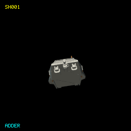

**Class:** Ship | [Definition](../Sources/EliteCore/Resources/Ships/SH001.toml) | [Provenance](SHIP-PROVENANCE.md#sh001)

| Game specification | Value |
| --- | --- |
| Cargo (t) | 2 |
| Top speed | 21.9 |
| Acceleration (speed/s) | 11.2 |
| Energy capacity | 85.0 |
| Energy recharge /s | 1.0 |
| Roll (rad/s) | 1.4 |
| Pitch (rad/s) | 2.0 |
| Yaw (rad/s) | 2.0 |
| Each shield | 255.0 |
| Shield recharge /s | 1.0 |
| Fuel tank (LY) | 7.0 |
| Base jump (LY) | 7.0 |
| Jump charge (s) | 15.0 |
| Missile pylons | 1 |
| Laser mounts | Front |
| Cargo bay upgrade (t) | 0 |
| Hull price (CR) | 76,000 |
| Power index | 819.0 |
| Trade-in (CR) | 57000.0 |
| Operating crew | 1 (project solo automation) |
| Design | 1102 vertices; 694 faces |

## SH002 - Alliance Challenger

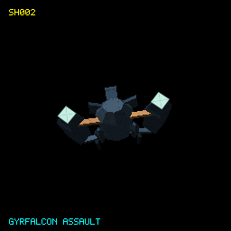

**Class:** Ship | [Definition](../Sources/EliteCore/Resources/Ships/SH002.toml) | [Provenance](SHIP-PROVENANCE.md#sh002)

| Game specification | Value |
| --- | --- |
| Cargo (t) | 40 |
| Top speed | 23.3 |
| Acceleration (speed/s) | 12.0 |
| Energy capacity | 640.0 |
| Energy recharge /s | 2.0 |
| Roll (rad/s) | 0.8 |
| Pitch (rad/s) | 0.6 |
| Yaw (rad/s) | 0.3 |
| Each shield | 701.2 |
| Shield recharge /s | 1.0 |
| Fuel tank (LY) | 7.0 |
| Base jump (LY) | 7.0 |
| Jump charge (s) | 15.0 |
| Missile pylons | 7 |
| Laser mounts | Front |
| Cargo bay upgrade (t) | 15 |
| Hull price (CR) | 232,000 |
| Power index | 2682.5 |
| Trade-in (CR) | 174000.0 |
| Operating crew | 1 (project solo automation) |
| Design | 3142 vertices; 2245 faces |

## SH003 - Alliance Chieftain

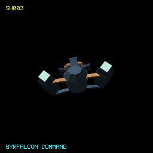

**Class:** Ship | [Definition](../Sources/EliteCore/Resources/Ships/SH003.toml) | [Provenance](SHIP-PROVENANCE.md#sh003)

| Game specification | Value |
| --- | --- |
| Cargo (t) | 40 |
| Top speed | 26.3 |
| Acceleration (speed/s) | 12.0 |
| Energy capacity | 597.3 |
| Energy recharge /s | 2.0 |
| Roll (rad/s) | 0.8 |
| Pitch (rad/s) | 0.7 |
| Yaw (rad/s) | 0.3 |
| Each shield | 637.5 |
| Shield recharge /s | 1.0 |
| Fuel tank (LY) | 7.0 |
| Base jump (LY) | 7.0 |
| Jump charge (s) | 15.0 |
| Missile pylons | 6 |
| Laser mounts | Front |
| Cargo bay upgrade (t) | 15 |
| Hull price (CR) | 226,000 |
| Power index | 2448.3 |
| Trade-in (CR) | 169500.0 |
| Operating crew | 1 (project solo automation) |
| Design | 3094 vertices; 2135 faces |

## SH004 - Alliance Crusader

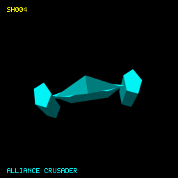

**Class:** Ship | [Definition](../Sources/EliteCore/Resources/Ships/SH004.toml) | [Provenance](SHIP-PROVENANCE.md#sh004)

| Game specification | Value |
| --- | --- |
| Cargo (t) | 40 |
| Top speed | 20.6 |
| Acceleration (speed/s) | 12.0 |
| Energy capacity | 640.0 |
| Energy recharge /s | 2.0 |
| Roll (rad/s) | 0.7 |
| Pitch (rad/s) | 0.6 |
| Yaw (rad/s) | 0.3 |
| Each shield | 637.5 |
| Shield recharge /s | 1.0 |
| Fuel tank (LY) | 7.0 |
| Base jump (LY) | 7.0 |
| Jump charge (s) | 15.0 |
| Missile pylons | 6 |
| Laser mounts | Front |
| Cargo bay upgrade (t) | 15 |
| Hull price (CR) | 224,000 |
| Power index | 2491.0 |
| Trade-in (CR) | 168000.0 |
| Operating crew | 1 (project solo automation) |
| Design | 3410 vertices; 2323 faces |

## SH005 - Anaconda

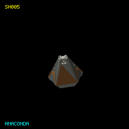

**Class:** Ship | [Definition](../Sources/EliteCore/Resources/Ships/SH005.toml) | [Provenance](SHIP-PROVENANCE.md#sh005)

| Game specification | Value |
| --- | --- |
| Cargo (t) | 750 |
| Top speed | 12.8 |
| Acceleration (speed/s) | 5.2 |
| Energy capacity | 500.0 |
| Energy recharge /s | 1.5 |
| Roll (rad/s) | 0.4 |
| Pitch (rad/s) | 0.4 |
| Yaw (rad/s) | 0.4 |
| Each shield | 255.0 |
| Shield recharge /s | 1.0 |
| Fuel tank (LY) | 7.0 |
| Base jump (LY) | 7.0 |
| Jump charge (s) | 15.0 |
| Missile pylons | 7 |
| Laser mounts | Front, Rear, Left, Right |
| Cargo bay upgrade (t) | 15 |
| Hull price (CR) | 1,128,000 |
| Power index | 2018.0 |
| Trade-in (CR) | 846000.0 |
| Operating crew | 1 (project solo automation) |
| Design | 3101 vertices; 1413 faces |

## SH006 - Anaconda Mk II

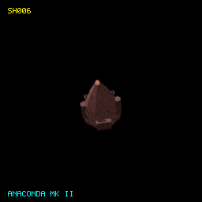

**Class:** Ship | [Definition](../Sources/EliteCore/Resources/Ships/SH006.toml) | [Provenance](SHIP-PROVENANCE.md#sh006)

| Game specification | Value |
| --- | --- |
| Cargo (t) | 20 |
| Top speed | 32.0 |
| Acceleration (speed/s) | 12.0 |
| Energy capacity | 256.0 |
| Energy recharge /s | 2.0 |
| Roll (rad/s) | 1.0 |
| Pitch (rad/s) | 1.0 |
| Yaw (rad/s) | 1.0 |
| Each shield | 255.0 |
| Shield recharge /s | 1.0 |
| Fuel tank (LY) | 7.0 |
| Base jump (LY) | 7.0 |
| Jump charge (s) | 15.0 |
| Missile pylons | 4 |
| Laser mounts | Front, Rear, Left, Right |
| Cargo bay upgrade (t) | 15 |
| Hull price (CR) | 150,000 |
| Power index | 1598.0 |
| Trade-in (CR) | 112500.0 |
| Operating crew | 1 (project solo automation) |
| Design | 2466 vertices; 1615 faces |

## SH007 - Argent's Quest

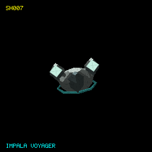

**Class:** Ship | [Definition](../Sources/EliteCore/Resources/Ships/SH007.toml) | [Provenance](SHIP-PROVENANCE.md#sh007)

| Game specification | Value |
| --- | --- |
| Cargo (t) | 750 |
| Top speed | 12.8 |
| Acceleration (speed/s) | 5.2 |
| Energy capacity | 500.0 |
| Energy recharge /s | 1.5 |
| Roll (rad/s) | 0.4 |
| Pitch (rad/s) | 0.4 |
| Yaw (rad/s) | 0.4 |
| Each shield | 255.0 |
| Shield recharge /s | 1.0 |
| Fuel tank (LY) | 7.0 |
| Base jump (LY) | 7.0 |
| Jump charge (s) | 15.0 |
| Missile pylons | 7 |
| Laser mounts | Front, Rear, Left, Right |
| Cargo bay upgrade (t) | 15 |
| Hull price (CR) | 1,128,000 |
| Power index | 2018.0 |
| Trade-in (CR) | 846000.0 |
| Operating crew | 1 (project solo automation) |
| Design | 1902 vertices; 1275 faces |

## SH008 - Asp Explorer

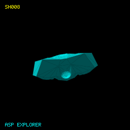

**Class:** Ship | [Definition](../Sources/EliteCore/Resources/Ships/SH008.toml) | [Provenance](SHIP-PROVENANCE.md#sh008)

| Game specification | Value |
| --- | --- |
| Cargo (t) | 38 |
| Top speed | 28.6 |
| Acceleration (speed/s) | 12.0 |
| Energy capacity | 448.0 |
| Energy recharge /s | 2.0 |
| Roll (rad/s) | 0.9 |
| Pitch (rad/s) | 0.7 |
| Yaw (rad/s) | 0.2 |
| Each shield | 446.2 |
| Shield recharge /s | 1.0 |
| Fuel tank (LY) | 7.0 |
| Base jump (LY) | 7.0 |
| Jump charge (s) | 15.0 |
| Missile pylons | 6 |
| Laser mounts | Front |
| Cargo bay upgrade (t) | 15 |
| Hull price (CR) | 204,000 |
| Power index | 1916.5 |
| Trade-in (CR) | 153000.0 |
| Operating crew | 1 (project solo automation) |
| Design | 1633 vertices; 776 faces |

## SH009 - Asp Mk II

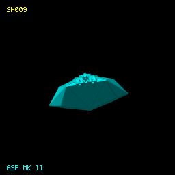

**Class:** Ship | [Definition](../Sources/EliteCore/Resources/Ships/SH009.toml) | [Provenance](SHIP-PROVENANCE.md#sh009)

| Game specification | Value |
| --- | --- |
| Cargo (t) | 0 |
| Top speed | 36.6 |
| Acceleration (speed/s) | 18.8 |
| Energy capacity | 350.0 |
| Energy recharge /s | 2.0 |
| Roll (rad/s) | 1.0 |
| Pitch (rad/s) | 1.0 |
| Yaw (rad/s) | 1.0 |
| Each shield | 255.0 |
| Shield recharge /s | 1.0 |
| Fuel tank (LY) | 7.0 |
| Base jump (LY) | 7.0 |
| Jump charge (s) | 15.0 |
| Missile pylons | 1 |
| Laser mounts | Front, Rear |
| Cargo bay upgrade (t) | 0 |
| Hull price (CR) | 133,000 |
| Power index | 1244.0 |
| Trade-in (CR) | 99750.0 |
| Operating crew | 1 (project solo automation) |
| Design | 1181 vertices; 726 faces |

## SH010 - Asp Mk II Custom

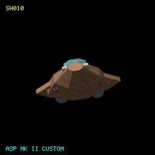

**Class:** Ship | [Definition](../Sources/EliteCore/Resources/Ships/SH010.toml) | [Provenance](SHIP-PROVENANCE.md#sh010)

| Game specification | Value |
| --- | --- |
| Cargo (t) | 20 |
| Top speed | 32.0 |
| Acceleration (speed/s) | 12.0 |
| Energy capacity | 256.0 |
| Energy recharge /s | 2.0 |
| Roll (rad/s) | 1.0 |
| Pitch (rad/s) | 1.0 |
| Yaw (rad/s) | 1.0 |
| Each shield | 255.0 |
| Shield recharge /s | 1.0 |
| Fuel tank (LY) | 7.0 |
| Base jump (LY) | 7.0 |
| Jump charge (s) | 15.0 |
| Missile pylons | 4 |
| Laser mounts | Front, Rear, Left, Right |
| Cargo bay upgrade (t) | 15 |
| Hull price (CR) | 150,000 |
| Power index | 1598.0 |
| Trade-in (CR) | 112500.0 |
| Operating crew | 1 (project solo automation) |
| Design | 2158 vertices; 1443 faces |

## SH011 - Asp Scout

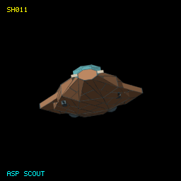

**Class:** Ship | [Definition](../Sources/EliteCore/Resources/Ships/SH011.toml) | [Provenance](SHIP-PROVENANCE.md#sh011)

| Game specification | Value |
| --- | --- |
| Cargo (t) | 16 |
| Top speed | 25.1 |
| Acceleration (speed/s) | 12.0 |
| Energy capacity | 384.0 |
| Energy recharge /s | 2.0 |
| Roll (rad/s) | 1.0 |
| Pitch (rad/s) | 0.7 |
| Yaw (rad/s) | 0.3 |
| Each shield | 382.5 |
| Shield recharge /s | 1.0 |
| Fuel tank (LY) | 7.0 |
| Base jump (LY) | 7.0 |
| Jump charge (s) | 15.0 |
| Missile pylons | 4 |
| Laser mounts | Front |
| Cargo bay upgrade (t) | 0 |
| Hull price (CR) | 154,000 |
| Power index | 1597.0 |
| Trade-in (CR) | 115500.0 |
| Operating crew | 1 (project solo automation) |
| Design | 2054 vertices; 1383 faces |

## SH012 - Beluga Liner

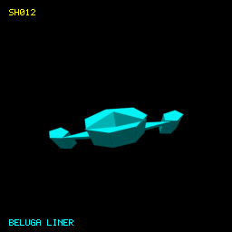

**Class:** Ship | [Definition](../Sources/EliteCore/Resources/Ships/SH012.toml) | [Provenance](SHIP-PROVENANCE.md#sh012)

| Game specification | Value |
| --- | --- |
| Cargo (t) | 44 |
| Top speed | 22.9 |
| Acceleration (speed/s) | 12.0 |
| Energy capacity | 597.3 |
| Energy recharge /s | 2.0 |
| Roll (rad/s) | 0.5 |
| Pitch (rad/s) | 0.4 |
| Yaw (rad/s) | 0.3 |
| Each shield | 892.5 |
| Shield recharge /s | 1.0 |
| Fuel tank (LY) | 7.0 |
| Base jump (LY) | 7.0 |
| Jump charge (s) | 15.0 |
| Missile pylons | 5 |
| Laser mounts | Front |
| Cargo bay upgrade (t) | 15 |
| Hull price (CR) | 222,000 |
| Power index | 2894.3 |
| Trade-in (CR) | 166500.0 |
| Operating crew | 1 (project solo automation) |
| Design | 652 vertices; 754 faces |

## SH013 - Boa

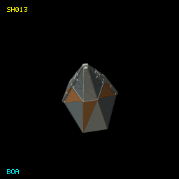

**Class:** Ship | [Definition](../Sources/EliteCore/Resources/Ships/SH013.toml) | [Provenance](SHIP-PROVENANCE.md#sh013)

| Game specification | Value |
| --- | --- |
| Cargo (t) | 125 |
| Top speed | 21.9 |
| Acceleration (speed/s) | 13.5 |
| Energy capacity | 450.0 |
| Energy recharge /s | 1.5 |
| Roll (rad/s) | 1.4 |
| Pitch (rad/s) | 1.0 |
| Yaw (rad/s) | 1.0 |
| Each shield | 255.0 |
| Shield recharge /s | 1.0 |
| Fuel tank (LY) | 7.0 |
| Base jump (LY) | 7.0 |
| Jump charge (s) | 15.0 |
| Missile pylons | 4 |
| Laser mounts | Front, Rear, Left, Right |
| Cargo bay upgrade (t) | 15 |
| Hull price (CR) | 302,000 |
| Power index | 1776.0 |
| Trade-in (CR) | 226500.0 |
| Operating crew | 1 (project solo automation) |
| Design | 1861 vertices; 1101 faces |

## SH014 - Boa Mk II

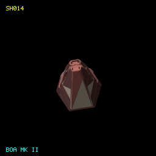

**Class:** Ship | [Definition](../Sources/EliteCore/Resources/Ships/SH014.toml) | [Provenance](SHIP-PROVENANCE.md#sh014)

| Game specification | Value |
| --- | --- |
| Cargo (t) | 175 |
| Top speed | 28.5 |
| Acceleration (speed/s) | 15.0 |
| Energy capacity | 525.0 |
| Energy recharge /s | 1.6 |
| Roll (rad/s) | 1.2 |
| Pitch (rad/s) | 1.0 |
| Yaw (rad/s) | 1.0 |
| Each shield | 255.0 |
| Shield recharge /s | 1.0 |
| Fuel tank (LY) | 7.0 |
| Base jump (LY) | 7.0 |
| Jump charge (s) | 15.0 |
| Missile pylons | 5 |
| Laser mounts | Front, Rear, Left, Right |
| Cargo bay upgrade (t) | 15 |
| Hull price (CR) | 392,000 |
| Power index | 1918.2 |
| Trade-in (CR) | 294000.0 |
| Operating crew | 1 (project solo automation) |
| Design | 2229 vertices; 1274 faces |

## SH015 - Bug

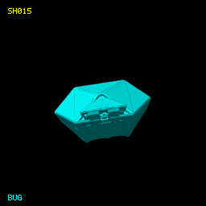

**Class:** Ship | [Definition](../Sources/EliteCore/Resources/Ships/SH015.toml) | [Provenance](SHIP-PROVENANCE.md#sh015)

| Game specification | Value |
| --- | --- |
| Cargo (t) | 1 |
| Top speed | 27.0 |
| Acceleration (speed/s) | 12.0 |
| Energy capacity | 100.0 |
| Energy recharge /s | 2.0 |
| Roll (rad/s) | 1.0 |
| Pitch (rad/s) | 1.0 |
| Yaw (rad/s) | 1.0 |
| Each shield | 255.0 |
| Shield recharge /s | 1.0 |
| Fuel tank (LY) | 7.0 |
| Base jump (LY) | 7.0 |
| Jump charge (s) | 15.0 |
| Missile pylons | 1 |
| Laser mounts | Front, Rear, Left, Right |
| Cargo bay upgrade (t) | 0 |
| Hull price (CR) | 84,000 |
| Power index | 1250.0 |
| Trade-in (CR) | 63000.0 |
| Operating crew | 1 (project solo automation) |
| Design | 2017 vertices; 1270 faces |

## SH016 - Bushmaster Archimedes

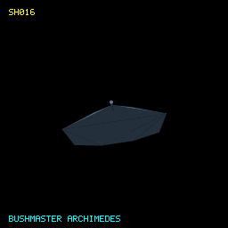

**Class:** Ship | [Definition](../Sources/EliteCore/Resources/Ships/SH016.toml) | [Provenance](SHIP-PROVENANCE.md#sh016)

| Game specification | Value |
| --- | --- |
| Cargo (t) | 20 |
| Top speed | 32.0 |
| Acceleration (speed/s) | 12.0 |
| Energy capacity | 256.0 |
| Energy recharge /s | 2.0 |
| Roll (rad/s) | 1.0 |
| Pitch (rad/s) | 1.0 |
| Yaw (rad/s) | 1.0 |
| Each shield | 255.0 |
| Shield recharge /s | 1.0 |
| Fuel tank (LY) | 7.0 |
| Base jump (LY) | 7.0 |
| Jump charge (s) | 15.0 |
| Missile pylons | 4 |
| Laser mounts | Front, Rear, Left, Right |
| Cargo bay upgrade (t) | 15 |
| Hull price (CR) | 150,000 |
| Power index | 1598.0 |
| Trade-in (CR) | 112500.0 |
| Operating crew | 1 (project solo automation) |
| Design | 107 vertices; 194 faces |

## SH017 - Bushmaster Elite-A

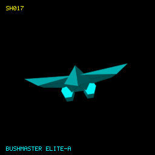

**Class:** Ship | [Definition](../Sources/EliteCore/Resources/Ships/SH017.toml) | [Provenance](SHIP-PROVENANCE.md#sh017)

| Game specification | Value |
| --- | --- |
| Cargo (t) | 20 |
| Top speed | 32.0 |
| Acceleration (speed/s) | 12.0 |
| Energy capacity | 256.0 |
| Energy recharge /s | 2.0 |
| Roll (rad/s) | 1.0 |
| Pitch (rad/s) | 1.0 |
| Yaw (rad/s) | 1.0 |
| Each shield | 255.0 |
| Shield recharge /s | 1.0 |
| Fuel tank (LY) | 7.0 |
| Base jump (LY) | 7.0 |
| Jump charge (s) | 15.0 |
| Missile pylons | 4 |
| Laser mounts | Front, Rear, Left, Right |
| Cargo bay upgrade (t) | 15 |
| Hull price (CR) | 150,000 |
| Power index | 1598.0 |
| Trade-in (CR) | 112500.0 |
| Operating crew | 1 (project solo automation) |
| Design | 1844 vertices; 1243 faces |

## SH018 - Caiman

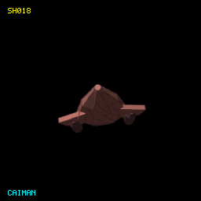

**Class:** Ship | [Definition](../Sources/EliteCore/Resources/Ships/SH018.toml) | [Provenance](SHIP-PROVENANCE.md#sh018)

| Game specification | Value |
| --- | --- |
| Cargo (t) | 20 |
| Top speed | 32.0 |
| Acceleration (speed/s) | 12.0 |
| Energy capacity | 256.0 |
| Energy recharge /s | 2.0 |
| Roll (rad/s) | 1.0 |
| Pitch (rad/s) | 1.0 |
| Yaw (rad/s) | 1.0 |
| Each shield | 255.0 |
| Shield recharge /s | 1.0 |
| Fuel tank (LY) | 7.0 |
| Base jump (LY) | 7.0 |
| Jump charge (s) | 15.0 |
| Missile pylons | 4 |
| Laser mounts | Front, Rear, Left, Right |
| Cargo bay upgrade (t) | 15 |
| Hull price (CR) | 150,000 |
| Power index | 1598.0 |
| Trade-in (CR) | 112500.0 |
| Operating crew | 1 (project solo automation) |
| Design | 2308 vertices; 1647 faces |

## SH019 - Caspian Explorer

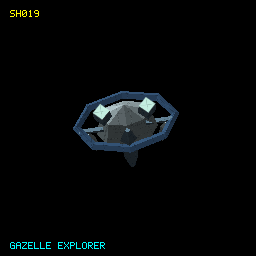

**Class:** Ship | [Definition](../Sources/EliteCore/Resources/Ships/SH019.toml) | [Provenance](SHIP-PROVENANCE.md#sh019)

| Game specification | Value |
| --- | --- |
| Cargo (t) | 96 |
| Top speed | 24.0 |
| Acceleration (speed/s) | 12.0 |
| Energy capacity | 736.0 |
| Energy recharge /s | 2.0 |
| Roll (rad/s) | 0.7 |
| Pitch (rad/s) | 0.5 |
| Yaw (rad/s) | 0.2 |
| Each shield | 1593.8 |
| Shield recharge /s | 1.0 |
| Fuel tank (LY) | 7.0 |
| Base jump (LY) | 7.0 |
| Jump charge (s) | 15.0 |
| Missile pylons | 7 |
| Laser mounts | Front |
| Cargo bay upgrade (t) | 15 |
| Hull price (CR) | 320,000 |
| Power index | 4563.5 |
| Trade-in (CR) | 240000.0 |
| Operating crew | 1 (project solo automation) |
| Design | 3692 vertices; 2420 faces |

## SH020 - Cat prototype

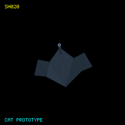

**Class:** Ship | [Definition](../Sources/EliteCore/Resources/Ships/SH020.toml) | [Provenance](SHIP-PROVENANCE.md#sh020)

| Game specification | Value |
| --- | --- |
| Cargo (t) | 20 |
| Top speed | 32.0 |
| Acceleration (speed/s) | 12.0 |
| Energy capacity | 256.0 |
| Energy recharge /s | 2.0 |
| Roll (rad/s) | 1.0 |
| Pitch (rad/s) | 1.0 |
| Yaw (rad/s) | 1.0 |
| Each shield | 255.0 |
| Shield recharge /s | 1.0 |
| Fuel tank (LY) | 7.0 |
| Base jump (LY) | 7.0 |
| Jump charge (s) | 15.0 |
| Missile pylons | 4 |
| Laser mounts | Front, Rear, Left, Right |
| Cargo bay upgrade (t) | 15 |
| Hull price (CR) | 150,000 |
| Power index | 1598.0 |
| Trade-in (CR) | 112500.0 |
| Operating crew | 1 (project solo automation) |
| Design | 93 vertices; 162 faces |

## SH021 - Chameleon

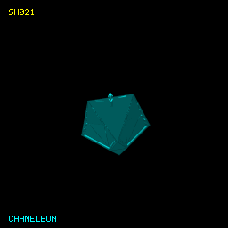

**Class:** Ship | [Definition](../Sources/EliteCore/Resources/Ships/SH021.toml) | [Provenance](SHIP-PROVENANCE.md#sh021)

| Game specification | Value |
| --- | --- |
| Cargo (t) | 35 |
| Top speed | 32.8 |
| Acceleration (speed/s) | 12.0 |
| Energy capacity | 256.0 |
| Energy recharge /s | 2.0 |
| Roll (rad/s) | 1.0 |
| Pitch (rad/s) | 1.0 |
| Yaw (rad/s) | 1.0 |
| Each shield | 255.0 |
| Shield recharge /s | 1.0 |
| Fuel tank (LY) | 8.0 |
| Base jump (LY) | 8.0 |
| Jump charge (s) | 15.0 |
| Missile pylons | 3 |
| Laser mounts | Front, Rear |
| Cargo bay upgrade (t) | 15 |
| Hull price (CR) | 167,000 |
| Power index | 1278.0 |
| Trade-in (CR) | 125250.0 |
| Operating crew | 1 (project solo automation) |
| Design | 462 vertices; 692 faces |

## SH022 - Cobra Mk I

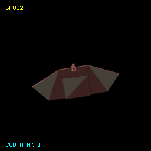

**Class:** Ship | [Definition](../Sources/EliteCore/Resources/Ships/SH022.toml) | [Provenance](SHIP-PROVENANCE.md#sh022)

| Game specification | Value |
| --- | --- |
| Cargo (t) | 10 |
| Top speed | 23.8 |
| Acceleration (speed/s) | 9.4 |
| Energy capacity | 150.0 |
| Energy recharge /s | 1.2 |
| Roll (rad/s) | 1.0 |
| Pitch (rad/s) | 1.2 |
| Yaw (rad/s) | 1.2 |
| Each shield | 255.0 |
| Shield recharge /s | 1.0 |
| Fuel tank (LY) | 7.0 |
| Base jump (LY) | 7.0 |
| Jump charge (s) | 15.0 |
| Missile pylons | 1 |
| Laser mounts | Front, Rear |
| Cargo bay upgrade (t) | 0 |
| Hull price (CR) | 99,000 |
| Power index | 1020.0 |
| Trade-in (CR) | 74250.0 |
| Operating crew | 1 (project solo automation) |
| Design | 1117 vertices; 731 faces |

## SH023 - Cobra Mk III

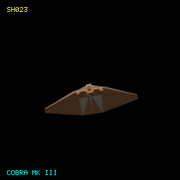

**Class:** Ship | [Definition](../Sources/EliteCore/Resources/Ships/SH023.toml) | [Provenance](SHIP-PROVENANCE.md#sh023)

| Game specification | Value |
| --- | --- |
| Cargo (t) | 20 |
| Top speed | 32.0 |
| Acceleration (speed/s) | 12.0 |
| Energy capacity | 256.0 |
| Energy recharge /s | 2.0 |
| Roll (rad/s) | 1.0 |
| Pitch (rad/s) | 1.0 |
| Yaw (rad/s) | 1.0 |
| Each shield | 255.0 |
| Shield recharge /s | 1.0 |
| Fuel tank (LY) | 7.0 |
| Base jump (LY) | 7.0 |
| Jump charge (s) | 15.0 |
| Missile pylons | 4 |
| Laser mounts | Front, Rear, Left, Right |
| Cargo bay upgrade (t) | 15 |
| Hull price (CR) | 150,000 |
| Power index | 1598.0 |
| Trade-in (CR) | 112500.0 |
| Operating crew | 1 (project solo automation) |
| Design | 1548 vertices; 1076 faces |

## SH024 - Cobra Mk IV

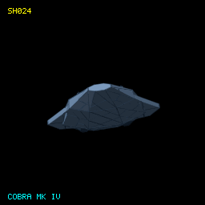

**Class:** Ship | [Definition](../Sources/EliteCore/Resources/Ships/SH024.toml) | [Provenance](SHIP-PROVENANCE.md#sh024)

| Game specification | Value |
| --- | --- |
| Cargo (t) | 18 |
| Top speed | 22.9 |
| Acceleration (speed/s) | 12.0 |
| Energy capacity | 256.0 |
| Energy recharge /s | 2.0 |
| Roll (rad/s) | 0.8 |
| Pitch (rad/s) | 0.5 |
| Yaw (rad/s) | 0.2 |
| Each shield | 382.5 |
| Shield recharge /s | 1.0 |
| Fuel tank (LY) | 7.0 |
| Base jump (LY) | 7.0 |
| Jump charge (s) | 15.0 |
| Missile pylons | 5 |
| Laser mounts | Front |
| Cargo bay upgrade (t) | 0 |
| Hull price (CR) | 138,000 |
| Power index | 1533.0 |
| Trade-in (CR) | 103500.0 |
| Operating crew | 1 (project solo automation) |
| Design | 2088 vertices; 1459 faces |

## SH025 - Cobra Mk V

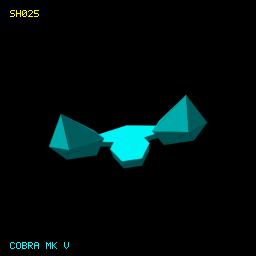

**Class:** Ship | [Definition](../Sources/EliteCore/Resources/Ships/SH025.toml) | [Provenance](SHIP-PROVENANCE.md#sh025)

| Game specification | Value |
| --- | --- |
| Cargo (t) | 12 |
| Top speed | 33.3 |
| Acceleration (speed/s) | 12.0 |
| Energy capacity | 384.0 |
| Energy recharge /s | 2.0 |
| Roll (rad/s) | 1.1 |
| Pitch (rad/s) | 0.8 |
| Yaw (rad/s) | 0.6 |
| Each shield | 510.0 |
| Shield recharge /s | 1.0 |
| Fuel tank (LY) | 7.0 |
| Base jump (LY) | 7.0 |
| Jump charge (s) | 15.0 |
| Missile pylons | 5 |
| Laser mounts | Front |
| Cargo bay upgrade (t) | 0 |
| Hull price (CR) | 164,000 |
| Power index | 1916.0 |
| Trade-in (CR) | 123000.0 |
| Operating crew | 1 (project solo automation) |
| Design | 2296 vertices; 1579 faces |

## SH026 - Constrictor

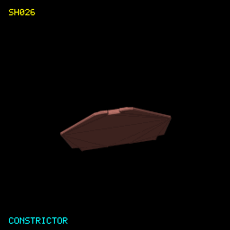

**Class:** Ship | [Definition](../Sources/EliteCore/Resources/Ships/SH026.toml) | [Provenance](SHIP-PROVENANCE.md#sh026)

| Game specification | Value |
| --- | --- |
| Cargo (t) | 1 |
| Top speed | 54.9 |
| Acceleration (speed/s) | 18.8 |
| Energy capacity | 450.0 |
| Energy recharge /s | 2.5 |
| Roll (rad/s) | 1.2 |
| Pitch (rad/s) | 1.8 |
| Yaw (rad/s) | 1.8 |
| Each shield | 255.0 |
| Shield recharge /s | 1.0 |
| Fuel tank (LY) | 7.0 |
| Base jump (LY) | 7.0 |
| Jump charge (s) | 15.0 |
| Missile pylons | 3 |
| Laser mounts | Front |
| Cargo bay upgrade (t) | 0 |
| Hull price (CR) | 182,000 |
| Power index | 1360.0 |
| Trade-in (CR) | 136500.0 |
| Operating crew | 1 (project solo automation) |
| Design | 1618 vertices; 980 faces |

## SH027 - Copperhead

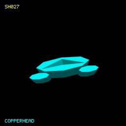

**Class:** Ship | [Definition](../Sources/EliteCore/Resources/Ships/SH027.toml) | [Provenance](SHIP-PROVENANCE.md#sh027)

| Game specification | Value |
| --- | --- |
| Cargo (t) | 20 |
| Top speed | 32.0 |
| Acceleration (speed/s) | 12.0 |
| Energy capacity | 256.0 |
| Energy recharge /s | 2.0 |
| Roll (rad/s) | 1.0 |
| Pitch (rad/s) | 1.0 |
| Yaw (rad/s) | 1.0 |
| Each shield | 255.0 |
| Shield recharge /s | 1.0 |
| Fuel tank (LY) | 7.0 |
| Base jump (LY) | 7.0 |
| Jump charge (s) | 15.0 |
| Missile pylons | 4 |
| Laser mounts | Front, Rear, Left, Right |
| Cargo bay upgrade (t) | 15 |
| Hull price (CR) | 150,000 |
| Power index | 1598.0 |
| Trade-in (CR) | 112500.0 |
| Operating crew | 1 (project solo automation) |
| Design | 1798 vertices; 1229 faces |

## SH028 - Coriolis station

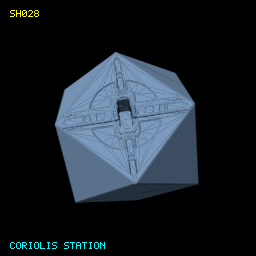

**Class:** Station | [Definition](../Sources/EliteCore/Resources/Ships/SH028.toml) | [Provenance](SHIP-PROVENANCE.md#sh028)

| Game specification | Value |
| --- | --- |
| Player availability | Display object; not flyable |
| Design | 1474 vertices; 2226 faces |

## SH029 - Corsair

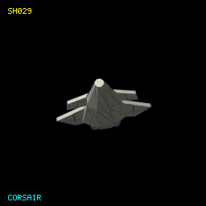

**Class:** Ship | [Definition](../Sources/EliteCore/Resources/Ships/SH029.toml) | [Provenance](SHIP-PROVENANCE.md#sh029)

| Game specification | Value |
| --- | --- |
| Cargo (t) | 48 |
| Top speed | 32.0 |
| Acceleration (speed/s) | 12.0 |
| Energy capacity | 576.0 |
| Energy recharge /s | 2.0 |
| Roll (rad/s) | 0.7 |
| Pitch (rad/s) | 0.5 |
| Yaw (rad/s) | 0.2 |
| Each shield | 749.1 |
| Shield recharge /s | 1.0 |
| Fuel tank (LY) | 7.0 |
| Base jump (LY) | 7.0 |
| Jump charge (s) | 15.0 |
| Missile pylons | 6 |
| Laser mounts | Front |
| Cargo bay upgrade (t) | 15 |
| Hull price (CR) | 241,000 |
| Power index | 2650.1 |
| Trade-in (CR) | 180750.0 |
| Operating crew | 1 (project solo automation) |
| Design | 1780 vertices; 1197 faces |

## SH030 - Cougar

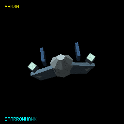

**Class:** Ship | [Definition](../Sources/EliteCore/Resources/Ships/SH030.toml) | [Provenance](SHIP-PROVENANCE.md#sh030)

| Game specification | Value |
| --- | --- |
| Cargo (t) | 4 |
| Top speed | 40.0 |
| Acceleration (speed/s) | 12.0 |
| Energy capacity | 252.0 |
| Energy recharge /s | 2.0 |
| Roll (rad/s) | 1.0 |
| Pitch (rad/s) | 1.0 |
| Yaw (rad/s) | 1.0 |
| Each shield | 255.0 |
| Shield recharge /s | 1.0 |
| Fuel tank (LY) | 7.0 |
| Base jump (LY) | 7.0 |
| Jump charge (s) | 15.0 |
| Missile pylons | 4 |
| Laser mounts | Front, Rear, Left, Right |
| Cargo bay upgrade (t) | 0 |
| Hull price (CR) | 140,000 |
| Power index | 1594.0 |
| Trade-in (CR) | 105000.0 |
| Operating crew | 1 (project solo automation) |
| Design | 1800 vertices; 1231 faces |

## SH031 - Delta

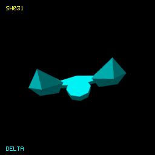

**Class:** Ship | [Definition](../Sources/EliteCore/Resources/Ships/SH031.toml) | [Provenance](SHIP-PROVENANCE.md#sh031)

| Game specification | Value |
| --- | --- |
| Cargo (t) | 20 |
| Top speed | 32.0 |
| Acceleration (speed/s) | 12.0 |
| Energy capacity | 256.0 |
| Energy recharge /s | 2.0 |
| Roll (rad/s) | 1.0 |
| Pitch (rad/s) | 1.0 |
| Yaw (rad/s) | 1.0 |
| Each shield | 255.0 |
| Shield recharge /s | 1.0 |
| Fuel tank (LY) | 7.0 |
| Base jump (LY) | 7.0 |
| Jump charge (s) | 15.0 |
| Missile pylons | 4 |
| Laser mounts | Front, Rear, Left, Right |
| Cargo bay upgrade (t) | 15 |
| Hull price (CR) | 150,000 |
| Power index | 1598.0 |
| Trade-in (CR) | 112500.0 |
| Operating crew | 1 (project solo automation) |
| Design | 1906 vertices; 1275 faces |

## SH032 - Diamondback Explorer

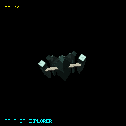

**Class:** Ship | [Definition](../Sources/EliteCore/Resources/Ships/SH032.toml) | [Provenance](SHIP-PROVENANCE.md#sh032)

| Game specification | Value |
| --- | --- |
| Cargo (t) | 12 |
| Top speed | 29.7 |
| Acceleration (speed/s) | 12.0 |
| Energy capacity | 320.0 |
| Energy recharge /s | 2.0 |
| Roll (rad/s) | 0.8 |
| Pitch (rad/s) | 0.6 |
| Yaw (rad/s) | 0.2 |
| Each shield | 478.1 |
| Shield recharge /s | 1.0 |
| Fuel tank (LY) | 7.0 |
| Base jump (LY) | 7.0 |
| Jump charge (s) | 15.0 |
| Missile pylons | 3 |
| Laser mounts | Front |
| Cargo bay upgrade (t) | 0 |
| Hull price (CR) | 142,000 |
| Power index | 1660.2 |
| Trade-in (CR) | 106500.0 |
| Operating crew | 1 (project solo automation) |
| Design | 2310 vertices; 1557 faces |

## SH033 - Diamondback Scout

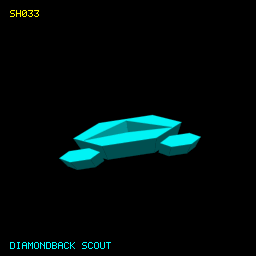

**Class:** Ship | [Definition](../Sources/EliteCore/Resources/Ships/SH033.toml) | [Provenance](SHIP-PROVENANCE.md#sh033)

| Game specification | Value |
| --- | --- |
| Cargo (t) | 0 |
| Top speed | 32.0 |
| Acceleration (speed/s) | 12.0 |
| Energy capacity | 256.0 |
| Energy recharge /s | 2.0 |
| Roll (rad/s) | 0.9 |
| Pitch (rad/s) | 0.7 |
| Yaw (rad/s) | 0.3 |
| Each shield | 382.5 |
| Shield recharge /s | 1.0 |
| Fuel tank (LY) | 7.0 |
| Base jump (LY) | 7.0 |
| Jump charge (s) | 15.0 |
| Missile pylons | 4 |
| Laser mounts | Front |
| Cargo bay upgrade (t) | 0 |
| Hull price (CR) | 124,000 |
| Power index | 1469.0 |
| Trade-in (CR) | 93000.0 |
| Operating crew | 1 (project solo automation) |
| Design | 2230 vertices; 1509 faces |

## SH034 - Dodo station

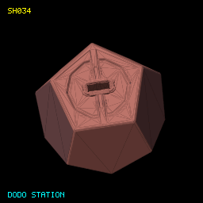

**Class:** Station | [Definition](../Sources/EliteCore/Resources/Ships/SH034.toml) | [Provenance](SHIP-PROVENANCE.md#sh034)

| Game specification | Value |
| --- | --- |
| Player availability | Display object; not flyable |
| Design | 4277 vertices; 2912 faces |

## SH035 - Dolphin

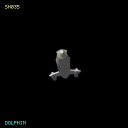

**Class:** Ship | [Definition](../Sources/EliteCore/Resources/Ships/SH035.toml) | [Provenance](SHIP-PROVENANCE.md#sh035)

| Game specification | Value |
| --- | --- |
| Cargo (t) | 14 |
| Top speed | 28.6 |
| Acceleration (speed/s) | 12.0 |
| Energy capacity | 234.7 |
| Energy recharge /s | 2.0 |
| Roll (rad/s) | 0.9 |
| Pitch (rad/s) | 0.5 |
| Yaw (rad/s) | 0.3 |
| Each shield | 350.6 |
| Shield recharge /s | 1.0 |
| Fuel tank (LY) | 7.0 |
| Base jump (LY) | 7.0 |
| Jump charge (s) | 15.0 |
| Missile pylons | 2 |
| Laser mounts | Front |
| Cargo bay upgrade (t) | 0 |
| Hull price (CR) | 127,000 |
| Power index | 1255.9 |
| Trade-in (CR) | 95250.0 |
| Operating crew | 1 (project solo automation) |
| Design | 532 vertices; 682 faces |

## SH036 - Drake

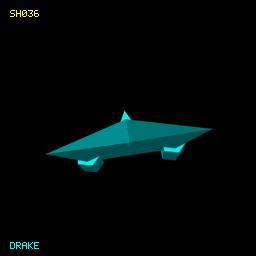

**Class:** Ship | [Definition](../Sources/EliteCore/Resources/Ships/SH036.toml) | [Provenance](SHIP-PROVENANCE.md#sh036)

| Game specification | Value |
| --- | --- |
| Cargo (t) | 20 |
| Top speed | 32.0 |
| Acceleration (speed/s) | 12.0 |
| Energy capacity | 256.0 |
| Energy recharge /s | 2.0 |
| Roll (rad/s) | 1.0 |
| Pitch (rad/s) | 1.0 |
| Yaw (rad/s) | 1.0 |
| Each shield | 255.0 |
| Shield recharge /s | 1.0 |
| Fuel tank (LY) | 7.0 |
| Base jump (LY) | 7.0 |
| Jump charge (s) | 15.0 |
| Missile pylons | 4 |
| Laser mounts | Front, Rear, Left, Right |
| Cargo bay upgrade (t) | 15 |
| Hull price (CR) | 150,000 |
| Power index | 1598.0 |
| Trade-in (CR) | 112500.0 |
| Operating crew | 1 (project solo automation) |
| Design | 2016 vertices; 1357 faces |

## SH037 - Eagle Mk I

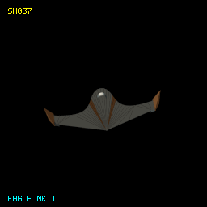

**Class:** Ship | [Definition](../Sources/EliteCore/Resources/Ships/SH037.toml) | [Provenance](SHIP-PROVENANCE.md#sh037)

| Game specification | Value |
| --- | --- |
| Cargo (t) | 20 |
| Top speed | 29.3 |
| Acceleration (speed/s) | 12.0 |
| Energy capacity | 180.0 |
| Energy recharge /s | 2.0 |
| Roll (rad/s) | 1.4 |
| Pitch (rad/s) | 1.8 |
| Yaw (rad/s) | 1.8 |
| Each shield | 255.0 |
| Shield recharge /s | 1.0 |
| Fuel tank (LY) | 7.0 |
| Base jump (LY) | 7.0 |
| Jump charge (s) | 15.0 |
| Missile pylons | 1 |
| Laser mounts | Front, Rear, Left, Right |
| Cargo bay upgrade (t) | 15 |
| Hull price (CR) | 124,000 |
| Power index | 1330.0 |
| Trade-in (CR) | 93000.0 |
| Operating crew | 1 (project solo automation) |
| Design | 388 vertices; 760 faces |

## SH038 - Eagle Mk II

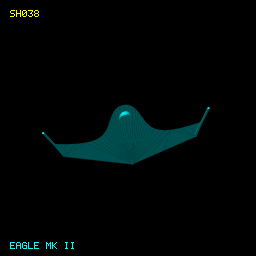

**Class:** Ship | [Definition](../Sources/EliteCore/Resources/Ships/SH038.toml) | [Provenance](SHIP-PROVENANCE.md#sh038)

| Game specification | Value |
| --- | --- |
| Cargo (t) | 2 |
| Top speed | 27.4 |
| Acceleration (speed/s) | 12.0 |
| Energy capacity | 85.3 |
| Energy recharge /s | 2.0 |
| Roll (rad/s) | 1.0 |
| Pitch (rad/s) | 0.9 |
| Yaw (rad/s) | 0.3 |
| Each shield | 191.2 |
| Shield recharge /s | 1.0 |
| Fuel tank (LY) | 7.0 |
| Base jump (LY) | 7.0 |
| Jump charge (s) | 15.0 |
| Missile pylons | 3 |
| Laser mounts | Front |
| Cargo bay upgrade (t) | 0 |
| Hull price (CR) | 91,000 |
| Power index | 851.8 |
| Trade-in (CR) | 68250.0 |
| Operating crew | 1 (project solo automation) |
| Design | 416 vertices; 816 faces |

## SH039 - Eagle Mk III

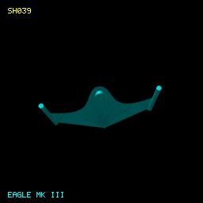

**Class:** Ship | [Definition](../Sources/EliteCore/Resources/Ships/SH039.toml) | [Provenance](SHIP-PROVENANCE.md#sh039)

| Game specification | Value |
| --- | --- |
| Cargo (t) | 20 |
| Top speed | 29.3 |
| Acceleration (speed/s) | 12.0 |
| Energy capacity | 180.0 |
| Energy recharge /s | 2.0 |
| Roll (rad/s) | 1.4 |
| Pitch (rad/s) | 1.8 |
| Yaw (rad/s) | 1.8 |
| Each shield | 255.0 |
| Shield recharge /s | 1.0 |
| Fuel tank (LY) | 7.0 |
| Base jump (LY) | 7.0 |
| Jump charge (s) | 15.0 |
| Missile pylons | 1 |
| Laser mounts | Front, Rear, Left, Right |
| Cargo bay upgrade (t) | 15 |
| Hull price (CR) | 124,000 |
| Power index | 1330.0 |
| Trade-in (CR) | 93000.0 |
| Operating crew | 1 (project solo automation) |
| Design | 416 vertices; 816 faces |

## SH040 - Escape capsule

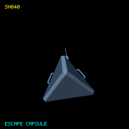

**Class:** Escape craft | [Definition](../Sources/EliteCore/Resources/Ships/SH040.toml) | [Provenance](SHIP-PROVENANCE.md#sh040)

| Game specification | Value |
| --- | --- |
| Cargo (t) | 0 |
| Top speed | 4.6 |
| Acceleration (speed/s) | 1.9 |
| Energy capacity | 25.0 |
| Energy recharge /s | 1.0 |
| Roll (rad/s) | 0.2 |
| Pitch (rad/s) | 0.5 |
| Yaw (rad/s) | 0.5 |
| Each shield | 255.0 |
| Shield recharge /s | 1.0 |
| Fuel tank (LY) | 7.0 |
| Base jump (LY) | 7.0 |
| Jump charge (s) | 15.0 |
| Missile pylons | 1 |
| Laser mounts | Front |
| Cargo bay upgrade (t) | 0 |
| Hull price (CR) | 40,000 |
| Power index | 759.0 |
| Trade-in (CR) | 30000.0 |
| Operating crew | 1 (project solo automation) |
| Design | 1172 vertices; 788 faces |

## SH041 - F63 Condor

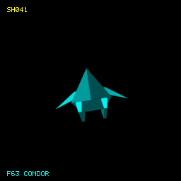

**Class:** Fighter | [Definition](../Sources/EliteCore/Resources/Ships/SH041.toml) | [Provenance](SHIP-PROVENANCE.md#sh041)

| Game specification | Value |
| --- | --- |
| Cargo (t) | 20 |
| Top speed | 29.3 |
| Acceleration (speed/s) | 12.0 |
| Energy capacity | 180.0 |
| Energy recharge /s | 2.0 |
| Roll (rad/s) | 1.4 |
| Pitch (rad/s) | 1.8 |
| Yaw (rad/s) | 1.8 |
| Each shield | 255.0 |
| Shield recharge /s | 1.0 |
| Fuel tank (LY) | 7.0 |
| Base jump (LY) | 7.0 |
| Jump charge (s) | 15.0 |
| Missile pylons | 1 |
| Laser mounts | Front, Rear, Left, Right |
| Cargo bay upgrade (t) | 15 |
| Hull price (CR) | 124,000 |
| Power index | 1330.0 |
| Trade-in (CR) | 93000.0 |
| Operating crew | 1 (project solo automation) |
| Design | 1290 vertices; 918 faces |

## SH042 - Falcon

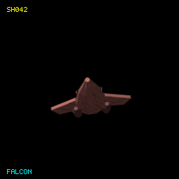

**Class:** Ship | [Definition](../Sources/EliteCore/Resources/Ships/SH042.toml) | [Provenance](SHIP-PROVENANCE.md#sh042)

| Game specification | Value |
| --- | --- |
| Cargo (t) | 20 |
| Top speed | 29.3 |
| Acceleration (speed/s) | 12.0 |
| Energy capacity | 180.0 |
| Energy recharge /s | 2.0 |
| Roll (rad/s) | 1.4 |
| Pitch (rad/s) | 1.8 |
| Yaw (rad/s) | 1.8 |
| Each shield | 255.0 |
| Shield recharge /s | 1.0 |
| Fuel tank (LY) | 7.0 |
| Base jump (LY) | 7.0 |
| Jump charge (s) | 15.0 |
| Missile pylons | 1 |
| Laser mounts | Front, Rear, Left, Right |
| Cargo bay upgrade (t) | 15 |
| Hull price (CR) | 124,000 |
| Power index | 1330.0 |
| Trade-in (CR) | 93000.0 |
| Operating crew | 1 (project solo automation) |
| Design | 1510 vertices; 1113 faces |

## SH043 - Farragut-class Battle Cruiser

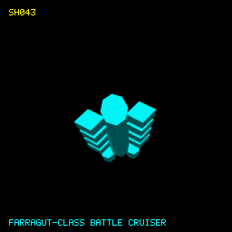

**Class:** Capital ship | [Definition](../Sources/EliteCore/Resources/Ships/SH043.toml) | [Provenance](SHIP-PROVENANCE.md#sh043)

| Game specification | Value |
| --- | --- |
| Cargo (t) | 6,000 |
| Top speed | 12.8 |
| Acceleration (speed/s) | 5.2 |
| Energy capacity | 4000.0 |
| Energy recharge /s | 1.5 |
| Roll (rad/s) | 0.2 |
| Pitch (rad/s) | 0.2 |
| Yaw (rad/s) | 0.2 |
| Each shield | 255.0 |
| Shield recharge /s | 1.0 |
| Fuel tank (LY) | 7.0 |
| Base jump (LY) | 7.0 |
| Jump charge (s) | 15.0 |
| Missile pylons | 7 |
| Laser mounts | Front, Rear, Left, Right |
| Cargo bay upgrade (t) | 15 |
| Hull price (CR) | 8,531,000 |
| Power index | 5518.0 |
| Trade-in (CR) | 6398250.0 |
| Operating crew | 1 (project solo automation) |
| Design | 4920 vertices; 3171 faces |

## SH044 - Federal Assault Ship

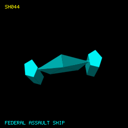

**Class:** Ship | [Definition](../Sources/EliteCore/Resources/Ships/SH044.toml) | [Provenance](SHIP-PROVENANCE.md#sh044)

| Game specification | Value |
| --- | --- |
| Cargo (t) | 32 |
| Top speed | 24.0 |
| Acceleration (speed/s) | 12.0 |
| Energy capacity | 640.0 |
| Energy recharge /s | 2.0 |
| Roll (rad/s) | 0.8 |
| Pitch (rad/s) | 0.7 |
| Yaw (rad/s) | 0.3 |
| Each shield | 637.5 |
| Shield recharge /s | 1.0 |
| Fuel tank (LY) | 7.0 |
| Base jump (LY) | 7.0 |
| Jump charge (s) | 15.0 |
| Missile pylons | 4 |
| Laser mounts | Front |
| Cargo bay upgrade (t) | 15 |
| Hull price (CR) | 211,000 |
| Power index | 2363.0 |
| Trade-in (CR) | 158250.0 |
| Operating crew | 1 (project solo automation) |
| Design | 2868 vertices; 1895 faces |

## SH045 - Federal Corvette

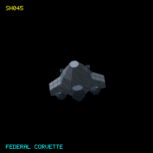

**Class:** Ship | [Definition](../Sources/EliteCore/Resources/Ships/SH045.toml) | [Provenance](SHIP-PROVENANCE.md#sh045)

| Game specification | Value |
| --- | --- |
| Cargo (t) | 76 |
| Top speed | 22.9 |
| Acceleration (speed/s) | 12.0 |
| Energy capacity | 789.3 |
| Energy recharge /s | 2.0 |
| Roll (rad/s) | 0.7 |
| Pitch (rad/s) | 0.5 |
| Yaw (rad/s) | 0.1 |
| Each shield | 1769.1 |
| Shield recharge /s | 1.0 |
| Fuel tank (LY) | 7.0 |
| Base jump (LY) | 7.0 |
| Jump charge (s) | 15.0 |
| Missile pylons | 7 |
| Laser mounts | Front |
| Cargo bay upgrade (t) | 15 |
| Hull price (CR) | 300,000 |
| Power index | 4967.5 |
| Trade-in (CR) | 225000.0 |
| Operating crew | 1 (project solo automation) |
| Design | 3324 vertices; 2169 faces |

## SH046 - Federal Dropship

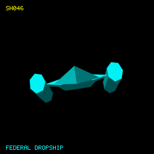

**Class:** Ship | [Definition](../Sources/EliteCore/Resources/Ships/SH046.toml) | [Provenance](SHIP-PROVENANCE.md#sh046)

| Game specification | Value |
| --- | --- |
| Cargo (t) | 56 |
| Top speed | 20.6 |
| Acceleration (speed/s) | 12.0 |
| Energy capacity | 640.0 |
| Energy recharge /s | 2.0 |
| Roll (rad/s) | 0.7 |
| Pitch (rad/s) | 0.5 |
| Yaw (rad/s) | 0.2 |
| Each shield | 637.5 |
| Shield recharge /s | 1.0 |
| Fuel tank (LY) | 7.0 |
| Base jump (LY) | 7.0 |
| Jump charge (s) | 15.0 |
| Missile pylons | 5 |
| Laser mounts | Front |
| Cargo bay upgrade (t) | 15 |
| Hull price (CR) | 241,000 |
| Power index | 2427.0 |
| Trade-in (CR) | 180750.0 |
| Operating crew | 1 (project solo automation) |
| Design | 2852 vertices; 1885 faces |

## SH047 - Federal Gunship

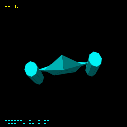

**Class:** Ship | [Definition](../Sources/EliteCore/Resources/Ships/SH047.toml) | [Provenance](SHIP-PROVENANCE.md#sh047)

| Game specification | Value |
| --- | --- |
| Cargo (t) | 16 |
| Top speed | 19.4 |
| Acceleration (speed/s) | 12.0 |
| Energy capacity | 746.7 |
| Energy recharge /s | 2.0 |
| Roll (rad/s) | 0.7 |
| Pitch (rad/s) | 0.4 |
| Yaw (rad/s) | 0.3 |
| Each shield | 796.9 |
| Shield recharge /s | 1.0 |
| Fuel tank (LY) | 7.0 |
| Base jump (LY) | 7.0 |
| Jump charge (s) | 15.0 |
| Missile pylons | 7 |
| Laser mounts | Front |
| Cargo bay upgrade (t) | 0 |
| Hull price (CR) | 210,000 |
| Power index | 2980.4 |
| Trade-in (CR) | 157500.0 |
| Operating crew | 1 (project solo automation) |
| Design | 2932 vertices; 1943 faces |

## SH048 - Fer-de-Lance

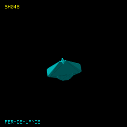

**Class:** Ship | [Definition](../Sources/EliteCore/Resources/Ships/SH048.toml) | [Provenance](SHIP-PROVENANCE.md#sh048)

| Game specification | Value |
| --- | --- |
| Cargo (t) | 12 |
| Top speed | 27.4 |
| Acceleration (speed/s) | 13.5 |
| Energy capacity | 150.0 |
| Energy recharge /s | 2.2 |
| Roll (rad/s) | 1.8 |
| Pitch (rad/s) | 1.0 |
| Yaw (rad/s) | 1.0 |
| Each shield | 255.0 |
| Shield recharge /s | 1.0 |
| Fuel tank (LY) | 7.0 |
| Base jump (LY) | 7.0 |
| Jump charge (s) | 15.0 |
| Missile pylons | 2 |
| Laser mounts | Front, Rear, Left, Right |
| Cargo bay upgrade (t) | 0 |
| Hull price (CR) | 110,000 |
| Power index | 1372.0 |
| Trade-in (CR) | 82500.0 |
| Operating crew | 1 (project solo automation) |
| Design | 921 vertices; 601 faces |

## SH049 - Gecko

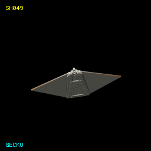

**Class:** Ship | [Definition](../Sources/EliteCore/Resources/Ships/SH049.toml) | [Provenance](SHIP-PROVENANCE.md#sh049)

| Game specification | Value |
| --- | --- |
| Cargo (t) | 2 |
| Top speed | 27.4 |
| Acceleration (speed/s) | 16.9 |
| Energy capacity | 250.0 |
| Energy recharge /s | 2.0 |
| Roll (rad/s) | 1.5 |
| Pitch (rad/s) | 1.5 |
| Yaw (rad/s) | 1.5 |
| Each shield | 255.0 |
| Shield recharge /s | 1.0 |
| Fuel tank (LY) | 7.0 |
| Base jump (LY) | 7.0 |
| Jump charge (s) | 15.0 |
| Missile pylons | 1 |
| Laser mounts | Front |
| Cargo bay upgrade (t) | 0 |
| Hull price (CR) | 108,000 |
| Power index | 1016.0 |
| Trade-in (CR) | 81000.0 |
| Operating crew | 1 (project solo automation) |
| Design | 1570 vertices; 1032 faces |

## SH050 - Ghavial

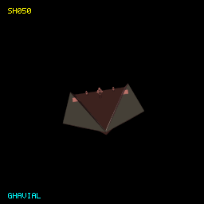

**Class:** Ship | [Definition](../Sources/EliteCore/Resources/Ships/SH050.toml) | [Provenance](SHIP-PROVENANCE.md#sh050)

| Game specification | Value |
| --- | --- |
| Cargo (t) | 55 |
| Top speed | 28.2 |
| Acceleration (speed/s) | 12.0 |
| Energy capacity | 256.0 |
| Energy recharge /s | 2.0 |
| Roll (rad/s) | 1.0 |
| Pitch (rad/s) | 1.0 |
| Yaw (rad/s) | 1.0 |
| Each shield | 255.0 |
| Shield recharge /s | 1.0 |
| Fuel tank (LY) | 8.0 |
| Base jump (LY) | 8.0 |
| Jump charge (s) | 15.0 |
| Missile pylons | 3 |
| Laser mounts | Front, Rear, Left, Right |
| Cargo bay upgrade (t) | 15 |
| Hull price (CR) | 187,000 |
| Power index | 1534.0 |
| Trade-in (CR) | 140250.0 |
| Operating crew | 1 (project solo automation) |
| Design | 440 vertices; 651 faces |

## SH051 - Gnat

**Class:** Ship | [Definition](../Sources/EliteCore/Resources/Ships/SH051.toml) | [Provenance](SHIP-PROVENANCE.md#sh051)

| Game specification | Value |
| --- | --- |
| Cargo (t) | 20 |
| Top speed | 32.0 |
| Acceleration (speed/s) | 12.0 |
| Energy capacity | 256.0 |
| Energy recharge /s | 2.0 |
| Roll (rad/s) | 1.0 |
| Pitch (rad/s) | 1.0 |
| Yaw (rad/s) | 1.0 |
| Each shield | 255.0 |
| Shield recharge /s | 1.0 |
| Fuel tank (LY) | 7.0 |
| Base jump (LY) | 7.0 |
| Jump charge (s) | 15.0 |
| Missile pylons | 4 |
| Laser mounts | Front, Rear, Left, Right |
| Cargo bay upgrade (t) | 15 |
| Hull price (CR) | 150,000 |
| Power index | 1598.0 |
| Trade-in (CR) | 112500.0 |
| Operating crew | 1 (project solo automation) |
| Design | 3874 vertices; 2860 faces |

## SH052 - Griffin

**Class:** Ship | [Definition](../Sources/EliteCore/Resources/Ships/SH052.toml) | [Provenance](SHIP-PROVENANCE.md#sh052)

| Game specification | Value |
| --- | --- |
| Cargo (t) | 20 |
| Top speed | 32.0 |
| Acceleration (speed/s) | 12.0 |
| Energy capacity | 256.0 |
| Energy recharge /s | 2.0 |
| Roll (rad/s) | 1.0 |
| Pitch (rad/s) | 1.0 |
| Yaw (rad/s) | 1.0 |
| Each shield | 255.0 |
| Shield recharge /s | 1.0 |
| Fuel tank (LY) | 7.0 |
| Base jump (LY) | 7.0 |
| Jump charge (s) | 15.0 |
| Missile pylons | 4 |
| Laser mounts | Front, Rear, Left, Right |
| Cargo bay upgrade (t) | 15 |
| Hull price (CR) | 150,000 |
| Power index | 1598.0 |
| Trade-in (CR) | 112500.0 |
| Operating crew | 1 (project solo automation) |
| Design | 83 vertices; 150 faces |

## SH053 - Griffin prototype

**Class:** Ship | [Definition](../Sources/EliteCore/Resources/Ships/SH053.toml) | [Provenance](SHIP-PROVENANCE.md#sh053)

| Game specification | Value |
| --- | --- |
| Cargo (t) | 20 |
| Top speed | 32.0 |
| Acceleration (speed/s) | 12.0 |
| Energy capacity | 256.0 |
| Energy recharge /s | 2.0 |
| Roll (rad/s) | 1.0 |
| Pitch (rad/s) | 1.0 |
| Yaw (rad/s) | 1.0 |
| Each shield | 255.0 |
| Shield recharge /s | 1.0 |
| Fuel tank (LY) | 7.0 |
| Base jump (LY) | 7.0 |
| Jump charge (s) | 15.0 |
| Missile pylons | 4 |
| Laser mounts | Front, Rear, Left, Right |
| Cargo bay upgrade (t) | 15 |
| Hull price (CR) | 150,000 |
| Power index | 1598.0 |
| Trade-in (CR) | 112500.0 |
| Operating crew | 1 (project solo automation) |
| Design | 8698 vertices; 6075 faces |

## SH054 - Gu-97

**Class:** Fighter | [Definition](../Sources/EliteCore/Resources/Ships/SH054.toml) | [Provenance](SHIP-PROVENANCE.md#sh054)

| Game specification | Value |
| --- | --- |
| Cargo (t) | 20 |
| Top speed | 29.3 |
| Acceleration (speed/s) | 12.0 |
| Energy capacity | 180.0 |
| Energy recharge /s | 2.0 |
| Roll (rad/s) | 1.4 |
| Pitch (rad/s) | 1.8 |
| Yaw (rad/s) | 1.8 |
| Each shield | 255.0 |
| Shield recharge /s | 1.0 |
| Fuel tank (LY) | 7.0 |
| Base jump (LY) | 7.0 |
| Jump charge (s) | 15.0 |
| Missile pylons | 1 |
| Laser mounts | Front, Rear, Left, Right |
| Cargo bay upgrade (t) | 15 |
| Hull price (CR) | 124,000 |
| Power index | 1330.0 |
| Trade-in (CR) | 93000.0 |
| Operating crew | 1 (project solo automation) |
| Design | 1472 vertices; 1090 faces |

## SH055 - Gyr

**Class:** Ship | [Definition](../Sources/EliteCore/Resources/Ships/SH055.toml) | [Provenance](SHIP-PROVENANCE.md#sh055)

| Game specification | Value |
| --- | --- |
| Cargo (t) | 20 |
| Top speed | 32.0 |
| Acceleration (speed/s) | 12.0 |
| Energy capacity | 256.0 |
| Energy recharge /s | 2.0 |
| Roll (rad/s) | 1.0 |
| Pitch (rad/s) | 1.0 |
| Yaw (rad/s) | 1.0 |
| Each shield | 255.0 |
| Shield recharge /s | 1.0 |
| Fuel tank (LY) | 7.0 |
| Base jump (LY) | 7.0 |
| Jump charge (s) | 15.0 |
| Missile pylons | 4 |
| Laser mounts | Front, Rear, Left, Right |
| Cargo bay upgrade (t) | 15 |
| Hull price (CR) | 150,000 |
| Power index | 1598.0 |
| Trade-in (CR) | 112500.0 |
| Operating crew | 1 (project solo automation) |
| Design | 1786 vertices; 1219 faces |

## SH056 - Harrier

**Class:** Ship | [Definition](../Sources/EliteCore/Resources/Ships/SH056.toml) | [Provenance](SHIP-PROVENANCE.md#sh056)

| Game specification | Value |
| --- | --- |
| Cargo (t) | 20 |
| Top speed | 29.3 |
| Acceleration (speed/s) | 12.0 |
| Energy capacity | 180.0 |
| Energy recharge /s | 2.0 |
| Roll (rad/s) | 1.4 |
| Pitch (rad/s) | 1.8 |
| Yaw (rad/s) | 1.8 |
| Each shield | 255.0 |
| Shield recharge /s | 1.0 |
| Fuel tank (LY) | 7.0 |
| Base jump (LY) | 7.0 |
| Jump charge (s) | 15.0 |
| Missile pylons | 1 |
| Laser mounts | Front, Rear, Left, Right |
| Cargo bay upgrade (t) | 15 |
| Hull price (CR) | 124,000 |
| Power index | 1330.0 |
| Trade-in (CR) | 93000.0 |
| Operating crew | 1 (project solo automation) |
| Design | 1426 vertices; 1065 faces |

## SH057 - Harris Fighter

**Class:** Ship | [Definition](../Sources/EliteCore/Resources/Ships/SH057.toml) | [Provenance](SHIP-PROVENANCE.md#sh057)

| Game specification | Value |
| --- | --- |
| Cargo (t) | 20 |
| Top speed | 29.3 |
| Acceleration (speed/s) | 12.0 |
| Energy capacity | 180.0 |
| Energy recharge /s | 2.0 |
| Roll (rad/s) | 1.4 |
| Pitch (rad/s) | 1.8 |
| Yaw (rad/s) | 1.8 |
| Each shield | 255.0 |
| Shield recharge /s | 1.0 |
| Fuel tank (LY) | 7.0 |
| Base jump (LY) | 7.0 |
| Jump charge (s) | 15.0 |
| Missile pylons | 1 |
| Laser mounts | Front, Rear, Left, Right |
| Cargo bay upgrade (t) | 15 |
| Hull price (CR) | 124,000 |
| Power index | 1330.0 |
| Trade-in (CR) | 93000.0 |
| Operating crew | 1 (project solo automation) |
| Design | 1770 vertices; 1205 faces |

## SH058 - Hauler

**Class:** Ship | [Definition](../Sources/EliteCore/Resources/Ships/SH058.toml) | [Provenance](SHIP-PROVENANCE.md#sh058)

| Game specification | Value |
| --- | --- |
| Cargo (t) | 8 |
| Top speed | 22.9 |
| Acceleration (speed/s) | 12.0 |
| Energy capacity | 213.3 |
| Energy recharge /s | 2.0 |
| Roll (rad/s) | 0.9 |
| Pitch (rad/s) | 0.6 |
| Yaw (rad/s) | 0.2 |
| Each shield | 159.4 |
| Shield recharge /s | 1.0 |
| Fuel tank (LY) | 7.0 |
| Base jump (LY) | 7.0 |
| Jump charge (s) | 15.0 |
| Missile pylons | 1 |
| Laser mounts | Front |
| Cargo bay upgrade (t) | 0 |
| Hull price (CR) | 104,000 |
| Power index | 788.1 |
| Trade-in (CR) | 78000.0 |
| Operating crew | 1 (project solo automation) |
| Design | 2352 vertices; 1598 faces |

## SH059 - Hawk Airfighter

**Class:** Ship | [Definition](../Sources/EliteCore/Resources/Ships/SH059.toml) | [Provenance](SHIP-PROVENANCE.md#sh059)

| Game specification | Value |
| --- | --- |
| Cargo (t) | 20 |
| Top speed | 32.0 |
| Acceleration (speed/s) | 12.0 |
| Energy capacity | 256.0 |
| Energy recharge /s | 2.0 |
| Roll (rad/s) | 1.0 |
| Pitch (rad/s) | 1.0 |
| Yaw (rad/s) | 1.0 |
| Each shield | 255.0 |
| Shield recharge /s | 1.0 |
| Fuel tank (LY) | 7.0 |
| Base jump (LY) | 7.0 |
| Jump charge (s) | 15.0 |
| Missile pylons | 4 |
| Laser mounts | Front, Rear, Left, Right |
| Cargo bay upgrade (t) | 15 |
| Hull price (CR) | 150,000 |
| Power index | 1598.0 |
| Trade-in (CR) | 112500.0 |
| Operating crew | 1 (project solo automation) |
| Design | 1258 vertices; 969 faces |

## SH060 - Hognose

**Class:** Ship | [Definition](../Sources/EliteCore/Resources/Ships/SH060.toml) | [Provenance](SHIP-PROVENANCE.md#sh060)

| Game specification | Value |
| --- | --- |
| Cargo (t) | 20 |
| Top speed | 32.0 |
| Acceleration (speed/s) | 12.0 |
| Energy capacity | 256.0 |
| Energy recharge /s | 2.0 |
| Roll (rad/s) | 1.0 |
| Pitch (rad/s) | 1.0 |
| Yaw (rad/s) | 1.0 |
| Each shield | 255.0 |
| Shield recharge /s | 1.0 |
| Fuel tank (LY) | 7.0 |
| Base jump (LY) | 7.0 |
| Jump charge (s) | 15.0 |
| Missile pylons | 4 |
| Laser mounts | Front, Rear, Left, Right |
| Cargo bay upgrade (t) | 15 |
| Hull price (CR) | 150,000 |
| Power index | 1598.0 |
| Trade-in (CR) | 112500.0 |
| Operating crew | 1 (project solo automation) |
| Design | 2430 vertices; 1752 faces |

## SH061 - Iguana

**Class:** Ship | [Definition](../Sources/EliteCore/Resources/Ships/SH061.toml) | [Provenance](SHIP-PROVENANCE.md#sh061)

| Game specification | Value |
| --- | --- |
| Cargo (t) | 21 |
| Top speed | 38.1 |
| Acceleration (speed/s) | 12.0 |
| Energy capacity | 256.0 |
| Energy recharge /s | 2.0 |
| Roll (rad/s) | 1.0 |
| Pitch (rad/s) | 1.0 |
| Yaw (rad/s) | 1.0 |
| Each shield | 255.0 |
| Shield recharge /s | 1.0 |
| Fuel tank (LY) | 7.5 |
| Base jump (LY) | 7.5 |
| Jump charge (s) | 15.0 |
| Missile pylons | 3 |
| Laser mounts | Front, Rear, Left, Right |
| Cargo bay upgrade (t) | 15 |
| Hull price (CR) | 156,000 |
| Power index | 1534.0 |
| Trade-in (CR) | 117000.0 |
| Operating crew | 1 (project solo automation) |
| Design | 990 vertices; 1504 faces |

## SH062 - Imperial Clipper

**Class:** Ship | [Definition](../Sources/EliteCore/Resources/Ships/SH062.toml) | [Provenance](SHIP-PROVENANCE.md#sh062)

| Game specification | Value |
| --- | --- |
| Cargo (t) | 74 |
| Top speed | 34.3 |
| Acceleration (speed/s) | 12.0 |
| Energy capacity | 576.0 |
| Energy recharge /s | 2.0 |
| Roll (rad/s) | 0.7 |
| Pitch (rad/s) | 0.7 |
| Yaw (rad/s) | 0.3 |
| Each shield | 573.8 |
| Shield recharge /s | 1.0 |
| Fuel tank (LY) | 7.0 |
| Base jump (LY) | 7.0 |
| Jump charge (s) | 15.0 |
| Missile pylons | 4 |
| Laser mounts | Front |
| Cargo bay upgrade (t) | 15 |
| Hull price (CR) | 271,000 |
| Power index | 2171.5 |
| Trade-in (CR) | 203250.0 |
| Operating crew | 1 (project solo automation) |
| Design | 1256 vertices; 1084 faces |

## SH063 - Imperial Courier

**Class:** Ship | [Definition](../Sources/EliteCore/Resources/Ships/SH063.toml) | [Provenance](SHIP-PROVENANCE.md#sh063)

| Game specification | Value |
| --- | --- |
| Cargo (t) | 12 |
| Top speed | 32.0 |
| Acceleration (speed/s) | 12.0 |
| Energy capacity | 170.7 |
| Energy recharge /s | 2.0 |
| Roll (rad/s) | 0.8 |
| Pitch (rad/s) | 0.7 |
| Yaw (rad/s) | 0.3 |
| Each shield | 637.5 |
| Shield recharge /s | 1.0 |
| Fuel tank (LY) | 7.0 |
| Base jump (LY) | 7.0 |
| Jump charge (s) | 15.0 |
| Missile pylons | 3 |
| Laser mounts | Front |
| Cargo bay upgrade (t) | 0 |
| Hull price (CR) | 123,000 |
| Power index | 1829.7 |
| Trade-in (CR) | 92250.0 |
| Operating crew | 1 (project solo automation) |
| Design | 136 vertices; 244 faces |

## SH064 - Imperial Cutter

**Class:** Ship | [Definition](../Sources/EliteCore/Resources/Ships/SH064.toml) | [Provenance](SHIP-PROVENANCE.md#sh064)

| Game specification | Value |
| --- | --- |
| Cargo (t) | 164 |
| Top speed | 22.9 |
| Acceleration (speed/s) | 12.0 |
| Energy capacity | 853.3 |
| Energy recharge /s | 2.0 |
| Roll (rad/s) | 0.4 |
| Pitch (rad/s) | 0.3 |
| Yaw (rad/s) | 0.1 |
| Each shield | 1912.5 |
| Shield recharge /s | 1.0 |
| Fuel tank (LY) | 7.0 |
| Base jump (LY) | 7.0 |
| Jump charge (s) | 15.0 |
| Missile pylons | 7 |
| Laser mounts | Front |
| Cargo bay upgrade (t) | 15 |
| Hull price (CR) | 425,000 |
| Power index | 5318.3 |
| Trade-in (CR) | 318750.0 |
| Operating crew | 1 (project solo automation) |
| Design | 1456 vertices; 1280 faces |

## SH065 - Imperial Eagle

**Class:** Ship | [Definition](../Sources/EliteCore/Resources/Ships/SH065.toml) | [Provenance](SHIP-PROVENANCE.md#sh065)

| Game specification | Value |
| --- | --- |
| Cargo (t) | 2 |
| Top speed | 34.3 |
| Acceleration (speed/s) | 12.0 |
| Energy capacity | 128.0 |
| Energy recharge /s | 2.0 |
| Roll (rad/s) | 0.9 |
| Pitch (rad/s) | 0.7 |
| Yaw (rad/s) | 0.3 |
| Each shield | 255.0 |
| Shield recharge /s | 1.0 |
| Fuel tank (LY) | 7.0 |
| Base jump (LY) | 7.0 |
| Jump charge (s) | 15.0 |
| Missile pylons | 3 |
| Laser mounts | Front |
| Cargo bay upgrade (t) | 0 |
| Hull price (CR) | 107,000 |
| Power index | 1022.0 |
| Trade-in (CR) | 80250.0 |
| Operating crew | 1 (project solo automation) |
| Design | 360 vertices; 450 faces |

## SH066 - Imperial Explorer

**Class:** Ship | [Definition](../Sources/EliteCore/Resources/Ships/SH066.toml) | [Provenance](SHIP-PROVENANCE.md#sh066)

| Game specification | Value |
| --- | --- |
| Cargo (t) | 750 |
| Top speed | 12.8 |
| Acceleration (speed/s) | 5.2 |
| Energy capacity | 500.0 |
| Energy recharge /s | 1.5 |
| Roll (rad/s) | 0.4 |
| Pitch (rad/s) | 0.4 |
| Yaw (rad/s) | 0.4 |
| Each shield | 255.0 |
| Shield recharge /s | 1.0 |
| Fuel tank (LY) | 7.0 |
| Base jump (LY) | 7.0 |
| Jump charge (s) | 15.0 |
| Missile pylons | 7 |
| Laser mounts | Front, Rear, Left, Right |
| Cargo bay upgrade (t) | 15 |
| Hull price (CR) | 1,128,000 |
| Power index | 2018.0 |
| Trade-in (CR) | 846000.0 |
| Operating crew | 1 (project solo automation) |
| Design | 1683 vertices; 3222 faces |

## SH067 - Imperial Trader

**Class:** Ship | [Definition](../Sources/EliteCore/Resources/Ships/SH067.toml) | [Provenance](SHIP-PROVENANCE.md#sh067)

| Game specification | Value |
| --- | --- |
| Cargo (t) | 125 |
| Top speed | 21.9 |
| Acceleration (speed/s) | 13.5 |
| Energy capacity | 450.0 |
| Energy recharge /s | 1.5 |
| Roll (rad/s) | 1.4 |
| Pitch (rad/s) | 1.0 |
| Yaw (rad/s) | 1.0 |
| Each shield | 255.0 |
| Shield recharge /s | 1.0 |
| Fuel tank (LY) | 7.0 |
| Base jump (LY) | 7.0 |
| Jump charge (s) | 15.0 |
| Missile pylons | 4 |
| Laser mounts | Front, Rear, Left, Right |
| Cargo bay upgrade (t) | 15 |
| Hull price (CR) | 302,000 |
| Power index | 1776.0 |
| Trade-in (CR) | 226500.0 |
| Operating crew | 1 (project solo automation) |
| Design | 1126 vertices; 974 faces |

## SH068 - Keelback

**Class:** Ship | [Definition](../Sources/EliteCore/Resources/Ships/SH068.toml) | [Provenance](SHIP-PROVENANCE.md#sh068)

| Game specification | Value |
| --- | --- |
| Cargo (t) | 42 |
| Top speed | 22.9 |
| Acceleration (speed/s) | 12.0 |
| Energy capacity | 576.0 |
| Energy recharge /s | 2.0 |
| Roll (rad/s) | 0.9 |
| Pitch (rad/s) | 0.5 |
| Yaw (rad/s) | 0.3 |
| Each shield | 430.3 |
| Shield recharge /s | 1.0 |
| Fuel tank (LY) | 7.0 |
| Base jump (LY) | 7.0 |
| Jump charge (s) | 15.0 |
| Missile pylons | 4 |
| Laser mounts | Front |
| Cargo bay upgrade (t) | 15 |
| Hull price (CR) | 213,000 |
| Power index | 1884.6 |
| Trade-in (CR) | 159750.0 |
| Operating crew | 1 (project solo automation) |
| Design | 2352 vertices; 1598 faces |

## SH069 - Kestrel Airfighter

**Class:** Ship | [Definition](../Sources/EliteCore/Resources/Ships/SH069.toml) | [Provenance](SHIP-PROVENANCE.md#sh069)

| Game specification | Value |
| --- | --- |
| Cargo (t) | 20 |
| Top speed | 29.3 |
| Acceleration (speed/s) | 12.0 |
| Energy capacity | 180.0 |
| Energy recharge /s | 2.0 |
| Roll (rad/s) | 1.4 |
| Pitch (rad/s) | 1.8 |
| Yaw (rad/s) | 1.8 |
| Each shield | 255.0 |
| Shield recharge /s | 1.0 |
| Fuel tank (LY) | 7.0 |
| Base jump (LY) | 7.0 |
| Jump charge (s) | 15.0 |
| Missile pylons | 1 |
| Laser mounts | Front, Rear, Left, Right |
| Cargo bay upgrade (t) | 15 |
| Hull price (CR) | 124,000 |
| Power index | 1330.0 |
| Trade-in (CR) | 93000.0 |
| Operating crew | 1 (project solo automation) |
| Design | 1296 vertices; 989 faces |

## SH070 - Kestrel Mk II

**Class:** Ship | [Definition](../Sources/EliteCore/Resources/Ships/SH070.toml) | [Provenance](SHIP-PROVENANCE.md#sh070)

| Game specification | Value |
| --- | --- |
| Cargo (t) | 4 |
| Top speed | 31.0 |
| Acceleration (speed/s) | 12.0 |
| Energy capacity | 149.3 |
| Energy recharge /s | 2.0 |
| Roll (rad/s) | 1.1 |
| Pitch (rad/s) | 0.9 |
| Yaw (rad/s) | 0.4 |
| Each shield | 717.2 |
| Shield recharge /s | 1.0 |
| Fuel tank (LY) | 7.0 |
| Base jump (LY) | 7.0 |
| Jump charge (s) | 15.0 |
| Missile pylons | 5 |
| Laser mounts | Front |
| Cargo bay upgrade (t) | 0 |
| Hull price (CR) | 116,000 |
| Power index | 2095.7 |
| Trade-in (CR) | 87000.0 |
| Operating crew | 1 (project solo automation) |
| Design | 1338 vertices; 1013 faces |

## SH071 - Krait

**Class:** Ship | [Definition](../Sources/EliteCore/Resources/Ships/SH071.toml) | [Provenance](SHIP-PROVENANCE.md#sh071)

| Game specification | Value |
| --- | --- |
| Cargo (t) | 9 |
| Top speed | 27.4 |
| Acceleration (speed/s) | 13.1 |
| Energy capacity | 250.0 |
| Energy recharge /s | 1.2 |
| Roll (rad/s) | 1.4 |
| Pitch (rad/s) | 1.5 |
| Yaw (rad/s) | 1.5 |
| Each shield | 255.0 |
| Shield recharge /s | 1.0 |
| Fuel tank (LY) | 7.0 |
| Base jump (LY) | 7.0 |
| Jump charge (s) | 15.0 |
| Missile pylons | 1 |
| Laser mounts | Front |
| Cargo bay upgrade (t) | 0 |
| Hull price (CR) | 117,000 |
| Power index | 992.0 |
| Trade-in (CR) | 87750.0 |
| Operating crew | 1 (project solo automation) |
| Design | 1023 vertices; 1509 faces |

## SH072 - Krait Mk II

**Class:** Ship | [Definition](../Sources/EliteCore/Resources/Ships/SH072.toml) | [Provenance](SHIP-PROVENANCE.md#sh072)

| Game specification | Value |
| --- | --- |
| Cargo (t) | 82 |
| Top speed | 27.4 |
| Acceleration (speed/s) | 12.0 |
| Energy capacity | 469.3 |
| Energy recharge /s | 2.0 |
| Roll (rad/s) | 0.8 |
| Pitch (rad/s) | 0.5 |
| Yaw (rad/s) | 0.2 |
| Each shield | 701.2 |
| Shield recharge /s | 1.0 |
| Fuel tank (LY) | 7.0 |
| Base jump (LY) | 7.0 |
| Jump charge (s) | 15.0 |
| Missile pylons | 5 |
| Laser mounts | Front |
| Cargo bay upgrade (t) | 15 |
| Hull price (CR) | 260,000 |
| Power index | 2383.8 |
| Trade-in (CR) | 195000.0 |
| Operating crew | 1 (project solo automation) |
| Design | 2846 vertices; 1899 faces |

## SH073 - Krait Phantom

**Class:** Ship | [Definition](../Sources/EliteCore/Resources/Ships/SH073.toml) | [Provenance](SHIP-PROVENANCE.md#sh073)

| Game specification | Value |
| --- | --- |
| Cargo (t) | 98 |
| Top speed | 28.6 |
| Acceleration (speed/s) | 12.0 |
| Energy capacity | 384.0 |
| Energy recharge /s | 2.0 |
| Roll (rad/s) | 0.8 |
| Pitch (rad/s) | 0.5 |
| Yaw (rad/s) | 0.2 |
| Each shield | 637.5 |
| Shield recharge /s | 1.0 |
| Fuel tank (LY) | 7.0 |
| Base jump (LY) | 7.0 |
| Jump charge (s) | 15.0 |
| Missile pylons | 4 |
| Laser mounts | Front |
| Cargo bay upgrade (t) | 15 |
| Hull price (CR) | 266,000 |
| Power index | 2107.0 |
| Trade-in (CR) | 199500.0 |
| Operating crew | 1 (project solo automation) |
| Design | 2788 vertices; 1821 faces |

## SH074 - Lanner

**Class:** Ship | [Definition](../Sources/EliteCore/Resources/Ships/SH074.toml) | [Provenance](SHIP-PROVENANCE.md#sh074)

| Game specification | Value |
| --- | --- |
| Cargo (t) | 100 |
| Top speed | 18.3 |
| Acceleration (speed/s) | 7.5 |
| Energy capacity | 450.0 |
| Energy recharge /s | 1.2 |
| Roll (rad/s) | 1.0 |
| Pitch (rad/s) | 0.8 |
| Yaw (rad/s) | 0.8 |
| Each shield | 255.0 |
| Shield recharge /s | 1.0 |
| Fuel tank (LY) | 7.0 |
| Base jump (LY) | 7.0 |
| Jump charge (s) | 15.0 |
| Missile pylons | 2 |
| Laser mounts | Front, Rear, Left, Right |
| Cargo bay upgrade (t) | 15 |
| Hull price (CR) | 257,000 |
| Power index | 1640.0 |
| Trade-in (CR) | 192750.0 |
| Operating crew | 1 (project solo automation) |
| Design | 2642 vertices; 1768 faces |

## SH075 - Lanner II

**Class:** Ship | [Definition](../Sources/EliteCore/Resources/Ships/SH075.toml) | [Provenance](SHIP-PROVENANCE.md#sh075)

| Game specification | Value |
| --- | --- |
| Cargo (t) | 125 |
| Top speed | 21.9 |
| Acceleration (speed/s) | 13.5 |
| Energy capacity | 450.0 |
| Energy recharge /s | 1.5 |
| Roll (rad/s) | 1.4 |
| Pitch (rad/s) | 1.0 |
| Yaw (rad/s) | 1.0 |
| Each shield | 255.0 |
| Shield recharge /s | 1.0 |
| Fuel tank (LY) | 7.0 |
| Base jump (LY) | 7.0 |
| Jump charge (s) | 15.0 |
| Missile pylons | 4 |
| Laser mounts | Front, Rear, Left, Right |
| Cargo bay upgrade (t) | 15 |
| Hull price (CR) | 302,000 |
| Power index | 1776.0 |
| Trade-in (CR) | 226500.0 |
| Operating crew | 1 (project solo automation) |
| Design | 2838 vertices; 1924 faces |

## SH076 - Lifter

**Class:** Ship | [Definition](../Sources/EliteCore/Resources/Ships/SH076.toml) | [Provenance](SHIP-PROVENANCE.md#sh076)

| Game specification | Value |
| --- | --- |
| Cargo (t) | 20 |
| Top speed | 32.0 |
| Acceleration (speed/s) | 12.0 |
| Energy capacity | 256.0 |
| Energy recharge /s | 2.0 |
| Roll (rad/s) | 1.0 |
| Pitch (rad/s) | 1.0 |
| Yaw (rad/s) | 1.0 |
| Each shield | 255.0 |
| Shield recharge /s | 1.0 |
| Fuel tank (LY) | 7.0 |
| Base jump (LY) | 7.0 |
| Jump charge (s) | 15.0 |
| Missile pylons | 4 |
| Laser mounts | Front, Rear, Left, Right |
| Cargo bay upgrade (t) | 15 |
| Hull price (CR) | 150,000 |
| Power index | 1598.0 |
| Trade-in (CR) | 112500.0 |
| Operating crew | 1 (project solo automation) |
| Design | 767 vertices; 1430 faces |

## SH077 - Lion

**Class:** Ship | [Definition](../Sources/EliteCore/Resources/Ships/SH077.toml) | [Provenance](SHIP-PROVENANCE.md#sh077)

| Game specification | Value |
| --- | --- |
| Cargo (t) | 750 |
| Top speed | 12.8 |
| Acceleration (speed/s) | 5.2 |
| Energy capacity | 500.0 |
| Energy recharge /s | 1.5 |
| Roll (rad/s) | 0.4 |
| Pitch (rad/s) | 0.4 |
| Yaw (rad/s) | 0.4 |
| Each shield | 255.0 |
| Shield recharge /s | 1.0 |
| Fuel tank (LY) | 7.0 |
| Base jump (LY) | 7.0 |
| Jump charge (s) | 15.0 |
| Missile pylons | 7 |
| Laser mounts | Front, Rear, Left, Right |
| Cargo bay upgrade (t) | 15 |
| Hull price (CR) | 1,128,000 |
| Power index | 2018.0 |
| Trade-in (CR) | 846000.0 |
| Operating crew | 1 (project solo automation) |
| Design | 2204 vertices; 1565 faces |

## SH078 - Long Range Cruiser

**Class:** Ship | [Definition](../Sources/EliteCore/Resources/Ships/SH078.toml) | [Provenance](SHIP-PROVENANCE.md#sh078)

| Game specification | Value |
| --- | --- |
| Cargo (t) | 3,000 |
| Top speed | 12.8 |
| Acceleration (speed/s) | 5.2 |
| Energy capacity | 2000.0 |
| Energy recharge /s | 1.5 |
| Roll (rad/s) | 0.2 |
| Pitch (rad/s) | 0.3 |
| Yaw (rad/s) | 0.3 |
| Each shield | 255.0 |
| Shield recharge /s | 1.0 |
| Fuel tank (LY) | 7.0 |
| Base jump (LY) | 7.0 |
| Jump charge (s) | 15.0 |
| Missile pylons | 7 |
| Laser mounts | Front, Rear, Left, Right |
| Cargo bay upgrade (t) | 15 |
| Hull price (CR) | 4,301,000 |
| Power index | 3518.0 |
| Trade-in (CR) | 3225750.0 |
| Operating crew | 1 (project solo automation) |
| Design | 5120 vertices; 3293 faces |

## SH079 - Lynx Bulk Carrier

**Class:** Ship | [Definition](../Sources/EliteCore/Resources/Ships/SH079.toml) | [Provenance](SHIP-PROVENANCE.md#sh079)

| Game specification | Value |
| --- | --- |
| Cargo (t) | 3,000 |
| Top speed | 12.8 |
| Acceleration (speed/s) | 5.2 |
| Energy capacity | 2000.0 |
| Energy recharge /s | 1.5 |
| Roll (rad/s) | 0.2 |
| Pitch (rad/s) | 0.3 |
| Yaw (rad/s) | 0.3 |
| Each shield | 255.0 |
| Shield recharge /s | 1.0 |
| Fuel tank (LY) | 7.0 |
| Base jump (LY) | 7.0 |
| Jump charge (s) | 15.0 |
| Missile pylons | 7 |
| Laser mounts | Front, Rear, Left, Right |
| Cargo bay upgrade (t) | 15 |
| Hull price (CR) | 4,301,000 |
| Power index | 3518.0 |
| Trade-in (CR) | 3225750.0 |
| Operating crew | 1 (project solo automation) |
| Design | 4376 vertices; 2835 faces |

## SH080 - Lynx Highliner

**Class:** Ship | [Definition](../Sources/EliteCore/Resources/Ships/SH080.toml) | [Provenance](SHIP-PROVENANCE.md#sh080)

| Game specification | Value |
| --- | --- |
| Cargo (t) | 20 |
| Top speed | 32.0 |
| Acceleration (speed/s) | 12.0 |
| Energy capacity | 256.0 |
| Energy recharge /s | 2.0 |
| Roll (rad/s) | 1.0 |
| Pitch (rad/s) | 1.0 |
| Yaw (rad/s) | 1.0 |
| Each shield | 255.0 |
| Shield recharge /s | 1.0 |
| Fuel tank (LY) | 7.0 |
| Base jump (LY) | 7.0 |
| Jump charge (s) | 15.0 |
| Missile pylons | 4 |
| Laser mounts | Front, Rear, Left, Right |
| Cargo bay upgrade (t) | 15 |
| Hull price (CR) | 150,000 |
| Power index | 1598.0 |
| Trade-in (CR) | 112500.0 |
| Operating crew | 1 (project solo automation) |
| Design | 4872 vertices; 3137 faces |

## SH081 - Majestic-class Interdictor

**Class:** Capital ship | [Definition](../Sources/EliteCore/Resources/Ships/SH081.toml) | [Provenance](SHIP-PROVENANCE.md#sh081)

| Game specification | Value |
| --- | --- |
| Cargo (t) | 6,000 |
| Top speed | 12.8 |
| Acceleration (speed/s) | 5.2 |
| Energy capacity | 4000.0 |
| Energy recharge /s | 1.5 |
| Roll (rad/s) | 0.2 |
| Pitch (rad/s) | 0.2 |
| Yaw (rad/s) | 0.2 |
| Each shield | 255.0 |
| Shield recharge /s | 1.0 |
| Fuel tank (LY) | 7.0 |
| Base jump (LY) | 7.0 |
| Jump charge (s) | 15.0 |
| Missile pylons | 7 |
| Laser mounts | Front, Rear, Left, Right |
| Cargo bay upgrade (t) | 15 |
| Hull price (CR) | 8,531,000 |
| Power index | 5518.0 |
| Trade-in (CR) | 6398250.0 |
| Operating crew | 1 (project solo automation) |
| Design | 4890 vertices; 3131 faces |

## SH082 - Mamba

**Class:** Ship | [Definition](../Sources/EliteCore/Resources/Ships/SH082.toml) | [Provenance](SHIP-PROVENANCE.md#sh082)

| Game specification | Value |
| --- | --- |
| Cargo (t) | 3 |
| Top speed | 29.3 |
| Acceleration (speed/s) | 12.0 |
| Energy capacity | 240.0 |
| Energy recharge /s | 1.5 |
| Roll (rad/s) | 1.1 |
| Pitch (rad/s) | 1.4 |
| Yaw (rad/s) | 1.4 |
| Each shield | 255.0 |
| Shield recharge /s | 1.0 |
| Fuel tank (LY) | 7.0 |
| Base jump (LY) | 7.0 |
| Jump charge (s) | 15.0 |
| Missile pylons | 1 |
| Laser mounts | Front |
| Cargo bay upgrade (t) | 0 |
| Hull price (CR) | 110,000 |
| Power index | 990.0 |
| Trade-in (CR) | 82500.0 |
| Operating crew | 1 (project solo automation) |
| Design | 1112 vertices; 688 faces |

## SH083 - Mandalay

**Class:** Ship | [Definition](../Sources/EliteCore/Resources/Ships/SH083.toml) | [Provenance](SHIP-PROVENANCE.md#sh083)

| Game specification | Value |
| --- | --- |
| Cargo (t) | 40 |
| Top speed | 32.0 |
| Acceleration (speed/s) | 12.0 |
| Energy capacity | 490.7 |
| Energy recharge /s | 2.0 |
| Roll (rad/s) | 0.8 |
| Pitch (rad/s) | 0.6 |
| Yaw (rad/s) | 0.5 |
| Each shield | 701.2 |
| Shield recharge /s | 1.0 |
| Fuel tank (LY) | 7.0 |
| Base jump (LY) | 7.0 |
| Jump charge (s) | 15.0 |
| Missile pylons | 6 |
| Laser mounts | Front |
| Cargo bay upgrade (t) | 15 |
| Hull price (CR) | 218,000 |
| Power index | 2469.2 |
| Trade-in (CR) | 163500.0 |
| Operating crew | 1 (project solo automation) |
| Design | 2080 vertices; 1500 faces |

## SH084 - Mantis

**Class:** Ship | [Definition](../Sources/EliteCore/Resources/Ships/SH084.toml) | [Provenance](SHIP-PROVENANCE.md#sh084)

| Game specification | Value |
| --- | --- |
| Cargo (t) | 20 |
| Top speed | 32.0 |
| Acceleration (speed/s) | 12.0 |
| Energy capacity | 256.0 |
| Energy recharge /s | 2.0 |
| Roll (rad/s) | 1.0 |
| Pitch (rad/s) | 1.0 |
| Yaw (rad/s) | 1.0 |
| Each shield | 255.0 |
| Shield recharge /s | 1.0 |
| Fuel tank (LY) | 7.0 |
| Base jump (LY) | 7.0 |
| Jump charge (s) | 15.0 |
| Missile pylons | 4 |
| Laser mounts | Front, Rear, Left, Right |
| Cargo bay upgrade (t) | 15 |
| Hull price (CR) | 150,000 |
| Power index | 1598.0 |
| Trade-in (CR) | 112500.0 |
| Operating crew | 1 (project solo automation) |
| Design | 1912 vertices; 1295 faces |

## SH085 - Merlin

**Class:** Ship | [Definition](../Sources/EliteCore/Resources/Ships/SH085.toml) | [Provenance](SHIP-PROVENANCE.md#sh085)

| Game specification | Value |
| --- | --- |
| Cargo (t) | 20 |
| Top speed | 32.0 |
| Acceleration (speed/s) | 12.0 |
| Energy capacity | 256.0 |
| Energy recharge /s | 2.0 |
| Roll (rad/s) | 1.0 |
| Pitch (rad/s) | 1.0 |
| Yaw (rad/s) | 1.0 |
| Each shield | 255.0 |
| Shield recharge /s | 1.0 |
| Fuel tank (LY) | 7.0 |
| Base jump (LY) | 7.0 |
| Jump charge (s) | 15.0 |
| Missile pylons | 4 |
| Laser mounts | Front, Rear, Left, Right |
| Cargo bay upgrade (t) | 15 |
| Hull price (CR) | 150,000 |
| Power index | 1598.0 |
| Trade-in (CR) | 112500.0 |
| Operating crew | 1 (project solo automation) |
| Design | 1384 vertices; 1041 faces |

## SH086 - Moccasin

**Class:** Ship | [Definition](../Sources/EliteCore/Resources/Ships/SH086.toml) | [Provenance](SHIP-PROVENANCE.md#sh086)

| Game specification | Value |
| --- | --- |
| Cargo (t) | 20 |
| Top speed | 32.0 |
| Acceleration (speed/s) | 12.0 |
| Energy capacity | 256.0 |
| Energy recharge /s | 2.0 |
| Roll (rad/s) | 1.0 |
| Pitch (rad/s) | 1.0 |
| Yaw (rad/s) | 1.0 |
| Each shield | 255.0 |
| Shield recharge /s | 1.0 |
| Fuel tank (LY) | 7.0 |
| Base jump (LY) | 7.0 |
| Jump charge (s) | 15.0 |
| Missile pylons | 4 |
| Laser mounts | Front, Rear, Left, Right |
| Cargo bay upgrade (t) | 15 |
| Hull price (CR) | 150,000 |
| Power index | 1598.0 |
| Trade-in (CR) | 112500.0 |
| Operating crew | 1 (project solo automation) |
| Design | 71 vertices; 138 faces |

## SH087 - Monitor

**Class:** Ship | [Definition](../Sources/EliteCore/Resources/Ships/SH087.toml) | [Provenance](SHIP-PROVENANCE.md#sh087)

| Game specification | Value |
| --- | --- |
| Cargo (t) | 81 |
| Top speed | 18.3 |
| Acceleration (speed/s) | 12.0 |
| Energy capacity | 256.0 |
| Energy recharge /s | 2.0 |
| Roll (rad/s) | 1.0 |
| Pitch (rad/s) | 1.0 |
| Yaw (rad/s) | 1.0 |
| Each shield | 255.0 |
| Shield recharge /s | 1.0 |
| Fuel tank (LY) | 11.0 |
| Base jump (LY) | 11.0 |
| Jump charge (s) | 15.0 |
| Missile pylons | 8 |
| Laser mounts | Front, Rear, Left, Right |
| Cargo bay upgrade (t) | 15 |
| Hull price (CR) | 226,000 |
| Power index | 1854.0 |
| Trade-in (CR) | 169500.0 |
| Operating crew | 1 (project solo automation) |
| Design | 443 vertices; 781 faces |

## SH088 - Moray Star Boat

**Class:** Ship | [Definition](../Sources/EliteCore/Resources/Ships/SH088.toml) | [Provenance](SHIP-PROVENANCE.md#sh088)

| Game specification | Value |
| --- | --- |
| Cargo (t) | 7 |
| Top speed | 27.4 |
| Acceleration (speed/s) | 12.0 |
| Energy capacity | 240.0 |
| Energy recharge /s | 1.5 |
| Roll (rad/s) | 1.2 |
| Pitch (rad/s) | 1.5 |
| Yaw (rad/s) | 1.5 |
| Each shield | 255.0 |
| Shield recharge /s | 1.0 |
| Fuel tank (LY) | 7.0 |
| Base jump (LY) | 7.0 |
| Jump charge (s) | 15.0 |
| Missile pylons | 2 |
| Laser mounts | Front, Rear, Left, Right |
| Cargo bay upgrade (t) | 0 |
| Hull price (CR) | 117,000 |
| Power index | 1438.0 |
| Trade-in (CR) | 87750.0 |
| Operating crew | 1 (project solo automation) |
| Design | 1324 vertices; 930 faces |

## SH089 - Mussurana

**Class:** Ship | [Definition](../Sources/EliteCore/Resources/Ships/SH089.toml) | [Provenance](SHIP-PROVENANCE.md#sh089)

| Game specification | Value |
| --- | --- |
| Cargo (t) | 20 |
| Top speed | 32.0 |
| Acceleration (speed/s) | 12.0 |
| Energy capacity | 256.0 |
| Energy recharge /s | 2.0 |
| Roll (rad/s) | 1.0 |
| Pitch (rad/s) | 1.0 |
| Yaw (rad/s) | 1.0 |
| Each shield | 255.0 |
| Shield recharge /s | 1.0 |
| Fuel tank (LY) | 7.0 |
| Base jump (LY) | 7.0 |
| Jump charge (s) | 15.0 |
| Missile pylons | 4 |
| Laser mounts | Front, Rear, Left, Right |
| Cargo bay upgrade (t) | 15 |
| Hull price (CR) | 150,000 |
| Power index | 1598.0 |
| Trade-in (CR) | 112500.0 |
| Operating crew | 1 (project solo automation) |
| Design | 517 vertices; 755 faces |

## SH090 - Naga

**Class:** Ship | [Definition](../Sources/EliteCore/Resources/Ships/SH090.toml) | [Provenance](SHIP-PROVENANCE.md#sh090)

| Game specification | Value |
| --- | --- |
| Cargo (t) | 20 |
| Top speed | 32.0 |
| Acceleration (speed/s) | 12.0 |
| Energy capacity | 256.0 |
| Energy recharge /s | 2.0 |
| Roll (rad/s) | 1.0 |
| Pitch (rad/s) | 1.0 |
| Yaw (rad/s) | 1.0 |
| Each shield | 255.0 |
| Shield recharge /s | 1.0 |
| Fuel tank (LY) | 7.0 |
| Base jump (LY) | 7.0 |
| Jump charge (s) | 15.0 |
| Missile pylons | 4 |
| Laser mounts | Front, Rear, Left, Right |
| Cargo bay upgrade (t) | 15 |
| Hull price (CR) | 150,000 |
| Power index | 1598.0 |
| Trade-in (CR) | 112500.0 |
| Operating crew | 1 (project solo automation) |
| Design | 81 vertices; 146 faces |

## SH091 - Nomad

**Class:** Utility craft | [Definition](../Sources/EliteCore/Resources/Ships/SH091.toml) | [Provenance](SHIP-PROVENANCE.md#sh091)

| Game specification | Value |
| --- | --- |
| Cargo (t) | 20 |
| Top speed | 32.0 |
| Acceleration (speed/s) | 12.0 |
| Energy capacity | 256.0 |
| Energy recharge /s | 2.0 |
| Roll (rad/s) | 1.0 |
| Pitch (rad/s) | 1.0 |
| Yaw (rad/s) | 1.0 |
| Each shield | 255.0 |
| Shield recharge /s | 1.0 |
| Fuel tank (LY) | 7.0 |
| Base jump (LY) | 7.0 |
| Jump charge (s) | 15.0 |
| Missile pylons | 4 |
| Laser mounts | Front, Rear, Left, Right |
| Cargo bay upgrade (t) | 15 |
| Hull price (CR) | 150,000 |
| Power index | 1598.0 |
| Trade-in (CR) | 112500.0 |
| Operating crew | 1 (project solo automation) |
| Design | 1964 vertices; 1360 faces |

## SH092 - Ophidian

**Class:** Ship | [Definition](../Sources/EliteCore/Resources/Ships/SH092.toml) | [Provenance](SHIP-PROVENANCE.md#sh092)

| Game specification | Value |
| --- | --- |
| Cargo (t) | 24 |
| Top speed | 38.9 |
| Acceleration (speed/s) | 12.0 |
| Energy capacity | 256.0 |
| Energy recharge /s | 2.0 |
| Roll (rad/s) | 1.0 |
| Pitch (rad/s) | 1.0 |
| Yaw (rad/s) | 1.0 |
| Each shield | 255.0 |
| Shield recharge /s | 1.0 |
| Fuel tank (LY) | 7.0 |
| Base jump (LY) | 7.0 |
| Jump charge (s) | 15.0 |
| Missile pylons | 2 |
| Laser mounts | Front |
| Cargo bay upgrade (t) | 15 |
| Hull price (CR) | 157,000 |
| Power index | 1086.0 |
| Trade-in (CR) | 117750.0 |
| Operating crew | 1 (project solo automation) |
| Design | 7394 vertices; 4764 faces |

## SH093 - Orca

**Class:** Ship | [Definition](../Sources/EliteCore/Resources/Ships/SH093.toml) | [Provenance](SHIP-PROVENANCE.md#sh093)

| Game specification | Value |
| --- | --- |
| Cargo (t) | 24 |
| Top speed | 34.3 |
| Acceleration (speed/s) | 12.0 |
| Energy capacity | 469.3 |
| Energy recharge /s | 2.0 |
| Roll (rad/s) | 0.5 |
| Pitch (rad/s) | 0.4 |
| Yaw (rad/s) | 0.3 |
| Each shield | 701.2 |
| Shield recharge /s | 1.0 |
| Fuel tank (LY) | 7.0 |
| Base jump (LY) | 7.0 |
| Jump charge (s) | 15.0 |
| Missile pylons | 3 |
| Laser mounts | Front |
| Cargo bay upgrade (t) | 15 |
| Hull price (CR) | 186,000 |
| Power index | 2255.8 |
| Trade-in (CR) | 139500.0 |
| Operating crew | 1 (project solo automation) |
| Design | 620 vertices; 734 faces |

## SH094 - Osprey Attack Fighter

**Class:** Ship | [Definition](../Sources/EliteCore/Resources/Ships/SH094.toml) | [Provenance](SHIP-PROVENANCE.md#sh094)

| Game specification | Value |
| --- | --- |
| Cargo (t) | 20 |
| Top speed | 29.3 |
| Acceleration (speed/s) | 12.0 |
| Energy capacity | 180.0 |
| Energy recharge /s | 2.0 |
| Roll (rad/s) | 1.4 |
| Pitch (rad/s) | 1.8 |
| Yaw (rad/s) | 1.8 |
| Each shield | 255.0 |
| Shield recharge /s | 1.0 |
| Fuel tank (LY) | 7.0 |
| Base jump (LY) | 7.0 |
| Jump charge (s) | 15.0 |
| Missile pylons | 1 |
| Laser mounts | Front, Rear, Left, Right |
| Cargo bay upgrade (t) | 15 |
| Hull price (CR) | 124,000 |
| Power index | 1330.0 |
| Trade-in (CR) | 93000.0 |
| Operating crew | 1 (project solo automation) |
| Design | 1594 vertices; 1161 faces |

## SH095 - Osprey X

**Class:** Ship | [Definition](../Sources/EliteCore/Resources/Ships/SH095.toml) | [Provenance](SHIP-PROVENANCE.md#sh095)

| Game specification | Value |
| --- | --- |
| Cargo (t) | 20 |
| Top speed | 29.3 |
| Acceleration (speed/s) | 12.0 |
| Energy capacity | 180.0 |
| Energy recharge /s | 2.0 |
| Roll (rad/s) | 1.4 |
| Pitch (rad/s) | 1.8 |
| Yaw (rad/s) | 1.8 |
| Each shield | 255.0 |
| Shield recharge /s | 1.0 |
| Fuel tank (LY) | 7.0 |
| Base jump (LY) | 7.0 |
| Jump charge (s) | 15.0 |
| Missile pylons | 1 |
| Laser mounts | Front, Rear, Left, Right |
| Cargo bay upgrade (t) | 15 |
| Hull price (CR) | 124,000 |
| Power index | 1330.0 |
| Trade-in (CR) | 93000.0 |
| Operating crew | 1 (project solo automation) |
| Design | 2356 vertices; 4378 faces |

## SH096 - Panther Clipper

**Class:** Ship | [Definition](../Sources/EliteCore/Resources/Ships/SH096.toml) | [Provenance](SHIP-PROVENANCE.md#sh096)

| Game specification | Value |
| --- | --- |
| Cargo (t) | 750 |
| Top speed | 12.8 |
| Acceleration (speed/s) | 5.2 |
| Energy capacity | 500.0 |
| Energy recharge /s | 1.5 |
| Roll (rad/s) | 0.4 |
| Pitch (rad/s) | 0.4 |
| Yaw (rad/s) | 0.4 |
| Each shield | 255.0 |
| Shield recharge /s | 1.0 |
| Fuel tank (LY) | 7.0 |
| Base jump (LY) | 7.0 |
| Jump charge (s) | 15.0 |
| Missile pylons | 7 |
| Laser mounts | Front, Rear, Left, Right |
| Cargo bay upgrade (t) | 15 |
| Hull price (CR) | 1,128,000 |
| Power index | 2018.0 |
| Trade-in (CR) | 846000.0 |
| Operating crew | 1 (project solo automation) |
| Design | 2212 vertices; 3864 faces |

## SH097 - Panther Clipper Mk II

**Class:** Ship | [Definition](../Sources/EliteCore/Resources/Ships/SH097.toml) | [Provenance](SHIP-PROVENANCE.md#sh097)

| Game specification | Value |
| --- | --- |
| Cargo (t) | 192 |
| Top speed | 20.7 |
| Acceleration (speed/s) | 12.0 |
| Energy capacity | 1322.7 |
| Energy recharge /s | 2.0 |
| Roll (rad/s) | 0.2 |
| Pitch (rad/s) | 0.3 |
| Yaw (rad/s) | 0.2 |
| Each shield | 1115.6 |
| Shield recharge /s | 1.0 |
| Fuel tank (LY) | 7.0 |
| Base jump (LY) | 7.0 |
| Jump charge (s) | 15.0 |
| Missile pylons | 10 |
| Laser mounts | Front |
| Cargo bay upgrade (t) | 15 |
| Hull price (CR) | 539,000 |
| Power index | 4385.9 |
| Trade-in (CR) | 404250.0 |
| Operating crew | 1 (project solo automation) |
| Design | 4324 vertices; 2800 faces |

## SH098 - Puma Clipper

**Class:** Ship | [Definition](../Sources/EliteCore/Resources/Ships/SH098.toml) | [Provenance](SHIP-PROVENANCE.md#sh098)

| Game specification | Value |
| --- | --- |
| Cargo (t) | 175 |
| Top speed | 28.5 |
| Acceleration (speed/s) | 15.0 |
| Energy capacity | 525.0 |
| Energy recharge /s | 1.6 |
| Roll (rad/s) | 1.2 |
| Pitch (rad/s) | 1.0 |
| Yaw (rad/s) | 1.0 |
| Each shield | 255.0 |
| Shield recharge /s | 1.0 |
| Fuel tank (LY) | 7.0 |
| Base jump (LY) | 7.0 |
| Jump charge (s) | 15.0 |
| Missile pylons | 5 |
| Laser mounts | Front, Rear, Left, Right |
| Cargo bay upgrade (t) | 15 |
| Hull price (CR) | 392,000 |
| Power index | 1918.2 |
| Trade-in (CR) | 294000.0 |
| Operating crew | 1 (project solo automation) |
| Design | 3354 vertices; 6154 faces |

## SH099 - Python

**Class:** Ship | [Definition](../Sources/EliteCore/Resources/Ships/SH099.toml) | [Provenance](SHIP-PROVENANCE.md#sh099)

| Game specification | Value |
| --- | --- |
| Cargo (t) | 100 |
| Top speed | 18.3 |
| Acceleration (speed/s) | 7.5 |
| Energy capacity | 450.0 |
| Energy recharge /s | 1.2 |
| Roll (rad/s) | 1.0 |
| Pitch (rad/s) | 0.8 |
| Yaw (rad/s) | 0.8 |
| Each shield | 255.0 |
| Shield recharge /s | 1.0 |
| Fuel tank (LY) | 7.0 |
| Base jump (LY) | 7.0 |
| Jump charge (s) | 15.0 |
| Missile pylons | 2 |
| Laser mounts | Front, Rear, Left, Right |
| Cargo bay upgrade (t) | 15 |
| Hull price (CR) | 257,000 |
| Power index | 1640.0 |
| Trade-in (CR) | 192750.0 |
| Operating crew | 1 (project solo automation) |
| Design | 2085 vertices; 1206 faces |

## SH100 - Python Mk II

**Class:** Ship | [Definition](../Sources/EliteCore/Resources/Ships/SH100.toml) | [Provenance](SHIP-PROVENANCE.md#sh100)

| Game specification | Value |
| --- | --- |
| Cargo (t) | 10 |
| Top speed | 29.3 |
| Acceleration (speed/s) | 12.0 |
| Energy capacity | 597.3 |
| Energy recharge /s | 2.0 |
| Roll (rad/s) | 0.8 |
| Pitch (rad/s) | 0.7 |
| Yaw (rad/s) | 0.2 |
| Each shield | 1067.8 |
| Shield recharge /s | 1.0 |
| Fuel tank (LY) | 7.0 |
| Base jump (LY) | 7.0 |
| Jump charge (s) | 15.0 |
| Missile pylons | 6 |
| Laser mounts | Front |
| Cargo bay upgrade (t) | 0 |
| Hull price (CR) | 191,000 |
| Power index | 3309.0 |
| Trade-in (CR) | 143250.0 |
| Operating crew | 1 (project solo automation) |
| Design | 2188 vertices; 1557 faces |

## SH101 - Racer

**Class:** Ship | [Definition](../Sources/EliteCore/Resources/Ships/SH101.toml) | [Provenance](SHIP-PROVENANCE.md#sh101)

| Game specification | Value |
| --- | --- |
| Cargo (t) | 20 |
| Top speed | 32.0 |
| Acceleration (speed/s) | 12.0 |
| Energy capacity | 256.0 |
| Energy recharge /s | 2.0 |
| Roll (rad/s) | 1.0 |
| Pitch (rad/s) | 1.0 |
| Yaw (rad/s) | 1.0 |
| Each shield | 255.0 |
| Shield recharge /s | 1.0 |
| Fuel tank (LY) | 7.0 |
| Base jump (LY) | 7.0 |
| Jump charge (s) | 15.0 |
| Missile pylons | 4 |
| Laser mounts | Front, Rear, Left, Right |
| Cargo bay upgrade (t) | 15 |
| Hull price (CR) | 150,000 |
| Power index | 1598.0 |
| Trade-in (CR) | 112500.0 |
| Operating crew | 1 (project solo automation) |
| Design | 1528 vertices; 1062 faces |

## SH102 - Rock hermit

**Class:** Station | [Definition](../Sources/EliteCore/Resources/Ships/SH102.toml) | [Provenance](SHIP-PROVENANCE.md#sh102)

| Game specification | Value |
| --- | --- |
| Player availability | Display object; not flyable |
| Design | 1628 vertices; 2586 faces |

## SH103 - Saker Mk III

**Class:** Ship | [Definition](../Sources/EliteCore/Resources/Ships/SH103.toml) | [Provenance](SHIP-PROVENANCE.md#sh103)

| Game specification | Value |
| --- | --- |
| Cargo (t) | 20 |
| Top speed | 29.3 |
| Acceleration (speed/s) | 12.0 |
| Energy capacity | 180.0 |
| Energy recharge /s | 2.0 |
| Roll (rad/s) | 1.4 |
| Pitch (rad/s) | 1.8 |
| Yaw (rad/s) | 1.8 |
| Each shield | 255.0 |
| Shield recharge /s | 1.0 |
| Fuel tank (LY) | 7.0 |
| Base jump (LY) | 7.0 |
| Jump charge (s) | 15.0 |
| Missile pylons | 1 |
| Laser mounts | Front, Rear, Left, Right |
| Cargo bay upgrade (t) | 15 |
| Hull price (CR) | 124,000 |
| Power index | 1330.0 |
| Trade-in (CR) | 93000.0 |
| Operating crew | 1 (project solo automation) |
| Design | 1246 vertices; 957 faces |

## SH104 - Salamander

**Class:** Ship | [Definition](../Sources/EliteCore/Resources/Ships/SH104.toml) | [Provenance](SHIP-PROVENANCE.md#sh104)

| Game specification | Value |
| --- | --- |
| Cargo (t) | 6 |
| Top speed | 8.0 |
| Acceleration (speed/s) | 12.0 |
| Energy capacity | 32.0 |
| Energy recharge /s | 2.0 |
| Roll (rad/s) | 1.0 |
| Pitch (rad/s) | 1.0 |
| Yaw (rad/s) | 1.0 |
| Each shield | 255.0 |
| Shield recharge /s | 1.0 |
| Fuel tank (LY) | 7.0 |
| Base jump (LY) | 7.0 |
| Jump charge (s) | 15.0 |
| Missile pylons | 1 |
| Laser mounts | Front, Rear, Left, Right |
| Cargo bay upgrade (t) | 0 |
| Hull price (CR) | 54,000 |
| Power index | 1182.0 |
| Trade-in (CR) | 40500.0 |
| Operating crew | 1 (project solo automation) |
| Design | 496 vertices; 732 faces |

## SH105 - Shuttle

**Class:** Ship | [Definition](../Sources/EliteCore/Resources/Ships/SH105.toml) | [Provenance](SHIP-PROVENANCE.md#sh105)

| Game specification | Value |
| --- | --- |
| Cargo (t) | 0 |
| Top speed | 7.3 |
| Acceleration (speed/s) | 6.0 |
| Energy capacity | 120.0 |
| Energy recharge /s | 0.5 |
| Roll (rad/s) | 1.0 |
| Pitch (rad/s) | 0.9 |
| Yaw (rad/s) | 0.9 |
| Each shield | 255.0 |
| Shield recharge /s | 1.0 |
| Fuel tank (LY) | 7.0 |
| Base jump (LY) | 7.0 |
| Jump charge (s) | 15.0 |
| Missile pylons | 1 |
| Laser mounts | Front |
| Cargo bay upgrade (t) | 0 |
| Hull price (CR) | 58,000 |
| Power index | 838.0 |
| Trade-in (CR) | 43500.0 |
| Operating crew | 1 (project solo automation) |
| Design | 477 vertices; 292 faces |

## SH106 - Shuttle Mk II

**Class:** Ship | [Definition](../Sources/EliteCore/Resources/Ships/SH106.toml) | [Provenance](SHIP-PROVENANCE.md#sh106)

| Game specification | Value |
| --- | --- |
| Cargo (t) | 20 |
| Top speed | 32.0 |
| Acceleration (speed/s) | 12.0 |
| Energy capacity | 256.0 |
| Energy recharge /s | 2.0 |
| Roll (rad/s) | 1.0 |
| Pitch (rad/s) | 1.0 |
| Yaw (rad/s) | 1.0 |
| Each shield | 255.0 |
| Shield recharge /s | 1.0 |
| Fuel tank (LY) | 7.0 |
| Base jump (LY) | 7.0 |
| Jump charge (s) | 15.0 |
| Missile pylons | 4 |
| Laser mounts | Front, Rear, Left, Right |
| Cargo bay upgrade (t) | 15 |
| Hull price (CR) | 150,000 |
| Power index | 1598.0 |
| Trade-in (CR) | 112500.0 |
| Operating crew | 1 (project solo automation) |
| Design | 2488 vertices; 1678 faces |

## SH107 - Sidewinder

**Class:** Ship | [Definition](../Sources/EliteCore/Resources/Ships/SH107.toml) | [Provenance](SHIP-PROVENANCE.md#sh107)

| Game specification | Value |
| --- | --- |
| Cargo (t) | 2 |
| Top speed | 33.8 |
| Acceleration (speed/s) | 13.9 |
| Energy capacity | 240.0 |
| Energy recharge /s | 1.0 |
| Roll (rad/s) | 1.4 |
| Pitch (rad/s) | 1.6 |
| Yaw (rad/s) | 1.6 |
| Each shield | 255.0 |
| Shield recharge /s | 1.0 |
| Fuel tank (LY) | 7.0 |
| Base jump (LY) | 7.0 |
| Jump charge (s) | 15.0 |
| Missile pylons | 1 |
| Laser mounts | Front |
| Cargo bay upgrade (t) | 0 |
| Hull price (CR) | 115,000 |
| Power index | 974.0 |
| Trade-in (CR) | 86250.0 |
| Operating crew | 1 (project solo automation) |
| Design | 1294 vertices; 762 faces |

## SH108 - Skeet

**Class:** Ship | [Definition](../Sources/EliteCore/Resources/Ships/SH108.toml) | [Provenance](SHIP-PROVENANCE.md#sh108)

| Game specification | Value |
| --- | --- |
| Cargo (t) | 20 |
| Top speed | 32.0 |
| Acceleration (speed/s) | 12.0 |
| Energy capacity | 256.0 |
| Energy recharge /s | 2.0 |
| Roll (rad/s) | 1.0 |
| Pitch (rad/s) | 1.0 |
| Yaw (rad/s) | 1.0 |
| Each shield | 255.0 |
| Shield recharge /s | 1.0 |
| Fuel tank (LY) | 7.0 |
| Base jump (LY) | 7.0 |
| Jump charge (s) | 15.0 |
| Missile pylons | 4 |
| Laser mounts | Front, Rear, Left, Right |
| Cargo bay upgrade (t) | 15 |
| Hull price (CR) | 150,000 |
| Power index | 1598.0 |
| Trade-in (CR) | 112500.0 |
| Operating crew | 1 (project solo automation) |
| Design | 1912 vertices; 1295 faces |

## SH109 - Spar

**Class:** Ship | [Definition](../Sources/EliteCore/Resources/Ships/SH109.toml) | [Provenance](SHIP-PROVENANCE.md#sh109)

| Game specification | Value |
| --- | --- |
| Cargo (t) | 20 |
| Top speed | 32.0 |
| Acceleration (speed/s) | 12.0 |
| Energy capacity | 256.0 |
| Energy recharge /s | 2.0 |
| Roll (rad/s) | 1.0 |
| Pitch (rad/s) | 1.0 |
| Yaw (rad/s) | 1.0 |
| Each shield | 255.0 |
| Shield recharge /s | 1.0 |
| Fuel tank (LY) | 7.0 |
| Base jump (LY) | 7.0 |
| Jump charge (s) | 15.0 |
| Missile pylons | 4 |
| Laser mounts | Front, Rear, Left, Right |
| Cargo bay upgrade (t) | 15 |
| Hull price (CR) | 150,000 |
| Power index | 1598.0 |
| Trade-in (CR) | 112500.0 |
| Operating crew | 1 (project solo automation) |
| Design | 1922 vertices; 1287 faces |

## SH110 - Stowmaster

**Class:** Fighter | [Definition](../Sources/EliteCore/Resources/Ships/SH110.toml) | [Provenance](SHIP-PROVENANCE.md#sh110)

| Game specification | Value |
| --- | --- |
| Cargo (t) | 20 |
| Top speed | 29.3 |
| Acceleration (speed/s) | 12.0 |
| Energy capacity | 180.0 |
| Energy recharge /s | 2.0 |
| Roll (rad/s) | 1.4 |
| Pitch (rad/s) | 1.8 |
| Yaw (rad/s) | 1.8 |
| Each shield | 255.0 |
| Shield recharge /s | 1.0 |
| Fuel tank (LY) | 7.0 |
| Base jump (LY) | 7.0 |
| Jump charge (s) | 15.0 |
| Missile pylons | 1 |
| Laser mounts | Front, Rear, Left, Right |
| Cargo bay upgrade (t) | 15 |
| Hull price (CR) | 124,000 |
| Power index | 1330.0 |
| Trade-in (CR) | 93000.0 |
| Operating crew | 1 (project solo automation) |
| Design | 1594 vertices; 1161 faces |

## SH111 - Taipan

**Class:** Fighter | [Definition](../Sources/EliteCore/Resources/Ships/SH111.toml) | [Provenance](SHIP-PROVENANCE.md#sh111)

| Game specification | Value |
| --- | --- |
| Cargo (t) | 20 |
| Top speed | 29.3 |
| Acceleration (speed/s) | 12.0 |
| Energy capacity | 180.0 |
| Energy recharge /s | 2.0 |
| Roll (rad/s) | 1.4 |
| Pitch (rad/s) | 1.8 |
| Yaw (rad/s) | 1.8 |
| Each shield | 255.0 |
| Shield recharge /s | 1.0 |
| Fuel tank (LY) | 7.0 |
| Base jump (LY) | 7.0 |
| Jump charge (s) | 15.0 |
| Missile pylons | 1 |
| Laser mounts | Front, Rear, Left, Right |
| Cargo bay upgrade (t) | 15 |
| Hull price (CR) | 124,000 |
| Power index | 1330.0 |
| Trade-in (CR) | 93000.0 |
| Operating crew | 1 (project solo automation) |
| Design | 1470 vertices; 1089 faces |

## SH112 - Thargoid Basilisk

**Class:** Alien craft | [Definition](../Sources/EliteCore/Resources/Ships/SH112.toml) | [Provenance](SHIP-PROVENANCE.md#sh112)

| Game specification | Value |
| --- | --- |
| Cargo (t) | 20 |
| Top speed | 45.7 |
| Acceleration (speed/s) | 18.8 |
| Energy capacity | 600.0 |
| Energy recharge /s | 2.0 |
| Roll (rad/s) | 1.0 |
| Pitch (rad/s) | 1.0 |
| Yaw (rad/s) | 1.0 |
| Each shield | 255.0 |
| Shield recharge /s | 1.0 |
| Fuel tank (LY) | 7.0 |
| Base jump (LY) | 7.0 |
| Jump charge (s) | 15.0 |
| Missile pylons | 5 |
| Laser mounts | Front, Rear, Left, Right |
| Cargo bay upgrade (t) | 15 |
| Hull price (CR) | 223,000 |
| Power index | 2006.0 |
| Trade-in (CR) | 167250.0 |
| Operating crew | 1 (project solo automation) |
| Design | 1100 vertices; 2128 faces |

## SH113 - Thargoid Berserker

**Class:** Alien craft | [Definition](../Sources/EliteCore/Resources/Ships/SH113.toml) | [Provenance](SHIP-PROVENANCE.md#sh113)

| Game specification | Value |
| --- | --- |
| Cargo (t) | 20 |
| Top speed | 45.7 |
| Acceleration (speed/s) | 18.8 |
| Energy capacity | 600.0 |
| Energy recharge /s | 2.0 |
| Roll (rad/s) | 1.0 |
| Pitch (rad/s) | 1.0 |
| Yaw (rad/s) | 1.0 |
| Each shield | 255.0 |
| Shield recharge /s | 1.0 |
| Fuel tank (LY) | 7.0 |
| Base jump (LY) | 7.0 |
| Jump charge (s) | 15.0 |
| Missile pylons | 5 |
| Laser mounts | Front, Rear, Left, Right |
| Cargo bay upgrade (t) | 15 |
| Hull price (CR) | 223,000 |
| Power index | 2006.0 |
| Trade-in (CR) | 167250.0 |
| Operating crew | 1 (project solo automation) |
| Design | 764 vertices; 1504 faces |

## SH114 - Thargoid Cyclops

**Class:** Alien craft | [Definition](../Sources/EliteCore/Resources/Ships/SH114.toml) | [Provenance](SHIP-PROVENANCE.md#sh114)

| Game specification | Value |
| --- | --- |
| Cargo (t) | 20 |
| Top speed | 45.7 |
| Acceleration (speed/s) | 18.8 |
| Energy capacity | 600.0 |
| Energy recharge /s | 2.0 |
| Roll (rad/s) | 1.0 |
| Pitch (rad/s) | 1.0 |
| Yaw (rad/s) | 1.0 |
| Each shield | 255.0 |
| Shield recharge /s | 1.0 |
| Fuel tank (LY) | 7.0 |
| Base jump (LY) | 7.0 |
| Jump charge (s) | 15.0 |
| Missile pylons | 5 |
| Laser mounts | Front, Rear, Left, Right |
| Cargo bay upgrade (t) | 15 |
| Hull price (CR) | 223,000 |
| Power index | 2006.0 |
| Trade-in (CR) | 167250.0 |
| Operating crew | 1 (project solo automation) |
| Design | 1100 vertices; 2128 faces |

## SH115 - Thargoid Glaive

**Class:** Alien craft | [Definition](../Sources/EliteCore/Resources/Ships/SH115.toml) | [Provenance](SHIP-PROVENANCE.md#sh115)

| Game specification | Value |
| --- | --- |
| Cargo (t) | 20 |
| Top speed | 45.7 |
| Acceleration (speed/s) | 18.8 |
| Energy capacity | 600.0 |
| Energy recharge /s | 2.0 |
| Roll (rad/s) | 1.0 |
| Pitch (rad/s) | 1.0 |
| Yaw (rad/s) | 1.0 |
| Each shield | 255.0 |
| Shield recharge /s | 1.0 |
| Fuel tank (LY) | 7.0 |
| Base jump (LY) | 7.0 |
| Jump charge (s) | 15.0 |
| Missile pylons | 5 |
| Laser mounts | Front, Rear, Left, Right |
| Cargo bay upgrade (t) | 15 |
| Hull price (CR) | 223,000 |
| Power index | 2006.0 |
| Trade-in (CR) | 167250.0 |
| Operating crew | 1 (project solo automation) |
| Design | 792 vertices; 1552 faces |

## SH116 - Thargoid Hydra

**Class:** Alien craft | [Definition](../Sources/EliteCore/Resources/Ships/SH116.toml) | [Provenance](SHIP-PROVENANCE.md#sh116)

| Game specification | Value |
| --- | --- |
| Cargo (t) | 20 |
| Top speed | 45.7 |
| Acceleration (speed/s) | 18.8 |
| Energy capacity | 600.0 |
| Energy recharge /s | 2.0 |
| Roll (rad/s) | 1.0 |
| Pitch (rad/s) | 1.0 |
| Yaw (rad/s) | 1.0 |
| Each shield | 255.0 |
| Shield recharge /s | 1.0 |
| Fuel tank (LY) | 7.0 |
| Base jump (LY) | 7.0 |
| Jump charge (s) | 15.0 |
| Missile pylons | 5 |
| Laser mounts | Front, Rear, Left, Right |
| Cargo bay upgrade (t) | 15 |
| Hull price (CR) | 223,000 |
| Power index | 2006.0 |
| Trade-in (CR) | 167250.0 |
| Operating crew | 1 (project solo automation) |
| Design | 1100 vertices; 2128 faces |

## SH117 - Thargoid Inciter

**Class:** Alien craft | [Definition](../Sources/EliteCore/Resources/Ships/SH117.toml) | [Provenance](SHIP-PROVENANCE.md#sh117)

| Game specification | Value |
| --- | --- |
| Cargo (t) | 20 |
| Top speed | 45.7 |
| Acceleration (speed/s) | 18.8 |
| Energy capacity | 600.0 |
| Energy recharge /s | 2.0 |
| Roll (rad/s) | 1.0 |
| Pitch (rad/s) | 1.0 |
| Yaw (rad/s) | 1.0 |
| Each shield | 255.0 |
| Shield recharge /s | 1.0 |
| Fuel tank (LY) | 7.0 |
| Base jump (LY) | 7.0 |
| Jump charge (s) | 15.0 |
| Missile pylons | 5 |
| Laser mounts | Front, Rear, Left, Right |
| Cargo bay upgrade (t) | 15 |
| Hull price (CR) | 223,000 |
| Power index | 2006.0 |
| Trade-in (CR) | 167250.0 |
| Operating crew | 1 (project solo automation) |
| Design | 764 vertices; 1504 faces |

## SH118 - Thargoid Marauder

**Class:** Alien craft | [Definition](../Sources/EliteCore/Resources/Ships/SH118.toml) | [Provenance](SHIP-PROVENANCE.md#sh118)

| Game specification | Value |
| --- | --- |
| Cargo (t) | 20 |
| Top speed | 45.7 |
| Acceleration (speed/s) | 18.8 |
| Energy capacity | 600.0 |
| Energy recharge /s | 2.0 |
| Roll (rad/s) | 1.0 |
| Pitch (rad/s) | 1.0 |
| Yaw (rad/s) | 1.0 |
| Each shield | 255.0 |
| Shield recharge /s | 1.0 |
| Fuel tank (LY) | 7.0 |
| Base jump (LY) | 7.0 |
| Jump charge (s) | 15.0 |
| Missile pylons | 5 |
| Laser mounts | Front, Rear, Left, Right |
| Cargo bay upgrade (t) | 15 |
| Hull price (CR) | 223,000 |
| Power index | 2006.0 |
| Trade-in (CR) | 167250.0 |
| Operating crew | 1 (project solo automation) |
| Design | 764 vertices; 1504 faces |

## SH119 - Thargoid Medusa

**Class:** Alien craft | [Definition](../Sources/EliteCore/Resources/Ships/SH119.toml) | [Provenance](SHIP-PROVENANCE.md#sh119)

| Game specification | Value |
| --- | --- |
| Cargo (t) | 20 |
| Top speed | 45.7 |
| Acceleration (speed/s) | 18.8 |
| Energy capacity | 600.0 |
| Energy recharge /s | 2.0 |
| Roll (rad/s) | 1.0 |
| Pitch (rad/s) | 1.0 |
| Yaw (rad/s) | 1.0 |
| Each shield | 255.0 |
| Shield recharge /s | 1.0 |
| Fuel tank (LY) | 7.0 |
| Base jump (LY) | 7.0 |
| Jump charge (s) | 15.0 |
| Missile pylons | 5 |
| Laser mounts | Front, Rear, Left, Right |
| Cargo bay upgrade (t) | 15 |
| Hull price (CR) | 223,000 |
| Power index | 2006.0 |
| Trade-in (CR) | 167250.0 |
| Operating crew | 1 (project solo automation) |
| Design | 1100 vertices; 2128 faces |

## SH120 - Thargoid Orthrus

**Class:** Alien craft | [Definition](../Sources/EliteCore/Resources/Ships/SH120.toml) | [Provenance](SHIP-PROVENANCE.md#sh120)

| Game specification | Value |
| --- | --- |
| Cargo (t) | 20 |
| Top speed | 45.7 |
| Acceleration (speed/s) | 18.8 |
| Energy capacity | 600.0 |
| Energy recharge /s | 2.0 |
| Roll (rad/s) | 1.0 |
| Pitch (rad/s) | 1.0 |
| Yaw (rad/s) | 1.0 |
| Each shield | 255.0 |
| Shield recharge /s | 1.0 |
| Fuel tank (LY) | 7.0 |
| Base jump (LY) | 7.0 |
| Jump charge (s) | 15.0 |
| Missile pylons | 5 |
| Laser mounts | Front, Rear, Left, Right |
| Cargo bay upgrade (t) | 15 |
| Hull price (CR) | 223,000 |
| Power index | 2006.0 |
| Trade-in (CR) | 167250.0 |
| Operating crew | 1 (project solo automation) |
| Design | 1100 vertices; 2128 faces |

## SH121 - Thargoid Regenerator

**Class:** Alien craft | [Definition](../Sources/EliteCore/Resources/Ships/SH121.toml) | [Provenance](SHIP-PROVENANCE.md#sh121)

| Game specification | Value |
| --- | --- |
| Cargo (t) | 20 |
| Top speed | 45.7 |
| Acceleration (speed/s) | 18.8 |
| Energy capacity | 600.0 |
| Energy recharge /s | 2.0 |
| Roll (rad/s) | 1.0 |
| Pitch (rad/s) | 1.0 |
| Yaw (rad/s) | 1.0 |
| Each shield | 255.0 |
| Shield recharge /s | 1.0 |
| Fuel tank (LY) | 7.0 |
| Base jump (LY) | 7.0 |
| Jump charge (s) | 15.0 |
| Missile pylons | 5 |
| Laser mounts | Front, Rear, Left, Right |
| Cargo bay upgrade (t) | 15 |
| Hull price (CR) | 223,000 |
| Power index | 2006.0 |
| Trade-in (CR) | 167250.0 |
| Operating crew | 1 (project solo automation) |
| Design | 816 vertices; 1600 faces |

## SH122 - Thargoid Scythe

**Class:** Alien craft | [Definition](../Sources/EliteCore/Resources/Ships/SH122.toml) | [Provenance](SHIP-PROVENANCE.md#sh122)

| Game specification | Value |
| --- | --- |
| Cargo (t) | 20 |
| Top speed | 45.7 |
| Acceleration (speed/s) | 18.8 |
| Energy capacity | 600.0 |
| Energy recharge /s | 2.0 |
| Roll (rad/s) | 1.0 |
| Pitch (rad/s) | 1.0 |
| Yaw (rad/s) | 1.0 |
| Each shield | 255.0 |
| Shield recharge /s | 1.0 |
| Fuel tank (LY) | 7.0 |
| Base jump (LY) | 7.0 |
| Jump charge (s) | 15.0 |
| Missile pylons | 5 |
| Laser mounts | Front, Rear, Left, Right |
| Cargo bay upgrade (t) | 15 |
| Hull price (CR) | 223,000 |
| Power index | 2006.0 |
| Trade-in (CR) | 167250.0 |
| Operating crew | 1 (project solo automation) |
| Design | 792 vertices; 1552 faces |

## SH123 - Thargoid Titan

**Class:** Alien craft | [Definition](../Sources/EliteCore/Resources/Ships/SH123.toml) | [Provenance](SHIP-PROVENANCE.md#sh123)

| Game specification | Value |
| --- | --- |
| Cargo (t) | 160 |
| Top speed | 45.7 |
| Acceleration (speed/s) | 18.8 |
| Energy capacity | 4800.0 |
| Energy recharge /s | 2.0 |
| Roll (rad/s) | 0.5 |
| Pitch (rad/s) | 0.5 |
| Yaw (rad/s) | 0.5 |
| Each shield | 255.0 |
| Shield recharge /s | 1.0 |
| Fuel tank (LY) | 7.0 |
| Base jump (LY) | 7.0 |
| Jump charge (s) | 15.0 |
| Missile pylons | 5 |
| Laser mounts | Front, Rear, Left, Right |
| Cargo bay upgrade (t) | 15 |
| Hull price (CR) | 1,022,000 |
| Power index | 6206.0 |
| Trade-in (CR) | 766500.0 |
| Operating crew | 1 (project solo automation) |
| Design | 1178 vertices; 2280 faces |

## SH124 - Thargoid warship

**Class:** Alien craft | [Definition](../Sources/EliteCore/Resources/Ships/SH124.toml) | [Provenance](SHIP-PROVENANCE.md#sh124)

| Game specification | Value |
| --- | --- |
| Cargo (t) | 75 |
| Top speed | 45.7 |
| Acceleration (speed/s) | 18.8 |
| Energy capacity | 600.0 |
| Energy recharge /s | 2.0 |
| Roll (rad/s) | 1.0 |
| Pitch (rad/s) | 1.0 |
| Yaw (rad/s) | 1.0 |
| Each shield | 255.0 |
| Shield recharge /s | 1.0 |
| Fuel tank (LY) | 7.0 |
| Base jump (LY) | 7.0 |
| Jump charge (s) | 15.0 |
| Missile pylons | 5 |
| Laser mounts | Front |
| Cargo bay upgrade (t) | 15 |
| Hull price (CR) | 296,000 |
| Power index | 1622.0 |
| Trade-in (CR) | 222000.0 |
| Operating crew | 1 (project solo automation) |
| Design | 1090 vertices; 624 faces |

## SH125 - Thargon

**Class:** Alien craft | [Definition](../Sources/EliteCore/Resources/Ships/SH125.toml) | [Provenance](SHIP-PROVENANCE.md#sh125)

| Game specification | Value |
| --- | --- |
| Cargo (t) | 1 |
| Top speed | 30.0 |
| Acceleration (speed/s) | 12.0 |
| Energy capacity | 20.0 |
| Energy recharge /s | 2.0 |
| Roll (rad/s) | 1.0 |
| Pitch (rad/s) | 1.0 |
| Yaw (rad/s) | 1.0 |
| Each shield | 255.0 |
| Shield recharge /s | 1.0 |
| Fuel tank (LY) | 7.0 |
| Base jump (LY) | 7.0 |
| Jump charge (s) | 15.0 |
| Missile pylons | 1 |
| Laser mounts | Front, Rear, Left, Right |
| Cargo bay upgrade (t) | 0 |
| Hull price (CR) | 76,000 |
| Power index | 1170.0 |
| Trade-in (CR) | 57000.0 |
| Operating crew | 1 (project solo automation) |
| Design | 247 vertices; 157 faces |

## SH126 - Tiercel

**Class:** Ship | [Definition](../Sources/EliteCore/Resources/Ships/SH126.toml) | [Provenance](SHIP-PROVENANCE.md#sh126)

| Game specification | Value |
| --- | --- |
| Cargo (t) | 20 |
| Top speed | 32.0 |
| Acceleration (speed/s) | 12.0 |
| Energy capacity | 256.0 |
| Energy recharge /s | 2.0 |
| Roll (rad/s) | 1.0 |
| Pitch (rad/s) | 1.0 |
| Yaw (rad/s) | 1.0 |
| Each shield | 255.0 |
| Shield recharge /s | 1.0 |
| Fuel tank (LY) | 7.0 |
| Base jump (LY) | 7.0 |
| Jump charge (s) | 15.0 |
| Missile pylons | 4 |
| Laser mounts | Front, Rear, Left, Right |
| Cargo bay upgrade (t) | 15 |
| Hull price (CR) | 150,000 |
| Power index | 1598.0 |
| Trade-in (CR) | 112500.0 |
| Operating crew | 1 (project solo automation) |
| Design | 2320 vertices; 1659 faces |

## SH127 - Tiger Trader

**Class:** Ship | [Definition](../Sources/EliteCore/Resources/Ships/SH127.toml) | [Provenance](SHIP-PROVENANCE.md#sh127)

| Game specification | Value |
| --- | --- |
| Cargo (t) | 100 |
| Top speed | 18.3 |
| Acceleration (speed/s) | 7.5 |
| Energy capacity | 450.0 |
| Energy recharge /s | 1.2 |
| Roll (rad/s) | 1.0 |
| Pitch (rad/s) | 0.8 |
| Yaw (rad/s) | 0.8 |
| Each shield | 255.0 |
| Shield recharge /s | 1.0 |
| Fuel tank (LY) | 7.0 |
| Base jump (LY) | 7.0 |
| Jump charge (s) | 15.0 |
| Missile pylons | 2 |
| Laser mounts | Front, Rear, Left, Right |
| Cargo bay upgrade (t) | 15 |
| Hull price (CR) | 257,000 |
| Power index | 1640.0 |
| Trade-in (CR) | 192750.0 |
| Operating crew | 1 (project solo automation) |
| Design | 3806 vertices; 7016 faces |

## SH128 - Transporter

**Class:** Ship | [Definition](../Sources/EliteCore/Resources/Ships/SH128.toml) | [Provenance](SHIP-PROVENANCE.md#sh128)

| Game specification | Value |
| --- | --- |
| Cargo (t) | 0 |
| Top speed | 9.1 |
| Acceleration (speed/s) | 7.5 |
| Energy capacity | 150.0 |
| Energy recharge /s | 1.5 |
| Roll (rad/s) | 1.0 |
| Pitch (rad/s) | 1.0 |
| Yaw (rad/s) | 1.0 |
| Each shield | 255.0 |
| Shield recharge /s | 1.0 |
| Fuel tank (LY) | 7.0 |
| Base jump (LY) | 7.0 |
| Jump charge (s) | 15.0 |
| Missile pylons | 1 |
| Laser mounts | Front |
| Cargo bay upgrade (t) | 0 |
| Hull price (CR) | 65,000 |
| Power index | 900.0 |
| Trade-in (CR) | 48750.0 |
| Operating crew | 1 (project solo automation) |
| Design | 897 vertices; 606 faces |

## SH129 - Type-10 Defender

**Class:** Ship | [Definition](../Sources/EliteCore/Resources/Ships/SH129.toml) | [Provenance](SHIP-PROVENANCE.md#sh129)

| Game specification | Value |
| --- | --- |
| Cargo (t) | 220 |
| Top speed | 20.5 |
| Acceleration (speed/s) | 12.0 |
| Energy capacity | 1237.3 |
| Energy recharge /s | 2.0 |
| Roll (rad/s) | 0.2 |
| Pitch (rad/s) | 0.3 |
| Yaw (rad/s) | 0.1 |
| Each shield | 1020.0 |
| Shield recharge /s | 1.0 |
| Fuel tank (LY) | 7.0 |
| Base jump (LY) | 7.0 |
| Jump charge (s) | 15.0 |
| Missile pylons | 9 |
| Laser mounts | Front |
| Cargo bay upgrade (t) | 15 |
| Hull price (CR) | 559,000 |
| Power index | 4045.3 |
| Trade-in (CR) | 419250.0 |
| Operating crew | 1 (project solo automation) |
| Design | 3578 vertices; 2430 faces |

## SH130 - Type-11 Prospector

**Class:** Ship | [Definition](../Sources/EliteCore/Resources/Ships/SH130.toml) | [Provenance](SHIP-PROVENANCE.md#sh130)

| Game specification | Value |
| --- | --- |
| Cargo (t) | 64 |
| Top speed | 31.1 |
| Acceleration (speed/s) | 12.0 |
| Energy capacity | 746.7 |
| Energy recharge /s | 2.0 |
| Roll (rad/s) | 0.3 |
| Pitch (rad/s) | 0.4 |
| Yaw (rad/s) | 0.4 |
| Each shield | 876.6 |
| Shield recharge /s | 1.0 |
| Fuel tank (LY) | 7.0 |
| Base jump (LY) | 7.0 |
| Jump charge (s) | 15.0 |
| Missile pylons | 4 |
| Laser mounts | Front |
| Cargo bay upgrade (t) | 15 |
| Hull price (CR) | 278,000 |
| Power index | 2947.8 |
| Trade-in (CR) | 208500.0 |
| Operating crew | 1 (project solo automation) |
| Design | 2616 vertices; 1765 faces |

## SH131 - Type-6 Transporter

**Class:** Ship | [Definition](../Sources/EliteCore/Resources/Ships/SH131.toml) | [Provenance](SHIP-PROVENANCE.md#sh131)

| Game specification | Value |
| --- | --- |
| Cargo (t) | 50 |
| Top speed | 25.1 |
| Acceleration (speed/s) | 12.0 |
| Energy capacity | 384.0 |
| Energy recharge /s | 2.0 |
| Roll (rad/s) | 0.9 |
| Pitch (rad/s) | 0.5 |
| Yaw (rad/s) | 0.3 |
| Each shield | 286.9 |
| Shield recharge /s | 1.0 |
| Fuel tank (LY) | 7.0 |
| Base jump (LY) | 7.0 |
| Jump charge (s) | 15.0 |
| Missile pylons | 2 |
| Laser mounts | Front |
| Cargo bay upgrade (t) | 15 |
| Hull price (CR) | 191,000 |
| Power index | 1277.8 |
| Trade-in (CR) | 143250.0 |
| Operating crew | 1 (project solo automation) |
| Design | 1720 vertices; 1240 faces |

## SH132 - Type-7 Transporter

**Class:** Ship | [Definition](../Sources/EliteCore/Resources/Ships/SH132.toml) | [Provenance](SHIP-PROVENANCE.md#sh132)

| Game specification | Value |
| --- | --- |
| Cargo (t) | 128 |
| Top speed | 20.6 |
| Acceleration (speed/s) | 12.0 |
| Energy capacity | 725.3 |
| Energy recharge /s | 2.0 |
| Roll (rad/s) | 0.5 |
| Pitch (rad/s) | 0.4 |
| Yaw (rad/s) | 0.4 |
| Each shield | 494.1 |
| Shield recharge /s | 1.0 |
| Fuel tank (LY) | 7.0 |
| Base jump (LY) | 7.0 |
| Jump charge (s) | 15.0 |
| Missile pylons | 4 |
| Laser mounts | Front |
| Cargo bay upgrade (t) | 15 |
| Hull price (CR) | 344,000 |
| Power index | 2161.5 |
| Trade-in (CR) | 258000.0 |
| Operating crew | 1 (project solo automation) |
| Design | 2464 vertices; 1672 faces |

## SH133 - Type-8 Transporter

**Class:** Ship | [Definition](../Sources/EliteCore/Resources/Ships/SH133.toml) | [Provenance](SHIP-PROVENANCE.md#sh133)

| Game specification | Value |
| --- | --- |
| Cargo (t) | 176 |
| Top speed | 22.9 |
| Acceleration (speed/s) | 12.0 |
| Energy capacity | 938.7 |
| Energy recharge /s | 2.0 |
| Roll (rad/s) | 0.5 |
| Pitch (rad/s) | 0.5 |
| Yaw (rad/s) | 0.3 |
| Each shield | 726.8 |
| Shield recharge /s | 1.0 |
| Fuel tank (LY) | 7.0 |
| Base jump (LY) | 7.0 |
| Jump charge (s) | 15.0 |
| Missile pylons | 6 |
| Laser mounts | Front |
| Cargo bay upgrade (t) | 15 |
| Hull price (CR) | 449,000 |
| Power index | 2968.2 |
| Trade-in (CR) | 336750.0 |
| Operating crew | 1 (project solo automation) |
| Design | 2736 vertices; 1809 faces |

## SH134 - Type-9 Heavy

**Class:** Ship | [Definition](../Sources/EliteCore/Resources/Ships/SH134.toml) | [Provenance](SHIP-PROVENANCE.md#sh134)

| Game specification | Value |
| --- | --- |
| Cargo (t) | 348 |
| Top speed | 14.9 |
| Acceleration (speed/s) | 12.0 |
| Energy capacity | 1024.0 |
| Energy recharge /s | 2.0 |
| Roll (rad/s) | 0.2 |
| Pitch (rad/s) | 0.3 |
| Yaw (rad/s) | 0.1 |
| Each shield | 765.0 |
| Shield recharge /s | 1.0 |
| Fuel tank (LY) | 7.0 |
| Base jump (LY) | 7.0 |
| Jump charge (s) | 15.0 |
| Missile pylons | 5 |
| Laser mounts | Front |
| Cargo bay upgrade (t) | 15 |
| Hull price (CR) | 673,000 |
| Power index | 3066.0 |
| Trade-in (CR) | 504750.0 |
| Operating crew | 1 (project solo automation) |
| Design | 3322 vertices; 2266 faces |

## SH135 - Urutu

**Class:** Ship | [Definition](../Sources/EliteCore/Resources/Ships/SH135.toml) | [Provenance](SHIP-PROVENANCE.md#sh135)

| Game specification | Value |
| --- | --- |
| Cargo (t) | 20 |
| Top speed | 32.0 |
| Acceleration (speed/s) | 12.0 |
| Energy capacity | 256.0 |
| Energy recharge /s | 2.0 |
| Roll (rad/s) | 1.0 |
| Pitch (rad/s) | 1.0 |
| Yaw (rad/s) | 1.0 |
| Each shield | 255.0 |
| Shield recharge /s | 1.0 |
| Fuel tank (LY) | 7.0 |
| Base jump (LY) | 7.0 |
| Jump charge (s) | 15.0 |
| Missile pylons | 4 |
| Laser mounts | Front, Rear, Left, Right |
| Cargo bay upgrade (t) | 15 |
| Hull price (CR) | 150,000 |
| Power index | 1598.0 |
| Trade-in (CR) | 112500.0 |
| Operating crew | 1 (project solo automation) |
| Design | 1674 vertices; 1149 faces |

## SH136 - Viper

**Class:** Ship | [Definition](../Sources/EliteCore/Resources/Ships/SH136.toml) | [Provenance](SHIP-PROVENANCE.md#sh136)

| Game specification | Value |
| --- | --- |
| Cargo (t) | 3 |
| Top speed | 29.3 |
| Acceleration (speed/s) | 12.0 |
| Energy capacity | 180.0 |
| Energy recharge /s | 2.0 |
| Roll (rad/s) | 1.4 |
| Pitch (rad/s) | 1.8 |
| Yaw (rad/s) | 1.8 |
| Each shield | 255.0 |
| Shield recharge /s | 1.0 |
| Fuel tank (LY) | 7.0 |
| Base jump (LY) | 7.0 |
| Jump charge (s) | 15.0 |
| Missile pylons | 1 |
| Laser mounts | Front |
| Cargo bay upgrade (t) | 0 |
| Hull price (CR) | 101,000 |
| Power index | 946.0 |
| Trade-in (CR) | 75750.0 |
| Operating crew | 1 (project solo automation) |
| Design | 1113 vertices; 699 faces |

## SH137 - Viper Mk II

**Class:** Ship | [Definition](../Sources/EliteCore/Resources/Ships/SH137.toml) | [Provenance](SHIP-PROVENANCE.md#sh137)

| Game specification | Value |
| --- | --- |
| Cargo (t) | 20 |
| Top speed | 32.0 |
| Acceleration (speed/s) | 12.0 |
| Energy capacity | 256.0 |
| Energy recharge /s | 2.0 |
| Roll (rad/s) | 1.0 |
| Pitch (rad/s) | 1.0 |
| Yaw (rad/s) | 1.0 |
| Each shield | 255.0 |
| Shield recharge /s | 1.0 |
| Fuel tank (LY) | 7.0 |
| Base jump (LY) | 7.0 |
| Jump charge (s) | 15.0 |
| Missile pylons | 4 |
| Laser mounts | Front, Rear, Left, Right |
| Cargo bay upgrade (t) | 15 |
| Hull price (CR) | 150,000 |
| Power index | 1598.0 |
| Trade-in (CR) | 112500.0 |
| Operating crew | 1 (project solo automation) |
| Design | 1692 vertices; 1157 faces |

## SH138 - Viper Mk III

**Class:** Ship | [Definition](../Sources/EliteCore/Resources/Ships/SH138.toml) | [Provenance](SHIP-PROVENANCE.md#sh138)

| Game specification | Value |
| --- | --- |
| Cargo (t) | 4 |
| Top speed | 36.6 |
| Acceleration (speed/s) | 12.0 |
| Energy capacity | 149.3 |
| Energy recharge /s | 2.0 |
| Roll (rad/s) | 0.8 |
| Pitch (rad/s) | 0.6 |
| Yaw (rad/s) | 0.3 |
| Each shield | 334.7 |
| Shield recharge /s | 1.0 |
| Fuel tank (LY) | 7.0 |
| Base jump (LY) | 7.0 |
| Jump charge (s) | 15.0 |
| Missile pylons | 4 |
| Laser mounts | Front |
| Cargo bay upgrade (t) | 0 |
| Hull price (CR) | 120,000 |
| Power index | 1266.7 |
| Trade-in (CR) | 90000.0 |
| Operating crew | 1 (project solo automation) |
| Design | 1700 vertices; 1161 faces |

## SH139 - Viper Mk IV

**Class:** Ship | [Definition](../Sources/EliteCore/Resources/Ships/SH139.toml) | [Provenance](SHIP-PROVENANCE.md#sh139)

| Game specification | Value |
| --- | --- |
| Cargo (t) | 18 |
| Top speed | 30.9 |
| Acceleration (speed/s) | 12.0 |
| Energy capacity | 320.0 |
| Energy recharge /s | 2.0 |
| Roll (rad/s) | 0.8 |
| Pitch (rad/s) | 0.5 |
| Yaw (rad/s) | 0.2 |
| Each shield | 478.1 |
| Shield recharge /s | 1.0 |
| Fuel tank (LY) | 7.0 |
| Base jump (LY) | 7.0 |
| Jump charge (s) | 15.0 |
| Missile pylons | 4 |
| Laser mounts | Front |
| Cargo bay upgrade (t) | 0 |
| Hull price (CR) | 155,000 |
| Power index | 1724.2 |
| Trade-in (CR) | 116250.0 |
| Operating crew | 1 (project solo automation) |
| Design | 1850 vertices; 1263 faces |

## SH140 - Vulture

**Class:** Ship | [Definition](../Sources/EliteCore/Resources/Ships/SH140.toml) | [Provenance](SHIP-PROVENANCE.md#sh140)

| Game specification | Value |
| --- | --- |
| Cargo (t) | 8 |
| Top speed | 24.0 |
| Acceleration (speed/s) | 12.0 |
| Energy capacity | 341.3 |
| Energy recharge /s | 2.0 |
| Roll (rad/s) | 1.0 |
| Pitch (rad/s) | 0.7 |
| Yaw (rad/s) | 0.3 |
| Each shield | 765.0 |
| Shield recharge /s | 1.0 |
| Fuel tank (LY) | 7.0 |
| Base jump (LY) | 7.0 |
| Jump charge (s) | 15.0 |
| Missile pylons | 2 |
| Laser mounts | Front |
| Cargo bay upgrade (t) | 0 |
| Hull price (CR) | 128,000 |
| Power index | 2191.3 |
| Trade-in (CR) | 96000.0 |
| Operating crew | 1 (project solo automation) |
| Design | 1836 vertices; 1277 faces |

## SH141 - Wheel station

**Class:** Station | [Definition](../Sources/EliteCore/Resources/Ships/SH141.toml) | [Provenance](SHIP-PROVENANCE.md#sh141)

| Game specification | Value |
| --- | --- |
| Player availability | Display object; not flyable |
| Design | 3368 vertices; 1872 faces |

## SH142 - Wolf Mk II

**Class:** Ship | [Definition](../Sources/EliteCore/Resources/Ships/SH142.toml) | [Provenance](SHIP-PROVENANCE.md#sh142)

| Game specification | Value |
| --- | --- |
| Cargo (t) | 20 |
| Top speed | 32.0 |
| Acceleration (speed/s) | 12.0 |
| Energy capacity | 256.0 |
| Energy recharge /s | 2.0 |
| Roll (rad/s) | 1.0 |
| Pitch (rad/s) | 1.0 |
| Yaw (rad/s) | 1.0 |
| Each shield | 255.0 |
| Shield recharge /s | 1.0 |
| Fuel tank (LY) | 7.0 |
| Base jump (LY) | 7.0 |
| Jump charge (s) | 15.0 |
| Missile pylons | 4 |
| Laser mounts | Front, Rear, Left, Right |
| Cargo bay upgrade (t) | 15 |
| Hull price (CR) | 150,000 |
| Power index | 1598.0 |
| Trade-in (CR) | 112500.0 |
| Operating crew | 1 (project solo automation) |
| Design | 2772 vertices; 1628 faces |

## SH143 - Worm

**Class:** Ship | [Definition](../Sources/EliteCore/Resources/Ships/SH143.toml) | [Provenance](SHIP-PROVENANCE.md#sh143)

| Game specification | Value |
| --- | --- |
| Cargo (t) | 1 |
| Top speed | 10.1 |
| Acceleration (speed/s) | 4.5 |
| Energy capacity | 75.0 |
| Energy recharge /s | 1.0 |
| Roll (rad/s) | 1.0 |
| Pitch (rad/s) | 1.0 |
| Yaw (rad/s) | 1.0 |
| Each shield | 255.0 |
| Shield recharge /s | 1.0 |
| Fuel tank (LY) | 7.0 |
| Base jump (LY) | 7.0 |
| Jump charge (s) | 15.0 |
| Missile pylons | 1 |
| Laser mounts | Front |
| Cargo bay upgrade (t) | 0 |
| Hull price (CR) | 56,000 |
| Power index | 809.0 |
| Trade-in (CR) | 42000.0 |
| Operating crew | 1 (project solo automation) |
| Design | 1094 vertices; 618 faces |

## SH144 - Wyvern

**Class:** Ship | [Definition](../Sources/EliteCore/Resources/Ships/SH144.toml) | [Provenance](SHIP-PROVENANCE.md#sh144)

| Game specification | Value |
| --- | --- |
| Cargo (t) | 20 |
| Top speed | 32.0 |
| Acceleration (speed/s) | 12.0 |
| Energy capacity | 256.0 |
| Energy recharge /s | 2.0 |
| Roll (rad/s) | 1.0 |
| Pitch (rad/s) | 1.0 |
| Yaw (rad/s) | 1.0 |
| Each shield | 255.0 |
| Shield recharge /s | 1.0 |
| Fuel tank (LY) | 7.0 |
| Base jump (LY) | 7.0 |
| Jump charge (s) | 15.0 |
| Missile pylons | 4 |
| Laser mounts | Front, Rear, Left, Right |
| Cargo bay upgrade (t) | 15 |
| Hull price (CR) | 150,000 |
| Power index | 1598.0 |
| Trade-in (CR) | 112500.0 |
| Operating crew | 1 (project solo automation) |
| Design | 2172 vertices; 1443 faces |

## SH145 - XG7 Trident

**Class:** Fighter | [Definition](../Sources/EliteCore/Resources/Ships/SH145.toml) | [Provenance](SHIP-PROVENANCE.md#sh145)

| Game specification | Value |
| --- | --- |
| Cargo (t) | 20 |
| Top speed | 29.3 |
| Acceleration (speed/s) | 12.0 |
| Energy capacity | 180.0 |
| Energy recharge /s | 2.0 |
| Roll (rad/s) | 1.4 |
| Pitch (rad/s) | 1.8 |
| Yaw (rad/s) | 1.8 |
| Each shield | 255.0 |
| Shield recharge /s | 1.0 |
| Fuel tank (LY) | 7.0 |
| Base jump (LY) | 7.0 |
| Jump charge (s) | 15.0 |
| Missile pylons | 1 |
| Laser mounts | Front, Rear, Left, Right |
| Cargo bay upgrade (t) | 15 |
| Hull price (CR) | 124,000 |
| Power index | 1330.0 |
| Trade-in (CR) | 93000.0 |
| Operating crew | 1 (project solo automation) |
| Design | 1042 vertices; 812 faces |

## SH146 - XG8 Javelin

**Class:** Fighter | [Definition](../Sources/EliteCore/Resources/Ships/SH146.toml) | [Provenance](SHIP-PROVENANCE.md#sh146)

| Game specification | Value |
| --- | --- |
| Cargo (t) | 20 |
| Top speed | 29.3 |
| Acceleration (speed/s) | 12.0 |
| Energy capacity | 180.0 |
| Energy recharge /s | 2.0 |
| Roll (rad/s) | 1.4 |
| Pitch (rad/s) | 1.8 |
| Yaw (rad/s) | 1.8 |
| Each shield | 255.0 |
| Shield recharge /s | 1.0 |
| Fuel tank (LY) | 7.0 |
| Base jump (LY) | 7.0 |
| Jump charge (s) | 15.0 |
| Missile pylons | 1 |
| Laser mounts | Front, Rear, Left, Right |
| Cargo bay upgrade (t) | 15 |
| Hull price (CR) | 124,000 |
| Power index | 1330.0 |
| Trade-in (CR) | 93000.0 |
| Operating crew | 1 (project solo automation) |
| Design | 1094 vertices; 848 faces |

## SH147 - XG9 Lance

**Class:** Fighter | [Definition](../Sources/EliteCore/Resources/Ships/SH147.toml) | [Provenance](SHIP-PROVENANCE.md#sh147)

| Game specification | Value |
| --- | --- |
| Cargo (t) | 20 |
| Top speed | 29.3 |
| Acceleration (speed/s) | 12.0 |
| Energy capacity | 180.0 |
| Energy recharge /s | 2.0 |
| Roll (rad/s) | 1.4 |
| Pitch (rad/s) | 1.8 |
| Yaw (rad/s) | 1.8 |
| Each shield | 255.0 |
| Shield recharge /s | 1.0 |
| Fuel tank (LY) | 7.0 |
| Base jump (LY) | 7.0 |
| Jump charge (s) | 15.0 |
| Missile pylons | 1 |
| Laser mounts | Front, Rear, Left, Right |
| Cargo bay upgrade (t) | 15 |
| Hull price (CR) | 124,000 |
| Power index | 1330.0 |
| Trade-in (CR) | 93000.0 |
| Operating crew | 1 (project solo automation) |
| Design | 1130 vertices; 864 faces |

## SH148 - Stealth Barracuda

**Class:** Ship | [Definition](../Sources/EliteCore/Resources/Ships/SH148.toml) | [Provenance](SHIP-PROVENANCE.md#sh148)

| Game specification | Value |
| --- | --- |
| Cargo (t) | 20 |
| Top speed | 32.0 |
| Acceleration (speed/s) | 12.0 |
| Energy capacity | 256.0 |
| Energy recharge /s | 2.0 |
| Roll (rad/s) | 1.0 |
| Pitch (rad/s) | 1.0 |
| Yaw (rad/s) | 1.0 |
| Each shield | 255.0 |
| Shield recharge /s | 1.0 |
| Fuel tank (LY) | 7.0 |
| Base jump (LY) | 7.0 |
| Jump charge (s) | 15.0 |
| Missile pylons | 4 |
| Laser mounts | Front, Rear, Left, Right |
| Cargo bay upgrade (t) | 15 |
| Hull price (CR) | 150,000 |
| Power index | 1598.0 |
| Trade-in (CR) | 112500.0 |
| Operating crew | 1 (project solo automation) |
| Design | 360 vertices; 716 faces |

## SH149 - Holy Avenger Mark II / Black Monk gunship

**Class:** Ship | [Definition](../Sources/EliteCore/Resources/Ships/SH149.toml) | [Provenance](SHIP-PROVENANCE.md#sh149)

| Game specification | Value |
| --- | --- |
| Cargo (t) | 20 |
| Top speed | 32.0 |
| Acceleration (speed/s) | 12.0 |
| Energy capacity | 256.0 |
| Energy recharge /s | 2.0 |
| Roll (rad/s) | 1.0 |
| Pitch (rad/s) | 1.0 |
| Yaw (rad/s) | 1.0 |
| Each shield | 255.0 |
| Shield recharge /s | 1.0 |
| Fuel tank (LY) | 7.0 |
| Base jump (LY) | 7.0 |
| Jump charge (s) | 15.0 |
| Missile pylons | 4 |
| Laser mounts | Front, Rear, Left, Right |
| Cargo bay upgrade (t) | 15 |
| Hull price (CR) | 150,000 |
| Power index | 1598.0 |
| Trade-in (CR) | 112500.0 |
| Operating crew | 1 (project solo automation) |
| Design | 751 vertices; 1159 faces |

## SH150 - Santa sled

**Class:** Ship | [Definition](../Sources/EliteCore/Resources/Ships/SH150.toml) | [Provenance](SHIP-PROVENANCE.md#sh150)

| Game specification | Value |
| --- | --- |
| Cargo (t) | 20 |
| Top speed | 32.0 |
| Acceleration (speed/s) | 12.0 |
| Energy capacity | 256.0 |
| Energy recharge /s | 2.0 |
| Roll (rad/s) | 1.0 |
| Pitch (rad/s) | 1.0 |
| Yaw (rad/s) | 1.0 |
| Each shield | 255.0 |
| Shield recharge /s | 1.0 |
| Fuel tank (LY) | 7.0 |
| Base jump (LY) | 7.0 |
| Jump charge (s) | 15.0 |
| Missile pylons | 4 |
| Laser mounts | Front, Rear, Left, Right |
| Cargo bay upgrade (t) | 15 |
| Hull price (CR) | 150,000 |
| Power index | 1598.0 |
| Trade-in (CR) | 112500.0 |
| Operating crew | 1 (project solo automation) |
| Design | 475 vertices; 758 faces |

## SH151 - Armed reindeer escort

**Class:** Ship | [Definition](../Sources/EliteCore/Resources/Ships/SH151.toml) | [Provenance](SHIP-PROVENANCE.md#sh151)

| Game specification | Value |
| --- | --- |
| Cargo (t) | 20 |
| Top speed | 32.0 |
| Acceleration (speed/s) | 12.0 |
| Energy capacity | 256.0 |
| Energy recharge /s | 2.0 |
| Roll (rad/s) | 1.0 |
| Pitch (rad/s) | 1.0 |
| Yaw (rad/s) | 1.0 |
| Each shield | 255.0 |
| Shield recharge /s | 1.0 |
| Fuel tank (LY) | 7.0 |
| Base jump (LY) | 7.0 |
| Jump charge (s) | 15.0 |
| Missile pylons | 4 |
| Laser mounts | Front, Rear, Left, Right |
| Cargo bay upgrade (t) | 15 |
| Hull price (CR) | 150,000 |
| Power index | 1598.0 |
| Trade-in (CR) | 112500.0 |
| Operating crew | 1 (project solo automation) |
| Design | 304 vertices; 436 faces |

## SH152 - Ionics Huntsman

**Class:** Ship | [Definition](../Sources/EliteCore/Resources/Ships/SH152.toml) | [Provenance](SHIP-PROVENANCE.md#sh152)

| Game specification | Value |
| --- | --- |
| Cargo (t) | 20 |
| Top speed | 32.0 |
| Acceleration (speed/s) | 12.0 |
| Energy capacity | 256.0 |
| Energy recharge /s | 2.0 |
| Roll (rad/s) | 1.0 |
| Pitch (rad/s) | 1.0 |
| Yaw (rad/s) | 1.0 |
| Each shield | 255.0 |
| Shield recharge /s | 1.0 |
| Fuel tank (LY) | 7.0 |
| Base jump (LY) | 7.0 |
| Jump charge (s) | 15.0 |
| Missile pylons | 4 |
| Laser mounts | Front, Rear, Left, Right |
| Cargo bay upgrade (t) | 15 |
| Hull price (CR) | 150,000 |
| Power index | 1598.0 |
| Trade-in (CR) | 112500.0 |
| Operating crew | 1 (project solo automation) |
| Design | 31 vertices; 58 faces |

## SH153 - Ionics Redback

**Class:** Ship | [Definition](../Sources/EliteCore/Resources/Ships/SH153.toml) | [Provenance](SHIP-PROVENANCE.md#sh153)

| Game specification | Value |
| --- | --- |
| Cargo (t) | 20 |
| Top speed | 32.0 |
| Acceleration (speed/s) | 12.0 |
| Energy capacity | 256.0 |
| Energy recharge /s | 2.0 |
| Roll (rad/s) | 1.0 |
| Pitch (rad/s) | 1.0 |
| Yaw (rad/s) | 1.0 |
| Each shield | 255.0 |
| Shield recharge /s | 1.0 |
| Fuel tank (LY) | 7.0 |
| Base jump (LY) | 7.0 |
| Jump charge (s) | 15.0 |
| Missile pylons | 4 |
| Laser mounts | Front, Rear, Left, Right |
| Cargo bay upgrade (t) | 15 |
| Hull price (CR) | 150,000 |
| Power index | 1598.0 |
| Trade-in (CR) | 112500.0 |
| Operating crew | 1 (project solo automation) |
| Design | 72 vertices; 140 faces |

## SH154 - Ionics Whitetail

**Class:** Ship | [Definition](../Sources/EliteCore/Resources/Ships/SH154.toml) | [Provenance](SHIP-PROVENANCE.md#sh154)

| Game specification | Value |
| --- | --- |
| Cargo (t) | 20 |
| Top speed | 32.0 |
| Acceleration (speed/s) | 12.0 |
| Energy capacity | 256.0 |
| Energy recharge /s | 2.0 |
| Roll (rad/s) | 1.0 |
| Pitch (rad/s) | 1.0 |
| Yaw (rad/s) | 1.0 |
| Each shield | 255.0 |
| Shield recharge /s | 1.0 |
| Fuel tank (LY) | 7.0 |
| Base jump (LY) | 7.0 |
| Jump charge (s) | 15.0 |
| Missile pylons | 4 |
| Laser mounts | Front, Rear, Left, Right |
| Cargo bay upgrade (t) | 15 |
| Hull price (CR) | 150,000 |
| Power index | 1598.0 |
| Trade-in (CR) | 112500.0 |
| Operating crew | 1 (project solo automation) |
| Design | 100 vertices; 184 faces |

## SH155 - Ionics Funnelweb

**Class:** Ship | [Definition](../Sources/EliteCore/Resources/Ships/SH155.toml) | [Provenance](SHIP-PROVENANCE.md#sh155)

| Game specification | Value |
| --- | --- |
| Cargo (t) | 20 |
| Top speed | 32.0 |
| Acceleration (speed/s) | 12.0 |
| Energy capacity | 256.0 |
| Energy recharge /s | 2.0 |
| Roll (rad/s) | 1.0 |
| Pitch (rad/s) | 1.0 |
| Yaw (rad/s) | 1.0 |
| Each shield | 255.0 |
| Shield recharge /s | 1.0 |
| Fuel tank (LY) | 7.0 |
| Base jump (LY) | 7.0 |
| Jump charge (s) | 15.0 |
| Missile pylons | 4 |
| Laser mounts | Front, Rear, Left, Right |
| Cargo bay upgrade (t) | 15 |
| Hull price (CR) | 150,000 |
| Power index | 1598.0 |
| Trade-in (CR) | 112500.0 |
| Operating crew | 1 (project solo automation) |
| Design | 354 vertices; 680 faces |

## SH156 - CR150 weapons platform

**Class:** Combat platform | [Definition](../Sources/EliteCore/Resources/Ships/SH156.toml) | [Provenance](SHIP-PROVENANCE.md#sh156)

| Game specification | Value |
| --- | --- |
| Player availability | Display object; not flyable |
| Design | 358 vertices; 688 faces |

## SH157 - Military Fiasco Basilisk

**Class:** Ship | [Definition](../Sources/EliteCore/Resources/Ships/SH157.toml) | [Provenance](SHIP-PROVENANCE.md#sh157)

| Game specification | Value |
| --- | --- |
| Cargo (t) | 20 |
| Top speed | 32.0 |
| Acceleration (speed/s) | 12.0 |
| Energy capacity | 256.0 |
| Energy recharge /s | 2.0 |
| Roll (rad/s) | 1.0 |
| Pitch (rad/s) | 1.0 |
| Yaw (rad/s) | 1.0 |
| Each shield | 255.0 |
| Shield recharge /s | 1.0 |
| Fuel tank (LY) | 7.0 |
| Base jump (LY) | 7.0 |
| Jump charge (s) | 15.0 |
| Missile pylons | 4 |
| Laser mounts | Front, Rear, Left, Right |
| Cargo bay upgrade (t) | 15 |
| Hull price (CR) | 150,000 |
| Power index | 1598.0 |
| Trade-in (CR) | 112500.0 |
| Operating crew | 1 (project solo automation) |
| Design | 18 vertices; 20 faces |

## SH158 - Military Fiasco Hydra I

**Class:** Ship | [Definition](../Sources/EliteCore/Resources/Ships/SH158.toml) | [Provenance](SHIP-PROVENANCE.md#sh158)

| Game specification | Value |
| --- | --- |
| Cargo (t) | 20 |
| Top speed | 32.0 |
| Acceleration (speed/s) | 12.0 |
| Energy capacity | 256.0 |
| Energy recharge /s | 2.0 |
| Roll (rad/s) | 1.0 |
| Pitch (rad/s) | 1.0 |
| Yaw (rad/s) | 1.0 |
| Each shield | 255.0 |
| Shield recharge /s | 1.0 |
| Fuel tank (LY) | 7.0 |
| Base jump (LY) | 7.0 |
| Jump charge (s) | 15.0 |
| Missile pylons | 4 |
| Laser mounts | Front, Rear, Left, Right |
| Cargo bay upgrade (t) | 15 |
| Hull price (CR) | 150,000 |
| Power index | 1598.0 |
| Trade-in (CR) | 112500.0 |
| Operating crew | 1 (project solo automation) |
| Design | 78 vertices; 128 faces |

## SH159 - Military Fiasco Hydra II

**Class:** Ship | [Definition](../Sources/EliteCore/Resources/Ships/SH159.toml) | [Provenance](SHIP-PROVENANCE.md#sh159)

| Game specification | Value |
| --- | --- |
| Cargo (t) | 20 |
| Top speed | 32.0 |
| Acceleration (speed/s) | 12.0 |
| Energy capacity | 256.0 |
| Energy recharge /s | 2.0 |
| Roll (rad/s) | 1.0 |
| Pitch (rad/s) | 1.0 |
| Yaw (rad/s) | 1.0 |
| Each shield | 255.0 |
| Shield recharge /s | 1.0 |
| Fuel tank (LY) | 7.0 |
| Base jump (LY) | 7.0 |
| Jump charge (s) | 15.0 |
| Missile pylons | 4 |
| Laser mounts | Front, Rear, Left, Right |
| Cargo bay upgrade (t) | 15 |
| Hull price (CR) | 150,000 |
| Power index | 1598.0 |
| Trade-in (CR) | 112500.0 |
| Operating crew | 1 (project solo automation) |
| Design | 98 vertices; 160 faces |

## SH160 - Military Fiasco Rattle Cutter

**Class:** Ship | [Definition](../Sources/EliteCore/Resources/Ships/SH160.toml) | [Provenance](SHIP-PROVENANCE.md#sh160)

| Game specification | Value |
| --- | --- |
| Cargo (t) | 20 |
| Top speed | 32.0 |
| Acceleration (speed/s) | 12.0 |
| Energy capacity | 256.0 |
| Energy recharge /s | 2.0 |
| Roll (rad/s) | 1.0 |
| Pitch (rad/s) | 1.0 |
| Yaw (rad/s) | 1.0 |
| Each shield | 255.0 |
| Shield recharge /s | 1.0 |
| Fuel tank (LY) | 7.0 |
| Base jump (LY) | 7.0 |
| Jump charge (s) | 15.0 |
| Missile pylons | 4 |
| Laser mounts | Front, Rear, Left, Right |
| Cargo bay upgrade (t) | 15 |
| Hull price (CR) | 150,000 |
| Power index | 1598.0 |
| Trade-in (CR) | 112500.0 |
| Operating crew | 1 (project solo automation) |
| Design | 57 vertices; 94 faces |

## SH161 - Military Fiasco Leviathan

**Class:** Carrier/station | [Definition](../Sources/EliteCore/Resources/Ships/SH161.toml) | [Provenance](SHIP-PROVENANCE.md#sh161)

| Game specification | Value |
| --- | --- |
| Player availability | Display object; not flyable |
| Design | 529 vertices; 1011 faces |

## SH162 - Thargoid Wars spy satellite

**Class:** Artificial satellite | [Definition](../Sources/EliteCore/Resources/Ships/SH162.toml) | [Provenance](SHIP-PROVENANCE.md#sh162)

| Game specification | Value |
| --- | --- |
| Player availability | Display object; not flyable |
| Design | 40 vertices; 72 faces |

## SH163 - Black Widow

**Class:** Mission ship with distinct model | [Definition](../Sources/EliteCore/Resources/Ships/SH163.toml) | [Provenance](SHIP-PROVENANCE.md#sh163)

| Game specification | Value |
| --- | --- |
| Player availability | Display object; not flyable |
| Design | 1553 vertices; 935 faces |

## SH164 - Deposed medical drug factory

**Class:** Station/factory encounter object | [Definition](../Sources/EliteCore/Resources/Ships/SH164.toml) | [Provenance](SHIP-PROVENANCE.md#sh164)

| Game specification | Value |
| --- | --- |
| Player availability | Display object; not flyable |
| Design | 18 vertices; 32 faces |

## SH165 - Vector

**Class:** Ship | [Definition](../Sources/EliteCore/Resources/Ships/SH165.toml) | [Provenance](SHIP-PROVENANCE.md#sh165)

| Game specification | Value |
| --- | --- |
| Cargo (t) | 12 |
| Top speed | 43.0 |
| Acceleration (speed/s) | 12.0 |
| Energy capacity | 384.0 |
| Energy recharge /s | 2.0 |
| Roll (rad/s) | 1.0 |
| Pitch (rad/s) | 1.4 |
| Yaw (rad/s) | 1.4 |
| Each shield | 255.0 |
| Shield recharge /s | 1.0 |
| Fuel tank (LY) | 7.0 |
| Base jump (LY) | 7.0 |
| Jump charge (s) | 15.0 |
| Missile pylons | 2 |
| Laser mounts | Front |
| Cargo bay upgrade (t) | 4 |
| Hull price (CR) | 166,000 |
| Power index | 1214.0 |
| Trade-in (CR) | 124500.0 |
| Operating crew | 1 (project solo automation) |
| Design | 124 vertices; 196 faces |

## SH166 - Arafura Rescue Boat

**Class:** Ship | [Definition](../Sources/EliteCore/Resources/Ships/SH166.toml) | [Provenance](SHIP-PROVENANCE.md#sh166)

| Game specification | Value |
| --- | --- |
| Cargo (t) | 125 |
| Top speed | 27.4 |
| Acceleration (speed/s) | 12.0 |
| Energy capacity | 512.0 |
| Energy recharge /s | 1.8 |
| Roll (rad/s) | 0.8 |
| Pitch (rad/s) | 0.8 |
| Yaw (rad/s) | 0.8 |
| Each shield | 255.0 |
| Shield recharge /s | 1.0 |
| Fuel tank (LY) | 7.0 |
| Base jump (LY) | 7.0 |
| Jump charge (s) | 15.0 |
| Missile pylons | 6 |
| Laser mounts | Front, Rear |
| Cargo bay upgrade (t) | 15 |
| Hull price (CR) | 326,000 |
| Power index | 1718.0 |
| Trade-in (CR) | 244500.0 |
| Operating crew | 1 (project solo automation) |
| Design | 1629 vertices; 1148 faces |

## SH167 - GC Inspection Team craft

**Class:** Ship | [Definition](../Sources/EliteCore/Resources/Ships/SH167.toml) | [Provenance](SHIP-PROVENANCE.md#sh167)

| Game specification | Value |
| --- | --- |
| Cargo (t) | 20 |
| Top speed | 21.0 |
| Acceleration (speed/s) | 7.1 |
| Energy capacity | 420.0 |
| Energy recharge /s | 1.0 |
| Roll (rad/s) | 0.2 |
| Pitch (rad/s) | 0.4 |
| Yaw (rad/s) | 0.4 |
| Each shield | 255.0 |
| Shield recharge /s | 1.0 |
| Fuel tank (LY) | 7.0 |
| Base jump (LY) | 7.0 |
| Jump charge (s) | 15.0 |
| Missile pylons | 1 |
| Laser mounts | Front |
| Cargo bay upgrade (t) | 15 |
| Hull price (CR) | 147,000 |
| Power index | 1154.0 |
| Trade-in (CR) | 110250.0 |
| Operating crew | 1 (project solo automation) |
| Design | 118 vertices; 164 faces |

## SH171 - Liberator DSV2

**Class:** Deep-space cruiser | [Definition](../Sources/EliteCore/Resources/Ships/SH171.toml) | [Provenance](SHIP-PROVENANCE.md#sh171)

| Game specification | Value |
| --- | --- |
| Cargo (t) | 120 |
| Top speed | 36.6 |
| Acceleration (speed/s) | 9.0 |
| Energy capacity | 1024.0 |
| Energy recharge /s | 4.0 |
| Roll (rad/s) | 0.4 |
| Pitch (rad/s) | 0.5 |
| Yaw (rad/s) | 0.5 |
| Each shield | 510.0 |
| Shield recharge /s | 2.0 |
| Fuel tank (LY) | 14.0 |
| Base jump (LY) | 7.0 |
| Jump charge (s) | 15.0 |
| Missile pylons | 8 |
| Laser mounts | Front, Rear, Left, Right |
| Cargo bay upgrade (t) | 15 |
| Hull price (CR) | 415,000 |
| Power index | 3196.0 |
| Trade-in (CR) | 311250.0 |
| Operating crew | 1 (project solo automation) |
| Design | 3868 vertices; 3134 faces |
