# Contract board, service careers and tutorials

[Return to the oracle contents](README.md). This reading view is extracted from [the complete single-file oracle](FINAL-GAME-ORACLE.md); its rules are the same.

The board previews the exact issuer, recipient, route, hazard tier, price, deposit, cargo and berth reservation before acceptance. The shared active-service ceiling is three; operator stock and charter allocation are additional finite constraints. A preview or quote transfers nothing. On acceptance, the exact stock and aggregate capacity are reserved atomically. Repeat jobs use new instance/consignment identities and genuine available stock. Successful repeats pay normally but do not replace another family's clue.

For a quoted base B, reachable full-route-leg count L and hazard tier H, the listed family quote is `B + L * per-leg + H * hazard-premium` CR. Deposits and donations are distinct from earned payment. An accepted quote is frozen; later travel or inspection does not reroll it.

## G01 - Sealed dispatch

**Identity:** `l337.contract/sealed-dispatch`.

- **Kind:** repeatable
- **Required cargo tonnes:** 1
- **Required berths:** 0
- **Deposit cr:** 0
- **Donation cr:** 0
- **Qualification:** Visible actual fitting, consent and reachable space-station endpoints; no external pack progress, hidden rank counter or imported score gate.
- **Quote / Base cr:** 320
- **Quote / Per route leg cr:** 90
- **Quote / Hazard premium cr:** 80
- **Quote / Source:** Independent authored service budget, not source arithmetic or converted tables.
- **Clock / Deadline seconds:** 0
- **Clock / Scan seconds:** 0
- **Clock / Policy:** No undisclosed deadline. An explicitly quoted variant freezes its remaining flight-simulation budget on pause and preserves it on current-format load.
- **Encounter policy:** Use unique registered actors and items. Preserve real casualties, attributed kills, consent, full cargo provenance and named reception; culling supplies no evidence.
- **Offer dialog:** Carry the unique sealed record from its actual sender to its named receiver.
- **Clue policy:** Grant this family's one distinct permanent zero-mass clue at its first verified successful terminal. Later legitimate jobs retain it and cannot substitute for missing sources.
- **Failure policy:** Preserve losses and incomplete evidence; no payment or clue on failure. A retry requires actual new available stock/actors and a new instance. Never restore destroyed people or clone lost cargo.

### G01 - accept

- **Event:** original_family_accepted
- **Target role:** registered-issuer
- **Required proofs:** offer-confirmed; actual-fit-reserved
- **Objective:** Carry the unique sealed record from its actual sender to its named receiver.
- **Dialog:** SENN: Keep its identity through the whole transfer; a lookalike crate is not delivery.
- **Primary art:** courier-crate

### G01 - perform

- **Event:** original_family_objective_verified
- **Target role:** registered-objective
- **Required proofs:** exact-identity-proof; physical-operation-proof
- **Objective:** Complete the exact consignment's physical receiving handoff.
- **Dialog:** SENN: Keep its identity through the whole transfer; a lookalike crate is not delivery. Keep the full instance-scoped evidence and its current receiving endpoint.
- **Primary art:** courier-crate

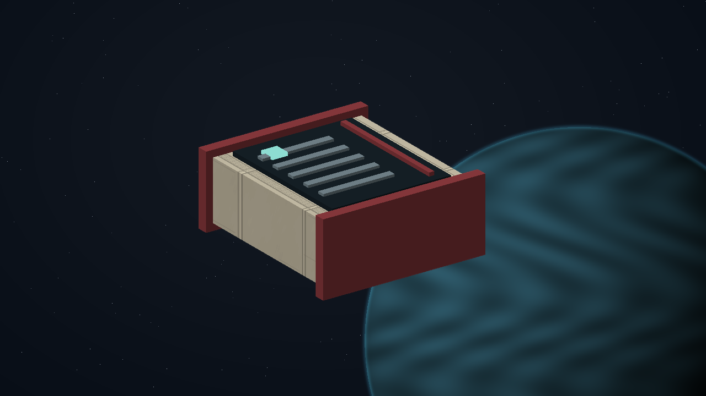

### G01 - receive

- **Event:** original_family_terminal_committed
- **Target role:** registered-receiver
- **Required proofs:** real-reception; settlement-committed
- **Objective:** Confirm the exact receiver, actual returned custody and the advertised settlement.
- **Dialog:** RECEPTION: The recorded work and its actual receiving evidence agree. The published settlement and this family's first-completion clue are committed together; later jobs cannot replace another family's clue.
- **Primary art:** courier-crate

First-success clue:

- **Source:** l337.contract/sealed-dispatch
- **Mission title:** Sealed dispatch
- **Id:** sealed-dispatch-family-trace
- **Label:** The sealed dispatch trace
- **Text:** The first verified sealed dispatch record contains a distinct inward-curved phase imprint that predates this job and its participating equipment.
- **Award dialog:** RECEPTION: One older curved signature lies outside this job's ordinary evidence. It is preserved in your journal for the AI at PLUGH.
- **Success rule:** Only the actual verified successful terminal for this current family, including required real custody, consent, attributed combat or financial settlement. Not acceptance, incidental payment, failure, cancellation or a different family.
- **Mass tonnes:** 0
- **Award event:** successful-mission-completion-committed
- **Receipt:** l337.unwritten-route/clue/sealed-dispatch-family-trace
- **Duplicate rule:** Grant this source clue once per commander; repeat completions retain the same clue and never replace a missing source.
- **Branch rule:** Every legitimate successful ending grants the same source clue; abandonment, failure, voided contracts and incidental sub-rewards do not.

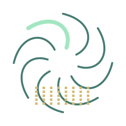

## G02 - Consented freight supply

**Identity:** `l337.contract/consented-freight`.

- **Kind:** repeatable
- **Required cargo tonnes:** 8
- **Required berths:** 0
- **Deposit cr:** 0
- **Donation cr:** 0
- **Qualification:** Visible actual fitting, consent and reachable space-station endpoints; no external pack progress, hidden rank counter or imported score gate.
- **Quote / Base cr:** 620
- **Quote / Per route leg cr:** 110
- **Quote / Hazard premium cr:** 80
- **Quote / Source:** Independent authored service budget, not source arithmetic or converted tables.
- **Clock / Deadline seconds:** 0
- **Clock / Scan seconds:** 0
- **Clock / Policy:** No undisclosed deadline. An explicitly quoted variant freezes its remaining flight-simulation budget on pause and preserves it on current-format load.
- **Encounter policy:** Use unique registered actors and items. Preserve real casualties, attributed kills, consent, full cargo provenance and named reception; culling supplies no evidence.
- **Offer dialog:** Reserve eight tonnes of identified utility parts from actual supplier stock.
- **Clue policy:** Grant this family's one distinct permanent zero-mass clue at its first verified successful terminal. Later legitimate jobs retain it and cannot substitute for missing sources.
- **Failure policy:** Preserve losses and incomplete evidence; no payment or clue on failure. A retry requires actual new available stock/actors and a new instance. Never restore destroyed people or clone lost cargo.

### G02 - accept

- **Event:** original_family_accepted
- **Target role:** registered-issuer
- **Required proofs:** offer-confirmed; actual-fit-reserved
- **Objective:** Reserve eight tonnes of identified utility parts from actual supplier stock.
- **Dialog:** ARLEN: Reserve what exists. Neither a quote nor a lost crate creates replacement stock.
- **Primary art:** utility-service-pallet

### G02 - perform

- **Event:** original_family_objective_verified
- **Target role:** registered-objective
- **Required proofs:** exact-identity-proof; physical-operation-proof
- **Objective:** Deliver the same eight tonnes to the consenting utility receiving crew.
- **Dialog:** ARLEN: Reserve what exists. Neither a quote nor a lost crate creates replacement stock. Keep the full instance-scoped evidence and its current receiving endpoint.
- **Primary art:** utility-service-pallet

### G02 - receive

- **Event:** original_family_terminal_committed
- **Target role:** registered-receiver
- **Required proofs:** real-reception; settlement-committed
- **Objective:** Confirm the exact receiver, actual returned custody and the advertised settlement.
- **Dialog:** RECEPTION: The recorded work and its actual receiving evidence agree. The published settlement and this family's first-completion clue are committed together; later jobs cannot replace another family's clue.
- **Primary art:** utility-service-pallet

First-success clue:

- **Source:** l337.contract/consented-freight
- **Mission title:** Consented freight supply
- **Id:** consented-freight-family-trace
- **Label:** The consented freight trace
- **Text:** The first verified consented freight supply record contains a distinct inward-curved phase imprint that predates this job and its participating equipment.
- **Award dialog:** RECEPTION: One older curved signature lies outside this job's ordinary evidence. It is preserved in your journal for the AI at PLUGH.
- **Success rule:** Only the actual verified successful terminal for this current family, including required real custody, consent, attributed combat or financial settlement. Not acceptance, incidental payment, failure, cancellation or a different family.
- **Mass tonnes:** 0
- **Award event:** successful-mission-completion-committed
- **Receipt:** l337.unwritten-route/clue/consented-freight-family-trace
- **Duplicate rule:** Grant this source clue once per commander; repeat completions retain the same clue and never replace a missing source.
- **Branch rule:** Every legitimate successful ending grants the same source clue; abandonment, failure, voided contracts and incidental sub-rewards do not.

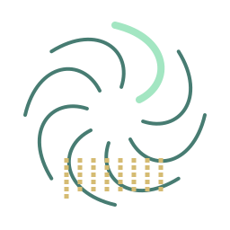

## G03 - Bonded freight passage

**Identity:** `l337.contract/bonded-freight`.

- **Kind:** repeatable
- **Required cargo tonnes:** 3
- **Required berths:** 0
- **Deposit cr:** 75
- **Donation cr:** 0
- **Qualification:** Visible actual fitting, consent and reachable space-station endpoints; no external pack progress, hidden rank counter or imported score gate.
- **Quote / Base cr:** 480
- **Quote / Per route leg cr:** 95
- **Quote / Hazard premium cr:** 80
- **Quote / Source:** Independent authored service budget, not source arithmetic or converted tables.
- **Clock / Deadline seconds:** 0
- **Clock / Scan seconds:** 0
- **Clock / Policy:** No undisclosed deadline. An explicitly quoted variant freezes its remaining flight-simulation budget on pause and preserves it on current-format load.
- **Encounter policy:** Use unique registered actors and items. Preserve real casualties, attributed kills, consent, full cargo provenance and named reception; culling supplies no evidence.
- **Offer dialog:** Accept a published three-tonne machinery custody bond with a 75 CR refundable deposit.
- **Clue policy:** Grant this family's one distinct permanent zero-mass clue at its first verified successful terminal. Later legitimate jobs retain it and cannot substitute for missing sources.
- **Failure policy:** Preserve losses and incomplete evidence; no payment or clue on failure. A retry requires actual new available stock/actors and a new instance. Never restore destroyed people or clone lost cargo.

### G03 - accept

- **Event:** original_family_accepted
- **Target role:** registered-issuer
- **Required proofs:** offer-confirmed; actual-fit-reserved
- **Objective:** Accept a published three-tonne machinery custody bond with a 75 CR refundable deposit.
- **Dialog:** TOREN: The 75 CR bond is returned with successful custody, not silently halved by intermediate docking.
- **Primary art:** return-cassette

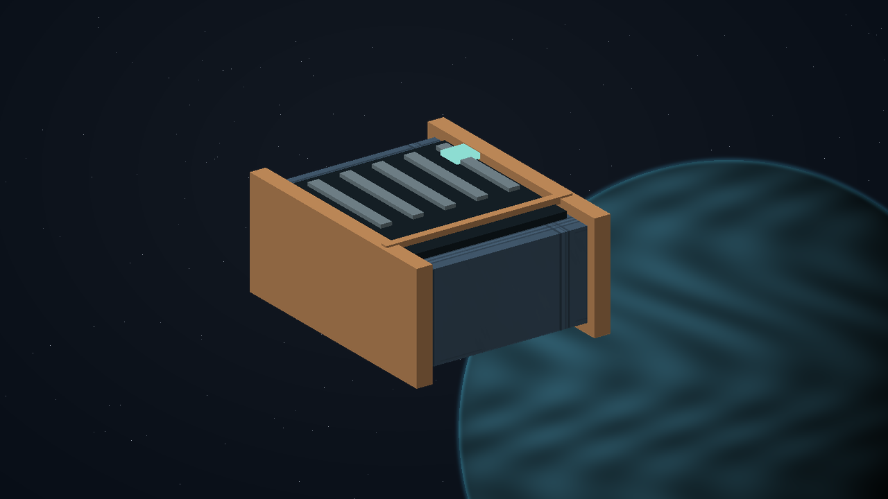

### G03 - perform

- **Event:** original_family_objective_verified
- **Target role:** registered-objective
- **Required proofs:** exact-identity-proof; physical-operation-proof
- **Objective:** Return custody to the named workshop, with the complete physical three-tonne manifest.
- **Dialog:** TOREN: The 75 CR bond is returned with successful custody, not silently halved by intermediate docking. Keep the full instance-scoped evidence and its current receiving endpoint.
- **Primary art:** return-cassette

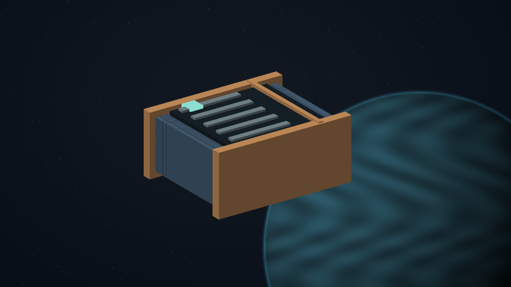

### G03 - receive

- **Event:** original_family_terminal_committed
- **Target role:** registered-receiver
- **Required proofs:** real-reception; settlement-committed
- **Objective:** Confirm the exact receiver, actual returned custody and the advertised settlement.
- **Dialog:** RECEPTION: The recorded work and its actual receiving evidence agree. The published settlement and this family's first-completion clue are committed together; later jobs cannot replace another family's clue.
- **Primary art:** return-cassette

First-success clue:

- **Source:** l337.contract/bonded-freight
- **Mission title:** Bonded freight passage
- **Id:** bonded-freight-family-trace
- **Label:** The bonded freight trace
- **Text:** The first verified bonded freight passage record contains a distinct inward-curved phase imprint that predates this job and its participating equipment.
- **Award dialog:** RECEPTION: One older curved signature lies outside this job's ordinary evidence. It is preserved in your journal for the AI at PLUGH.
- **Success rule:** Only the actual verified successful terminal for this current family, including required real custody, consent, attributed combat or financial settlement. Not acceptance, incidental payment, failure, cancellation or a different family.
- **Mass tonnes:** 0
- **Award event:** successful-mission-completion-committed
- **Receipt:** l337.unwritten-route/clue/bonded-freight-family-trace
- **Duplicate rule:** Grant this source clue once per commander; repeat completions retain the same clue and never replace a missing source.
- **Branch rule:** Every legitimate successful ending grants the same source clue; abandonment, failure, voided contracts and incidental sub-rewards do not.

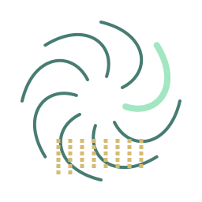

## G04 - Consented cabin journey

**Identity:** `l337.contract/cabin-journey`.

- **Kind:** repeatable
- **Required cargo tonnes:** 0
- **Required berths:** 2
- **Deposit cr:** 0
- **Donation cr:** 0
- **Qualification:** Visible actual fitting, consent and reachable space-station endpoints; no external pack progress, hidden rank counter or imported score gate.
- **Quote / Base cr:** 510
- **Quote / Per route leg cr:** 100
- **Quote / Hazard premium cr:** 80
- **Quote / Source:** Independent authored service budget, not source arithmetic or converted tables.
- **Clock / Deadline seconds:** 0
- **Clock / Scan seconds:** 0
- **Clock / Policy:** No undisclosed deadline. An explicitly quoted variant freezes its remaining flight-simulation budget on pause and preserves it on current-format load.
- **Encounter policy:** Use unique registered actors and items. Preserve real casualties, attributed kills, consent, full cargo provenance and named reception; culling supplies no evidence.
- **Offer dialog:** Board two consenting named passengers into real compatible fitted berths.
- **Clue policy:** Grant this family's one distinct permanent zero-mass clue at its first verified successful terminal. Later legitimate jobs retain it and cannot substitute for missing sources.
- **Failure policy:** Preserve losses and incomplete evidence; no payment or clue on failure. A retry requires actual new available stock/actors and a new instance. Never restore destroyed people or clone lost cargo.

### G04 - accept

- **Event:** original_family_accepted
- **Target role:** registered-issuer
- **Required proofs:** offer-confirmed; actual-fit-reserved
- **Objective:** Board two consenting named passengers into real compatible fitted berths.
- **Dialog:** DAIN: Count real fitted berths and real people; a cargo pod is not a passenger cabin.
- **Primary art:** custody-register

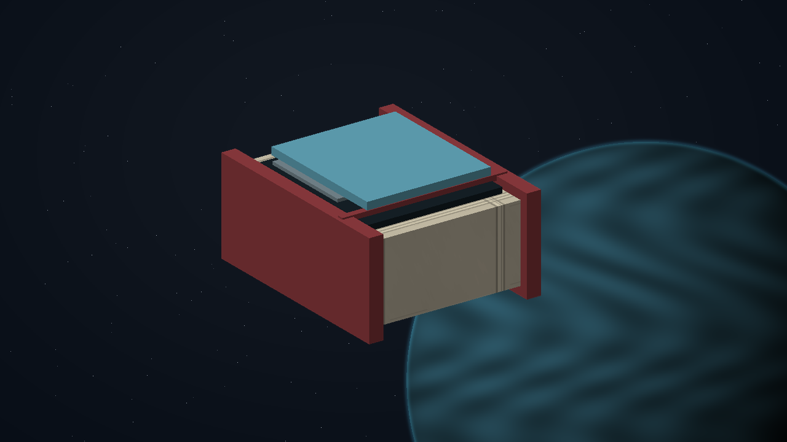

### G04 - perform

- **Event:** original_family_objective_verified
- **Target role:** registered-objective
- **Required proofs:** exact-identity-proof; physical-operation-proof
- **Objective:** Receive the same living passengers at their agreed orbital destination.
- **Dialog:** DAIN: Count real fitted berths and real people; a cargo pod is not a passenger cabin. Keep the full instance-scoped evidence and its current receiving endpoint.
- **Primary art:** custody-register

### G04 - receive

- **Event:** original_family_terminal_committed
- **Target role:** registered-receiver
- **Required proofs:** real-reception; settlement-committed
- **Objective:** Confirm the exact receiver, actual returned custody and the advertised settlement.
- **Dialog:** RECEPTION: The recorded work and its actual receiving evidence agree. The published settlement and this family's first-completion clue are committed together; later jobs cannot replace another family's clue.
- **Primary art:** custody-register

First-success clue:

- **Source:** l337.contract/cabin-journey
- **Mission title:** Consented cabin journey
- **Id:** cabin-journey-family-trace
- **Label:** The cabin journey trace
- **Text:** The first verified consented cabin journey record contains a distinct inward-curved phase imprint that predates this job and its participating equipment.
- **Award dialog:** RECEPTION: One older curved signature lies outside this job's ordinary evidence. It is preserved in your journal for the AI at PLUGH.
- **Success rule:** Only the actual verified successful terminal for this current family, including required real custody, consent, attributed combat or financial settlement. Not acceptance, incidental payment, failure, cancellation or a different family.
- **Mass tonnes:** 0
- **Award event:** successful-mission-completion-committed
- **Receipt:** l337.unwritten-route/clue/cabin-journey-family-trace
- **Duplicate rule:** Grant this source clue once per commander; repeat completions retain the same clue and never replace a missing source.
- **Branch rule:** Every legitimate successful ending grants the same source clue; abandonment, failure, voided contracts and incidental sub-rewards do not.

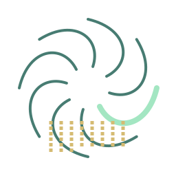

## G05 - Orbital outlook journey

**Identity:** `l337.contract/orbital-outlook`.

- **Kind:** repeatable
- **Required cargo tonnes:** 0
- **Required berths:** 2
- **Deposit cr:** 0
- **Donation cr:** 0
- **Qualification:** Visible actual fitting, consent and reachable space-station endpoints; no external pack progress, hidden rank counter or imported score gate.
- **Quote / Base cr:** 650
- **Quote / Per route leg cr:** 110
- **Quote / Hazard premium cr:** 80
- **Quote / Source:** Independent authored service budget, not source arithmetic or converted tables.
- **Clock / Deadline seconds:** 0
- **Clock / Scan seconds:** 0
- **Clock / Policy:** No undisclosed deadline. An explicitly quoted variant freezes its remaining flight-simulation budget on pause and preserves it on current-format load.
- **Encounter policy:** Use unique registered actors and items. Preserve real casualties, attributed kills, consent, full cargo provenance and named reception; culling supplies no evidence.
- **Offer dialog:** Board a consented two-passenger itinerary containing three ordered orbital viewing points.
- **Clue policy:** Grant this family's one distinct permanent zero-mass clue at its first verified successful terminal. Later legitimate jobs retain it and cannot substitute for missing sources.
- **Failure policy:** Preserve losses and incomplete evidence; no payment or clue on failure. A retry requires actual new available stock/actors and a new instance. Never restore destroyed people or clone lost cargo.

### G05 - accept

- **Event:** original_family_accepted
- **Target role:** registered-issuer
- **Required proofs:** offer-confirmed; actual-fit-reserved
- **Objective:** Board a consented two-passenger itinerary containing three ordered orbital viewing points.
- **Dialog:** SOREL: The travellers see the same itinerary you do. A duplicate scan cannot replace a missed view.
- **Primary art:** outer-watcher

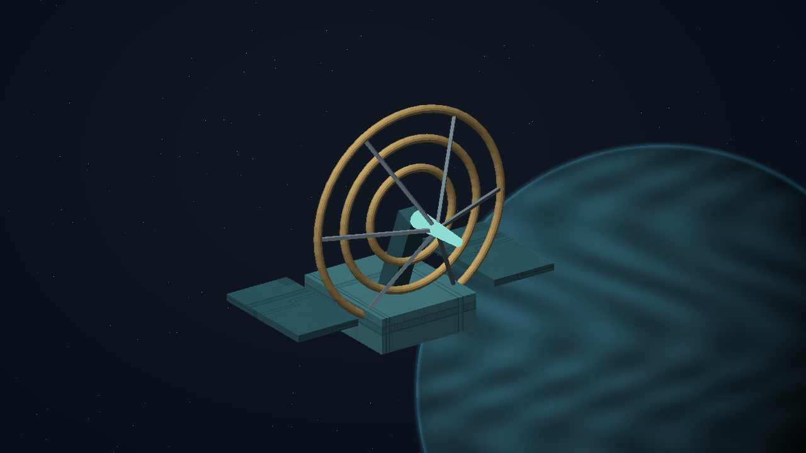

### G05 - perform

- **Event:** original_family_objective_verified
- **Target role:** registered-objective
- **Required proofs:** exact-identity-proof; physical-operation-proof
- **Objective:** Verify all three target scans in order and the actual living passenger return.
- **Dialog:** SOREL: The travellers see the same itinerary you do. A duplicate scan cannot replace a missed view. Keep the full instance-scoped evidence and its current receiving endpoint.
- **Primary art:** outer-watcher

### G05 - receive

- **Event:** original_family_terminal_committed
- **Target role:** registered-receiver
- **Required proofs:** real-reception; settlement-committed
- **Objective:** Confirm the exact receiver, actual returned custody and the advertised settlement.
- **Dialog:** RECEPTION: The recorded work and its actual receiving evidence agree. The published settlement and this family's first-completion clue are committed together; later jobs cannot replace another family's clue.
- **Primary art:** outer-watcher

First-success clue:

- **Source:** l337.contract/orbital-outlook
- **Mission title:** Orbital outlook journey
- **Id:** orbital-outlook-family-trace
- **Label:** The orbital outlook trace
- **Text:** The first verified orbital outlook journey record contains a distinct inward-curved phase imprint that predates this job and its participating equipment.
- **Award dialog:** RECEPTION: One older curved signature lies outside this job's ordinary evidence. It is preserved in your journal for the AI at PLUGH.
- **Success rule:** Only the actual verified successful terminal for this current family, including required real custody, consent, attributed combat or financial settlement. Not acceptance, incidental payment, failure, cancellation or a different family.
- **Mass tonnes:** 0
- **Award event:** successful-mission-completion-committed
- **Receipt:** l337.unwritten-route/clue/orbital-outlook-family-trace
- **Duplicate rule:** Grant this source clue once per commander; repeat completions retain the same clue and never replace a missing source.
- **Branch rule:** Every legitimate successful ending grants the same source clue; abandonment, failure, voided contracts and incidental sub-rewards do not.

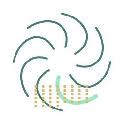

## G06 - Verified hostile warrant

**Identity:** `l337.contract/verified-warrant`.

- **Kind:** repeatable
- **Required cargo tonnes:** 0
- **Required berths:** 0
- **Deposit cr:** 0
- **Donation cr:** 0
- **Qualification:** Visible actual fitting, consent and reachable space-station endpoints; no external pack progress, hidden rank counter or imported score gate.
- **Quote / Base cr:** 860
- **Quote / Per route leg cr:** 130
- **Quote / Hazard premium cr:** 80
- **Quote / Source:** Independent authored service budget, not source arithmetic or converted tables.
- **Clock / Deadline seconds:** 0
- **Clock / Scan seconds:** 0
- **Clock / Policy:** No undisclosed deadline. An explicitly quoted variant freezes its remaining flight-simulation budget on pause and preserves it on current-format load.
- **Encounter policy:** Use unique registered actors and items. Preserve real casualties, attributed kills, consent, full cargo provenance and named reception; culling supplies no evidence.
- **Offer dialog:** Accept one currently verified warrant on a specifically identified armed aggressor.
- **Clue policy:** Grant this family's one distinct permanent zero-mass clue at its first verified successful terminal. Later legitimate jobs retain it and cannot substitute for missing sources.
- **Failure policy:** Preserve losses and incomplete evidence; no payment or clue on failure. A retry requires actual new available stock/actors and a new instance. Never restore destroyed people or clone lost cargo.

### G06 - accept

- **Event:** original_family_accepted
- **Target role:** registered-issuer
- **Required proofs:** offer-confirmed; actual-fit-reserved
- **Objective:** Accept one currently verified warrant on a specifically identified armed aggressor.
- **Dialog:** VOSS: The warrant names an actor, not a hull class. Innocents and unrelated kills never count.
- **Primary art:** custody-register

### G06 - perform

- **Event:** original_family_objective_verified
- **Target role:** registered-objective
- **Required proofs:** exact-identity-proof; physical-operation-proof
- **Objective:** Obtain the actual player-attributed destruction receipt for that target and report it.
- **Dialog:** VOSS: The warrant names an actor, not a hull class. Innocents and unrelated kills never count. Keep the full instance-scoped evidence and its current receiving endpoint.
- **Primary art:** custody-register

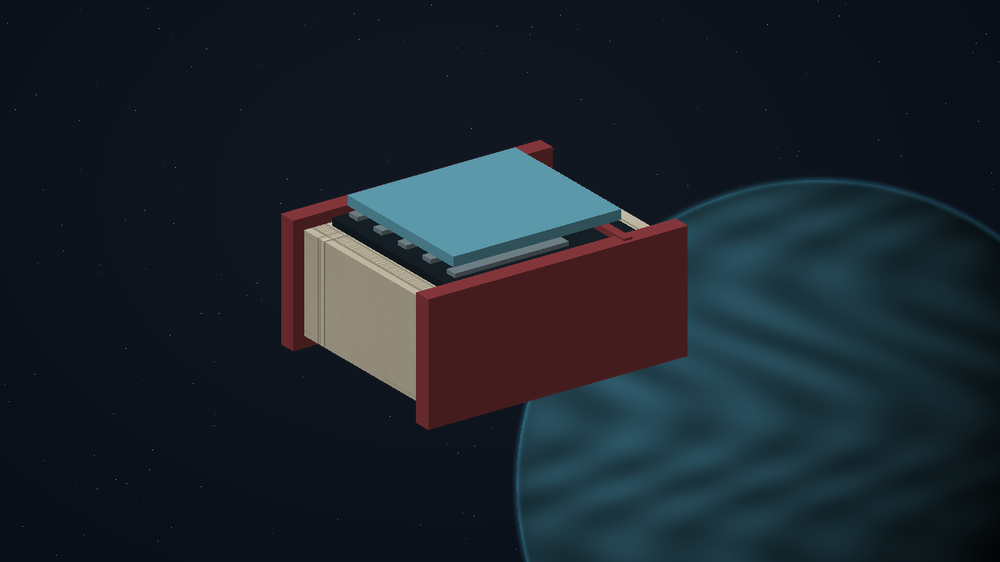

### G06 - receive

- **Event:** original_family_terminal_committed
- **Target role:** registered-receiver
- **Required proofs:** real-reception; settlement-committed
- **Objective:** Confirm the exact receiver, actual returned custody and the advertised settlement.
- **Dialog:** RECEPTION: The recorded work and its actual receiving evidence agree. The published settlement and this family's first-completion clue are committed together; later jobs cannot replace another family's clue.
- **Primary art:** custody-register

First-success clue:

- **Source:** l337.contract/verified-warrant
- **Mission title:** Verified hostile warrant
- **Id:** verified-warrant-family-trace
- **Label:** The verified warrant trace
- **Text:** The first verified verified hostile warrant record contains a distinct inward-curved phase imprint that predates this job and its participating equipment.
- **Award dialog:** RECEPTION: One older curved signature lies outside this job's ordinary evidence. It is preserved in your journal for the AI at PLUGH.
- **Success rule:** Only the actual verified successful terminal for this current family, including required real custody, consent, attributed combat or financial settlement. Not acceptance, incidental payment, failure, cancellation or a different family.
- **Mass tonnes:** 0
- **Award event:** successful-mission-completion-committed
- **Receipt:** l337.unwritten-route/clue/verified-warrant-family-trace
- **Duplicate rule:** Grant this source clue once per commander; repeat completions retain the same clue and never replace a missing source.
- **Branch rule:** Every legitimate successful ending grants the same source clue; abandonment, failure, voided contracts and incidental sub-rewards do not.

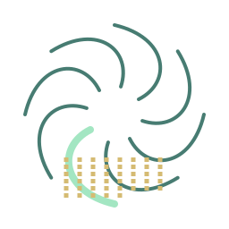

## G07 - Registered corridor defence

**Identity:** `l337.contract/corridor-defence`.

- **Kind:** repeatable
- **Required cargo tonnes:** 0
- **Required berths:** 0
- **Deposit cr:** 0
- **Donation cr:** 0
- **Qualification:** Visible actual fitting, consent and reachable space-station endpoints; no external pack progress, hidden rank counter or imported score gate.
- **Quote / Base cr:** 1120
- **Quote / Per route leg cr:** 140
- **Quote / Hazard premium cr:** 80
- **Quote / Source:** Independent authored service budget, not source arithmetic or converted tables.
- **Clock / Deadline seconds:** 0
- **Clock / Scan seconds:** 0
- **Clock / Policy:** No undisclosed deadline. An explicitly quoted variant freezes its remaining flight-simulation budget on pause and preserves it on current-format load.
- **Encounter policy:** Use unique registered actors and items. Preserve real casualties, attributed kills, consent, full cargo provenance and named reception; culling supplies no evidence.
- **Offer dialog:** Protect a declared corridor against three specifically registered hostile raiders.
- **Clue policy:** Grant this family's one distinct permanent zero-mass clue at its first verified successful terminal. Later legitimate jobs retain it and cannot substitute for missing sources.
- **Failure policy:** Preserve losses and incomplete evidence; no payment or clue on failure. A retry requires actual new available stock/actors and a new instance. Never restore destroyed people or clone lost cargo.

### G07 - accept

- **Event:** original_family_accepted
- **Target role:** registered-issuer
- **Required proofs:** offer-confirmed; actual-fit-reserved
- **Objective:** Protect a declared corridor against three specifically registered hostile raiders.
- **Dialog:** VOSS: Count each registered aggressor once. Culling, ordinary traffic and shared names are not kills.
- **Primary art:** convoy-receipt-beacon

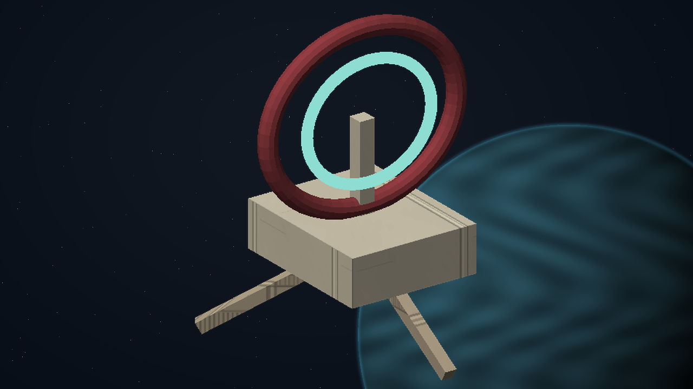

### G07 - perform

- **Event:** original_family_objective_verified
- **Target role:** registered-objective
- **Required proofs:** hostile-raider-a; hostile-raider-b; hostile-raider-c
- **Objective:** Record three distinct actual player-attributed hostile neutralisations and verify corridor reception.
- **Dialog:** VOSS: Count each registered aggressor once. Culling, ordinary traffic and shared names are not kills. Keep the full instance-scoped evidence and its current receiving endpoint.
- **Primary art:** convoy-receipt-beacon

### G07 - receive

- **Event:** original_family_terminal_committed
- **Target role:** registered-receiver
- **Required proofs:** real-reception; settlement-committed
- **Objective:** Confirm the exact receiver, actual returned custody and the advertised settlement.
- **Dialog:** RECEPTION: The recorded work and its actual receiving evidence agree. The published settlement and this family's first-completion clue are committed together; later jobs cannot replace another family's clue.
- **Primary art:** convoy-receipt-beacon

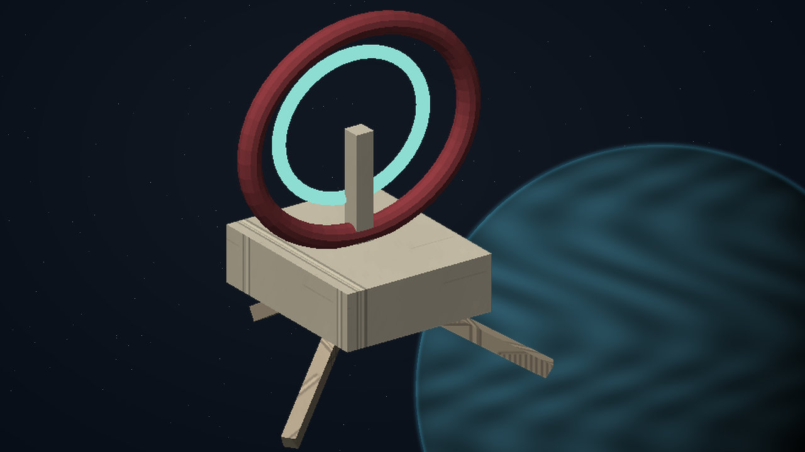

First-success clue:

- **Source:** l337.contract/corridor-defence
- **Mission title:** Registered corridor defence
- **Id:** corridor-defence-family-trace
- **Label:** The corridor defence trace
- **Text:** The first verified registered corridor defence record contains a distinct inward-curved phase imprint that predates this job and its participating equipment.
- **Award dialog:** RECEPTION: One older curved signature lies outside this job's ordinary evidence. It is preserved in your journal for the AI at PLUGH.
- **Success rule:** Only the actual verified successful terminal for this current family, including required real custody, consent, attributed combat or financial settlement. Not acceptance, incidental payment, failure, cancellation or a different family.
- **Mass tonnes:** 0
- **Award event:** successful-mission-completion-committed
- **Receipt:** l337.unwritten-route/clue/corridor-defence-family-trace
- **Duplicate rule:** Grant this source clue once per commander; repeat completions retain the same clue and never replace a missing source.
- **Branch rule:** Every legitimate successful ending grants the same source clue; abandonment, failure, voided contracts and incidental sub-rewards do not.

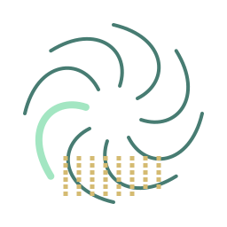

## G08 - Consented custody rescue

**Identity:** `l337.contract/custody-rescue`.

- **Kind:** repeatable
- **Required cargo tonnes:** 1
- **Required berths:** 2
- **Deposit cr:** 0
- **Donation cr:** 0
- **Qualification:** Visible actual fitting, consent and reachable space-station endpoints; no external pack progress, hidden rank counter or imported score gate.
- **Quote / Base cr:** 900
- **Quote / Per route leg cr:** 120
- **Quote / Hazard premium cr:** 80
- **Quote / Source:** Independent authored service budget, not source arithmetic or converted tables.
- **Clock / Deadline seconds:** 0
- **Clock / Scan seconds:** 0
- **Clock / Policy:** No undisclosed deadline. An explicitly quoted variant freezes its remaining flight-simulation budget on pause and preserves it on current-format load.
- **Encounter policy:** Use unique registered actors and items. Preserve real casualties, attributed kills, consent, full cargo provenance and named reception; culling supplies no evidence.
- **Offer dialog:** Reserve two fitted berths for registered living evacuees and one tonne for their unique emergency record.
- **Clue policy:** Grant this family's one distinct permanent zero-mass clue at its first verified successful terminal. Later legitimate jobs retain it and cannot substitute for missing sources.
- **Failure policy:** Preserve losses and incomplete evidence; no payment or clue on failure. A retry requires actual new available stock/actors and a new instance. Never restore destroyed people or clone lost cargo.

### G08 - accept

- **Event:** original_family_accepted
- **Target role:** registered-issuer
- **Required proofs:** offer-confirmed; actual-fit-reserved
- **Objective:** Reserve two fitted berths for registered living evacuees and one tonne for their unique emergency record.
- **Dialog:** DAIN: People keep their consent after rescue. Destroyed capsules and empty pods cannot become survivors.
- **Primary art:** rescue-launch

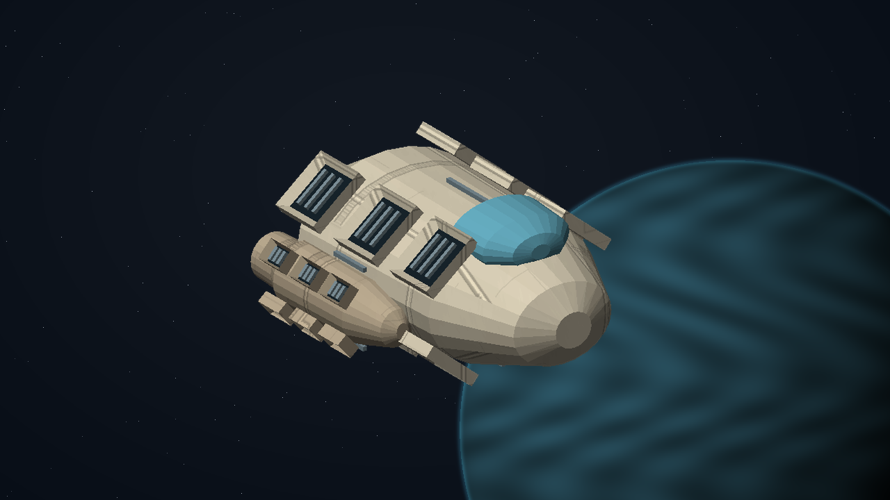

### G08 - perform

- **Event:** original_family_objective_verified
- **Target role:** registered-objective
- **Required proofs:** exact-identity-proof; physical-operation-proof
- **Objective:** Recover the identified living capsules safely, obtain voluntary boarding and complete their real reception.
- **Dialog:** DAIN: People keep their consent after rescue. Destroyed capsules and empty pods cannot become survivors. Keep the full instance-scoped evidence and its current receiving endpoint.
- **Primary art:** rescue-launch

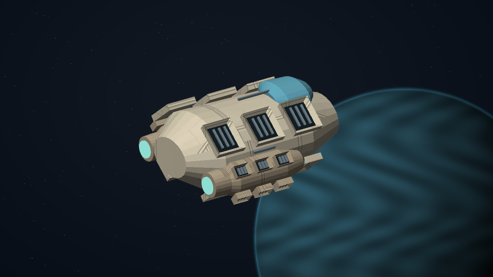

### G08 - receive

- **Event:** original_family_terminal_committed
- **Target role:** registered-receiver
- **Required proofs:** real-reception; settlement-committed
- **Objective:** Confirm the exact receiver, actual returned custody and the advertised settlement.
- **Dialog:** RECEPTION: The recorded work and its actual receiving evidence agree. The published settlement and this family's first-completion clue are committed together; later jobs cannot replace another family's clue.
- **Primary art:** rescue-launch

First-success clue:

- **Source:** l337.contract/custody-rescue
- **Mission title:** Consented custody rescue
- **Id:** custody-rescue-family-trace
- **Label:** The custody rescue trace
- **Text:** The first verified consented custody rescue record contains a distinct inward-curved phase imprint that predates this job and its participating equipment.
- **Award dialog:** RECEPTION: One older curved signature lies outside this job's ordinary evidence. It is preserved in your journal for the AI at PLUGH.
- **Success rule:** Only the actual verified successful terminal for this current family, including required real custody, consent, attributed combat or financial settlement. Not acceptance, incidental payment, failure, cancellation or a different family.
- **Mass tonnes:** 0
- **Award event:** successful-mission-completion-committed
- **Receipt:** l337.unwritten-route/clue/custody-rescue-family-trace
- **Duplicate rule:** Grant this source clue once per commander; repeat completions retain the same clue and never replace a missing source.
- **Branch rule:** Every legitimate successful ending grants the same source clue; abandonment, failure, voided contracts and incidental sub-rewards do not.

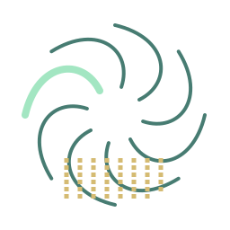

## G09 - Identified salvage return

**Identity:** `l337.contract/identified-salvage`.

- **Kind:** repeatable
- **Required cargo tonnes:** 2
- **Required berths:** 0
- **Deposit cr:** 0
- **Donation cr:** 0
- **Qualification:** Visible actual fitting, consent and reachable space-station endpoints; no external pack progress, hidden rank counter or imported score gate.
- **Quote / Base cr:** 650
- **Quote / Per route leg cr:** 115
- **Quote / Hazard premium cr:** 80
- **Quote / Source:** Independent authored service budget, not source arithmetic or converted tables.
- **Clock / Deadline seconds:** 0
- **Clock / Scan seconds:** 0
- **Clock / Policy:** No undisclosed deadline. An explicitly quoted variant freezes its remaining flight-simulation budget on pause and preserves it on current-format load.
- **Encounter policy:** Use unique registered actors and items. Preserve real casualties, attributed kills, consent, full cargo provenance and named reception; culling supplies no evidence.
- **Offer dialog:** Locate two tonnes of uniquely registered recoverable equipment in an orbital wreck cradle.
- **Clue policy:** Grant this family's one distinct permanent zero-mass clue at its first verified successful terminal. Later legitimate jobs retain it and cannot substitute for missing sources.
- **Failure policy:** Preserve losses and incomplete evidence; no payment or clue on failure. A retry requires actual new available stock/actors and a new instance. Never restore destroyed people or clone lost cargo.

### G09 - accept

- **Event:** original_family_accepted
- **Target role:** registered-issuer
- **Required proofs:** offer-confirmed; actual-fit-reserved
- **Objective:** Locate two tonnes of uniquely registered recoverable equipment in an orbital wreck cradle.
- **Dialog:** PELL: A matching commodity name does not prove wreck provenance.
- **Primary art:** crew-custody-recorder

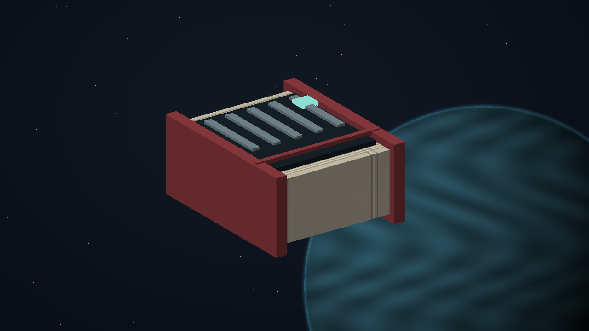

### G09 - perform

- **Event:** original_family_objective_verified
- **Target role:** registered-objective
- **Required proofs:** exact-identity-proof; physical-operation-proof
- **Objective:** Recover those exact physical items and hand them to their consenting owner.
- **Dialog:** PELL: A matching commodity name does not prove wreck provenance. Keep the full instance-scoped evidence and its current receiving endpoint.
- **Primary art:** crew-custody-recorder

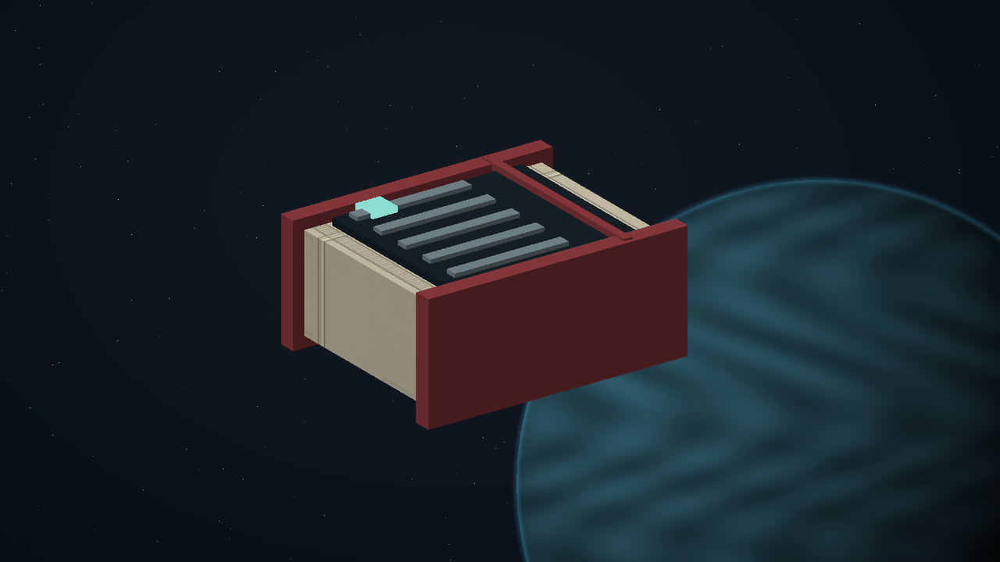

### G09 - receive

- **Event:** original_family_terminal_committed
- **Target role:** registered-receiver
- **Required proofs:** real-reception; settlement-committed
- **Objective:** Confirm the exact receiver, actual returned custody and the advertised settlement.
- **Dialog:** RECEPTION: The recorded work and its actual receiving evidence agree. The published settlement and this family's first-completion clue are committed together; later jobs cannot replace another family's clue.
- **Primary art:** crew-custody-recorder

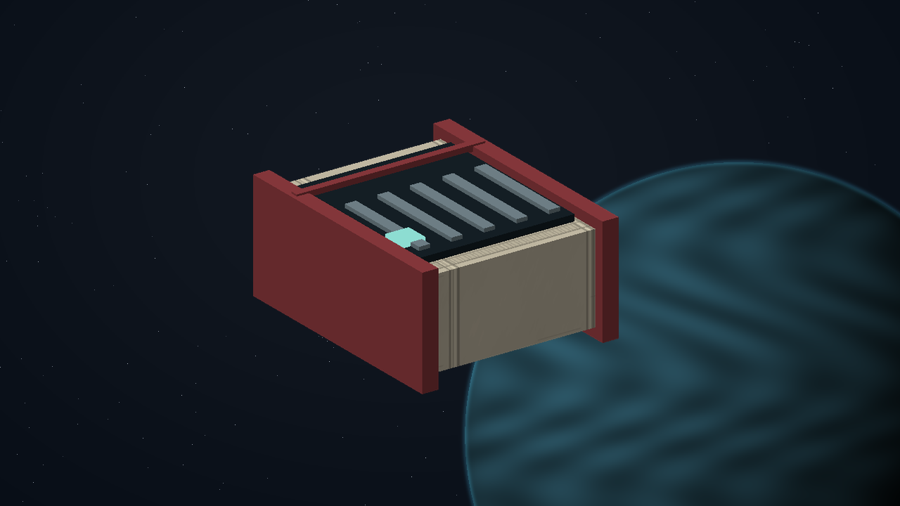

First-success clue:

- **Source:** l337.contract/identified-salvage
- **Mission title:** Identified salvage return
- **Id:** identified-salvage-family-trace
- **Label:** The identified salvage trace
- **Text:** The first verified identified salvage return record contains a distinct inward-curved phase imprint that predates this job and its participating equipment.
- **Award dialog:** RECEPTION: One older curved signature lies outside this job's ordinary evidence. It is preserved in your journal for the AI at PLUGH.
- **Success rule:** Only the actual verified successful terminal for this current family, including required real custody, consent, attributed combat or financial settlement. Not acceptance, incidental payment, failure, cancellation or a different family.
- **Mass tonnes:** 0
- **Award event:** successful-mission-completion-committed
- **Receipt:** l337.unwritten-route/clue/identified-salvage-family-trace
- **Duplicate rule:** Grant this source clue once per commander; repeat completions retain the same clue and never replace a missing source.
- **Branch rule:** Every legitimate successful ending grants the same source clue; abandonment, failure, voided contracts and incidental sub-rewards do not.

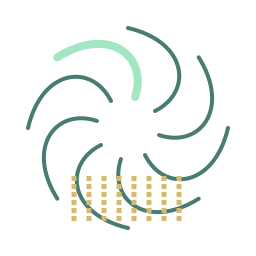

## G10 - Consented orbital survey

**Identity:** `l337.contract/consented-survey`.

- **Kind:** repeatable
- **Required cargo tonnes:** 0
- **Required berths:** 0
- **Deposit cr:** 0
- **Donation cr:** 0
- **Qualification:** Visible actual fitting, consent and reachable space-station endpoints; no external pack progress, hidden rank counter or imported score gate.
- **Quote / Base cr:** 540
- **Quote / Per route leg cr:** 95
- **Quote / Hazard premium cr:** 80
- **Quote / Source:** Independent authored service budget, not source arithmetic or converted tables.
- **Clock / Deadline seconds:** 0
- **Clock / Scan seconds:** 12
- **Clock / Policy:** No undisclosed deadline. An explicitly quoted variant freezes its remaining flight-simulation budget on pause and preserves it on current-format load.
- **Encounter policy:** Use unique registered actors and items. Preserve real casualties, attributed kills, consent, full cargo provenance and named reception; culling supplies no evidence.
- **Offer dialog:** Survey three registered ship-accessible calibration points at their advertised safe ranges.
- **Clue policy:** Grant this family's one distinct permanent zero-mass clue at its first verified successful terminal. Later legitimate jobs retain it and cannot substitute for missing sources.
- **Failure policy:** Preserve losses and incomplete evidence; no payment or clue on failure. A retry requires actual new available stock/actors and a new instance. Never restore destroyed people or clone lost cargo.

### G10 - accept

- **Event:** original_family_accepted
- **Target role:** registered-issuer
- **Required proofs:** offer-confirmed; actual-fit-reserved
- **Objective:** Survey three registered ship-accessible calibration points at their advertised safe ranges.
- **Dialog:** KEST: An interrupted scan keeps only confirmed data. The same point cannot stand in for another.
- **Primary art:** lattice-meter

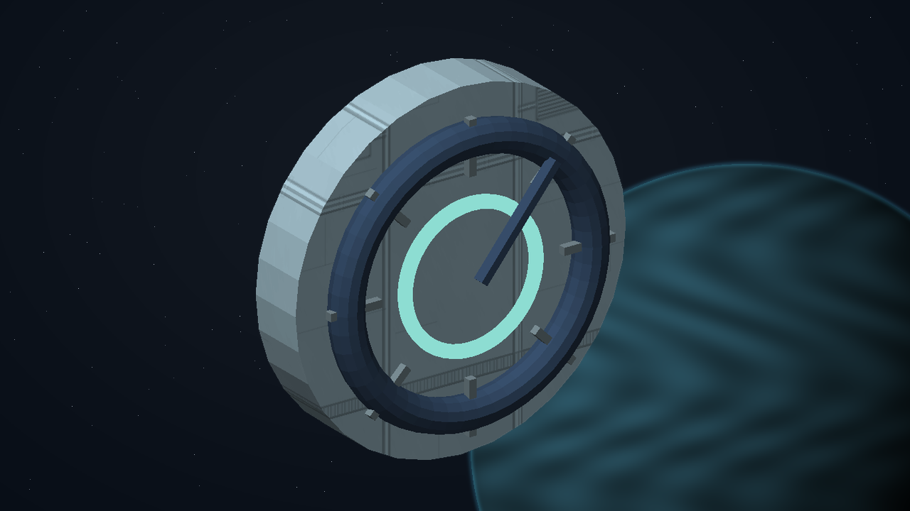

### G10 - perform

- **Event:** original_family_objective_verified
- **Target role:** registered-objective
- **Required proofs:** exact-identity-proof; physical-operation-proof
- **Objective:** Complete three distinct 12-second scans and return the signed measurements.
- **Dialog:** KEST: An interrupted scan keeps only confirmed data. The same point cannot stand in for another. Keep the full instance-scoped evidence and its current receiving endpoint.
- **Primary art:** lattice-meter

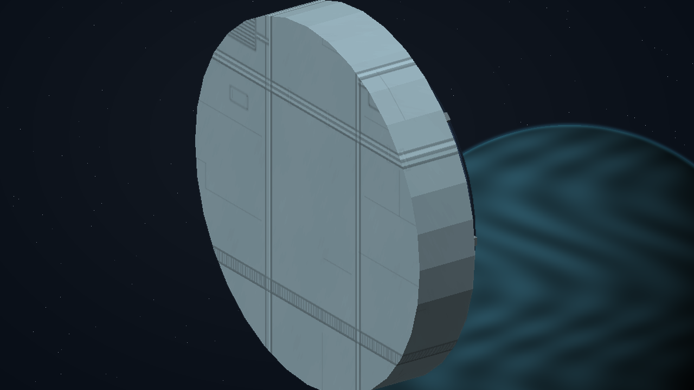

### G10 - receive

- **Event:** original_family_terminal_committed
- **Target role:** registered-receiver
- **Required proofs:** real-reception; settlement-committed
- **Objective:** Confirm the exact receiver, actual returned custody and the advertised settlement.
- **Dialog:** RECEPTION: The recorded work and its actual receiving evidence agree. The published settlement and this family's first-completion clue are committed together; later jobs cannot replace another family's clue.
- **Primary art:** lattice-meter

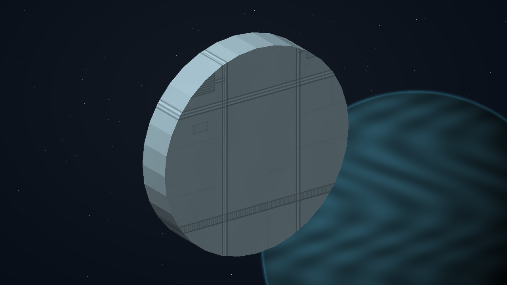

First-success clue:

- **Source:** l337.contract/consented-survey
- **Mission title:** Consented orbital survey
- **Id:** consented-survey-family-trace
- **Label:** The consented survey trace
- **Text:** The first verified consented orbital survey record contains a distinct inward-curved phase imprint that predates this job and its participating equipment.
- **Award dialog:** RECEPTION: One older curved signature lies outside this job's ordinary evidence. It is preserved in your journal for the AI at PLUGH.
- **Success rule:** Only the actual verified successful terminal for this current family, including required real custody, consent, attributed combat or financial settlement. Not acceptance, incidental payment, failure, cancellation or a different family.
- **Mass tonnes:** 0
- **Award event:** successful-mission-completion-committed
- **Receipt:** l337.unwritten-route/clue/consented-survey-family-trace
- **Duplicate rule:** Grant this source clue once per commander; repeat completions retain the same clue and never replace a missing source.
- **Branch rule:** Every legitimate successful ending grants the same source clue; abandonment, failure, voided contracts and incidental sub-rewards do not.

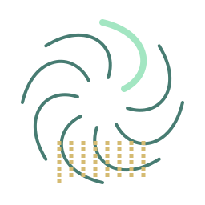

## G11 - External isolation work

**Identity:** `l337.contract/isolation-work`.

- **Kind:** repeatable
- **Required cargo tonnes:** 1
- **Required berths:** 0
- **Deposit cr:** 0
- **Donation cr:** 0
- **Qualification:** Visible actual fitting, consent and reachable space-station endpoints; no external pack progress, hidden rank counter or imported score gate.
- **Quote / Base cr:** 760
- **Quote / Per route leg cr:** 105
- **Quote / Hazard premium cr:** 80
- **Quote / Source:** Independent authored service budget, not source arithmetic or converted tables.
- **Clock / Deadline seconds:** 0
- **Clock / Scan seconds:** 0
- **Clock / Policy:** No undisclosed deadline. An explicitly quoted variant freezes its remaining flight-simulation budget on pause and preserves it on current-format load.
- **Encounter policy:** Use unique registered actors and items. Preserve real casualties, attributed kills, consent, full cargo provenance and named reception; culling supplies no evidence.
- **Offer dialog:** Take a one-tonne uniquely loaned programmer to two named unmanned external control modules.
- **Clue policy:** Grant this family's one distinct permanent zero-mass clue at its first verified successful terminal. Later legitimate jobs retain it and cannot substitute for missing sources.
- **Failure policy:** Preserve losses and incomplete evidence; no payment or clue on failure. A retry requires actual new available stock/actors and a new instance. Never restore destroyed people or clone lost cargo.

### G11 - accept

- **Event:** original_family_accepted
- **Target role:** registered-issuer
- **Required proofs:** offer-confirmed; actual-fit-reserved
- **Objective:** Take a one-tonne uniquely loaned programmer to two named unmanned external control modules.
- **Dialog:** LERR: The modules are distinct from station hulls. A station attack is never an accepted repair.
- **Primary art:** isolation-programmer

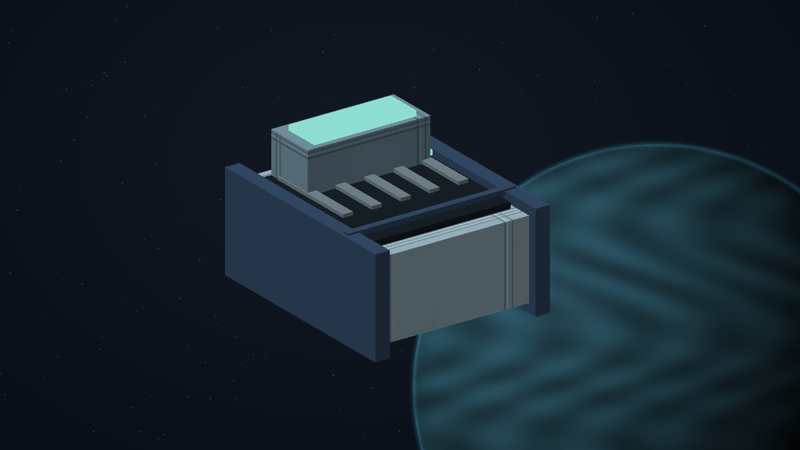

### G11 - perform

- **Event:** original_family_objective_verified
- **Target role:** registered-objective
- **Required proofs:** exact-identity-proof; physical-operation-proof
- **Objective:** Verify both physical isolation states and return the same programmer to its issuer.
- **Dialog:** LERR: The modules are distinct from station hulls. A station attack is never an accepted repair. Keep the full instance-scoped evidence and its current receiving endpoint.
- **Primary art:** isolation-programmer

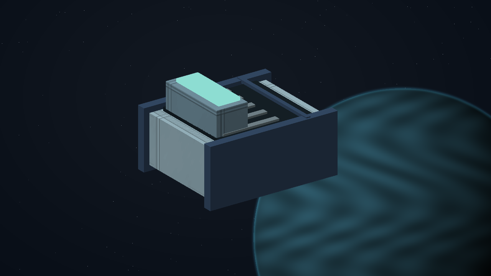

### G11 - receive

- **Event:** original_family_terminal_committed
- **Target role:** registered-receiver
- **Required proofs:** real-reception; settlement-committed
- **Objective:** Confirm the exact receiver, actual returned custody and the advertised settlement.
- **Dialog:** RECEPTION: The recorded work and its actual receiving evidence agree. The published settlement and this family's first-completion clue are committed together; later jobs cannot replace another family's clue.
- **Primary art:** isolation-programmer

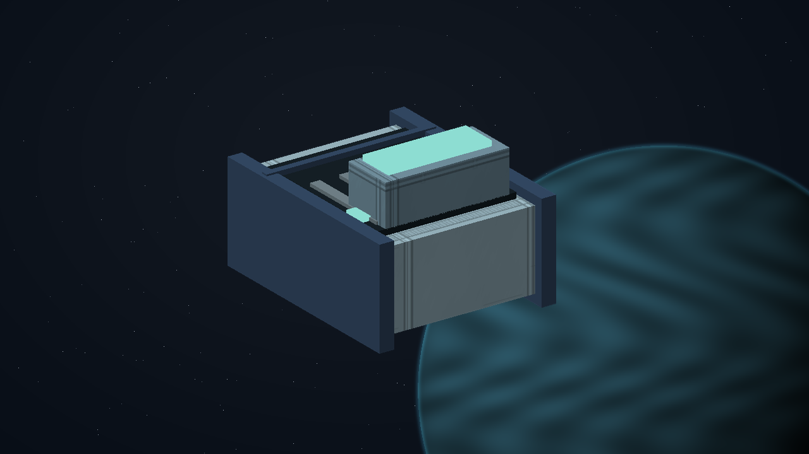

First-success clue:

- **Source:** l337.contract/isolation-work
- **Mission title:** External isolation work
- **Id:** isolation-work-family-trace
- **Label:** The isolation work trace
- **Text:** The first verified external isolation work record contains a distinct inward-curved phase imprint that predates this job and its participating equipment.
- **Award dialog:** RECEPTION: One older curved signature lies outside this job's ordinary evidence. It is preserved in your journal for the AI at PLUGH.
- **Success rule:** Only the actual verified successful terminal for this current family, including required real custody, consent, attributed combat or financial settlement. Not acceptance, incidental payment, failure, cancellation or a different family.
- **Mass tonnes:** 0
- **Award event:** successful-mission-completion-committed
- **Receipt:** l337.unwritten-route/clue/isolation-work-family-trace
- **Duplicate rule:** Grant this source clue once per commander; repeat completions retain the same clue and never replace a missing source.
- **Branch rule:** Every legitimate successful ending grants the same source clue; abandonment, failure, voided contracts and incidental sub-rewards do not.

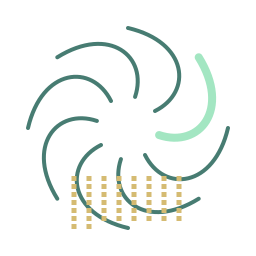

## G12 - Measured asteroid extraction

**Identity:** `l337.contract/measured-extraction`.

- **Kind:** repeatable
- **Required cargo tonnes:** 12
- **Required berths:** 0
- **Deposit cr:** 0
- **Donation cr:** 0
- **Qualification:** Visible actual fitting, consent and reachable space-station endpoints; no external pack progress, hidden rank counter or imported score gate.
- **Quote / Base cr:** 780
- **Quote / Per route leg cr:** 110
- **Quote / Hazard premium cr:** 80
- **Quote / Source:** Independent authored service budget, not source arithmetic or converted tables.
- **Clock / Deadline seconds:** 0
- **Clock / Scan seconds:** 0
- **Clock / Policy:** No undisclosed deadline. An explicitly quoted variant freezes its remaining flight-simulation budget on pause and preserves it on current-format load.
- **Encounter policy:** Use unique registered actors and items. Preserve real casualties, attributed kills, consent, full cargo provenance and named reception; culling supplies no evidence.
- **Offer dialog:** Reserve twelve tonnes of hold and identify a consented orbital extraction body.
- **Clue policy:** Grant this family's one distinct permanent zero-mass clue at its first verified successful terminal. Later legitimate jobs retain it and cannot substitute for missing sources.
- **Failure policy:** Preserve losses and incomplete evidence; no payment or clue on failure. A retry requires actual new available stock/actors and a new instance. Never restore destroyed people or clone lost cargo.

### G12 - accept

- **Event:** original_family_accepted
- **Target role:** registered-issuer
- **Required proofs:** offer-confirmed; actual-fit-reserved
- **Objective:** Reserve twelve tonnes of hold and identify a consented orbital extraction body.
- **Dialog:** ORR: Bought ore can fill your hold, but cannot prove the extraction this receiver requested.
- **Primary art:** ore-junction

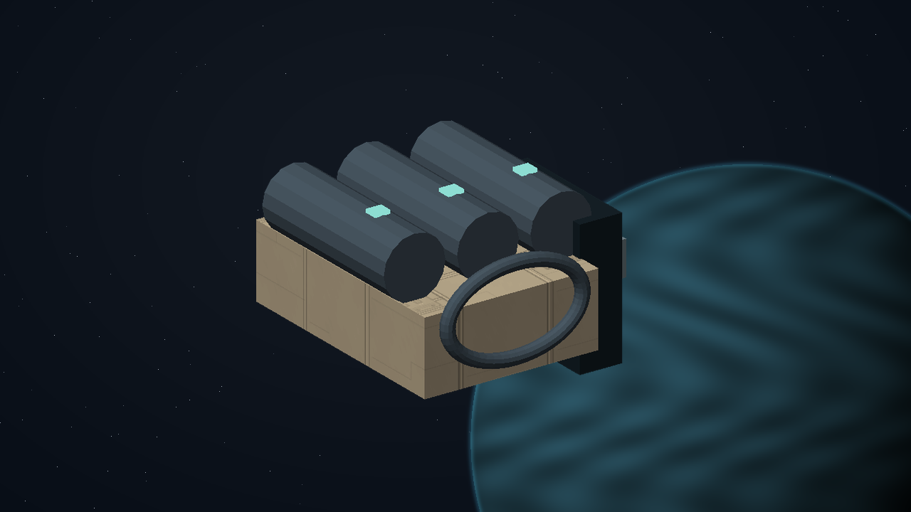

### G12 - perform

- **Event:** original_family_objective_verified
- **Target role:** registered-objective
- **Required proofs:** exact-identity-proof; physical-operation-proof
- **Objective:** Mine and refine twelve tonnes with this job's verified extraction provenance, then deliver them.
- **Dialog:** ORR: Bought ore can fill your hold, but cannot prove the extraction this receiver requested. Keep the full instance-scoped evidence and its current receiving endpoint.
- **Primary art:** ore-junction

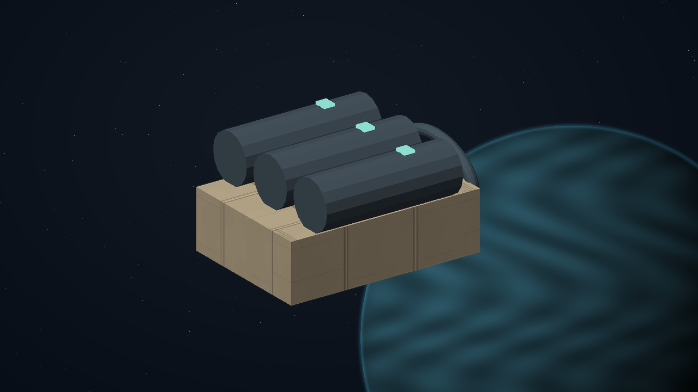

### G12 - receive

- **Event:** original_family_terminal_committed
- **Target role:** registered-receiver
- **Required proofs:** real-reception; settlement-committed
- **Objective:** Confirm the exact receiver, actual returned custody and the advertised settlement.
- **Dialog:** RECEPTION: The recorded work and its actual receiving evidence agree. The published settlement and this family's first-completion clue are committed together; later jobs cannot replace another family's clue.
- **Primary art:** ore-junction

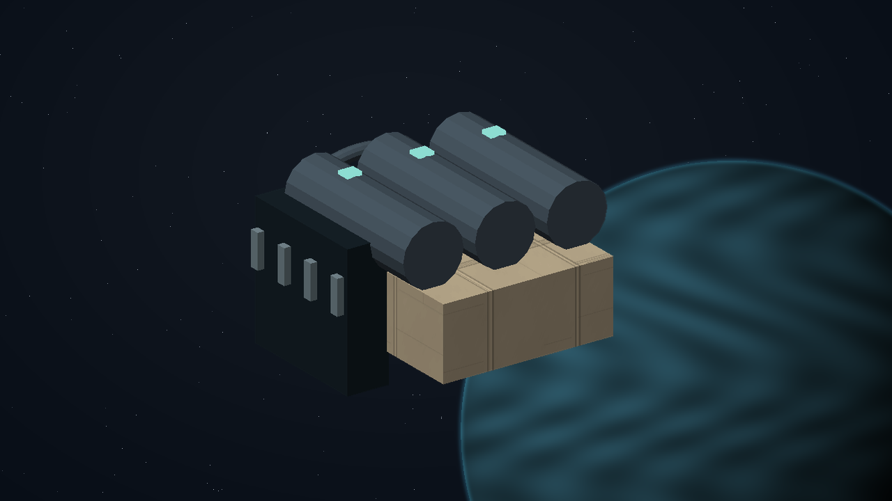

First-success clue:

- **Source:** l337.contract/measured-extraction
- **Mission title:** Measured asteroid extraction
- **Id:** measured-extraction-family-trace
- **Label:** The measured extraction trace
- **Text:** The first verified measured asteroid extraction record contains a distinct inward-curved phase imprint that predates this job and its participating equipment.
- **Award dialog:** RECEPTION: One older curved signature lies outside this job's ordinary evidence. It is preserved in your journal for the AI at PLUGH.
- **Success rule:** Only the actual verified successful terminal for this current family, including required real custody, consent, attributed combat or financial settlement. Not acceptance, incidental payment, failure, cancellation or a different family.
- **Mass tonnes:** 0
- **Award event:** successful-mission-completion-committed
- **Receipt:** l337.unwritten-route/clue/measured-extraction-family-trace
- **Duplicate rule:** Grant this source clue once per commander; repeat completions retain the same clue and never replace a missing source.
- **Branch rule:** Every legitimate successful ending grants the same source clue; abandonment, failure, voided contracts and incidental sub-rewards do not.

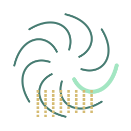

## G13 - Mutual relief contribution

**Identity:** `l337.contract/mutual-contribution`.

- **Kind:** repeatable
- **Required cargo tonnes:** 0
- **Required berths:** 0
- **Deposit cr:** 0
- **Donation cr:** 500
- **Qualification:** Visible actual fitting, consent and reachable space-station endpoints; no external pack progress, hidden rank counter or imported score gate.
- **Quote / Base cr:** 0
- **Quote / Per route leg cr:** 0
- **Quote / Hazard premium cr:** 0
- **Quote / Source:** Independent authored service budget, not source arithmetic or converted tables.
- **Clock / Deadline seconds:** 0
- **Clock / Scan seconds:** 0
- **Clock / Policy:** No undisclosed deadline. An explicitly quoted variant freezes its remaining flight-simulation budget on pause and preserves it on current-format load.
- **Encounter policy:** Use unique registered actors and items. Preserve real casualties, attributed kills, consent, full cargo provenance and named reception; culling supplies no evidence.
- **Offer dialog:** Review a voluntary 500 CR contribution to a named orbital relief reserve.
- **Clue policy:** Grant this family's one distinct permanent zero-mass clue at its first verified successful terminal. Later legitimate jobs retain it and cannot substitute for missing sources.
- **Failure policy:** Preserve losses and incomplete evidence; no payment or clue on failure. A retry requires actual new available stock/actors and a new instance. Never restore destroyed people or clone lost cargo.

### G13 - accept

- **Event:** original_family_accepted
- **Target role:** registered-issuer
- **Required proofs:** offer-confirmed; actual-fit-reserved
- **Objective:** Review a voluntary 500 CR contribution to a named orbital relief reserve.
- **Dialog:** SENN: The contribution earns no fictional cash profit. Confirm the named recipient before transferring.
- **Primary art:** exchange-dispatch-console

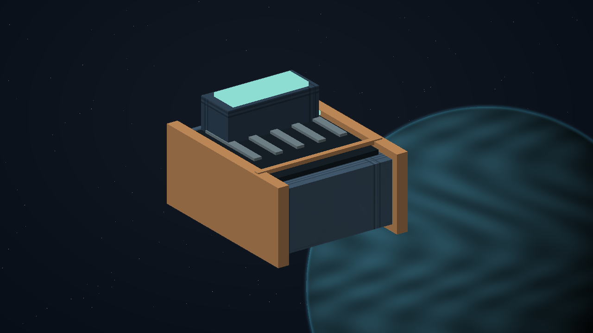

### G13 - perform

- **Event:** original_family_objective_verified
- **Target role:** registered-objective
- **Required proofs:** exact-identity-proof; physical-operation-proof
- **Objective:** Commit exactly 500 CR to its real recipient and receive the verified fund acknowledgement.
- **Dialog:** SENN: The contribution earns no fictional cash profit. Confirm the named recipient before transferring. Keep the full instance-scoped evidence and its current receiving endpoint.
- **Primary art:** exchange-dispatch-console

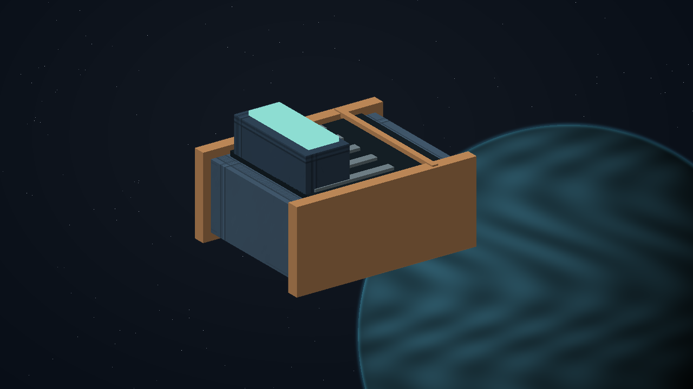

### G13 - receive

- **Event:** original_family_terminal_committed
- **Target role:** registered-receiver
- **Required proofs:** real-reception; settlement-committed
- **Objective:** Confirm the exact receiver, actual returned custody and the advertised settlement.
- **Dialog:** SENN: The relief reserve received exactly 500 CR. There is no cash reward for a donation. Its independent acknowledgement is preserved.
- **Primary art:** exchange-dispatch-console

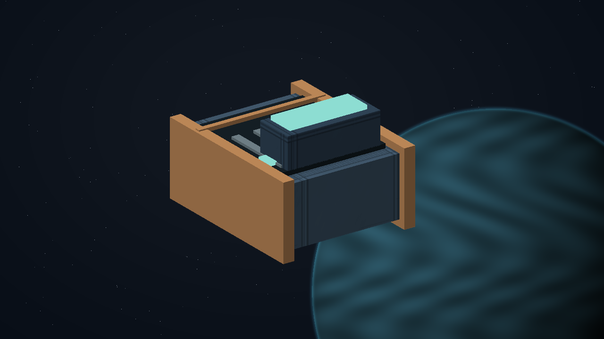

First-success clue:

- **Source:** l337.contract/mutual-contribution
- **Mission title:** Mutual relief contribution
- **Id:** mutual-contribution-family-trace
- **Label:** The mutual contribution trace
- **Text:** The first verified mutual relief contribution record contains a distinct inward-curved phase imprint that predates this job and its participating equipment.
- **Award dialog:** RECEPTION: One older curved signature lies outside this job's ordinary evidence. It is preserved in your journal for the AI at PLUGH.
- **Success rule:** Only the actual verified successful terminal for this current family, including required real custody, consent, attributed combat or financial settlement. Not acceptance, incidental payment, failure, cancellation or a different family.
- **Mass tonnes:** 0
- **Award event:** successful-mission-completion-committed
- **Receipt:** l337.unwritten-route/clue/mutual-contribution-family-trace
- **Duplicate rule:** Grant this source clue once per commander; repeat completions retain the same clue and never replace a missing source.
- **Branch rule:** Every legitimate successful ending grants the same source clue; abandonment, failure, voided contracts and incidental sub-rewards do not.

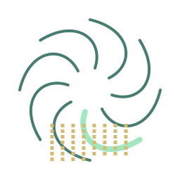

## G14 - Registered orbital evacuation

**Identity:** `l337.contract/orbital-evacuation`.

- **Kind:** repeatable
- **Required cargo tonnes:** 0
- **Required berths:** 4
- **Deposit cr:** 0
- **Donation cr:** 0
- **Qualification:** Visible actual fitting, consent and reachable space-station endpoints; no external pack progress, hidden rank counter or imported score gate.
- **Quote / Base cr:** 940
- **Quote / Per route leg cr:** 125
- **Quote / Hazard premium cr:** 80
- **Quote / Source:** Independent authored service budget, not source arithmetic or converted tables.
- **Clock / Deadline seconds:** 0
- **Clock / Scan seconds:** 0
- **Clock / Policy:** No undisclosed deadline. An explicitly quoted variant freezes its remaining flight-simulation budget on pause and preserves it on current-format load.
- **Encounter policy:** Use unique registered actors and items. Preserve real casualties, attributed kills, consent, full cargo provenance and named reception; culling supplies no evidence.
- **Offer dialog:** Reserve four fitted berths for a registered living orbital evacuation group.
- **Clue policy:** Grant this family's one distinct permanent zero-mass clue at its first verified successful terminal. Later legitimate jobs retain it and cannot substitute for missing sources.
- **Failure policy:** Preserve losses and incomplete evidence; no payment or clue on failure. A retry requires actual new available stock/actors and a new instance. Never restore destroyed people or clone lost cargo.

### G14 - accept

- **Event:** original_family_accepted
- **Target role:** registered-issuer
- **Required proofs:** offer-confirmed; actual-fit-reserved
- **Objective:** Reserve four fitted berths for a registered living orbital evacuation group.
- **Dialog:** DAIN: An arrival manifest must match the people actually aboard.
- **Primary art:** rescue-launch

### G14 - perform

- **Event:** original_family_objective_verified
- **Target role:** registered-objective
- **Required proofs:** exact-identity-proof; physical-operation-proof
- **Objective:** Bring the same consenting survivors to the verified receiving berth; preserve real losses.
- **Dialog:** DAIN: An arrival manifest must match the people actually aboard. Keep the full instance-scoped evidence and its current receiving endpoint.
- **Primary art:** rescue-launch

### G14 - receive

- **Event:** original_family_terminal_committed
- **Target role:** registered-receiver
- **Required proofs:** real-reception; settlement-committed
- **Objective:** Confirm the exact receiver, actual returned custody and the advertised settlement.
- **Dialog:** RECEPTION: The recorded work and its actual receiving evidence agree. The published settlement and this family's first-completion clue are committed together; later jobs cannot replace another family's clue.
- **Primary art:** rescue-launch

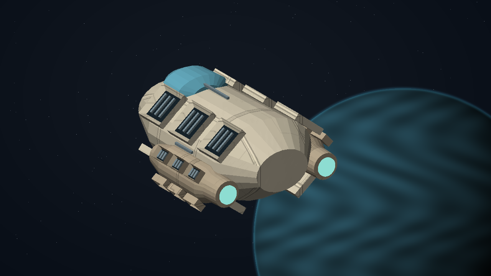

First-success clue:

- **Source:** l337.contract/orbital-evacuation
- **Mission title:** Registered orbital evacuation
- **Id:** orbital-evacuation-family-trace
- **Label:** The orbital evacuation trace
- **Text:** The first verified registered orbital evacuation record contains a distinct inward-curved phase imprint that predates this job and its participating equipment.
- **Award dialog:** RECEPTION: One older curved signature lies outside this job's ordinary evidence. It is preserved in your journal for the AI at PLUGH.
- **Success rule:** Only the actual verified successful terminal for this current family, including required real custody, consent, attributed combat or financial settlement. Not acceptance, incidental payment, failure, cancellation or a different family.
- **Mass tonnes:** 0
- **Award event:** successful-mission-completion-committed
- **Receipt:** l337.unwritten-route/clue/orbital-evacuation-family-trace
- **Duplicate rule:** Grant this source clue once per commander; repeat completions retain the same clue and never replace a missing source.
- **Branch rule:** Every legitimate successful ending grants the same source clue; abandonment, failure, voided contracts and incidental sub-rewards do not.

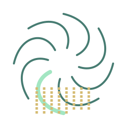

## G15 - Designated hostile Larvaal defence

**Identity:** `l337.contract/hostile-larvaal-defence`.

- **Kind:** repeatable
- **Required cargo tonnes:** 0
- **Required berths:** 0
- **Deposit cr:** 0
- **Donation cr:** 0
- **Qualification:** Visible actual fitting, consent and reachable space-station endpoints; no external pack progress, hidden rank counter or imported score gate.
- **Quote / Base cr:** 1250
- **Quote / Per route leg cr:** 150
- **Quote / Hazard premium cr:** 80
- **Quote / Source:** Independent authored service budget, not source arithmetic or converted tables.
- **Clock / Deadline seconds:** 0
- **Clock / Scan seconds:** 0
- **Clock / Policy:** No undisclosed deadline. An explicitly quoted variant freezes its remaining flight-simulation budget on pause and preserves it on current-format load.
- **Encounter policy:** Use unique registered actors and items. Preserve real casualties, attributed kills, consent, full cargo provenance and named reception; culling supplies no evidence.
- **Offer dialog:** Accept a verified corridor threat involving two registered armed hostile Larvaal actors.
- **Clue policy:** Grant this family's one distinct permanent zero-mass clue at its first verified successful terminal. Later legitimate jobs retain it and cannot substitute for missing sources.
- **Failure policy:** Preserve losses and incomplete evidence; no payment or clue on failure. A retry requires actual new available stock/actors and a new instance. Never restore destroyed people or clone lost cargo.

### G15 - accept

- **Event:** original_family_accepted
- **Target role:** registered-issuer
- **Required proofs:** offer-confirmed; actual-fit-reserved
- **Objective:** Accept a verified corridor threat involving two registered armed hostile Larvaal actors.
- **Dialog:** HOLT: Species alone does not make a target hostile. Neutral and consenting Larvaal vessels never count.
- **Primary art:** passive-receiver

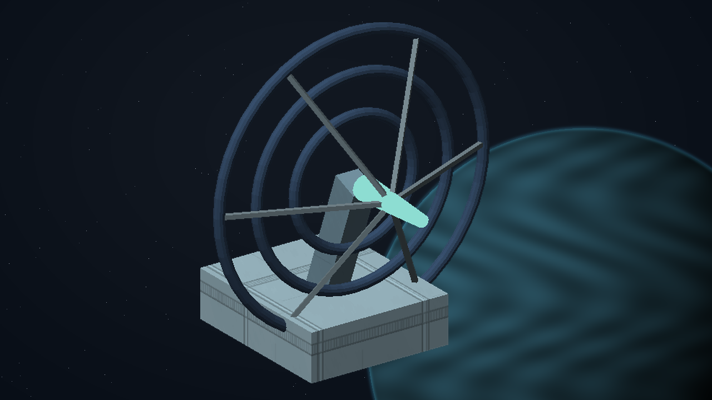

### G15 - perform

- **Event:** original_family_objective_verified
- **Target role:** registered-objective
- **Required proofs:** hostile-larvaal-a; hostile-larvaal-b; civilian-arrival
- **Objective:** Obtain two distinct player-attributed neutralisation receipts and the actual civilian safe-arrival record.
- **Dialog:** HOLT: Species alone does not make a target hostile. Neutral and consenting Larvaal vessels never count. Keep the full instance-scoped evidence and its current receiving endpoint.
- **Primary art:** passive-receiver

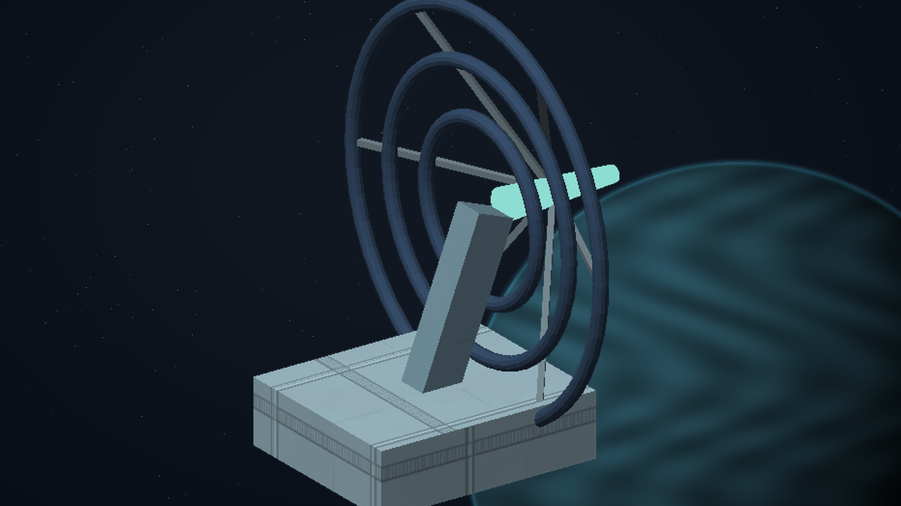

### G15 - receive

- **Event:** original_family_terminal_committed
- **Target role:** registered-receiver
- **Required proofs:** real-reception; settlement-committed
- **Objective:** Confirm the exact receiver, actual returned custody and the advertised settlement.
- **Dialog:** RECEPTION: The recorded work and its actual receiving evidence agree. The published settlement and this family's first-completion clue are committed together; later jobs cannot replace another family's clue.
- **Primary art:** passive-receiver

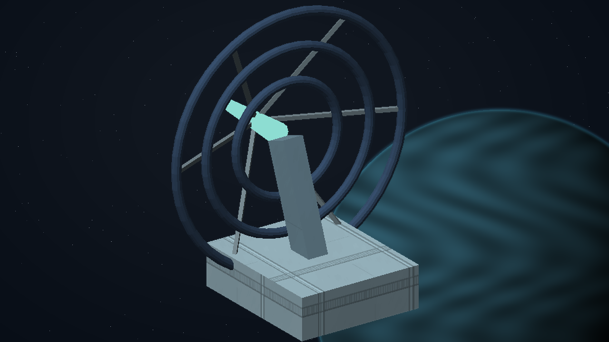

First-success clue:

- **Source:** l337.contract/hostile-larvaal-defence
- **Mission title:** Designated hostile Larvaal defence
- **Id:** hostile-larvaal-defence-family-trace
- **Label:** The hostile larvaal defence trace
- **Text:** The first verified designated hostile larvaal defence record contains a distinct inward-curved phase imprint that predates this job and its participating equipment.
- **Award dialog:** RECEPTION: One older curved signature lies outside this job's ordinary evidence. It is preserved in your journal for the AI at PLUGH.
- **Success rule:** Only the actual verified successful terminal for this current family, including required real custody, consent, attributed combat or financial settlement. Not acceptance, incidental payment, failure, cancellation or a different family.
- **Mass tonnes:** 0
- **Award event:** successful-mission-completion-committed
- **Receipt:** l337.unwritten-route/clue/hostile-larvaal-defence-family-trace
- **Duplicate rule:** Grant this source clue once per commander; repeat completions retain the same clue and never replace a missing source.
- **Branch rule:** Every legitimate successful ending grants the same source clue; abandonment, failure, voided contracts and incidental sub-rewards do not.

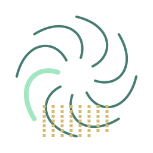

## T01 - Flight and reception practice

**Identity:** `l337.training/flight-reception`.

- **Kind:** training
- **Required cargo tonnes:** 0
- **Required berths:** 0
- **Deposit cr:** 0
- **Donation cr:** 0
- **Qualification:** Visible actual fitting, consent and reachable space-station endpoints; no external pack progress, hidden rank counter or imported score gate.
- **Quote / Base cr:** 0
- **Quote / Per route leg cr:** 0
- **Quote / Hazard premium cr:** 0
- **Quote / Source:** Independent authored service budget, not source arithmetic or converted tables.
- **Clock / Deadline seconds:** 0
- **Clock / Scan seconds:** 0
- **Clock / Policy:** No undisclosed deadline. An explicitly quoted variant freezes its remaining flight-simulation budget on pause and preserves it on current-format load.
- **Encounter policy:** Use unique registered actors and items. Preserve real casualties, attributed kills, consent, full cargo provenance and named reception; culling supplies no evidence.
- **Offer dialog:** Choose a safe orbital training berth; review throttle, roll, pitch and the shared view controls.
- **Clue policy:** Grant this family's one distinct permanent zero-mass clue at its first verified successful terminal. Later legitimate jobs retain it and cannot substitute for missing sources.
- **Failure policy:** Preserve losses and incomplete evidence; no payment or clue on failure. A retry requires actual new available stock/actors and a new instance. Never restore destroyed people or clone lost cargo.

### T01 - accept

- **Event:** original_family_accepted
- **Target role:** registered-issuer
- **Required proofs:** offer-confirmed; actual-fit-reserved
- **Objective:** Choose a safe orbital training berth; review throttle, roll, pitch and the shared view controls.
- **Dialog:** VENN: Learn with your current commander. Canceling a practice never wipes a save.
- **Primary art:** navigation-beacon

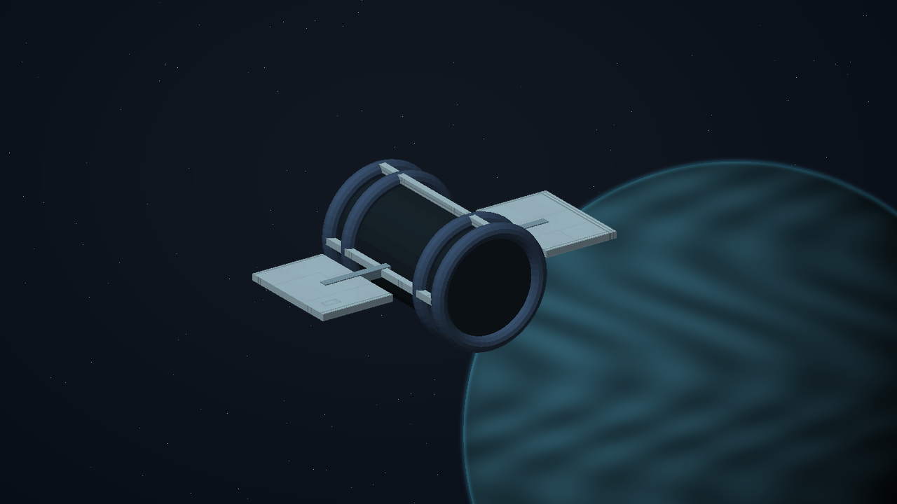

### T01 - perform

- **Event:** original_family_objective_verified
- **Target role:** registered-objective
- **Required proofs:** exact-identity-proof; physical-operation-proof
- **Objective:** Complete a bounded flight alignment, safe approach and actual training-berth reception.
- **Dialog:** VENN: Learn with your current commander. Canceling a practice never wipes a save. Keep the full instance-scoped evidence and its current receiving endpoint.
- **Primary art:** navigation-beacon

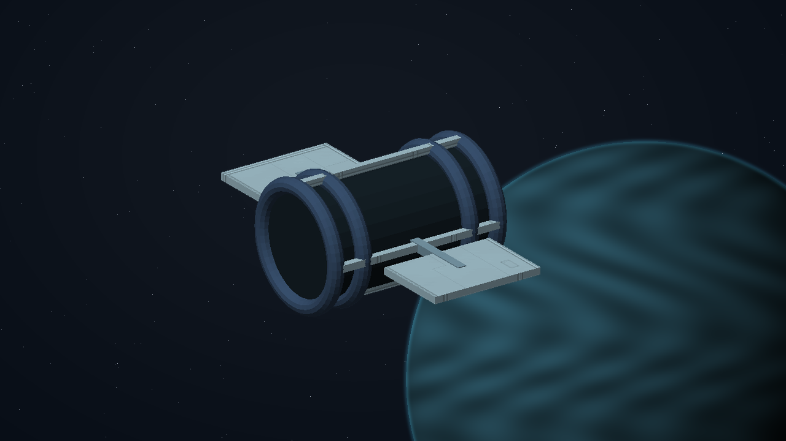

### T01 - receive

- **Event:** original_family_terminal_committed
- **Target role:** registered-receiver
- **Required proofs:** real-reception; settlement-committed
- **Objective:** Confirm the actual completed practice or trade evidence with the training berth.
- **Dialog:** RECEPTION: The recorded work and its actual receiving evidence agree. The published settlement and this family's first-completion clue are committed together; later jobs cannot replace another family's clue.
- **Primary art:** navigation-beacon

First-success clue:

- **Source:** l337.training/flight-reception
- **Mission title:** Flight and reception practice
- **Id:** flight-reception-family-trace
- **Label:** The flight reception trace
- **Text:** The first verified flight and reception practice record contains a distinct inward-curved phase imprint that predates this job and its participating equipment.
- **Award dialog:** RECEPTION: One older curved signature lies outside this job's ordinary evidence. It is preserved in your journal for the AI at PLUGH.
- **Success rule:** Only the actual verified successful terminal for this current family, including required real custody, consent, attributed combat or financial settlement. Not acceptance, incidental payment, failure, cancellation or a different family.
- **Mass tonnes:** 0
- **Award event:** successful-mission-completion-committed
- **Receipt:** l337.unwritten-route/clue/flight-reception-family-trace
- **Duplicate rule:** Grant this source clue once per commander; repeat completions retain the same clue and never replace a missing source.
- **Branch rule:** Every legitimate successful ending grants the same source clue; abandonment, failure, voided contracts and incidental sub-rewards do not.

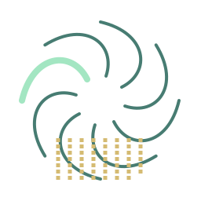

## T02 - Safe gunnery practice

**Identity:** `l337.training/safe-gunnery`.

- **Kind:** training
- **Required cargo tonnes:** 0
- **Required berths:** 0
- **Deposit cr:** 0
- **Donation cr:** 0
- **Qualification:** Visible actual fitting, consent and reachable space-station endpoints; no external pack progress, hidden rank counter or imported score gate.
- **Quote / Base cr:** 0
- **Quote / Per route leg cr:** 0
- **Quote / Hazard premium cr:** 0
- **Quote / Source:** Independent authored service budget, not source arithmetic or converted tables.
- **Clock / Deadline seconds:** 0
- **Clock / Scan seconds:** 0
- **Clock / Policy:** No undisclosed deadline. An explicitly quoted variant freezes its remaining flight-simulation budget on pause and preserves it on current-format load.
- **Encounter policy:** Use unique registered actors and items. Preserve real casualties, attributed kills, consent, full cargo provenance and named reception; culling supplies no evidence.
- **Offer dialog:** Review three clearly marked uncrewed simulated gunnery targets in an isolated orbital practice volume.
- **Clue policy:** Grant this family's one distinct permanent zero-mass clue at its first verified successful terminal. Later legitimate jobs retain it and cannot substitute for missing sources.
- **Failure policy:** Preserve losses and incomplete evidence; no payment or clue on failure. A retry requires actual new available stock/actors and a new instance. Never restore destroyed people or clone lost cargo.

### T02 - accept

- **Event:** original_family_accepted
- **Target role:** registered-issuer
- **Required proofs:** offer-confirmed; actual-fit-reserved
- **Objective:** Review three clearly marked uncrewed simulated gunnery targets in an isolated orbital practice volume.
- **Dialog:** HOLT: Practice targets award no real kill count, bounty or legal offence.
- **Primary art:** outer-watcher

### T02 - perform

- **Event:** original_family_objective_verified
- **Target role:** registered-objective
- **Required proofs:** exact-identity-proof; physical-operation-proof
- **Objective:** Verify three distinct practice hits and a safe cease-fire receipt.
- **Dialog:** HOLT: Practice targets award no real kill count, bounty or legal offence. Keep the full instance-scoped evidence and its current receiving endpoint.
- **Primary art:** outer-watcher

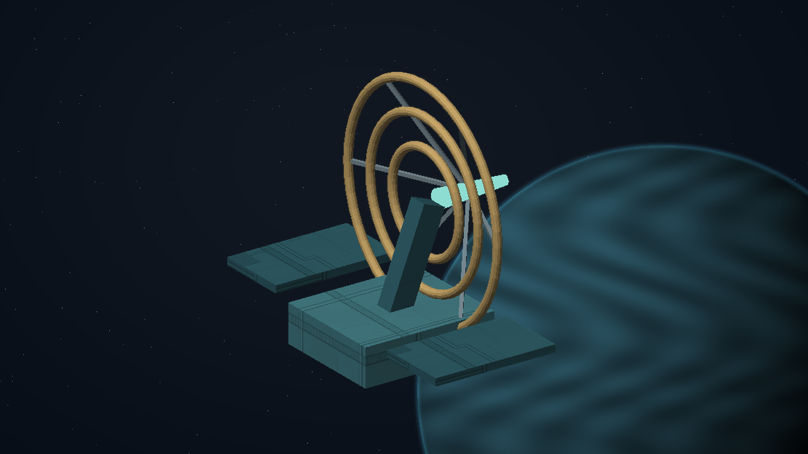

### T02 - receive

- **Event:** original_family_terminal_committed
- **Target role:** registered-receiver
- **Required proofs:** real-reception; settlement-committed
- **Objective:** Confirm the actual completed practice or trade evidence with the training berth.
- **Dialog:** RECEPTION: The recorded work and its actual receiving evidence agree. The published settlement and this family's first-completion clue are committed together; later jobs cannot replace another family's clue.
- **Primary art:** outer-watcher

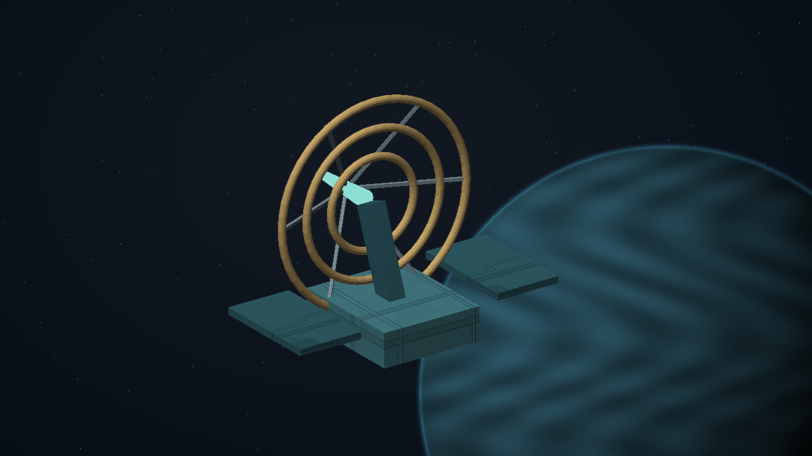

First-success clue:

- **Source:** l337.training/safe-gunnery
- **Mission title:** Safe gunnery practice
- **Id:** safe-gunnery-family-trace
- **Label:** The safe gunnery trace
- **Text:** The first verified safe gunnery practice record contains a distinct inward-curved phase imprint that predates this job and its participating equipment.
- **Award dialog:** RECEPTION: One older curved signature lies outside this job's ordinary evidence. It is preserved in your journal for the AI at PLUGH.
- **Success rule:** Only the actual verified successful terminal for this current family, including required real custody, consent, attributed combat or financial settlement. Not acceptance, incidental payment, failure, cancellation or a different family.
- **Mass tonnes:** 0
- **Award event:** successful-mission-completion-committed
- **Receipt:** l337.unwritten-route/clue/safe-gunnery-family-trace
- **Duplicate rule:** Grant this source clue once per commander; repeat completions retain the same clue and never replace a missing source.
- **Branch rule:** Every legitimate successful ending grants the same source clue; abandonment, failure, voided contracts and incidental sub-rewards do not.

## T03 - Defensive flight practice

**Identity:** `l337.training/defensive-flight`.

- **Kind:** training
- **Required cargo tonnes:** 0
- **Required berths:** 0
- **Deposit cr:** 0
- **Donation cr:** 0
- **Qualification:** Visible actual fitting, consent and reachable space-station endpoints; no external pack progress, hidden rank counter or imported score gate.
- **Quote / Base cr:** 0
- **Quote / Per route leg cr:** 0
- **Quote / Hazard premium cr:** 0
- **Quote / Source:** Independent authored service budget, not source arithmetic or converted tables.
- **Clock / Deadline seconds:** 0
- **Clock / Scan seconds:** 0
- **Clock / Policy:** No undisclosed deadline. An explicitly quoted variant freezes its remaining flight-simulation budget on pause and preserves it on current-format load.
- **Encounter policy:** Use unique registered actors and items. Preserve real casualties, attributed kills, consent, full cargo provenance and named reception; culling supplies no evidence.
- **Offer dialog:** Review an uncrewed consenting training actor and the published break-off envelope.
- **Clue policy:** Grant this family's one distinct permanent zero-mass clue at its first verified successful terminal. Later legitimate jobs retain it and cannot substitute for missing sources.
- **Failure policy:** Preserve losses and incomplete evidence; no payment or clue on failure. A retry requires actual new available stock/actors and a new instance. Never restore destroyed people or clone lost cargo.
- **Oracle native course:** Manual observation of the attempt's native centre beacon ordinal 1, not ordinary Tab/AUTO or a hardware grant. Acquire nearest unobstructed centre sight within 5 degrees for 2 continuous seconds in the approach zone. Fly ordered virtual gates (+180,0,-450)m then (-180,0,-450)m relative to centre, radius 40m, holding each 0.5s at actual speed 5-30m/s and requested signed lateral motion >=3m/s. Withdraw with nose >=150 degrees off the beacon and separation >=5m/s for 3s beyond 1100m in the cleared exit corridor. Use the three original inert uncrewed practice bodies and actual hull clearance; no AI attack or fabricated damage. Discharge or ordinary harm fails the non-firing attempt, preserving ordinary consequences. Intrusion pauses/resets the continuous window. Accept and later explicitly receive at Avenor; zero fee/deposit/reward, its own first-success clue, no T02 prerequisite.

### T03 - accept

- **Event:** original_family_accepted
- **Target role:** registered-issuer
- **Required proofs:** offer-confirmed; actual-fit-reserved
- **Objective:** Review an uncrewed consenting training actor and the published break-off envelope.
- **Dialog:** HOLT: This is a bounded training exercise. Esc leaves the practice; it does not abandon real missions.
- **Primary art:** resonance-filter

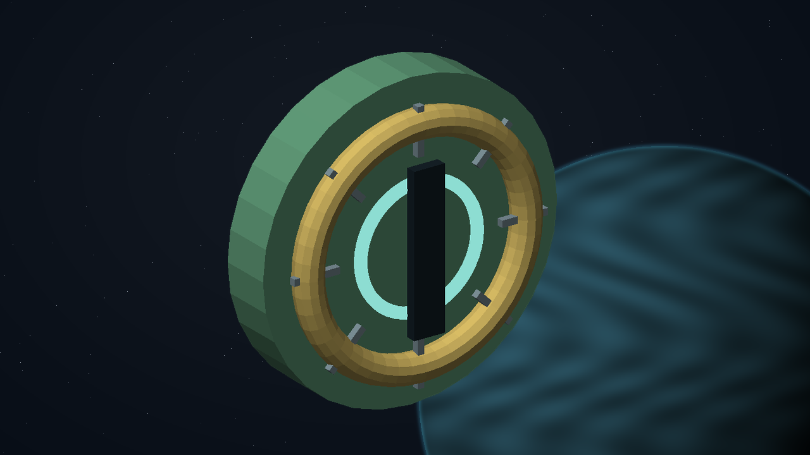

### T03 - perform

- **Event:** original_family_objective_verified
- **Target role:** registered-objective
- **Required proofs:** exact-identity-proof; physical-operation-proof
- **Objective:** Demonstrate target acquisition, controlled evasion and safe disengagement without harming ordinary traffic.
- **Dialog:** HOLT: This is a bounded training exercise. Esc leaves the practice; it does not abandon real missions. Keep the full instance-scoped evidence and its current receiving endpoint.
- **Primary art:** resonance-filter

### T03 - receive

- **Event:** original_family_terminal_committed
- **Target role:** registered-receiver
- **Required proofs:** real-reception; settlement-committed
- **Objective:** Confirm the actual completed practice or trade evidence with the training berth.
- **Dialog:** RECEPTION: The recorded work and its actual receiving evidence agree. The published settlement and this family's first-completion clue are committed together; later jobs cannot replace another family's clue.
- **Primary art:** resonance-filter

First-success clue:

- **Source:** l337.training/defensive-flight
- **Mission title:** Defensive flight practice
- **Id:** defensive-flight-family-trace
- **Label:** The defensive flight trace
- **Text:** The first verified defensive flight practice record contains a distinct inward-curved phase imprint that predates this job and its participating equipment.
- **Award dialog:** RECEPTION: One older curved signature lies outside this job's ordinary evidence. It is preserved in your journal for the AI at PLUGH.
- **Success rule:** Only the actual verified successful terminal for this current family, including required real custody, consent, attributed combat or financial settlement. Not acceptance, incidental payment, failure, cancellation or a different family.
- **Mass tonnes:** 0
- **Award event:** successful-mission-completion-committed
- **Receipt:** l337.unwritten-route/clue/defensive-flight-family-trace
- **Duplicate rule:** Grant this source clue once per commander; repeat completions retain the same clue and never replace a missing source.
- **Branch rule:** Every legitimate successful ending grants the same source clue; abandonment, failure, voided contracts and incidental sub-rewards do not.

## T04 - Navigation and trade practice

**Identity:** `l337.training/navigation-trade`.

- **Kind:** training
- **Required cargo tonnes:** 1
- **Required berths:** 0
- **Deposit cr:** 0
- **Donation cr:** 0
- **Qualification:** Visible actual fitting, consent and reachable space-station endpoints; no external pack progress, hidden rank counter or imported score gate.
- **Quote / Base cr:** 0
- **Quote / Per route leg cr:** 0
- **Quote / Hazard premium cr:** 0
- **Quote / Source:** Independent authored service budget, not source arithmetic or converted tables.
- **Clock / Deadline seconds:** 0
- **Clock / Scan seconds:** 0
- **Clock / Policy:** No undisclosed deadline. An explicitly quoted variant freezes its remaining flight-simulation budget on pause and preserves it on current-format load.
- **Encounter policy:** Use unique registered actors and items. Preserve real casualties, attributed kills, consent, full cargo provenance and named reception; culling supplies no evidence.
- **Offer dialog:** Reserve one tonne of a real legal commodity and preview a reachable original-world route.
- **Clue policy:** Grant this family's one distinct permanent zero-mass clue at its first verified successful terminal. Later legitimate jobs retain it and cannot substitute for missing sources.
- **Failure policy:** Preserve losses and incomplete evidence; no payment or clue on failure. A retry requires actual new available stock/actors and a new instance. Never restore destroyed people or clone lost cargo.

### T04 - accept

- **Event:** original_family_accepted
- **Target role:** registered-issuer
- **Required proofs:** offer-confirmed; actual-fit-reserved
- **Objective:** Reserve one tonne of a real legal commodity and preview a reachable original-world route.
- **Dialog:** SENN: Record the credits actually spent and received. The tutorial invents no profitable sale.
- **Primary art:** courier-crate

### T04 - perform

- **Event:** original_family_objective_verified
- **Target role:** registered-objective
- **Required proofs:** exact-identity-proof; physical-operation-proof
- **Objective:** Complete the selected journey and an actual sale, accounting for fuel and the real buy/sell difference.
- **Dialog:** SENN: Record the credits actually spent and received. The tutorial invents no profitable sale. Keep the full instance-scoped evidence and its current receiving endpoint.
- **Primary art:** courier-crate

### T04 - receive

- **Event:** original_family_terminal_committed
- **Target role:** registered-receiver
- **Required proofs:** real-reception; settlement-committed
- **Objective:** Confirm the actual completed practice or trade evidence with the training berth.
- **Dialog:** RECEPTION: The recorded work and its actual receiving evidence agree. The published settlement and this family's first-completion clue are committed together; later jobs cannot replace another family's clue.
- **Primary art:** courier-crate

First-success clue:

- **Source:** l337.training/navigation-trade
- **Mission title:** Navigation and trade practice
- **Id:** navigation-trade-family-trace
- **Label:** The navigation trade trace
- **Text:** The first verified navigation and trade practice record contains a distinct inward-curved phase imprint that predates this job and its participating equipment.
- **Award dialog:** RECEPTION: One older curved signature lies outside this job's ordinary evidence. It is preserved in your journal for the AI at PLUGH.
- **Success rule:** Only the actual verified successful terminal for this current family, including required real custody, consent, attributed combat or financial settlement. Not acceptance, incidental payment, failure, cancellation or a different family.
- **Mass tonnes:** 0
- **Award event:** successful-mission-completion-committed
- **Receipt:** l337.unwritten-route/clue/navigation-trade-family-trace
- **Duplicate rule:** Grant this source clue once per commander; repeat completions retain the same clue and never replace a missing source.
- **Branch rule:** Every legitimate successful ending grants the same source clue; abandonment, failure, voided contracts and incidental sub-rewards do not.

## W01 - Cold-chain clinic service

**Identity:** `l337.wayfarer-service/cold-chain`.

**Closed native profile:** Cedamar G01-S085 -> Celalen G01-S241; 2,700 armed-flight seconds from actual pickup, H0, six original stock units, shared maximum three active, 405 CR at verified receiving. Pause freezes flight time and save/load preserves the original deadline. These are existing terms for this exact native profile, not a default for all possible variants.

- **Kind:** cold-chain
- **Description:** Carry a sealed medical sample with an advertised integrity budget.
- **Required cargo tonnes:** 1
- **Required berths:** 0
- **Perishable:** yes
- **Qualification:** Accredited for advanced or hazardous variants; ordinary variants show their own equipment/capacity conditions.
- **Quote / Base cr:** 320
- **Quote / Per route leg cr:** 85
- **Quote / Hazard premium cr:** 90
- **Quote / Derivation:** Independent service budget plus reachable route legs and declared hazard tier; never imported source tables or hidden multipliers.
- **Deadline policy:** Only explicitly quoted simulation-time deadlines. Pause stops the clock; saving preserves the remainder and does not reset it.
- **Failure policy:** Preserve actual losses. A retry uses a new unique consignment from actual source stock and its own quote; no payment, restored cargo or induction clue from a failed instance.
- **Clue policy:** Grant this service family its own distinct permanent zero-mass clue on first verified successful reception. Repeat jobs retain it; never grant the induction clue or impersonate another family.
- **Custody policy:** Reserve the exact source consignment, transfer it to the player at pickup and to the actual named receiver at completion. No manufactured replacement stock.

### W01 - collect

- **Objective:** Confirm the registered source custody.
- **Event:** service_pickup_confirmed
- **Target role:** registered-source
- **Receipt scope:** Current service instance and unique consignment
- **Primary art:** clinic-cold-crate

### W01 - deliver

- **Objective:** Carry a sealed medical sample with an advertised integrity budget.
- **Event:** service_objective_verified
- **Target role:** registered-objective
- **Receipt scope:** Current service instance and unique consignment
- **Primary art:** clinic-cold-crate

### W01 - receive

- **Objective:** Commit the exact qualifying receiver and payment receipt.
- **Event:** service_receipt_confirmed
- **Target role:** registered-receiver
- **Receipt scope:** Current service instance and unique consignment
- **Primary art:** clinic-cold-crate

First-success clue:

- **Source:** l337.wayfarer-service/cold-chain
- **Mission title:** Cold-chain clinic service
- **Id:** exchange-service-cold-chain
- **Label:** The cold chain trace
- **Text:** The first verified cold-chain clinic service receiving record carries a distinct inward-curved phase mark predating this consignment.
- **Award dialog:** SENN: This service is received and paid. Its older curved signature is copied to your journal; later work keeps the same clue rather than replacing another family.
- **Mass tonnes:** 0
- **Award event:** successful-mission-completion-committed
- **Receipt:** l337.unwritten-route/clue/exchange-service-cold-chain
- **Duplicate rule:** Grant this source clue once per commander; repeat completions retain the same clue and never replace a missing source.
- **Branch rule:** Every legitimate successful ending grants the same source clue; abandonment, failure, voided contracts and incidental sub-rewards do not.

## W02 - Closed repair exchange

**Identity:** `l337.wayfarer-service/repair-loop`.

- **Kind:** repair-loop
- **Description:** Carry an identified failed unit to its workshop and return the serviced unit to its registered owner.
- **Required cargo tonnes:** 2
- **Required berths:** 0
- **Perishable:** no
- **Qualification:** Accredited for advanced or hazardous variants; ordinary variants show their own equipment/capacity conditions.
- **Quote / Base cr:** 430
- **Quote / Per route leg cr:** 90
- **Quote / Hazard premium cr:** 80
- **Quote / Derivation:** Independent service budget plus reachable route legs and declared hazard tier; never imported source tables or hidden multipliers.
- **Deadline policy:** Only explicitly quoted simulation-time deadlines. Pause stops the clock; saving preserves the remainder and does not reset it.
- **Failure policy:** Preserve actual losses. A retry uses a new unique consignment from actual source stock and its own quote; no payment, restored cargo or induction clue from a failed instance.
- **Clue policy:** Grant this service family its own distinct permanent zero-mass clue on first verified successful reception. Repeat jobs retain it; never grant the induction clue or impersonate another family.
- **Custody policy:** Reserve the exact source consignment, transfer it to the player at pickup and to the actual named receiver at completion. No manufactured replacement stock.
- **Route policy:** Quote the complete source-to-workshop-to-original-owner loop. The work stage verifies the same serial unit was serviced at the named workshop; final reception is at its original owner.

### W02 - collect

- **Objective:** Confirm the registered source custody.
- **Event:** service_pickup_confirmed
- **Target role:** registered-source
- **Receipt scope:** Current service instance and unique consignment
- **Primary art:** return-cassette

### W02 - service

- **Objective:** Carry an identified failed unit to its workshop and return the serviced unit to its registered owner.
- **Event:** service_objective_verified
- **Target role:** registered-objective
- **Receipt scope:** Current service instance and unique consignment
- **Primary art:** return-cassette

### W02 - receive

- **Objective:** Commit the exact qualifying receiver and payment receipt.
- **Event:** service_receipt_confirmed
- **Target role:** registered-receiver
- **Receipt scope:** Current service instance and unique consignment
- **Primary art:** return-cassette

First-success clue:

- **Source:** l337.wayfarer-service/repair-loop
- **Mission title:** Closed repair exchange
- **Id:** exchange-service-repair-loop
- **Label:** The repair loop trace
- **Text:** The first verified closed repair exchange receiving record carries a distinct inward-curved phase mark predating this consignment.
- **Award dialog:** SENN: This service is received and paid. Its older curved signature is copied to your journal; later work keeps the same clue rather than replacing another family.
- **Mass tonnes:** 0
- **Award event:** successful-mission-completion-committed
- **Receipt:** l337.unwritten-route/clue/exchange-service-repair-loop
- **Duplicate rule:** Grant this source clue once per commander; repeat completions retain the same clue and never replace a missing source.
- **Branch rule:** Every legitimate successful ending grants the same source clue; abandonment, failure, voided contracts and incidental sub-rewards do not.

## W03 - Seed-bank transfer

**Identity:** `l337.wayfarer-service/seed-transfer`.

**Closed native profile:** Celalen G01-S241 -> Cedamar G01-S085; 2,700 armed-flight seconds from actual pickup, H0, six original stock units, shared maximum three active, 605 CR at verified receiving. Pause freezes flight time and save/load preserves the original deadline. These are existing terms for this exact native profile, not a default for all possible variants.

- **Kind:** seed-transfer
- **Description:** Transfer a consented seed consignment between independent custodians.
- **Required cargo tonnes:** 3
- **Required berths:** 0
- **Perishable:** yes
- **Qualification:** Accredited for advanced or hazardous variants; ordinary variants show their own equipment/capacity conditions.
- **Quote / Base cr:** 510
- **Quote / Per route leg cr:** 95
- **Quote / Hazard premium cr:** 110
- **Quote / Derivation:** Independent service budget plus reachable route legs and declared hazard tier; never imported source tables or hidden multipliers.
- **Deadline policy:** Only explicitly quoted simulation-time deadlines. Pause stops the clock; saving preserves the remainder and does not reset it.
- **Failure policy:** Preserve actual losses. A retry uses a new unique consignment from actual source stock and its own quote; no payment, restored cargo or induction clue from a failed instance.
- **Clue policy:** Grant this service family its own distinct permanent zero-mass clue on first verified successful reception. Repeat jobs retain it; never grant the induction clue or impersonate another family.
- **Custody policy:** Reserve the exact source consignment, transfer it to the player at pickup and to the actual named receiver at completion. No manufactured replacement stock.

### W03 - collect

- **Objective:** Confirm the registered source custody.
- **Event:** service_pickup_confirmed
- **Target role:** registered-source
- **Receipt scope:** Current service instance and unique consignment
- **Primary art:** seed-transfer-case

### W03 - deliver

- **Objective:** Transfer a consented seed consignment between independent custodians.
- **Event:** service_objective_verified
- **Target role:** registered-objective
- **Receipt scope:** Current service instance and unique consignment
- **Primary art:** seed-transfer-case

### W03 - receive

- **Objective:** Commit the exact qualifying receiver and payment receipt.
- **Event:** service_receipt_confirmed
- **Target role:** registered-receiver
- **Receipt scope:** Current service instance and unique consignment
- **Primary art:** seed-transfer-case

First-success clue:

- **Source:** l337.wayfarer-service/seed-transfer
- **Mission title:** Seed-bank transfer
- **Id:** exchange-service-seed-transfer
- **Label:** The seed transfer trace
- **Text:** The first verified seed-bank transfer receiving record carries a distinct inward-curved phase mark predating this consignment.
- **Award dialog:** SENN: This service is received and paid. Its older curved signature is copied to your journal; later work keeps the same clue rather than replacing another family.
- **Mass tonnes:** 0
- **Award event:** successful-mission-completion-committed
- **Receipt:** l337.unwritten-route/clue/exchange-service-seed-transfer
- **Duplicate rule:** Grant this source clue once per commander; repeat completions retain the same clue and never replace a missing source.
- **Branch rule:** Every legitimate successful ending grants the same source clue; abandonment, failure, voided contracts and incidental sub-rewards do not.

## W04 - Remote utility relief

**Identity:** `l337.wayfarer-service/field-relief`.

- **Kind:** field-relief
- **Description:** Deliver actual repair materials to a remote utility receiving crew and verify their service handoff.
- **Required cargo tonnes:** 4
- **Required berths:** 0
- **Perishable:** no
- **Qualification:** Accredited for advanced or hazardous variants; ordinary variants show their own equipment/capacity conditions.
- **Quote / Base cr:** 610
- **Quote / Per route leg cr:** 110
- **Quote / Hazard premium cr:** 120
- **Quote / Derivation:** Independent service budget plus reachable route legs and declared hazard tier; never imported source tables or hidden multipliers.
- **Deadline policy:** Only explicitly quoted simulation-time deadlines. Pause stops the clock; saving preserves the remainder and does not reset it.
- **Failure policy:** Preserve actual losses. A retry uses a new unique consignment from actual source stock and its own quote; no payment, restored cargo or induction clue from a failed instance.
- **Clue policy:** Grant this service family its own distinct permanent zero-mass clue on first verified successful reception. Repeat jobs retain it; never grant the induction clue or impersonate another family.
- **Custody policy:** Reserve the exact source consignment, transfer it to the player at pickup and to the actual named receiver at completion. No manufactured replacement stock.

### W04 - collect

- **Objective:** Confirm the registered source custody.
- **Event:** service_pickup_confirmed
- **Target role:** registered-source
- **Receipt scope:** Current service instance and unique consignment
- **Primary art:** utility-service-pallet

### W04 - install

- **Objective:** Deliver actual repair materials to a remote utility receiving crew and verify their service handoff.
- **Event:** service_objective_verified
- **Target role:** registered-objective
- **Receipt scope:** Current service instance and unique consignment
- **Primary art:** utility-service-pallet

### W04 - receive

- **Objective:** Commit the exact qualifying receiver and payment receipt.
- **Event:** service_receipt_confirmed
- **Target role:** registered-receiver
- **Receipt scope:** Current service instance and unique consignment
- **Primary art:** utility-service-pallet

First-success clue:

- **Source:** l337.wayfarer-service/field-relief
- **Mission title:** Remote utility relief
- **Id:** exchange-service-field-relief
- **Label:** The field relief trace
- **Text:** The first verified remote utility relief receiving record carries a distinct inward-curved phase mark predating this consignment.
- **Award dialog:** SENN: This service is received and paid. Its older curved signature is copied to your journal; later work keeps the same clue rather than replacing another family.
- **Mass tonnes:** 0
- **Award event:** successful-mission-completion-committed
- **Receipt:** l337.unwritten-route/clue/exchange-service-field-relief
- **Duplicate rule:** Grant this source clue once per commander; repeat completions retain the same clue and never replace a missing source.
- **Branch rule:** Every legitimate successful ending grants the same source clue; abandonment, failure, voided contracts and incidental sub-rewards do not.

## W05 - Crew record recovery

**Identity:** `l337.wayfarer-service/record-recovery`.

- **Kind:** record-recovery
- **Description:** Recover a specific flight/custody recorder without treating cargo wreckage as a living survivor.
- **Required cargo tonnes:** 1
- **Required berths:** 0
- **Perishable:** no
- **Qualification:** Accredited for advanced or hazardous variants; ordinary variants show their own equipment/capacity conditions.
- **Quote / Base cr:** 460
- **Quote / Per route leg cr:** 95
- **Quote / Hazard premium cr:** 130
- **Quote / Derivation:** Independent service budget plus reachable route legs and declared hazard tier; never imported source tables or hidden multipliers.
- **Deadline policy:** Only explicitly quoted simulation-time deadlines. Pause stops the clock; saving preserves the remainder and does not reset it.
- **Failure policy:** Preserve actual losses. A retry uses a new unique consignment from actual source stock and its own quote; no payment, restored cargo or induction clue from a failed instance.
- **Clue policy:** Grant this service family its own distinct permanent zero-mass clue on first verified successful reception. Repeat jobs retain it; never grant the induction clue or impersonate another family.
- **Custody policy:** Identification alone leaves the recorder at its unique wreck cradle. Recovery transfers it once to the player; final reception transfers that same recorder to its custodian.

### W05 - locate

- **Objective:** Locate and identify the unique physical recorder; leave it in the wreck cradle until recovery.
- **Event:** service_objective_verified
- **Target role:** registered-objective
- **Receipt scope:** Current service instance and unique consignment
- **Primary art:** crew-custody-recorder

### W05 - recover

- **Objective:** Recover a specific flight/custody recorder without treating cargo wreckage as a living survivor.
- **Event:** service_pickup_confirmed
- **Target role:** registered-source
- **Receipt scope:** Current service instance and unique consignment
- **Primary art:** crew-custody-recorder

### W05 - receive

- **Objective:** Commit the exact qualifying receiver and payment receipt.
- **Event:** service_receipt_confirmed
- **Target role:** registered-receiver
- **Receipt scope:** Current service instance and unique consignment
- **Primary art:** crew-custody-recorder

First-success clue:

- **Source:** l337.wayfarer-service/record-recovery
- **Mission title:** Crew record recovery
- **Id:** exchange-service-record-recovery
- **Label:** The record recovery trace
- **Text:** The first verified crew record recovery receiving record carries a distinct inward-curved phase mark predating this consignment.
- **Award dialog:** SENN: This service is received and paid. Its older curved signature is copied to your journal; later work keeps the same clue rather than replacing another family.
- **Mass tonnes:** 0
- **Award event:** successful-mission-completion-committed
- **Receipt:** l337.unwritten-route/clue/exchange-service-record-recovery
- **Duplicate rule:** Grant this source clue once per commander; repeat completions retain the same clue and never replace a missing source.
- **Branch rule:** Every legitimate successful ending grants the same source clue; abandonment, failure, voided contracts and incidental sub-rewards do not.

## W06 - Registered convoy watch

**Identity:** `l337.wayfarer-service/convoy-watch`.

- **Kind:** convoy-watch
- **Description:** Escort the exact registered convoy and require the receiver's real cargo and arrival record.
- **Required cargo tonnes:** 0
- **Required berths:** 0
- **Perishable:** no
- **Qualification:** Accredited for advanced or hazardous variants; ordinary variants show their own equipment/capacity conditions.
- **Quote / Base cr:** 700
- **Quote / Per route leg cr:** 120
- **Quote / Hazard premium cr:** 170
- **Quote / Derivation:** Independent service budget plus reachable route legs and declared hazard tier; never imported source tables or hidden multipliers.
- **Deadline policy:** Only explicitly quoted simulation-time deadlines. Pause stops the clock; saving preserves the remainder and does not reset it.
- **Failure policy:** Preserve actual losses. A retry uses a new unique consignment from actual source stock and its own quote; no payment, restored cargo or induction clue from a failed instance.
- **Clue policy:** Grant this service family its own distinct permanent zero-mass clue on first verified successful reception. Repeat jobs retain it; never grant the induction clue or impersonate another family.
- **Custody policy:** Cargo remains aboard the identified convoy. Registration neither moves it into the player hold nor clones it. A living registered convoy and its actual cargo must reach reception.

### W06 - register

- **Objective:** Confirm the registered source custody.
- **Event:** service_pickup_confirmed
- **Target role:** registered-source
- **Receipt scope:** Current service instance and unique consignment
- **Primary art:** convoy-receipt-beacon

### W06 - escort

- **Objective:** Escort the exact registered convoy and require the receiver's real cargo and arrival record.
- **Event:** service_objective_verified
- **Target role:** registered-objective
- **Receipt scope:** Current service instance and unique consignment
- **Primary art:** convoy-receipt-beacon

### W06 - receive

- **Objective:** Commit the exact qualifying receiver and payment receipt.
- **Event:** service_receipt_confirmed
- **Target role:** registered-receiver
- **Receipt scope:** Current service instance and unique consignment
- **Primary art:** convoy-receipt-beacon

First-success clue:

- **Source:** l337.wayfarer-service/convoy-watch
- **Mission title:** Registered convoy watch
- **Id:** exchange-service-convoy-watch
- **Label:** The convoy watch trace
- **Text:** The first verified registered convoy watch receiving record carries a distinct inward-curved phase mark predating this consignment.
- **Award dialog:** SENN: This service is received and paid. Its older curved signature is copied to your journal; later work keeps the same clue rather than replacing another family.
- **Mass tonnes:** 0
- **Award event:** successful-mission-completion-committed
- **Receipt:** l337.unwritten-route/clue/exchange-service-convoy-watch
- **Duplicate rule:** Grant this source clue once per commander; repeat completions retain the same clue and never replace a missing source.
- **Branch rule:** Every legitimate successful ending grants the same source clue; abandonment, failure, voided contracts and incidental sub-rewards do not.

