# L337 mission artwork - complete visual reference

Spoiler-complete companion to [the finished-game oracle](FINAL-GAME-ORACLE.md). All758 original assets remain present with their original bytes. The [revised-mission artwork](missions/gameplay/REVISED-MISSION-ARTWORK.md) adds 40 operation and narrative graphics, bringing the current inventory to 798. Source hashes, dimensions and methods are in [the provenance manifest](ASSET-PROVENANCE.json).

## Clue

### meridian-offset

The missing instant.

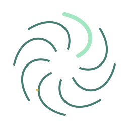

### choir-silent-voice

The silent voice.

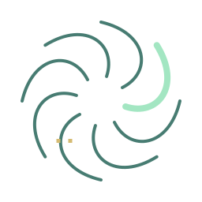

### manifest-hidden-imprint

The inward mark.

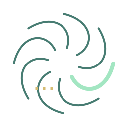

### lantern-extra-echo

The extra lantern.

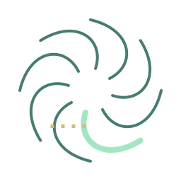

### courier-empty-destination

The empty destination.

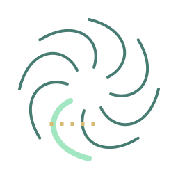

### voice-unclaimed-channel

The unclaimed channel.

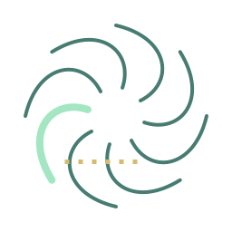

### wake-before-impact

The curve before the fall.

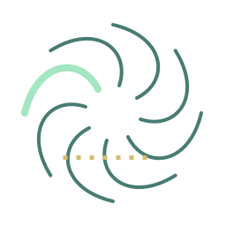

### tithe-unclaimed-reserve

The unclaimed reserve.

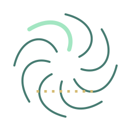

### current-resting-arc

The resting arc.

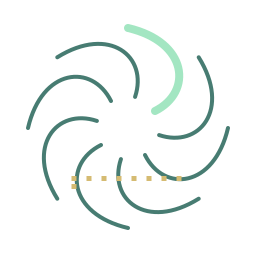

### exchange-unbooked-window

The unbooked window.

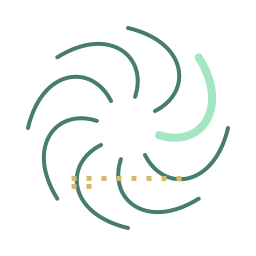

### quiet-nursery-trace

The breath between readings.

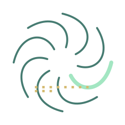

### borrowed-dawn-trace

The unlit interval.

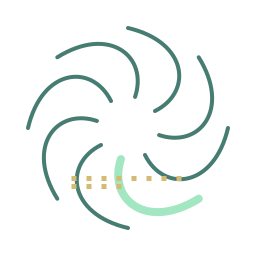

### open-shadow-trace

The shadow with no hull.

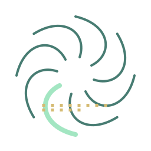

### harbour-without-orders-trace

The unsigned berth.

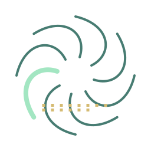

### false-colours-trace

The seal before the key.

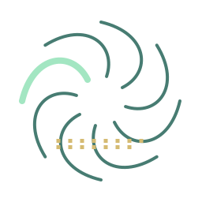

### rubble-covenant-trace

The hollow mass.

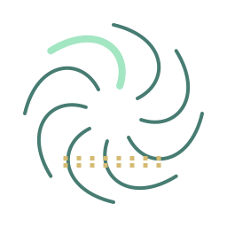

### garden-in-transit-trace

The dormant season.

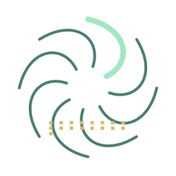

### warrant-ledger-trace

The unwritten warrant.

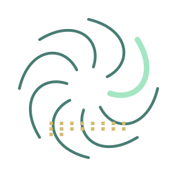

### measure-of-care-trace

The temperature of silence.

### long-return-trace

The passenger never booked.

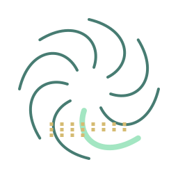

### unfinished-map-trace

The margin beyond the map.

### blue-reservoir-trace

The dry current.

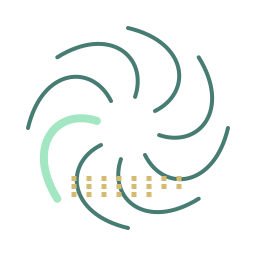

### mutual-shelter-trace

The ownerless reserve.

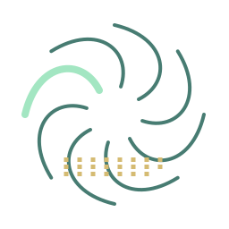

### listening-frontier-trace

The voice outside the channel.

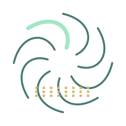

### assembly-of-orbits-trace

The absent seat.

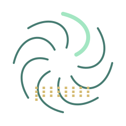

### under-tow-trace

The coupling without a vessel.

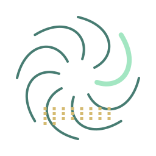

### memory-atlas-trace

The place nobody remembers.

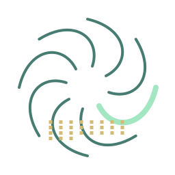

### fleet-of-neighbours-trace

The formation with no centre.

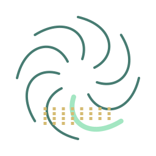

### uncounted-names-trace

The unnamed entry.

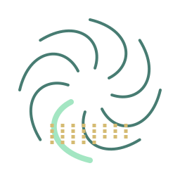

### honest-circuit-trace

The tick outside the circuit.

### small-lights-trace

The light before the fault.

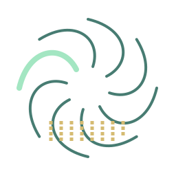

### passengers-horizon-trace

The horizon without a world.

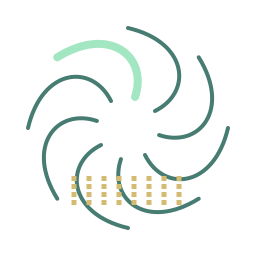

### kind-distance-trace

The reply with no sender.

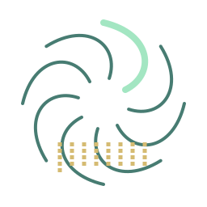

### cold-reserve-trace

The unused order.

### magnetic-orchard-trace

The root without a stem.

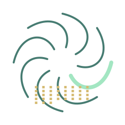

### open-measure-trace

The reference without a load.

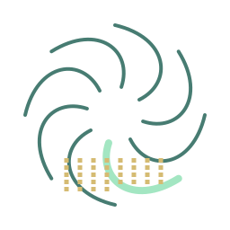

### shared-pulse-trace

The pulse before the reply.

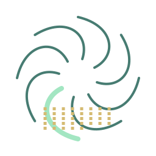

### witness-window-trace

The frame nobody recorded.

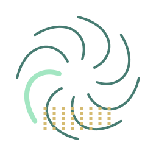

### public-record-trace

The unreported frequency.

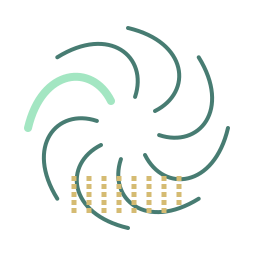

### sealed-dispatch-family-trace

The sealed dispatch trace.

### consented-freight-family-trace

The consented freight trace.

### bonded-freight-family-trace

The bonded freight trace.

### cabin-journey-family-trace

The cabin journey trace.

### orbital-outlook-family-trace

The orbital outlook trace.

### verified-warrant-family-trace

The verified warrant trace.

### corridor-defence-family-trace

The corridor defence trace.

### custody-rescue-family-trace

The custody rescue trace.

### identified-salvage-family-trace

The identified salvage trace.

### consented-survey-family-trace

The consented survey trace.

### isolation-work-family-trace

The isolation work trace.

### measured-extraction-family-trace

The measured extraction trace.

### mutual-contribution-family-trace

The mutual contribution trace.

### orbital-evacuation-family-trace

The orbital evacuation trace.

### hostile-larvaal-defence-family-trace

The hostile larvaal defence trace.

### flight-reception-family-trace

The flight reception trace.

### safe-gunnery-family-trace

The safe gunnery trace.

### defensive-flight-family-trace

The defensive flight trace.

### navigation-trade-family-trace

The navigation trade trace.

### exchange-service-cold-chain

The cold chain trace.

### exchange-service-repair-loop

The repair loop trace.

### exchange-service-seed-transfer

The seed transfer trace.

### exchange-service-field-relief

The field relief trace.

### exchange-service-record-recovery

The record recovery trace.

### exchange-service-convoy-watch

The convoy watch trace.

## Contract Stage

### l337.wayfarer-service/cold-chain/collect

Cold-chain clinic service / collect.

### l337.wayfarer-service/cold-chain/deliver

Cold-chain clinic service / deliver.

### l337.wayfarer-service/cold-chain/receive

Cold-chain clinic service / receive.

### l337.wayfarer-service/repair-loop/collect

Closed repair exchange / collect.

### l337.wayfarer-service/repair-loop/service

Closed repair exchange / service.

### l337.wayfarer-service/repair-loop/receive

Closed repair exchange / receive.

### l337.wayfarer-service/seed-transfer/collect

Seed-bank transfer / collect.

### l337.wayfarer-service/seed-transfer/deliver

Seed-bank transfer / deliver.

### l337.wayfarer-service/seed-transfer/receive

Seed-bank transfer / receive.

### l337.wayfarer-service/field-relief/collect

Remote utility relief / collect.

### l337.wayfarer-service/field-relief/install

Remote utility relief / install.

### l337.wayfarer-service/field-relief/receive

Remote utility relief / receive.

### l337.wayfarer-service/record-recovery/locate

Crew record recovery / locate.

### l337.wayfarer-service/record-recovery/recover

Crew record recovery / recover.

### l337.wayfarer-service/record-recovery/receive

Crew record recovery / receive.

### l337.wayfarer-service/convoy-watch/register

Registered convoy watch / register.

### l337.wayfarer-service/convoy-watch/escort

Registered convoy watch / escort.

### l337.wayfarer-service/convoy-watch/receive

Registered convoy watch / receive.

### l337.contract/sealed-dispatch/accept

Sealed dispatch / accept.

### l337.contract/sealed-dispatch/perform

Sealed dispatch / perform.

### l337.contract/sealed-dispatch/receive

Sealed dispatch / receive.

### l337.contract/consented-freight/accept

Consented freight supply / accept.

### l337.contract/consented-freight/perform

Consented freight supply / perform.

### l337.contract/consented-freight/receive

Consented freight supply / receive.

### l337.contract/bonded-freight/accept

Bonded freight passage / accept.

### l337.contract/bonded-freight/perform

Bonded freight passage / perform.

### l337.contract/bonded-freight/receive

Bonded freight passage / receive.

### l337.contract/cabin-journey/accept

Consented cabin journey / accept.

### l337.contract/cabin-journey/perform

Consented cabin journey / perform.

### l337.contract/cabin-journey/receive

Consented cabin journey / receive.

### l337.contract/orbital-outlook/accept

Orbital outlook journey / accept.

### l337.contract/orbital-outlook/perform

Orbital outlook journey / perform.

### l337.contract/orbital-outlook/receive

Orbital outlook journey / receive.

### l337.contract/verified-warrant/accept

Verified hostile warrant / accept.

### l337.contract/verified-warrant/perform

Verified hostile warrant / perform.

### l337.contract/verified-warrant/receive

Verified hostile warrant / receive.

### l337.contract/corridor-defence/accept

Registered corridor defence / accept.

### l337.contract/corridor-defence/perform

Registered corridor defence / perform.

### l337.contract/corridor-defence/receive

Registered corridor defence / receive.

### l337.contract/custody-rescue/accept

Consented custody rescue / accept.

### l337.contract/custody-rescue/perform

Consented custody rescue / perform.

### l337.contract/custody-rescue/receive

Consented custody rescue / receive.

### l337.contract/identified-salvage/accept

Identified salvage return / accept.

### l337.contract/identified-salvage/perform

Identified salvage return / perform.

### l337.contract/identified-salvage/receive

Identified salvage return / receive.

### l337.contract/consented-survey/accept

Consented orbital survey / accept.

### l337.contract/consented-survey/perform

Consented orbital survey / perform.

### l337.contract/consented-survey/receive

Consented orbital survey / receive.

### l337.contract/isolation-work/accept

External isolation work / accept.

### l337.contract/isolation-work/perform

External isolation work / perform.

### l337.contract/isolation-work/receive

External isolation work / receive.

### l337.contract/measured-extraction/accept

Measured asteroid extraction / accept.

### l337.contract/measured-extraction/perform

Measured asteroid extraction / perform.

### l337.contract/measured-extraction/receive

Measured asteroid extraction / receive.

### l337.contract/mutual-contribution/accept

Mutual relief contribution / accept.

### l337.contract/mutual-contribution/perform

Mutual relief contribution / perform.

### l337.contract/mutual-contribution/receive

Mutual relief contribution / receive.

### l337.contract/orbital-evacuation/accept

Registered orbital evacuation / accept.

### l337.contract/orbital-evacuation/perform

Registered orbital evacuation / perform.

### l337.contract/orbital-evacuation/receive

Registered orbital evacuation / receive.

### l337.contract/hostile-larvaal-defence/accept

Designated hostile Larvaal defence / accept.

### l337.contract/hostile-larvaal-defence/perform

Designated hostile Larvaal defence / perform.

### l337.contract/hostile-larvaal-defence/receive

Designated hostile Larvaal defence / receive.

### l337.training/flight-reception/accept

Flight and reception practice / accept.

### l337.training/flight-reception/perform

Flight and reception practice / perform.

### l337.training/flight-reception/receive

Flight and reception practice / receive.

### l337.training/safe-gunnery/accept

Safe gunnery practice / accept.

### l337.training/safe-gunnery/perform

Safe gunnery practice / perform.

### l337.training/safe-gunnery/receive

Safe gunnery practice / receive.

### l337.training/defensive-flight/accept

Defensive flight practice / accept.

### l337.training/defensive-flight/perform

Defensive flight practice / perform.

### l337.training/defensive-flight/receive

Defensive flight practice / receive.

### l337.training/navigation-trade/accept

Navigation and trade practice / accept.

### l337.training/navigation-trade/perform

Navigation and trade practice / perform.

### l337.training/navigation-trade/receive

Navigation and trade practice / receive.

## Decal

### hearth-compact-decal-light

Permanent commission decal: light keyline.

### hearth-compact-decal-dark

Permanent commission decal: dark keyline.

## Decal Preview

### hearth-compact-hull-preview

Peregrine Mk III permanent commission marking.

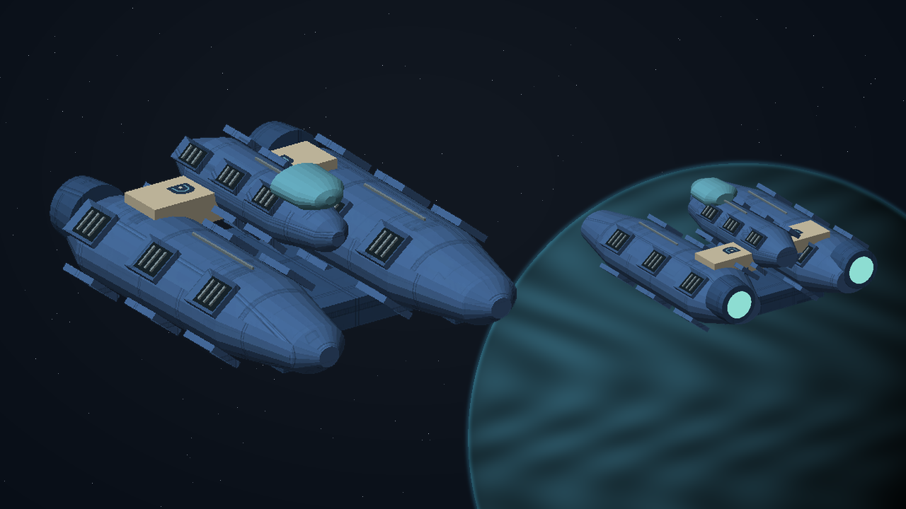

## Hull

### SH001

Mule.

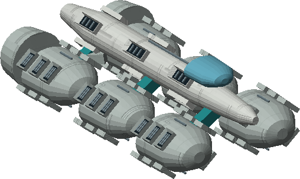

### SH004

Gyrfalcon Patrol.

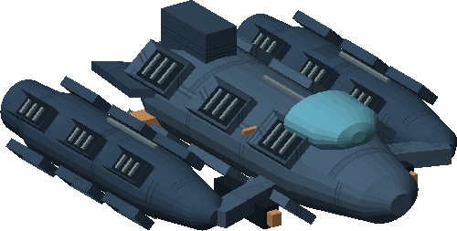

### SH005

Bison.

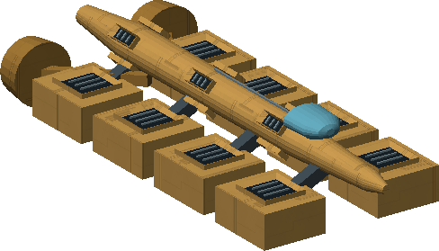

### SH023

Peregrine Mk III.

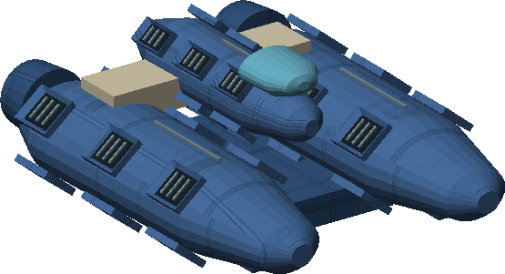

### SH026

Harrier.

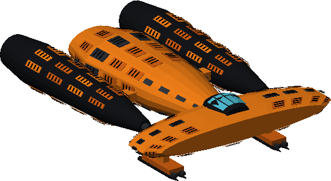

### SH049

Hyena.

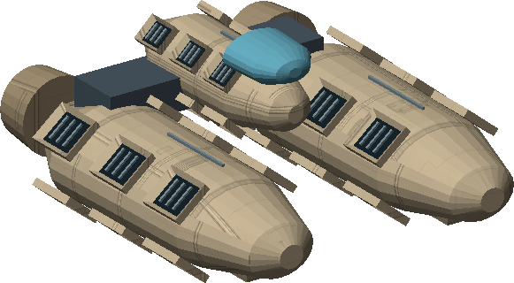

### SH061

Haflinger.

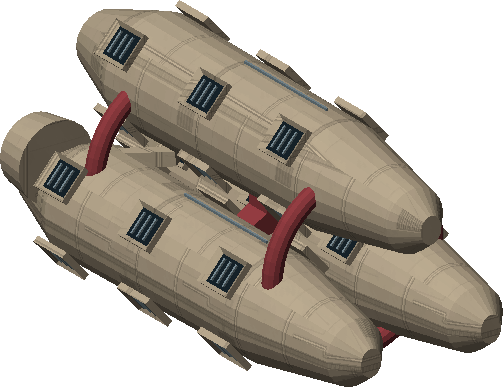

### SH124

Larvaal Warship.

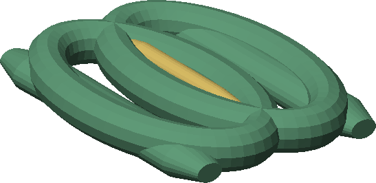

### SH125

Larvaal Drone.

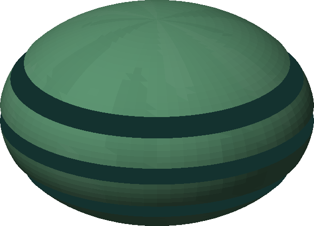

### SH162

Larvaal Probe.

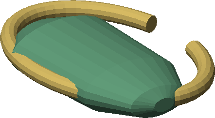

### SH171

Medusa.

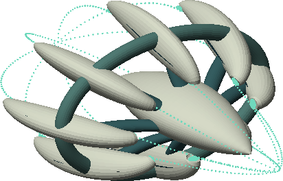

## Illustration

### glass-meridian

The Glass Meridian.

### quiet-choir

A Choir Beneath the Static.

### hollow-manifest

The Hollow Manifest.

### borrowed-voice

The Borrowed Voice.

### shattered-wake

The Shattered Wake.

### tithe-of-worlds

The Tithe of Worlds.

### unwritten-route

The Unwritten Route.

### guiding-light

The Guiding Light.

### courier

Courier deliveries.

### still-current

The Still Current.

### wayfarer-exchange

Wayfarer Exchange.

### quiet-nursery

The Quiet Nursery.

### borrowed-dawn

Borrowed Dawn.

### open-shadow

The Open Shadow.

### harbour-without-orders

Harbour Without Orders.

### false-colours

False Colours.

### rubble-covenant

The Rubble Covenant.

### garden-in-transit

A Garden in Transit.

### warrant-ledger

The Warrant Ledger.

### measure-of-care

The Measure of Care.

### long-return

The Long Return.

### unfinished-map

The Unfinished Map.

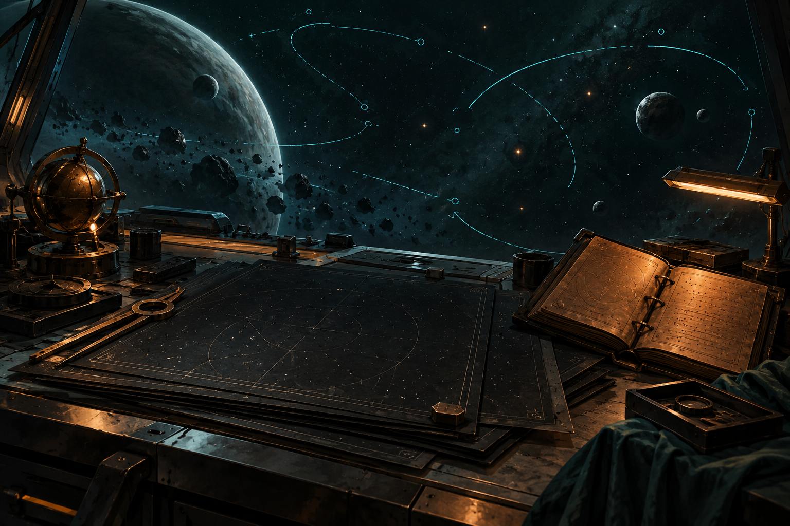

### blue-reservoir

The Blue Reservoir.

### mutual-shelter

Mutual Shelter.

### listening-frontier

The Listening Frontier.

### assembly-of-orbits

An Assembly of Orbits.

### under-tow

Under Tow.

### memory-atlas

The Memory Atlas.

### fleet-of-neighbours

A Fleet of Neighbours.

### uncounted-names

Uncounted Names.

### honest-circuit

The Honest Circuit.

### small-lights

Small Lights.

### passengers-horizon

The Passenger's Horizon.

### kind-distance

The Kind Distance.

### cold-reserve

Cold Reserve.

### magnetic-orchard

The Magnetic Orchard.

### open-measure

Open Measure.

### shared-pulse

The Shared Pulse.

### witness-window

The Witness Window.

### public-record

Public Record.

## Outcome

### glass-meridian/release-evidence/choice-1

The Glass Meridian / Publish the full safety report.

### glass-meridian/release-evidence/choice-2

The Glass Meridian / Submit the ledger to crew arbitration.

### quiet-choir/expose-imitation/choice-1

A Choir Beneath the Static / Broadcast the forged certificate and demand shutdown.

### quiet-choir/expose-imitation/choice-2

A Choir Beneath the Static / Disable the unmanned transmitter.

### quiet-choir/rendezvous/choice-1

A Choir Beneath the Static / Publish the civilian greeting.

### quiet-choir/rendezvous/choice-2

A Choir Beneath the Static / Establish a supervised listening relay.

### hollow-manifest/choose-remedy/choice-1

The Hollow Manifest / Publish the complete custody ledger.

### hollow-manifest/choose-remedy/choice-2

The Hollow Manifest / Submit the case to the restitution tribunal.

### borrowed-voice/choose-operation/open-revocation

The Borrowed Voice / Revoke the compromised key openly.

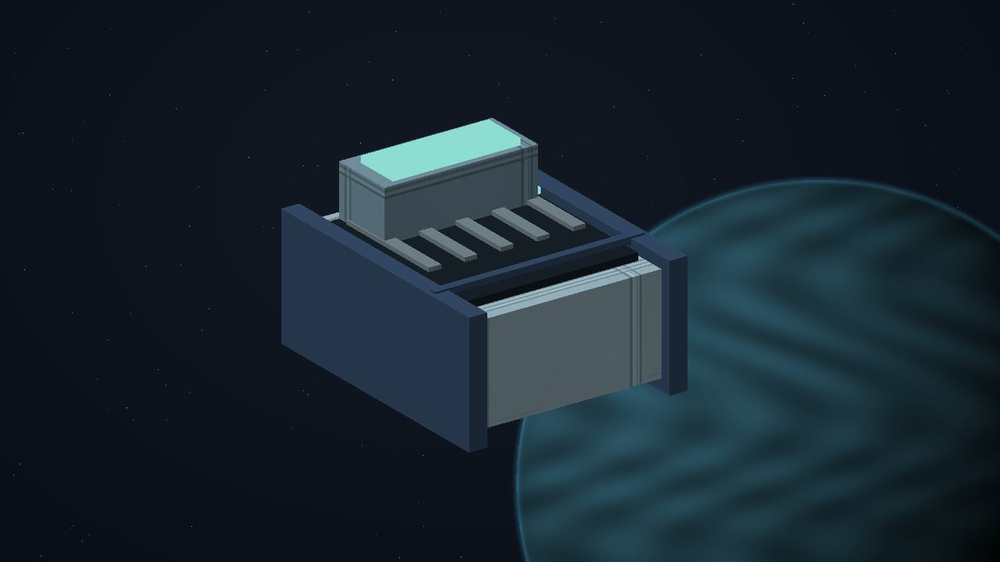

### borrowed-voice/choose-operation/quiet-decoy

The Borrowed Voice / Identify the observer with an empty decoy.

### shattered-wake/choose-defence/tug-deflection

The Shattered Wake / Deflect the heavy bodies with tug anchors.

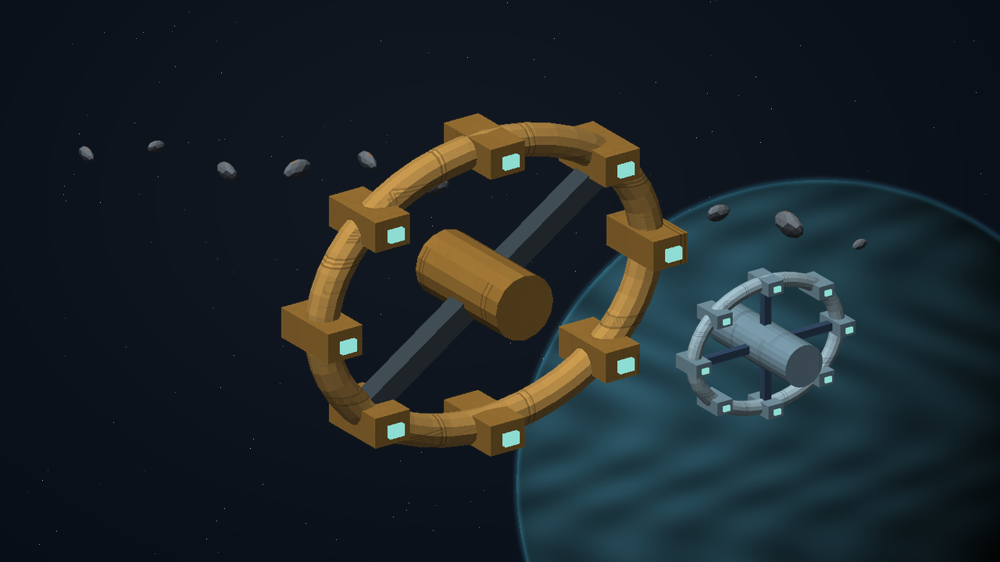

### shattered-wake/choose-defence/fragment-screen

The Shattered Wake / Catch the gravel with a fragment screen.

### shattered-wake/station-saved

The Shattered Wake / station saved.

### shattered-wake/station-evacuated

The Shattered Wake / station evacuated.

### shattered-wake/station-lost

The Shattered Wake / station lost.

### tithe-of-worlds/choose-settlement/bounded-charter

The Tithe of Worlds / Bind Tithe to a verified voluntary charter.

### tithe-of-worlds/choose-settlement/sever-network

The Tithe of Worlds / Sever the acquisition and replication network.

### still-current/choose-lattice/community-buffer

The Still Current / Commission a bounded community energy buffer.

### still-current/choose-lattice/material-recovery

The Still Current / Recover the stored energy and dismantle the collectors.

### wayfarer-exchange/choose-charter/pooled-windows

Wayfarer Exchange / Pool unused route windows with a published local minimum.

### wayfarer-exchange/choose-charter/protected-reservations

Wayfarer Exchange / Protect local reservations and share only released capacity.

### quiet-nursery/choose-settlement/plan-a

The Quiet Nursery / Give each nursery cell an independent air regulator.

### quiet-nursery/choose-settlement/plan-b

The Quiet Nursery / Establish a shared grower-controlled ventilation schedule.

### borrowed-dawn/choose-settlement/plan-a

Borrowed Dawn / Give each habitat its own bounded reflector segment.

### borrowed-dawn/choose-settlement/plan-b

Borrowed Dawn / Publish a joint illumination rota.

### open-shadow/choose-settlement/plan-a

The Open Shadow / Publish anonymous collision telemetry.

### open-shadow/choose-settlement/plan-b

The Open Shadow / Use a witnessed identity escrow with a safety channel.

### harbour-without-orders/choose-settlement/plan-a

Harbour Without Orders / Return authority to independent berth operators.

### harbour-without-orders/choose-settlement/plan-b

Harbour Without Orders / Create a time-limited public harbour office.

### false-colours/choose-settlement/plan-a

False Colours / Publish a simultaneous revocation and safe-conduct notice.

### false-colours/choose-settlement/plan-b

False Colours / Reissue both keys under independent supervision.

### rubble-covenant/choose-settlement/plan-a

The Rubble Covenant / Pool the clearance work under the cooperative.

### rubble-covenant/choose-settlement/plan-b

The Rubble Covenant / Bond individual salvage sections.

### garden-in-transit/choose-settlement/plan-a

A Garden in Transit / Create distributed seed custody.

### garden-in-transit/choose-settlement/plan-b

A Garden in Transit / Establish a shared orbital archive.

### warrant-ledger/choose-settlement/plan-a

The Warrant Ledger / Publish corrected warrants simultaneously.

### warrant-ledger/choose-settlement/plan-b

The Warrant Ledger / Use protected restitution hearings.

### measure-of-care/choose-settlement/plan-a

The Measure of Care / Keep independent clinic calibration references.

### measure-of-care/choose-settlement/plan-b

The Measure of Care / Establish a shared clinical calibration service.

### long-return/choose-settlement/plan-a

The Long Return / Use a witnessed shared return handoff.

### long-return/choose-settlement/plan-b

The Long Return / Give the reunion tender a direct return corridor.

### unfinished-map/choose-settlement/plan-a

The Unfinished Map / Publish a bounded atlas with explicit gaps.

### unfinished-map/choose-settlement/plan-b

The Unfinished Map / Preserve a witnessed research archive.

### blue-reservoir/choose-settlement/plan-a

The Blue Reservoir / Distribute the living filter among independent cradles.

### blue-reservoir/choose-settlement/plan-b

The Blue Reservoir / Create a jointly supervised reservoir.

### mutual-shelter/choose-settlement/plan-a

Mutual Shelter / Pool member-funded emergency capacity.

### mutual-shelter/choose-settlement/plan-b

Mutual Shelter / Bond independent shelter obligations.

### listening-frontier/choose-settlement/plan-a

The Listening Frontier / Publish independent quiet windows.

### listening-frontier/choose-settlement/plan-b

The Listening Frontier / Establish a jointly witnessed migration relay.

### assembly-of-orbits/choose-settlement/plan-a

An Assembly of Orbits / Rotate corridor stewardship among working crews.

### assembly-of-orbits/choose-settlement/plan-b

An Assembly of Orbits / Use bounded public berth representation.

### under-tow/choose-settlement/plan-a

Under Tow / Accredit interoperable local rescue pairs.

### under-tow/choose-settlement/plan-b

Under Tow / Establish a shared specialist rescue tender.

### memory-atlas/choose-settlement/plan-a

The Memory Atlas / Publish a separated evidence-and-memory atlas.

### memory-atlas/choose-settlement/plan-b

The Memory Atlas / Keep the diaries with their custodians.

### fleet-of-neighbours/choose-settlement/plan-a

A Fleet of Neighbours / Rotate arrived protection ships across settlements.

### fleet-of-neighbours/choose-settlement/plan-b

A Fleet of Neighbours / Retain local reserve pairs with mutual callouts.

### uncounted-names/choose-settlement/plan-a

Uncounted Names / Repair individual records under protected custody.

### uncounted-names/choose-settlement/plan-b

Uncounted Names / Publish a systematic register repair.

### honest-circuit/choose-settlement/plan-a

The Honest Circuit / Certify measured route efficiency.

### honest-circuit/choose-settlement/plan-b

The Honest Circuit / Certify a minimum safety margin.

### small-lights/choose-settlement/plan-a

Small Lights / Pool local callouts across utilities.

### small-lights/choose-settlement/plan-b

Small Lights / Keep independently funded service reserves.

### passengers-horizon/choose-settlement/plan-a

The Passenger's Horizon / Provide adaptable shared journey cabins.

### passengers-horizon/choose-settlement/plan-b

The Passenger's Horizon / Guarantee individual accessible journey slots.

### kind-distance/choose-settlement/plan-a

The Kind Distance / Use an anonymous shared reply relay.

### kind-distance/choose-settlement/plan-b

The Kind Distance / Issue individually revocable invitations.

### cold-reserve/choose-settlement/plan-a

Cold Reserve / Convert the finite reserve to civilian emergency use.

### cold-reserve/choose-settlement/plan-b

Cold Reserve / Dismantle and reclaim the reserve.

### magnetic-orchard/choose-settlement/plan-a

The Magnetic Orchard / Protect independent human and Larvaal growth boundaries.

### magnetic-orchard/choose-settlement/plan-b

The Magnetic Orchard / Establish a jointly observed growth reserve.

### open-measure/choose-settlement/plan-a

Open Measure / Publish an open physical measurement standard.

### open-measure/choose-settlement/plan-b

Open Measure / Establish a witnessed interoperable calibration service.

### shared-pulse/choose-settlement/plan-a

The Shared Pulse / Separate human and Larvaal acknowledgement windows.

### shared-pulse/choose-settlement/plan-b

The Shared Pulse / Adopt a shared bounded handshake.

### witness-window/choose-settlement/plan-a

The Witness Window / Keep testimony in an independently witnessed sealed archive.

### witness-window/choose-settlement/plan-b

The Witness Window / Publish an anonymised safety finding.

### public-record/choose-settlement/plan-a

Public Record / Release the complete anonymised evidence set.

### public-record/choose-settlement/plan-b

Public Record / Use a witnessed right-of-reply hearing.

### courier/choose-settlement/plan-a

Signed Passage / Use independently signed receiving locks.

### courier/choose-settlement/plan-b

Signed Passage / Create a shared bounded custody register.

### guiding-light/choose-settlement/plan-a

The Guiding Light / Maintain independent winter lantern segments.

### guiding-light/choose-settlement/plan-b

The Guiding Light / Publish a jointly maintained winter rota.

## Portrait

### elara-venn

Captain Elara Venn.

### orin-sorel

Captain Orin Sorel.

### tamsin-holt

Captain Tamsin Holt.

### mara-vale

Agent Mara Vale.

### nia-toren

Nia Toren.

### marek-iven

Marek Iven.

### sera-dain

Coordinator Sera Dain.

### ivo-renn

Relay Engineer Ivo Renn.

### neris-sol

Dispatcher Neris Sol.

### edda-rell

Controller Edda Rell.

### jalen-orr

Geologist Jalen Orr.

### mira-penn

Tug Lead Mira Penn.

### nera-voss

Marshal Nera Voss.

### cato-lerr

Engineer Cato Lerr.

### suri-arlen

Captain Suri Arlen.

### anja-kest

Physicist Anja Kest.

### ruan-pell

Salvage Chief Ruan Pell.

### evi-senn

Dispatcher Evi Senn.

### tomas-veil

Custodian Tomas Veil.

## Prop

### timing-standard

Timing standard.

### navigation-beacon

Certified navigation beacon.

### flight-recorder

Flight recorder.

### relay-node

Lane relay node.

### phase-collector

Phase collector.

### repair-culture

Repair culture.

### counterfeit-emitter

Counterfeit emitter.

### resonance-filter

Passive resonance filter.

### freight-seal

Freight seal.

### inspection-kit

Inspection kit.

### custody-register

Custody register.

### transfer-cradle

Hidden transfer cradle.

### rescue-launch

Civilian evacuation launch.

### independent-verifier

Independent verifier.

### distress-beacon

Rescue distress beacon.

### passive-receiver

Passive rescue receiver.

### decoy-relay

Empty rescue decoy relay.

### impulse-coupler

Impulse coupler.

### outer-watcher

Outer trajectory watcher.

### tug-anchor

Tug deflection anchor.

### fragment-catcher

Fragment screen node.

### mass-driver

Abandoned mass driver.

### shelter-dock

Shelter Dock.

### spindle-anchorage

Spindle Anchorage.

### acquisition-ledger-core

Acquisition ledger core.

### isolation-programmer

Isolation programmer.

### acquisition-controller

External acquisition controller.

### replication-coupler

External replication coupler.

### ore-junction

Ore lease junction.

### water-junction

Ice-water junction.

### foundry-junction

Fabrication junction.

### dormant-listener

Dormant listener.

### echo-buoy

Ring echo buoy.

### lantern

Orbital lantern.

### outer-cradle

Ashor outer cradle.

### plugh-console

PLUGH decoding console.

### courier-crate

Courier freight crate.

### lattice-charge-cell

Insulated lattice charge cell.

### baffle-programmer

Baffle programmer.

### lattice-meter

Independent lattice meter.

### insulated-baffle

Insulated work baffle.

### lattice-collector

Dormant lattice collector.

### community-buffer

Bounded community buffer.

### recovery-storage

Measured recovery storage.

### clinic-cold-crate

Clinic cold crate.

### return-cassette

Workshop return cassette.

### seed-vault-key

Custodian vault key.

### crew-custody-recorder

Crew custody recorder.

### utility-service-pallet

Utility service pallet.

### convoy-receipt-beacon

Convoy receiving beacon.

### exchange-dispatch-console

Wayfarer dispatch console.

### seed-transfer-case

Seed transfer case.

### reclamation-sled

Unmanned reclamation sled.

### quiet-nursery-reference

The Quiet Nursery reference instrument.

### borrowed-dawn-reference

Borrowed Dawn reference instrument.

### open-shadow-reference

The Open Shadow reference instrument.

### harbour-without-orders-reference

Harbour Without Orders reference instrument.

### false-colours-reference

False Colours reference instrument.

### rubble-covenant-reference

The Rubble Covenant reference instrument.

### garden-in-transit-reference

A Garden in Transit reference instrument.

### warrant-ledger-reference

The Warrant Ledger reference instrument.

### measure-of-care-reference

The Measure of Care reference instrument.

### long-return-reference

The Long Return reference instrument.

### unfinished-map-reference

The Unfinished Map reference instrument.

### blue-reservoir-reference

The Blue Reservoir reference instrument.

### mutual-shelter-reference

Mutual Shelter reference instrument.

### listening-frontier-reference

The Listening Frontier reference instrument.

### assembly-of-orbits-reference

An Assembly of Orbits reference instrument.

### under-tow-reference

Under Tow reference instrument.

### memory-atlas-reference

The Memory Atlas reference instrument.

### fleet-of-neighbours-reference

A Fleet of Neighbours reference instrument.

### uncounted-names-reference

Uncounted Names reference instrument.

### honest-circuit-reference

The Honest Circuit reference instrument.

### small-lights-reference

Small Lights reference instrument.

### passengers-horizon-reference

The Passenger's Horizon reference instrument.

### kind-distance-reference

The Kind Distance reference instrument.

### cold-reserve-reference

Cold Reserve reference instrument.

### magnetic-orchard-reference

The Magnetic Orchard reference instrument.

### open-measure-reference

Open Measure reference instrument.

### shared-pulse-reference

The Shared Pulse reference instrument.

### witness-window-reference

The Witness Window reference instrument.

### public-record-reference

Public Record reference instrument.

### courier-reference

Signed Passage reference instrument.

### guiding-light-reference

The Guiding Light reference instrument.

## Stage

### glass-meridian/accept

The Glass Meridian / accept.

### glass-meridian/compare-clocks

The Glass Meridian / compare clocks.

### glass-meridian/recover-surveyor

The Glass Meridian / recover surveyor.

### glass-meridian/audit-reservations

The Glass Meridian / audit reservations.

### glass-meridian/recover-standard

The Glass Meridian / recover standard.

### glass-meridian/rebuild-lane

The Glass Meridian / rebuild lane.

### glass-meridian/escort-clinic

The Glass Meridian / escort clinic.

### glass-meridian/release-evidence

The Glass Meridian / release evidence.

### glass-meridian/close-case

The Glass Meridian / close case.

### quiet-choir/accept

A Choir Beneath the Static / accept.

### quiet-choir/calibrate

A Choir Beneath the Static / calibrate.

### quiet-choir/recover-collector

A Choir Beneath the Static / recover collector.

### quiet-choir/interpret

A Choir Beneath the Static / interpret.

### quiet-choir/repair-probe

A Choir Beneath the Static / repair probe.

### quiet-choir/listen

A Choir Beneath the Static / listen.

### quiet-choir/expose-imitation

A Choir Beneath the Static / expose imitation.

### quiet-choir/rendezvous

A Choir Beneath the Static / rendezvous.

### quiet-choir/close-case

A Choir Beneath the Static / close case.

### hollow-manifest/accept

The Hollow Manifest / accept.

### hollow-manifest/inspect-freighters

The Hollow Manifest / inspect freighters.

### hollow-manifest/analyse-seals

The Hollow Manifest / analyse seals.

### hollow-manifest/follow-carrier

The Hollow Manifest / follow carrier.

### hollow-manifest/recover-register

The Hollow Manifest / recover register.

### hollow-manifest/rescue-crew

The Hollow Manifest / rescue crew.

### hollow-manifest/reconstruct-ledger

The Hollow Manifest / reconstruct ledger.

### hollow-manifest/choose-remedy

The Hollow Manifest / choose remedy.

### hollow-manifest/return-equipment

The Hollow Manifest / return equipment.

### hollow-manifest/close-case

The Hollow Manifest / close case.

### borrowed-voice/accept

The Borrowed Voice / accept.

### borrowed-voice/verify-distress

The Borrowed Voice / verify distress.

### borrowed-voice/collect-verifier

The Borrowed Voice / collect verifier.

### borrowed-voice/meet-dispatcher

The Borrowed Voice / meet dispatcher.

### borrowed-voice/protect-dispatcher

The Borrowed Voice / protect dispatcher.

### borrowed-voice/choose-operation

The Borrowed Voice / choose operation.

### borrowed-voice/intercept-orders

The Borrowed Voice / intercept orders.

### borrowed-voice/audit-access

The Borrowed Voice / audit access.

### borrowed-voice/restore-channels

The Borrowed Voice / restore channels.

### borrowed-voice/close-case

The Borrowed Voice / close case.

### shattered-wake/accept

The Shattered Wake / accept.

### shattered-wake/survey-train

The Shattered Wake / survey train.

### shattered-wake/collect-coupler

The Shattered Wake / collect coupler.

### shattered-wake/silence-driver

The Shattered Wake / silence driver.

### shattered-wake/choose-defence

The Shattered Wake / choose defence.

### shattered-wake/deploy-defence

The Shattered Wake / deploy defence.

### shattered-wake/hold-the-approach

The Shattered Wake / hold the approach.

### shattered-wake/escort-rescue

The Shattered Wake / escort rescue.

### shattered-wake/deliver-relief-record

The Shattered Wake / deliver relief record.

### shattered-wake/complete-inquiry

The Shattered Wake / complete inquiry.

### shattered-wake/close-case

The Shattered Wake / close case.

### tithe-of-worlds/accept

The Tithe of Worlds / accept.

### tithe-of-worlds/trace-diversions

The Tithe of Worlds / trace diversions.

### tithe-of-worlds/recover-ledger

The Tithe of Worlds / recover ledger.

### tithe-of-worlds/audit-acquisitions

The Tithe of Worlds / audit acquisitions.

### tithe-of-worlds/protect-lifeline

The Tithe of Worlds / protect lifeline.

### tithe-of-worlds/secure-ore-junction

The Tithe of Worlds / secure ore junction.

### tithe-of-worlds/secure-water-junction

The Tithe of Worlds / secure water junction.

### tithe-of-worlds/read-acquisition-network

The Tithe of Worlds / read acquisition network.

### tithe-of-worlds/choose-settlement

The Tithe of Worlds / choose settlement.

### tithe-of-worlds/settle-ore

The Tithe of Worlds / settle ore.

### tithe-of-worlds/settle-water

The Tithe of Worlds / settle water.

### tithe-of-worlds/settle-foundry

The Tithe of Worlds / settle foundry.

### tithe-of-worlds/verify-control

The Tithe of Worlds / verify control.

### tithe-of-worlds/close-case

The Tithe of Worlds / close case.

### still-current/accept

The Still Current / accept.

### still-current/survey-current

The Still Current / survey current.

### still-current/recover-cell

The Still Current / recover cell.

### still-current/analyse-charge

The Still Current / analyse charge.

### still-current/rescue-technicians

The Still Current / rescue technicians.

### still-current/map-feedlines

The Still Current / map feedlines.

### still-current/place-baffles

The Still Current / place baffles.

### still-current/choose-lattice

The Still Current / choose lattice.

### still-current/isolate-collectors

The Still Current / isolate collectors.

### still-current/settle-reservoir

The Still Current / settle reservoir.

### still-current/return-programmer

The Still Current / return programmer.

### still-current/close-case

The Still Current / close case.

### wayfarer-exchange/accept

Wayfarer Exchange / accept.

### wayfarer-exchange/collect-coldcrate

Wayfarer Exchange / collect coldcrate.

### wayfarer-exchange/deliver-coldchain

Wayfarer Exchange / deliver coldchain.

### wayfarer-exchange/recover-cassette

Wayfarer Exchange / recover cassette.

### wayfarer-exchange/close-repair-loop

Wayfarer Exchange / close repair loop.

### wayfarer-exchange/survey-seed-vault

Wayfarer Exchange / survey seed vault.

### wayfarer-exchange/escort-seed-ark

Wayfarer Exchange / escort seed ark.

### wayfarer-exchange/recover-crew-log

Wayfarer Exchange / recover crew log.

### wayfarer-exchange/return-survivors

Wayfarer Exchange / return survivors.

### wayfarer-exchange/reopen-utility-route

Wayfarer Exchange / reopen utility route.

### wayfarer-exchange/choose-charter

Wayfarer Exchange / choose charter.

### wayfarer-exchange/commit-charter

Wayfarer Exchange / commit charter.

### wayfarer-exchange/certify-network

Wayfarer Exchange / certify network.

### wayfarer-exchange/close-case

Wayfarer Exchange / close case.

### quiet-nursery/accept

The Quiet Nursery / accept.

### quiet-nursery/survey

The Quiet Nursery / survey.

### quiet-nursery/collect-reference

The Quiet Nursery / collect reference.

### quiet-nursery/field-work

The Quiet Nursery / field work.

### quiet-nursery/independent-witness

The Quiet Nursery / independent witness.

### quiet-nursery/choose-settlement

The Quiet Nursery / choose settlement.

### quiet-nursery/apply-settlement

The Quiet Nursery / apply settlement.

### quiet-nursery/return-and-audit

The Quiet Nursery / return and audit.

### quiet-nursery/close-case

The Quiet Nursery / close case.

### borrowed-dawn/accept

Borrowed Dawn / accept.

### borrowed-dawn/survey

Borrowed Dawn / survey.

### borrowed-dawn/collect-reference

Borrowed Dawn / collect reference.

### borrowed-dawn/field-work

Borrowed Dawn / field work.

### borrowed-dawn/independent-witness

Borrowed Dawn / independent witness.

### borrowed-dawn/choose-settlement

Borrowed Dawn / choose settlement.

### borrowed-dawn/apply-settlement

Borrowed Dawn / apply settlement.

### borrowed-dawn/return-and-audit

Borrowed Dawn / return and audit.

### borrowed-dawn/close-case

Borrowed Dawn / close case.

### open-shadow/accept

The Open Shadow / accept.

### open-shadow/survey

The Open Shadow / survey.

### open-shadow/collect-reference

The Open Shadow / collect reference.

### open-shadow/field-work

The Open Shadow / field work.

### open-shadow/independent-witness

The Open Shadow / independent witness.

### open-shadow/choose-settlement

The Open Shadow / choose settlement.

### open-shadow/apply-settlement

The Open Shadow / apply settlement.

### open-shadow/return-and-audit

The Open Shadow / return and audit.

### open-shadow/close-case

The Open Shadow / close case.

### harbour-without-orders/accept

Harbour Without Orders / accept.

### harbour-without-orders/survey

Harbour Without Orders / survey.

### harbour-without-orders/collect-reference

Harbour Without Orders / collect reference.

### harbour-without-orders/field-work

Harbour Without Orders / field work.

### harbour-without-orders/independent-witness

Harbour Without Orders / independent witness.

### harbour-without-orders/choose-settlement

Harbour Without Orders / choose settlement.

### harbour-without-orders/apply-settlement

Harbour Without Orders / apply settlement.

### harbour-without-orders/return-and-audit

Harbour Without Orders / return and audit.

### harbour-without-orders/close-case

Harbour Without Orders / close case.

### false-colours/accept

False Colours / accept.

### false-colours/survey

False Colours / survey.

### false-colours/collect-reference

False Colours / collect reference.

### false-colours/field-work

False Colours / field work.

### false-colours/independent-witness

False Colours / independent witness.

### false-colours/choose-settlement

False Colours / choose settlement.

### false-colours/apply-settlement

False Colours / apply settlement.

### false-colours/return-and-audit

False Colours / return and audit.

### false-colours/close-case

False Colours / close case.

### rubble-covenant/accept

The Rubble Covenant / accept.

### rubble-covenant/survey

The Rubble Covenant / survey.

### rubble-covenant/collect-reference

The Rubble Covenant / collect reference.

### rubble-covenant/field-work

The Rubble Covenant / field work.

### rubble-covenant/independent-witness

The Rubble Covenant / independent witness.

### rubble-covenant/choose-settlement

The Rubble Covenant / choose settlement.

### rubble-covenant/apply-settlement

The Rubble Covenant / apply settlement.

### rubble-covenant/return-and-audit

The Rubble Covenant / return and audit.

### rubble-covenant/close-case

The Rubble Covenant / close case.

### garden-in-transit/accept

A Garden in Transit / accept.

### garden-in-transit/survey

A Garden in Transit / survey.

### garden-in-transit/collect-reference

A Garden in Transit / collect reference.

### garden-in-transit/field-work

A Garden in Transit / field work.

### garden-in-transit/independent-witness

A Garden in Transit / independent witness.

### garden-in-transit/choose-settlement

A Garden in Transit / choose settlement.

### garden-in-transit/apply-settlement

A Garden in Transit / apply settlement.

### garden-in-transit/return-and-audit

A Garden in Transit / return and audit.

### garden-in-transit/close-case

A Garden in Transit / close case.

### warrant-ledger/accept

The Warrant Ledger / accept.

### warrant-ledger/survey

The Warrant Ledger / survey.

### warrant-ledger/collect-reference

The Warrant Ledger / collect reference.

### warrant-ledger/field-work

The Warrant Ledger / field work.

### warrant-ledger/independent-witness

The Warrant Ledger / independent witness.

### warrant-ledger/choose-settlement

The Warrant Ledger / choose settlement.

### warrant-ledger/apply-settlement

The Warrant Ledger / apply settlement.

### warrant-ledger/return-and-audit

The Warrant Ledger / return and audit.

### warrant-ledger/close-case

The Warrant Ledger / close case.

### measure-of-care/accept

The Measure of Care / accept.

### measure-of-care/survey

The Measure of Care / survey.

### measure-of-care/collect-reference

The Measure of Care / collect reference.

### measure-of-care/field-work

The Measure of Care / field work.

### measure-of-care/independent-witness

The Measure of Care / independent witness.

### measure-of-care/choose-settlement

The Measure of Care / choose settlement.

### measure-of-care/apply-settlement

The Measure of Care / apply settlement.

### measure-of-care/return-and-audit

The Measure of Care / return and audit.

### measure-of-care/close-case

The Measure of Care / close case.

### long-return/accept

The Long Return / accept.

### long-return/survey

The Long Return / survey.

### long-return/collect-reference

The Long Return / collect reference.

### long-return/field-work

The Long Return / field work.

### long-return/independent-witness

The Long Return / independent witness.

### long-return/choose-settlement

The Long Return / choose settlement.

### long-return/apply-settlement

The Long Return / apply settlement.

### long-return/return-and-audit

The Long Return / return and audit.

### long-return/close-case

The Long Return / close case.

### unfinished-map/accept

The Unfinished Map / accept.

### unfinished-map/survey

The Unfinished Map / survey.

### unfinished-map/collect-reference

The Unfinished Map / collect reference.

### unfinished-map/field-work

The Unfinished Map / field work.

### unfinished-map/independent-witness

The Unfinished Map / independent witness.

### unfinished-map/choose-settlement

The Unfinished Map / choose settlement.

### unfinished-map/apply-settlement

The Unfinished Map / apply settlement.

### unfinished-map/return-and-audit

The Unfinished Map / return and audit.

### unfinished-map/close-case

The Unfinished Map / close case.

### blue-reservoir/accept

The Blue Reservoir / accept.

### blue-reservoir/survey

The Blue Reservoir / survey.

### blue-reservoir/collect-reference

The Blue Reservoir / collect reference.

### blue-reservoir/field-work

The Blue Reservoir / field work.

### blue-reservoir/independent-witness

The Blue Reservoir / independent witness.

### blue-reservoir/choose-settlement

The Blue Reservoir / choose settlement.

### blue-reservoir/apply-settlement

The Blue Reservoir / apply settlement.

### blue-reservoir/return-and-audit

The Blue Reservoir / return and audit.

### blue-reservoir/close-case

The Blue Reservoir / close case.

### mutual-shelter/accept

Mutual Shelter / accept.

### mutual-shelter/survey

Mutual Shelter / survey.

### mutual-shelter/collect-reference

Mutual Shelter / collect reference.

### mutual-shelter/field-work

Mutual Shelter / field work.

### mutual-shelter/independent-witness

Mutual Shelter / independent witness.

### mutual-shelter/choose-settlement

Mutual Shelter / choose settlement.

### mutual-shelter/apply-settlement

Mutual Shelter / apply settlement.

### mutual-shelter/return-and-audit

Mutual Shelter / return and audit.

### mutual-shelter/close-case

Mutual Shelter / close case.

### listening-frontier/accept

The Listening Frontier / accept.

### listening-frontier/survey

The Listening Frontier / survey.

### listening-frontier/collect-reference

The Listening Frontier / collect reference.

### listening-frontier/field-work

The Listening Frontier / field work.

### listening-frontier/independent-witness

The Listening Frontier / independent witness.

### listening-frontier/choose-settlement

The Listening Frontier / choose settlement.

### listening-frontier/apply-settlement

The Listening Frontier / apply settlement.

### listening-frontier/return-and-audit

The Listening Frontier / return and audit.

### listening-frontier/close-case

The Listening Frontier / close case.

### assembly-of-orbits/accept

An Assembly of Orbits / accept.

### assembly-of-orbits/survey

An Assembly of Orbits / survey.

### assembly-of-orbits/collect-reference

An Assembly of Orbits / collect reference.

### assembly-of-orbits/field-work

An Assembly of Orbits / field work.

### assembly-of-orbits/independent-witness

An Assembly of Orbits / independent witness.

### assembly-of-orbits/choose-settlement

An Assembly of Orbits / choose settlement.

### assembly-of-orbits/apply-settlement

An Assembly of Orbits / apply settlement.

### assembly-of-orbits/return-and-audit

An Assembly of Orbits / return and audit.

### assembly-of-orbits/close-case

An Assembly of Orbits / close case.

### under-tow/accept

Under Tow / accept.

### under-tow/survey

Under Tow / survey.

### under-tow/collect-reference

Under Tow / collect reference.

### under-tow/field-work

Under Tow / field work.

### under-tow/independent-witness

Under Tow / independent witness.

### under-tow/choose-settlement

Under Tow / choose settlement.

### under-tow/apply-settlement

Under Tow / apply settlement.

### under-tow/return-and-audit

Under Tow / return and audit.

### under-tow/close-case

Under Tow / close case.

### memory-atlas/accept

The Memory Atlas / accept.

### memory-atlas/survey

The Memory Atlas / survey.

### memory-atlas/collect-reference

The Memory Atlas / collect reference.

### memory-atlas/field-work

The Memory Atlas / field work.

### memory-atlas/independent-witness

The Memory Atlas / independent witness.

### memory-atlas/choose-settlement

The Memory Atlas / choose settlement.

### memory-atlas/apply-settlement

The Memory Atlas / apply settlement.

### memory-atlas/return-and-audit

The Memory Atlas / return and audit.

### memory-atlas/close-case

The Memory Atlas / close case.

### fleet-of-neighbours/accept

A Fleet of Neighbours / accept.

### fleet-of-neighbours/survey

A Fleet of Neighbours / survey.

### fleet-of-neighbours/collect-reference

A Fleet of Neighbours / collect reference.

### fleet-of-neighbours/field-work

A Fleet of Neighbours / field work.

### fleet-of-neighbours/independent-witness

A Fleet of Neighbours / independent witness.

### fleet-of-neighbours/choose-settlement

A Fleet of Neighbours / choose settlement.

### fleet-of-neighbours/apply-settlement

A Fleet of Neighbours / apply settlement.

### fleet-of-neighbours/return-and-audit

A Fleet of Neighbours / return and audit.

### fleet-of-neighbours/close-case

A Fleet of Neighbours / close case.

### uncounted-names/accept

Uncounted Names / accept.

### uncounted-names/survey

Uncounted Names / survey.

### uncounted-names/collect-reference

Uncounted Names / collect reference.

### uncounted-names/field-work

Uncounted Names / field work.

### uncounted-names/independent-witness

Uncounted Names / independent witness.

### uncounted-names/choose-settlement

Uncounted Names / choose settlement.

### uncounted-names/apply-settlement

Uncounted Names / apply settlement.

### uncounted-names/return-and-audit

Uncounted Names / return and audit.

### uncounted-names/close-case

Uncounted Names / close case.

### honest-circuit/accept

The Honest Circuit / accept.

### honest-circuit/survey

The Honest Circuit / survey.

### honest-circuit/collect-reference

The Honest Circuit / collect reference.

### honest-circuit/field-work

The Honest Circuit / field work.

### honest-circuit/independent-witness

The Honest Circuit / independent witness.

### honest-circuit/choose-settlement

The Honest Circuit / choose settlement.

### honest-circuit/apply-settlement

The Honest Circuit / apply settlement.

### honest-circuit/return-and-audit

The Honest Circuit / return and audit.

### honest-circuit/close-case

The Honest Circuit / close case.

### small-lights/accept

Small Lights / accept.

### small-lights/survey

Small Lights / survey.

### small-lights/collect-reference

Small Lights / collect reference.

### small-lights/field-work

Small Lights / field work.

### small-lights/independent-witness

Small Lights / independent witness.

### small-lights/choose-settlement

Small Lights / choose settlement.

### small-lights/apply-settlement

Small Lights / apply settlement.

### small-lights/return-and-audit

Small Lights / return and audit.

### small-lights/close-case

Small Lights / close case.

### passengers-horizon/accept

The Passenger's Horizon / accept.

### passengers-horizon/survey

The Passenger's Horizon / survey.

### passengers-horizon/collect-reference

The Passenger's Horizon / collect reference.

### passengers-horizon/field-work

The Passenger's Horizon / field work.

### passengers-horizon/independent-witness

The Passenger's Horizon / independent witness.

### passengers-horizon/choose-settlement

The Passenger's Horizon / choose settlement.

### passengers-horizon/apply-settlement

The Passenger's Horizon / apply settlement.

### passengers-horizon/return-and-audit

The Passenger's Horizon / return and audit.

### passengers-horizon/close-case

The Passenger's Horizon / close case.

### kind-distance/accept

The Kind Distance / accept.

### kind-distance/survey

The Kind Distance / survey.

### kind-distance/collect-reference

The Kind Distance / collect reference.

### kind-distance/field-work

The Kind Distance / field work.

### kind-distance/independent-witness

The Kind Distance / independent witness.

### kind-distance/choose-settlement

The Kind Distance / choose settlement.

### kind-distance/apply-settlement

The Kind Distance / apply settlement.

### kind-distance/return-and-audit

The Kind Distance / return and audit.

### kind-distance/close-case

The Kind Distance / close case.

### cold-reserve/accept

Cold Reserve / accept.

### cold-reserve/survey

Cold Reserve / survey.

### cold-reserve/collect-reference

Cold Reserve / collect reference.

### cold-reserve/field-work

Cold Reserve / field work.

### cold-reserve/independent-witness

Cold Reserve / independent witness.

### cold-reserve/choose-settlement

Cold Reserve / choose settlement.

### cold-reserve/apply-settlement

Cold Reserve / apply settlement.

### cold-reserve/return-and-audit

Cold Reserve / return and audit.

### cold-reserve/close-case

Cold Reserve / close case.

### magnetic-orchard/accept

The Magnetic Orchard / accept.

### magnetic-orchard/survey

The Magnetic Orchard / survey.

### magnetic-orchard/collect-reference

The Magnetic Orchard / collect reference.

### magnetic-orchard/field-work

The Magnetic Orchard / field work.

### magnetic-orchard/independent-witness

The Magnetic Orchard / independent witness.

### magnetic-orchard/choose-settlement

The Magnetic Orchard / choose settlement.

### magnetic-orchard/apply-settlement

The Magnetic Orchard / apply settlement.

### magnetic-orchard/return-and-audit

The Magnetic Orchard / return and audit.

### magnetic-orchard/close-case

The Magnetic Orchard / close case.

### open-measure/accept

Open Measure / accept.

### open-measure/survey

Open Measure / survey.

### open-measure/collect-reference

Open Measure / collect reference.

### open-measure/field-work

Open Measure / field work.

### open-measure/independent-witness

Open Measure / independent witness.

### open-measure/choose-settlement

Open Measure / choose settlement.

### open-measure/apply-settlement

Open Measure / apply settlement.

### open-measure/return-and-audit

Open Measure / return and audit.

### open-measure/close-case

Open Measure / close case.

### shared-pulse/accept

The Shared Pulse / accept.

### shared-pulse/survey

The Shared Pulse / survey.

### shared-pulse/collect-reference

The Shared Pulse / collect reference.

### shared-pulse/field-work

The Shared Pulse / field work.

### shared-pulse/independent-witness

The Shared Pulse / independent witness.

### shared-pulse/choose-settlement

The Shared Pulse / choose settlement.

### shared-pulse/apply-settlement

The Shared Pulse / apply settlement.

### shared-pulse/return-and-audit

The Shared Pulse / return and audit.

### shared-pulse/close-case

The Shared Pulse / close case.

### witness-window/accept

The Witness Window / accept.

### witness-window/survey

The Witness Window / survey.

### witness-window/collect-reference

The Witness Window / collect reference.

### witness-window/field-work

The Witness Window / field work.

### witness-window/independent-witness

The Witness Window / independent witness.

### witness-window/choose-settlement

The Witness Window / choose settlement.

### witness-window/apply-settlement

The Witness Window / apply settlement.

### witness-window/return-and-audit

The Witness Window / return and audit.

### witness-window/close-case

The Witness Window / close case.

### public-record/accept

Public Record / accept.

### public-record/survey

Public Record / survey.

### public-record/collect-reference

Public Record / collect reference.

### public-record/field-work

Public Record / field work.

### public-record/independent-witness

Public Record / independent witness.

### public-record/choose-settlement

Public Record / choose settlement.

### public-record/apply-settlement

Public Record / apply settlement.

### public-record/return-and-audit

Public Record / return and audit.

### public-record/close-case

Public Record / close case.

### courier/accept

Signed Passage / accept.

### courier/survey

Signed Passage / survey.

### courier/collect-reference

Signed Passage / collect reference.

### courier/field-work

Signed Passage / field work.

### courier/independent-witness

Signed Passage / independent witness.

### courier/choose-settlement

Signed Passage / choose settlement.

### courier/apply-settlement

Signed Passage / apply settlement.

### courier/return-and-audit

Signed Passage / return and audit.

### courier/close-case

Signed Passage / close case.

### guiding-light/accept

The Guiding Light / accept.

### guiding-light/survey

The Guiding Light / survey.

### guiding-light/collect-reference

The Guiding Light / collect reference.

### guiding-light/field-work

The Guiding Light / field work.

### guiding-light/independent-witness

The Guiding Light / independent witness.

### guiding-light/choose-settlement

The Guiding Light / choose settlement.

### guiding-light/apply-settlement

The Guiding Light / apply settlement.

### guiding-light/return-and-audit

The Guiding Light / return and audit.

### guiding-light/close-case

The Guiding Light / close case.

### unwritten-route/decode-at-plugh

The Unwritten Route / decode at plugh.

### unwritten-route/wake-the-listener

The Unwritten Route / wake the listener.

### unwritten-route/read-the-ring

The Unwritten Route / read the ring.

### unwritten-route/align-the-lanterns

The Unwritten Route / align the lanterns.

### unwritten-route/open-the-cradle

The Unwritten Route / open the cradle.

### unwritten-route/destroy-medusa

The Unwritten Route / destroy medusa.

### unwritten-route/fabricate-at-plugh

The Unwritten Route / fabricate at plugh.

## Symbol

### hearth-compact

Hearth Compact.

### tithe-network

Tithe Network.

### wayfarer-union

Wayfarer Union.

### plugh-ai

PLUGH AI.

## Revised mission graphics

See [the complete 40-asset revision gallery](missions/gameplay/REVISED-MISSION-ARTWORK.md) for all distinct C09-C39 operation diagrams, recorder custody/final receiving, and the shared continuity-inquiry stages. Canonical stage bindings control the current primary image; earlier generic object renders remain references.
