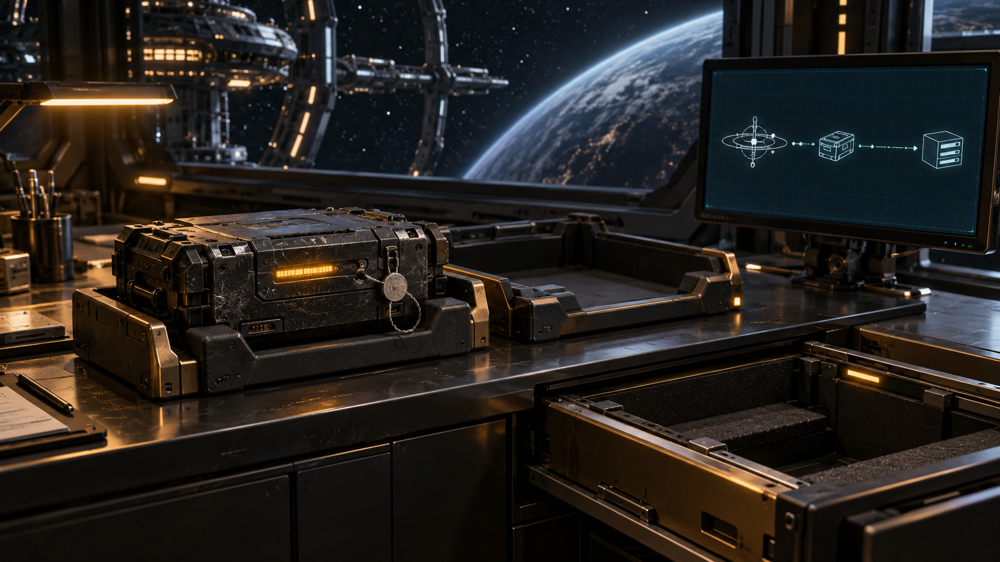
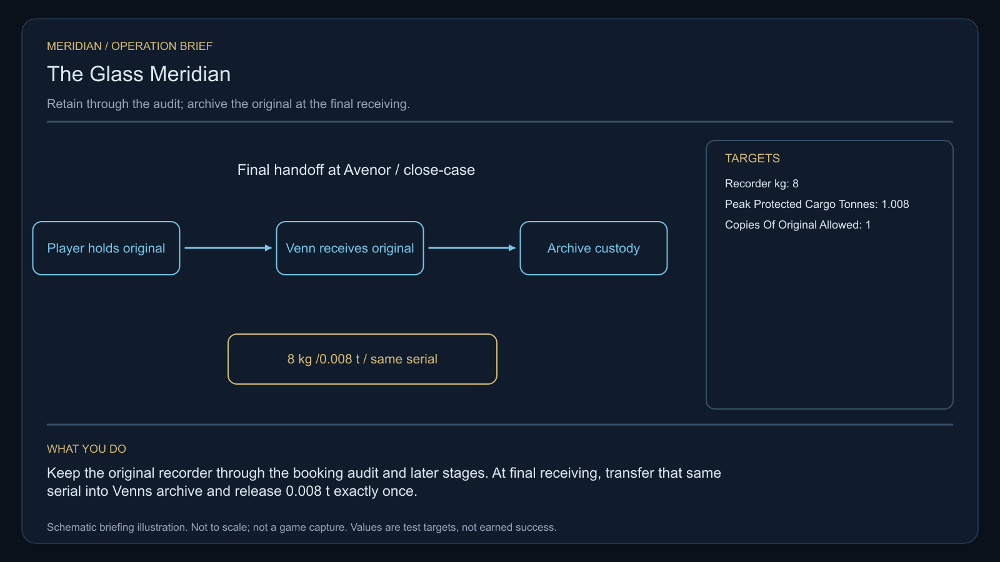

# C01 - The Glass Meridian

[Oracle contents](../README.md). This is a derived reading view of [the full oracle](../FINAL-GAME-ORACLE.md). Canonical mission data and gameplay specifications are in `docs/meridian/missions/`.

**Mission identity:** `l337.glass-meridian`. **Premise:** Someone is selling the same safe passage to two ships at once.

Avenor has recorded three near-collisions on a supposedly certified medical freight lane. Its navigation buoys agree about position but disagree about time. A missing civilian surveyor is being blamed. The real fault is a contractor selling duplicate reservations and disguising the conflict as pilot error. The commander must recover the survey record, rebuild the timing chain and guide a clinic ship through a corrected lane before deciding how to release the evidence.

**Offer:** Dock at Avenor after visiting three different systems and identifying two ship types. No kill-count gate or dependency on another campaign.

**Briefing:** Captain Elara Venn: Our clinic convoy cannot launch while two ships can hold the same reservation. Read the beacons at Renas. Look for the surveyor at Navidor. Bring back evidence before deciding who is at fault.

**Contacts:** Captain Elara Venn, Captain Orin Sorel. **Story craft:** SH026.

**Successful settlement:** 4,800 CR. A public lane-safety commendation and the selected evidence outcome in regional gossip. No fabricated combat points or automatic ship blueprint. A permanent clue for The Unwritten Route: The missing instant.

Mission-specific rules and resources:

- **Items 1 / Id:** timing-standard
- **Items 1 / Mass tonnes:** 1
- **Items 1 / Acquire stage:** recover-standard
- **Items 1 / Consume stage:** rebuild-lane
- **Items 2 / Id:** surveyor-recorder
- **Items 2 / Mass tonnes:** 0.008
- **Items 2 / Acquire stage:** recover-surveyor
- **Items 2 / Consume stage:** close-case
- **Items 2 / Final custodian:** Captain Venn, Avenor station evidence archive
- **Items 2 / Authority:** 8kg source rule; final archive at close-case is an explicit review-resolution design decision
- **Terminal stage:** complete
- **Reward receipt:** l337.glass-meridian/final-payment
- **Reward policy:** Pay credits once, atomically with the terminal receipt. Delay optional equipment fitting if incompatible; offer it again without duplicating payment. Never award kill points for non-kills or clear unrelated legal status. Commit the clue and terminal reward receipt atomically; a pending optional fitting does not delay the clue.
- **Branch policy:** Record the selected evidence/protocol outcome in pack state and gossip. Branches reconverge at the next stage and share the advertised base payment.
- **Identity policy:** Match locations by galaxy/system identity, not coordinates or displayed spelling. Match entities by mission instance and target ID, never merely ship type.
- **Persistence policy:** Every campaign starts unaccepted with its current identity and zero progress. Persist current-format stage evidence, choices, mission-item custody, reward and clue receipts. Resume these records on load; replayed events cannot duplicate rewards. No previous campaign or save format is imported.
- **Custody revision / Peak protected cargo tonnes:** 1.008
- **Custody revision / Rule:** Retain the exact original recorder through the reservation audit, timing-standard collection, lane repair and escort. The timing standard consumes1t at rebuild-lane; the recorder transfers only at close-case with an atomic archive receipt. Data copies have zero mass and cannot replace physical custody. Archive, payment and clue are one final transaction. Loss follows the separate remedial inquiry, without cloning the recorder.
- **Recovery policy ref:** ../gameplay/recovery-policy.json
- **Main quest continuity:** Original failure remains recorded. A successful separately scoped continuity inquiry can earn this same source clue without its original fee or reward; always requestable through the clue journal/charter orbital desk, independent of money, source stock and original station/witness survival.

## C01.01 - accept

**Place:** Avenor (G01-S007). **Objective:** Accept the lane investigation at Avenor.

**Story/dialogue:** VENN: Three crews nearly died without either pilot making a navigation error. I need measurements, not a convenient suspect. Your ship can carry the survey data without occupying the hold.

- **Event:** mission_contact_confirmed
- **Required targets:** venn-commission
- **Interaction item mass tonnes:** 0
- **Next:** compare-clocks
- **Completion rule:** All requiredTargets must have confirmed mission-scoped evidence; consume the transition once.
- **Recovery:** Persist completed target evidence. Restore unloaded or culled actors from saved state with their same identity; genuine destruction and casualties remain recorded. Retry an escort only through its mission-specific recovery procedure and genuinely available crew, hull and cargo. Loss or replacement earns no arrival or reward. A dead named witness cannot be replaced by a lookalike.
- **Confirmation:** Confirm accepts a transfer or choice; Esc only closes the dialog and never transfers an item, spends money or selects a branch.
- **Cargo policy:** Reserve the listed mission item separately from commodities. Require free hold before accepting it; never silently delete, sell or overwrite player cargo. Contacts hold it safely when space is unavailable.
- **Decline policy:** Offer remains available until accepted. Preparation has no deadline. Any explicitly armed incident follows its advertised simulation clock; normal game pause and current-format save/load remain available.
- **Receipt:** l337.glass-meridian/accept
- **Item transaction:** Preview and commit the whole itemEffects batch atomically; capacity is evaluated after removals and additions together. Refusal or cancellation changes neither stage nor custody.

## C01.02 - compare-clocks

**Place:** Renas (G01-S185). **Objective:** Scan both certified navigation beacons at Renas.

**Story/dialogue:** The beacons mark the same corridor as vacant at two overlapping times. Their signed reservation counters differ by exactly one booking.

- **Event:** entity_scan_completed
- **Required targets:** sedan-clock-a; sedan-clock-b
- **Interaction item mass tonnes:** 0
- **Next:** recover-surveyor
- **Completion rule:** All requiredTargets must have confirmed mission-scoped evidence; consume the transition once.
- **Recovery:** Persist completed target evidence. Restore unloaded or culled actors from saved state with their same identity; genuine destruction and casualties remain recorded. Retry an escort only through its mission-specific recovery procedure and genuinely available crew, hull and cargo. Loss or replacement earns no arrival or reward. A dead named witness cannot be replaced by a lookalike.
- **Confirmation:** Confirm accepts a transfer or choice; Esc only closes the dialog and never transfers an item, spends money or selects a branch.
- **Cargo policy:** Reserve the listed mission item separately from commodities. Require free hold before accepting it; never silently delete, sell or overwrite player cargo. Contacts hold it safely when space is unavailable.
- **Decline policy:** Offer remains available until accepted. Preparation has no deadline. Any explicitly armed incident follows its advertised simulation clock; normal game pause and current-format save/load remain available.
- **Receipt:** l337.glass-meridian/compare-clocks
- **Item transaction:** Preview and commit the whole itemEffects batch atomically; capacity is evaluated after removals and additions together. Refusal or cancellation changes neither stage nor custody.
- **Oracle continuous observation:** Scan both actual certified beacons, in either order: front view, aim within 2 degrees, surface distance 250-1500 native units, nearest unoccluded mesh and the same target for 12 continuous simulation seconds. Completed readings persist; pause freezes time, and interruption or load resets only an unfinished dwell. Merely selecting a beacon or opening its preview grants no scan.

## C01.03 - recover-surveyor

**Place:** Navidor (G01-S164). **Objective:** Locate the disabled Harrier and recover its flight recorder at Navidor.

**Story/dialogue:** SOREL: I parked my Harrier after the guidance lights sent a freighter across my bow. The original recorder is detached beside the service area, eighty metres to my right. Please do not turn a rescue into a shooting incident.

- **Event:** mission_item_recovered
- **Required targets:** surveyor-recorder
- **Interaction item mass tonnes:** 0.008
- **Next:** audit-reservations
- **Completion rule:** All requiredTargets must have confirmed mission-scoped evidence; consume the transition once.
- **Recovery:** Persist completed target evidence. Restore unloaded or culled actors from saved state with their same identity; genuine destruction and casualties remain recorded. Retry an escort only through its mission-specific recovery procedure and genuinely available crew, hull and cargo. Loss or replacement earns no arrival or reward. A dead named witness cannot be replaced by a lookalike.
- **Confirmation:** Confirm accepts a transfer or choice; Esc only closes the dialog and never transfers an item, spends money or selects a branch.
- **Cargo policy:** Reserve the listed mission item separately from commodities. Require free hold before accepting it; never silently delete, sell or overwrite player cargo. Contacts hold it safely when space is unavailable.
- **Decline policy:** Offer remains available until accepted. Preparation has no deadline. Any explicitly armed incident follows its advertised simulation clock; normal game pause and current-format save/load remain available.
- **Receipt:** l337.glass-meridian/recover-surveyor
- **Item effects 1 / Kind:** add
- **Item effects 1 / Item:** surveyor-recorder
- **Item effects 1 / Mass tonnes:** 0.008
- **Item transaction:** Preview and commit the whole itemEffects batch atomically; capacity is evaluated after removals and additions together. Refusal or cancellation changes neither stage nor custody.
- **Oracle physical custody:** Recover the original detached 8 kg recorder (0.008 tonnes), 80 metres to the original Harrier's right, using actual fitted Fuel Scoops and a slow aligned underside approach. Keep the same source identity and protected custody through the later reservation audit. Do not charge a whole tonne, award a kill or substitute a lookalike recorder.

## C01.04 - audit-reservations

**Place:** Enmadan (G01-S000). **Objective:** Dock at Enmadan and compare the recorder with the convoy booking ledger.

**Story/dialogue:** SOREL: These are two paid reservations with one certificate number. The contractor copied the signature, then offset the beacon clocks to hide the overlap.

- **Event:** mission_contact_confirmed
- **Required targets:** sorel-ledger-audit
- **Interaction item mass tonnes:** 0
- **Next:** recover-standard
- **Completion rule:** All requiredTargets must have confirmed mission-scoped evidence; consume the transition once.
- **Recovery:** Persist completed target evidence. Restore unloaded or culled actors from saved state with their same identity; genuine destruction and casualties remain recorded. Retry an escort only through its mission-specific recovery procedure and genuinely available crew, hull and cargo. Loss or replacement earns no arrival or reward. A dead named witness cannot be replaced by a lookalike.
- **Confirmation:** Confirm accepts a transfer or choice; Esc only closes the dialog and never transfers an item, spends money or selects a branch.
- **Cargo policy:** Reserve the listed mission item separately from commodities. Require free hold before accepting it; never silently delete, sell or overwrite player cargo. Contacts hold it safely when space is unavailable.
- **Decline policy:** Offer remains available until accepted. Preparation has no deadline. Any explicitly armed incident follows its advertised simulation clock; normal game pause and current-format save/load remain available.
- **Receipt:** l337.glass-meridian/audit-reservations
- **Item transaction:** Preview and commit the whole itemEffects batch atomically; capacity is evaluated after removals and additions together. Refusal or cancellation changes neither stage nor custody.
- **Oracle ledger evidence:** At Enmadan, compare the immutable original recorder with the genuine commission-bound booking corpus. Two customers each paid 50 CR into the conserved 100 CR record. The true intervals [E+600,E+660) and [E+630,E+690) overlap for 30 seconds; clock offsets are 0/+60 seconds and reservation counters 1/2. These are authored booking facts, not player cash or a live convoy deadline. Retain 8 kg original custody and create only zero-mass evidence; no repair, cancellation, cash or clue is awarded at this stage.

## C01.05 - recover-standard

**Place:** Enlirin (G01-S162). **Objective:** Recover the one-tonne timing standard from the abandoned maintenance cradle at Enlirin.

**Story/dialogue:** The cradle contains a sealed timing standard. A damaged support arm blocks the automated tug; a close, slow recovery will free the crate.

- **Event:** mission_item_recovered
- **Required targets:** timing-standard
- **Interaction item mass tonnes:** 1
- **Next:** rebuild-lane
- **Completion rule:** All requiredTargets must have confirmed mission-scoped evidence; consume the transition once.
- **Recovery:** Persist completed target evidence. Restore unloaded or culled actors from saved state with their same identity; genuine destruction and casualties remain recorded. Retry an escort only through its mission-specific recovery procedure and genuinely available crew, hull and cargo. Loss or replacement earns no arrival or reward. A dead named witness cannot be replaced by a lookalike.
- **Confirmation:** Confirm accepts a transfer or choice; Esc only closes the dialog and never transfers an item, spends money or selects a branch.
- **Cargo policy:** Reserve the listed mission item separately from commodities. Require free hold before accepting it; never silently delete, sell or overwrite player cargo. Contacts hold it safely when space is unavailable.
- **Decline policy:** Offer remains available until accepted. Preparation has no deadline. Any explicitly armed incident follows its advertised simulation clock; normal game pause and current-format save/load remain available.
- **Receipt:** l337.glass-meridian/recover-standard
- **Item effects 1 / Kind:** add
- **Item effects 1 / Item:** timing-standard
- **Item effects 1 / Mass tonnes:** 1
- **Item transaction:** Preview and commit the whole itemEffects batch atomically; capacity is evaluated after removals and additions together. Refusal or cancellation changes neither stage nor custody.

## C01.06 - rebuild-lane

**Place:** Lareria (G01-S091). **Objective:** Use the standard to recalibrate three relay nodes at Lareria.

**Story/dialogue:** Each relay accepts the same independent clock. The conflicting bookings now appear as two distinct tracks instead of one hidden collision.

- **Event:** mission_action_confirmed
- **Required targets:** relay-inner; relay-middle; relay-outer
- **Interaction item mass tonnes:** 1
- **Next:** escort-clinic
- **Completion rule:** All requiredTargets must have confirmed mission-scoped evidence; consume the transition once.
- **Recovery:** Persist completed target evidence. Restore unloaded or culled actors from saved state with their same identity; genuine destruction and casualties remain recorded. Retry an escort only through its mission-specific recovery procedure and genuinely available crew, hull and cargo. Loss or replacement earns no arrival or reward. A dead named witness cannot be replaced by a lookalike.
- **Confirmation:** Confirm accepts a transfer or choice; Esc only closes the dialog and never transfers an item, spends money or selects a branch.
- **Cargo policy:** Reserve the listed mission item separately from commodities. Require free hold before accepting it; never silently delete, sell or overwrite player cargo. Contacts hold it safely when space is unavailable.
- **Decline policy:** Offer remains available until accepted. Preparation has no deadline. Any explicitly armed incident follows its advertised simulation clock; normal game pause and current-format save/load remain available.
- **Receipt:** l337.glass-meridian/rebuild-lane
- **Item effects 1 / Kind:** remove
- **Item effects 1 / Item:** timing-standard
- **Item effects 1 / Mass tonnes:** 1
- **Item transaction:** Preview and commit the whole itemEffects batch atomically; capacity is evaluated after removals and additions together. Refusal or cancellation changes neither stage nor custody.

## C01.07 - escort-clinic

**Place:** Lareria (G01-S091). **Objective:** Escort the clinic tender from the maintenance cradle to Lareria main station.

**Story/dialogue:** SOREL: We will follow the corrected lane. Stay near the tender until station control confirms its berth. Fast arrivals are less useful than everyone arriving.

- **Event:** escort_arrived
- **Required targets:** clinic-tender
- **Interaction item mass tonnes:** 0
- **Next:** release-evidence
- **Completion rule:** All requiredTargets must have confirmed mission-scoped evidence; consume the transition once.
- **Recovery:** Persist completed target evidence. Restore unloaded or culled actors from saved state with their same identity; genuine destruction and casualties remain recorded. Retry an escort only through its mission-specific recovery procedure and genuinely available crew, hull and cargo. Loss or replacement earns no arrival or reward. A dead named witness cannot be replaced by a lookalike.
- **Confirmation:** Confirm accepts a transfer or choice; Esc only closes the dialog and never transfers an item, spends money or selects a branch.
- **Cargo policy:** Reserve the listed mission item separately from commodities. Require free hold before accepting it; never silently delete, sell or overwrite player cargo. Contacts hold it safely when space is unavailable.
- **Decline policy:** Offer remains available until accepted. Preparation has no deadline. Any explicitly armed incident follows its advertised simulation clock; normal game pause and current-format save/load remain available.
- **Receipt:** l337.glass-meridian/escort-clinic
- **Item transaction:** Preview and commit the whole itemEffects batch atomically; capacity is evaluated after removals and additions together. Refusal or cancellation changes neither stage nor custody.

## C01.08 - release-evidence

**Place:** Avenor (G01-S007). **Objective:** Return to Avenor and choose how to release the booking evidence.

**Story/dialogue:** VENN: A public report warns every pilot immediately. A sealed arbitration submission protects the crews while their compensation is assessed. Both preserve the complete ledger.

- **Event:** mission_choice_confirmed
- **Required targets:** meridian-disposition
- **Interaction item mass tonnes:** 0
- **Choices:** Publish the full safety report; Submit the ledger to crew arbitration
- **Next:** close-case
- **Completion rule:** All requiredTargets must have confirmed mission-scoped evidence; consume the transition once.
- **Recovery:** Persist completed target evidence. Restore unloaded or culled actors from saved state with their same identity; genuine destruction and casualties remain recorded. Retry an escort only through its mission-specific recovery procedure and genuinely available crew, hull and cargo. Loss or replacement earns no arrival or reward. A dead named witness cannot be replaced by a lookalike.
- **Confirmation:** Confirm accepts a transfer or choice; Esc only closes the dialog and never transfers an item, spends money or selects a branch.
- **Cargo policy:** Reserve the listed mission item separately from commodities. Require free hold before accepting it; never silently delete, sell or overwrite player cargo. Contacts hold it safely when space is unavailable.
- **Decline policy:** Offer remains available until accepted. Preparation has no deadline. Any explicitly armed incident follows its advertised simulation clock; normal game pause and current-format save/load remain available.
- **Receipt:** l337.glass-meridian/release-evidence
- **Item transaction:** Preview and commit the whole itemEffects batch atomically; capacity is evaluated after removals and additions together. Refusal or cancellation changes neither stage nor custody.

## C01.09 - close-case

**Place:** Avenor (G01-S007). **Objective:** Archive the same original 8kg recorder with Captain Venn at Avenor; confirm the lane-safety report and collect payment.

**Story/dialogue:** VENN: The reservations have been separated, the surveyor has been cleared by evidence, and the clinic tender is safe. Your fee is 4,800 CR. Your chosen report is now part of the regional record.

VENN: There is one detail the inquiry could not explain: a curved trace in the timing standard, written between the clock ticks. I have copied it to your journal. PLUGH's AI may be able to read it.

- **Event:** mission_contact_confirmed
- **Required targets:** meridian-payment
- **Interaction item mass tonnes:** 0
- **Next:** complete
- **Completion rule:** All requiredTargets must have confirmed mission-scoped evidence; consume the transition once.
- **Recovery:** Persist completed target evidence. Restore unloaded or culled actors from saved state with their same identity; genuine destruction and casualties remain recorded. Retry an escort only through its mission-specific recovery procedure and genuinely available crew, hull and cargo. Loss or replacement earns no arrival or reward. A dead named witness cannot be replaced by a lookalike.
- **Confirmation:** Confirm accepts a transfer or choice; Esc only closes the dialog and never transfers an item, spends money or selects a branch.
- **Cargo policy:** Reserve the listed mission item separately from commodities. Require free hold before accepting it; never silently delete, sell or overwrite player cargo. Contacts hold it safely when space is unavailable.
- **Decline policy:** Offer remains available until accepted. Preparation has no deadline. Any explicitly armed incident follows its advertised simulation clock; normal game pause and current-format save/load remain available.
- **Receipt:** l337.glass-meridian/close-case
- **Item effects 1 / Kind:** remove
- **Item effects 1 / Item:** surveyor-recorder
- **Item effects 1 / Mass tonnes:** 0.008
- **Item transaction:** Preview and commit the whole itemEffects batch atomically; capacity is evaluated after removals and additions together. Refusal or cancellation changes neither stage nor custody.
- **Archive receipt:** l337.glass-meridian/original-recorder-archived
- **Reference artwork / Id:** glass-meridian/close-case
- **Reference artwork / File:** ../../assets/missions/stages/glass-meridian/close-case.png
- **Reference artwork / Visibility:** Mission stage briefing and completed history
- **Reference artwork / Role:** Superseded generic original stage reference
- **Supplementary artwork 1 / Id:** revision/meridian-recorder-custody
- **Supplementary artwork 1 / File:** ../../assets/missions/revisions/meridian-recorder-custody.png
- **Supplementary artwork 1 / Visibility:** Final receiving briefing/history

**Permanent clue:** The missing instant (`meridian-offset`). The recovered timing standard contains an interval that none of the lane clocks measured. Inside that interval, a curved trace repeats eight times.

**Failure follow-up:** [Source-specific funded recovery](gameplay/recovery-policy.json) under `l337.glass-meridian`. Original loss and original fee receipts remain unchanged.

[Complete structured definition](definitions/glass-meridian.json).
