# C02 - A Choir Beneath the Static

[Return to the oracle contents](../README.md). This reading view is extracted from [the complete single-file oracle](../FINAL-GAME-ORACLE.md); its rules are the same.

**Mission identity:** `l337.quiet-choir`. **Premise:** A signal mistaken for a weapon may be a request for help.

Mining navigation receivers in Quiet Current are being drowned by repeating Larvaal phase pulses. The pulses contain synchronized gaps, not firing orders. A damaged Larvaal Probe has been trying to locate its dispersed companions while human smugglers imitate the signal to conceal their own traffic. The commander reconstructs the pulses, repairs the probe, exposes the imitation and negotiates a narrow-band rendezvous that lets both fleets navigate safely.

**Offer:** After identifying a Larvaal vessel and visiting four systems, speak to Holt at Omdogan in Galaxy 4. This campaign is independent of The Glass Meridian.

**Briefing:** Captain Tamsin Holt: No one has proved these pulses are an attack. Calibrate your receiver at Lobagom before approaching the source. Agent Mara Vale will compare what you find with the mining relays.

**Contacts:** Captain Tamsin Holt, Agent Mara Vale. **Story craft:** SH124 Larvaal Warship, SH125 Larvaal Drone, SH162 Larvaal Probe.

**Successful settlement:** 6,400 CR. A resonance-filter fitting, improving identification of this campaign's Larvaal signals. It grants no extra energy capacity, general faction immunity or free ship fabrication. A permanent clue for The Unwritten Route: The silent voice.

Mission-specific rules and resources:

- **Items 1 / Id:** phase-collector
- **Items 1 / Mass tonnes:** 1
- **Items 1 / Acquire stage:** recover-collector
- **Items 1 / Consume stage:** interpret
- **Items 2 / Id:** repair-culture
- **Items 2 / Mass tonnes:** 1
- **Items 2 / Acquire stage:** interpret
- **Items 2 / Consume stage:** repair-probe
- **Terminal stage:** complete
- **Reward receipt:** l337.quiet-choir/final-payment
- **Reward policy:** Pay credits once, atomically with the terminal receipt. Delay optional equipment fitting if incompatible; offer it again without duplicating payment. Never award kill points for non-kills or clear unrelated legal status. Commit the clue and terminal reward receipt atomically; a pending optional fitting does not delay the clue.
- **Branch policy:** Record the selected evidence/protocol outcome in pack state and gossip. Branches reconverge at the next stage and share the advertised base payment.
- **Identity policy:** Match locations by galaxy/system identity, not coordinates or displayed spelling. Match entities by mission instance and target ID, never merely ship type.
- **Persistence policy:** Every campaign starts unaccepted with its current identity and zero progress. Persist current-format stage evidence, choices, mission-item custody, reward and clue receipts. Resume these records on load; replayed events cannot duplicate rewards. No previous campaign or save format is imported.

## C02.01 - accept

**Place:** Omdogan (G04-S040). **Objective:** Accept Holt's signal investigation at Omdogan.

**Story/dialogue:** HOLT: Our miners are losing their bearings. I will not order an attack on the basis of interference. Find out whether someone is calling, warning or hiding.

- **Event:** mission_contact_confirmed
- **Required targets:** holt-commission
- **Interaction item mass tonnes:** 0
- **Next:** calibrate
- **Completion rule:** All requiredTargets must have confirmed mission-scoped evidence; consume the transition once.
- **Recovery:** Persist each completed target. Recreate an uncompleted objective after load or entity loss; duplicate scans and incidental removal cannot complete it. Escort destruction returns to the escort briefing with a replacement launch and no reward.
- **Confirmation:** Confirm accepts a transfer or choice; Esc only closes the dialog and never transfers an item, spends money or selects a branch.
- **Cargo policy:** Reserve the listed mission item separately from commodities. Require free hold before accepting it; never silently delete, sell or overwrite player cargo. Contacts hold it safely when space is unavailable.
- **Decline policy:** Offer remains available until accepted. Preparation has no deadline. Any explicitly armed incident follows its advertised simulation clock; normal game pause and current-format save/load remain available.
- **Receipt:** l337.quiet-choir/accept
- **Item transaction:** Preview and commit the whole itemEffects batch atomically; capacity is evaluated after removals and additions together. Refusal or cancellation changes neither stage nor custody.

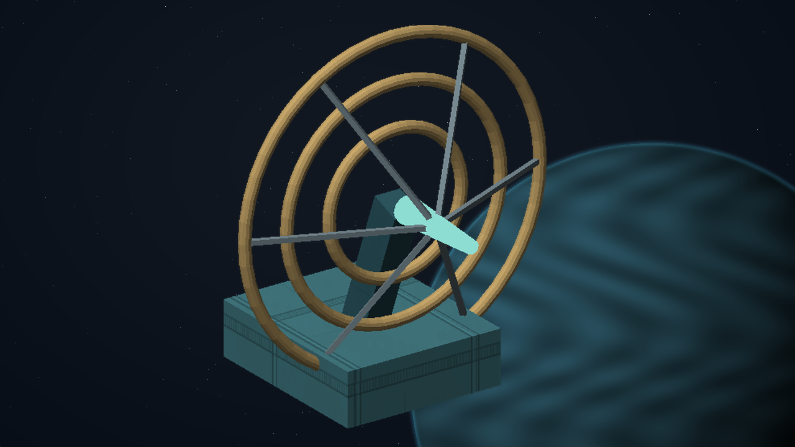

## C02.02 - calibrate

**Place:** Lobagom (G04-S249). **Objective:** Scan three reference emitters at Lobagom to separate receiver drift from outside interference.

**Story/dialogue:** The receiver is stable. The interference contains a deliberate pause after every third pulse, repeated across all three bands.

- **Event:** entity_scan_completed
- **Required targets:** reference-low; reference-mid; reference-high
- **Interaction item mass tonnes:** 0
- **Next:** recover-collector
- **Completion rule:** All requiredTargets must have confirmed mission-scoped evidence; consume the transition once.
- **Recovery:** Persist each completed target. Recreate an uncompleted objective after load or entity loss; duplicate scans and incidental removal cannot complete it. Escort destruction returns to the escort briefing with a replacement launch and no reward.
- **Confirmation:** Confirm accepts a transfer or choice; Esc only closes the dialog and never transfers an item, spends money or selects a branch.
- **Cargo policy:** Reserve the listed mission item separately from commodities. Require free hold before accepting it; never silently delete, sell or overwrite player cargo. Contacts hold it safely when space is unavailable.
- **Decline policy:** Offer remains available until accepted. Preparation has no deadline. Any explicitly armed incident follows its advertised simulation clock; normal game pause and current-format save/load remain available.
- **Receipt:** l337.quiet-choir/calibrate
- **Item transaction:** Preview and commit the whole itemEffects batch atomically; capacity is evaluated after removals and additions together. Refusal or cancellation changes neither stage nor custody.

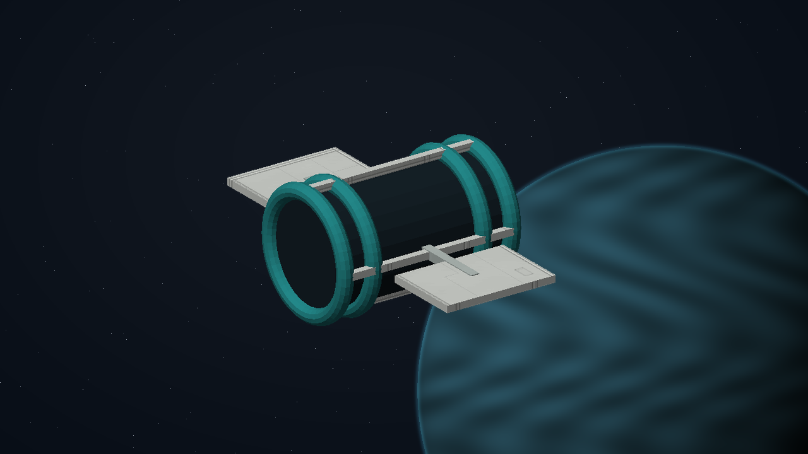

## C02.03 - recover-collector

**Place:** Lodogom (G04-S078). **Objective:** Recover a one-tonne phase collector from the damaged mining relay at Lodogom.

**Story/dialogue:** A passive collector has recorded the missing phase information. The relay is dead, but its sealed recorder can be recovered without disabling any ship.

- **Event:** mission_item_recovered
- **Required targets:** phase-collector
- **Interaction item mass tonnes:** 1
- **Next:** interpret
- **Completion rule:** All requiredTargets must have confirmed mission-scoped evidence; consume the transition once.
- **Recovery:** Persist each completed target. Recreate an uncompleted objective after load or entity loss; duplicate scans and incidental removal cannot complete it. Escort destruction returns to the escort briefing with a replacement launch and no reward.
- **Confirmation:** Confirm accepts a transfer or choice; Esc only closes the dialog and never transfers an item, spends money or selects a branch.
- **Cargo policy:** Reserve the listed mission item separately from commodities. Require free hold before accepting it; never silently delete, sell or overwrite player cargo. Contacts hold it safely when space is unavailable.
- **Decline policy:** Offer remains available until accepted. Preparation has no deadline. Any explicitly armed incident follows its advertised simulation clock; normal game pause and current-format save/load remain available.
- **Receipt:** l337.quiet-choir/recover-collector
- **Item effects 1 / Kind:** add
- **Item effects 1 / Item:** phase-collector
- **Item effects 1 / Mass tonnes:** 1
- **Item transaction:** Preview and commit the whole itemEffects batch atomically; capacity is evaluated after removals and additions together. Refusal or cancellation changes neither stage nor custody.

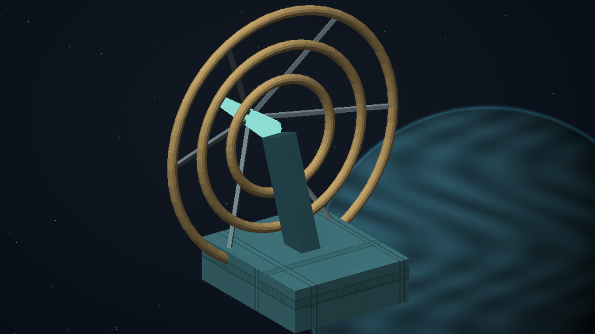

## C02.04 - interpret

**Place:** Balmabol (G04-S109). **Objective:** Dock at Balmabol and let Mara Vale reconstruct the signal.

**Story/dialogue:** VALE: This is a gathering call. Each pause leaves room for a reply from a missing companion. Someone has copied the loud part and omitted the listening interval.

- **Event:** mission_contact_confirmed
- **Required targets:** vale-analysis
- **Interaction item mass tonnes:** 0
- **Next:** repair-probe
- **Completion rule:** All requiredTargets must have confirmed mission-scoped evidence; consume the transition once.
- **Recovery:** Persist each completed target. Recreate an uncompleted objective after load or entity loss; duplicate scans and incidental removal cannot complete it. Escort destruction returns to the escort briefing with a replacement launch and no reward.
- **Confirmation:** Confirm accepts a transfer or choice; Esc only closes the dialog and never transfers an item, spends money or selects a branch.
- **Cargo policy:** Reserve the listed mission item separately from commodities. Require free hold before accepting it; never silently delete, sell or overwrite player cargo. Contacts hold it safely when space is unavailable.
- **Decline policy:** Offer remains available until accepted. Preparation has no deadline. Any explicitly armed incident follows its advertised simulation clock; normal game pause and current-format save/load remain available.
- **Receipt:** l337.quiet-choir/interpret
- **Item effects 1 / Kind:** remove
- **Item effects 1 / Item:** phase-collector
- **Item effects 1 / Mass tonnes:** 1
- **Item effects 2 / Kind:** add
- **Item effects 2 / Item:** repair-culture
- **Item effects 2 / Mass tonnes:** 1
- **Item transaction:** Preview and commit the whole itemEffects batch atomically; capacity is evaluated after removals and additions together. Refusal or cancellation changes neither stage nor custody.

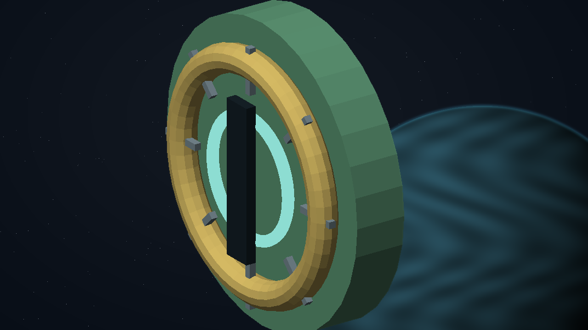

## C02.05 - repair-probe

**Place:** Balgodan (G04-S184). **Objective:** Deliver the loaned repair culture to the stranded Larvaal Probe at Balgodan.

**Story/dialogue:** The jade shell opens around the damaged resonator. The repair culture bridges a broken fold; the probe answers with a short gold pulse.

- **Event:** mission_action_confirmed
- **Required targets:** probe-culture-transfer
- **Interaction item mass tonnes:** 1
- **Next:** listen
- **Completion rule:** All requiredTargets must have confirmed mission-scoped evidence; consume the transition once.
- **Recovery:** Persist each completed target. Recreate an uncompleted objective after load or entity loss; duplicate scans and incidental removal cannot complete it. Escort destruction returns to the escort briefing with a replacement launch and no reward.
- **Confirmation:** Confirm accepts a transfer or choice; Esc only closes the dialog and never transfers an item, spends money or selects a branch.
- **Cargo policy:** Reserve the listed mission item separately from commodities. Require free hold before accepting it; never silently delete, sell or overwrite player cargo. Contacts hold it safely when space is unavailable.
- **Decline policy:** Offer remains available until accepted. Preparation has no deadline. Any explicitly armed incident follows its advertised simulation clock; normal game pause and current-format save/load remain available.
- **Receipt:** l337.quiet-choir/repair-probe
- **Item effects 1 / Kind:** remove
- **Item effects 1 / Item:** repair-culture
- **Item effects 1 / Mass tonnes:** 1
- **Item transaction:** Preview and commit the whole itemEffects batch atomically; capacity is evaluated after removals and additions together. Refusal or cancellation changes neither stage nor custody.

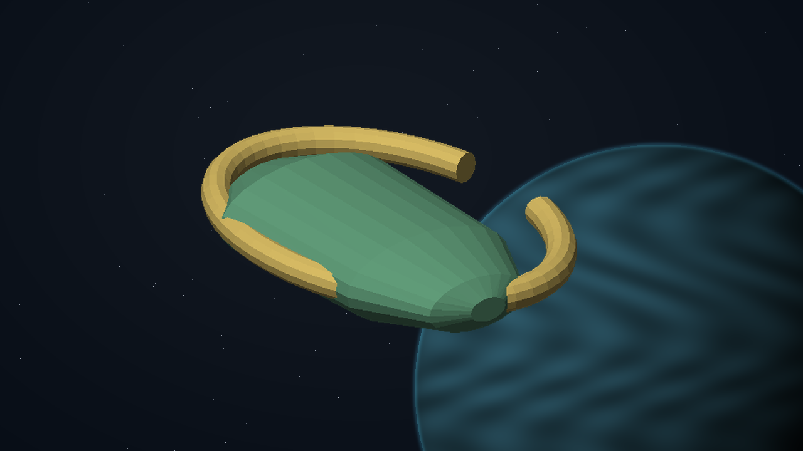

## C02.06 - listen

**Place:** Dalonom (G04-S127). **Objective:** Listen at three safe positions around the Larvaal gathering at Dalonom.

**Story/dialogue:** Three listening positions reveal an empty place in the call. The missing voice should be near Fobolan, where the repeated signal never pauses.

- **Event:** entity_scan_completed
- **Required targets:** choir-near; choir-above; choir-aft
- **Interaction item mass tonnes:** 0
- **Next:** expose-imitation
- **Completion rule:** All requiredTargets must have confirmed mission-scoped evidence; consume the transition once.
- **Recovery:** Persist each completed target. Recreate an uncompleted objective after load or entity loss; duplicate scans and incidental removal cannot complete it. Escort destruction returns to the escort briefing with a replacement launch and no reward.
- **Confirmation:** Confirm accepts a transfer or choice; Esc only closes the dialog and never transfers an item, spends money or selects a branch.
- **Cargo policy:** Reserve the listed mission item separately from commodities. Require free hold before accepting it; never silently delete, sell or overwrite player cargo. Contacts hold it safely when space is unavailable.
- **Decline policy:** Offer remains available until accepted. Preparation has no deadline. Any explicitly armed incident follows its advertised simulation clock; normal game pause and current-format save/load remain available.
- **Receipt:** l337.quiet-choir/listen
- **Item transaction:** Preview and commit the whole itemEffects batch atomically; capacity is evaluated after removals and additions together. Refusal or cancellation changes neither stage nor custody.

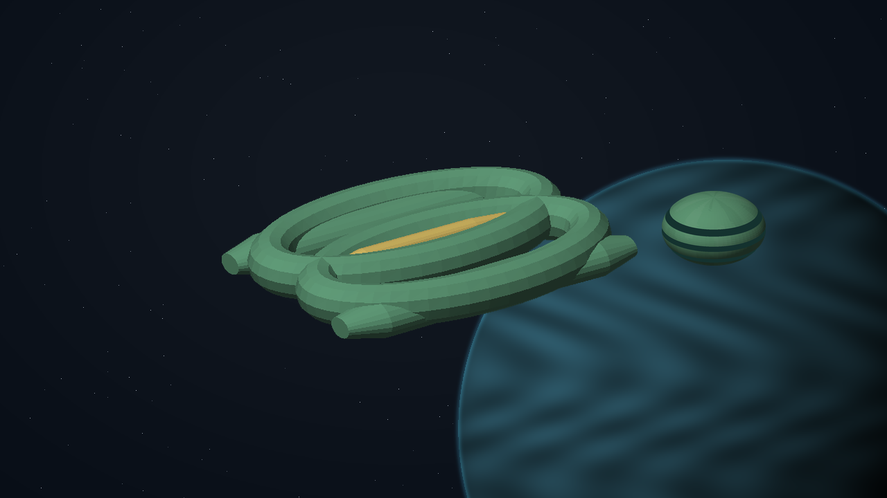

## C02.07 - expose-imitation

**Place:** Fobolan (G04-S132). **Objective:** Locate and silence the counterfeit emitter at Fobolan.

**Story/dialogue:** Human freight seals surround the emitter. Present its copied certificate to make the smugglers abandon it, or disable the exposed transmitter. Destroying unrelated ships proves nothing.

- **Event:** mission_action_confirmed
- **Required targets:** counterfeit-emitter-disabled
- **Interaction item mass tonnes:** 0
- **Choices:** Broadcast the forged certificate and demand shutdown; Disable the unmanned transmitter
- **Next:** rendezvous
- **Completion rule:** All requiredTargets must have confirmed mission-scoped evidence; consume the transition once.
- **Recovery:** Persist each completed target. Recreate an uncompleted objective after load or entity loss; duplicate scans and incidental removal cannot complete it. Escort destruction returns to the escort briefing with a replacement launch and no reward.
- **Confirmation:** Confirm accepts a transfer or choice; Esc only closes the dialog and never transfers an item, spends money or selects a branch.
- **Cargo policy:** Reserve the listed mission item separately from commodities. Require free hold before accepting it; never silently delete, sell or overwrite player cargo. Contacts hold it safely when space is unavailable.
- **Decline policy:** Offer remains available until accepted. Preparation has no deadline. Any explicitly armed incident follows its advertised simulation clock; normal game pause and current-format save/load remain available.
- **Receipt:** l337.quiet-choir/expose-imitation
- **Item transaction:** Preview and commit the whole itemEffects batch atomically; capacity is evaluated after removals and additions together. Refusal or cancellation changes neither stage nor custody.

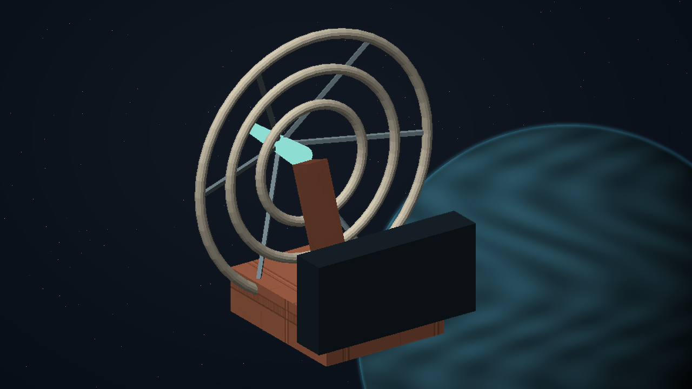

## C02.08 - rendezvous

**Place:** Omdogan (G04-S040). **Objective:** Transmit the corrected reply at Omdogan and choose a rendezvous protocol.

**Story/dialogue:** VALE: We can publish the narrow-band greeting for civilian receivers, or establish a supervised relay while both sides learn its limits.

- **Event:** mission_choice_confirmed
- **Required targets:** choir-protocol
- **Interaction item mass tonnes:** 0
- **Choices:** Publish the civilian greeting; Establish a supervised listening relay
- **Next:** close-case
- **Completion rule:** All requiredTargets must have confirmed mission-scoped evidence; consume the transition once.
- **Recovery:** Persist each completed target. Recreate an uncompleted objective after load or entity loss; duplicate scans and incidental removal cannot complete it. Escort destruction returns to the escort briefing with a replacement launch and no reward.
- **Confirmation:** Confirm accepts a transfer or choice; Esc only closes the dialog and never transfers an item, spends money or selects a branch.
- **Cargo policy:** Reserve the listed mission item separately from commodities. Require free hold before accepting it; never silently delete, sell or overwrite player cargo. Contacts hold it safely when space is unavailable.
- **Decline policy:** Offer remains available until accepted. Preparation has no deadline. Any explicitly armed incident follows its advertised simulation clock; normal game pause and current-format save/load remain available.
- **Receipt:** l337.quiet-choir/rendezvous
- **Item transaction:** Preview and commit the whole itemEffects batch atomically; capacity is evaluated after removals and additions together. Refusal or cancellation changes neither stage nor custody.

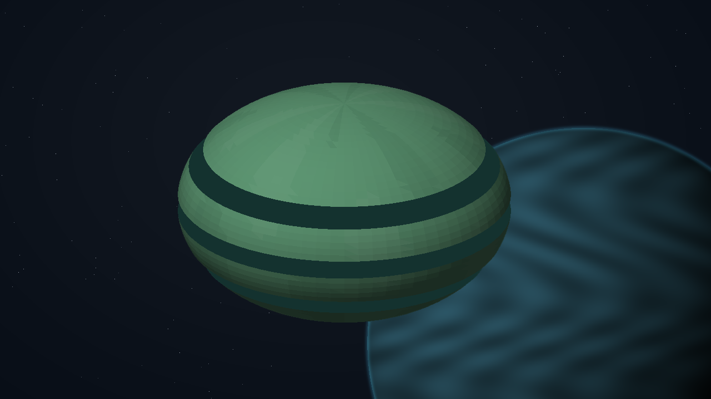

## C02.09 - close-case

**Place:** Omdogan (G04-S040). **Objective:** Dock at Omdogan and confirm the completed signal accord.

**Story/dialogue:** HOLT: The miners have clean guidance channels. The Larvaal vessels have a safe gathering frequency. Your fee is 6,400 CR; the passive resonance filter is ready for fitting.

VALE: One voice answered from outside the gathering. The Larvaal listeners do not recognise it. Its pauses form a pattern like a map. I have preserved the reply in your journal.

- **Event:** mission_contact_confirmed
- **Required targets:** choir-payment
- **Interaction item mass tonnes:** 0
- **Next:** complete
- **Completion rule:** All requiredTargets must have confirmed mission-scoped evidence; consume the transition once.
- **Recovery:** Persist each completed target. Recreate an uncompleted objective after load or entity loss; duplicate scans and incidental removal cannot complete it. Escort destruction returns to the escort briefing with a replacement launch and no reward.
- **Confirmation:** Confirm accepts a transfer or choice; Esc only closes the dialog and never transfers an item, spends money or selects a branch.
- **Cargo policy:** Reserve the listed mission item separately from commodities. Require free hold before accepting it; never silently delete, sell or overwrite player cargo. Contacts hold it safely when space is unavailable.
- **Decline policy:** Offer remains available until accepted. Preparation has no deadline. Any explicitly armed incident follows its advertised simulation clock; normal game pause and current-format save/load remain available.
- **Receipt:** l337.quiet-choir/close-case
- **Item transaction:** Preview and commit the whole itemEffects batch atomically; capacity is evaluated after removals and additions together. Refusal or cancellation changes neither stage nor custody.

**Permanent clue:** The silent voice (`choir-silent-voice`). The restored Larvaal call contains a reply from beyond the gathering. Its pauses describe a curve, but no Larvaal vessel claims the voice.

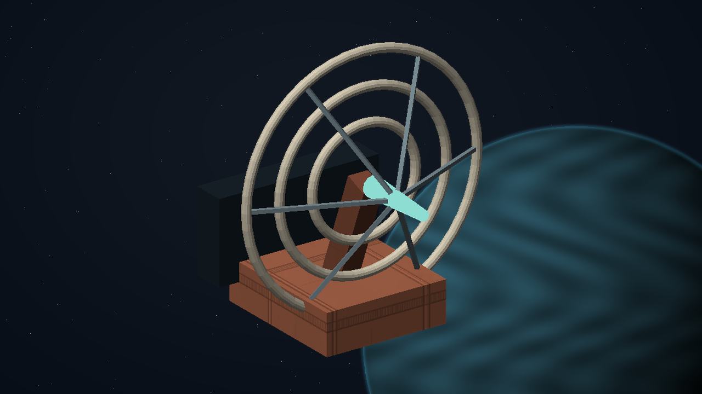

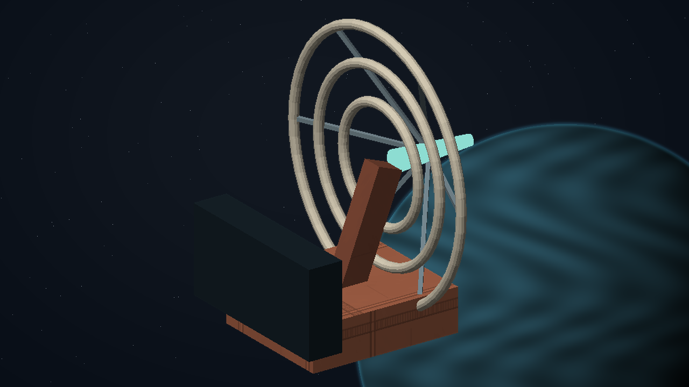

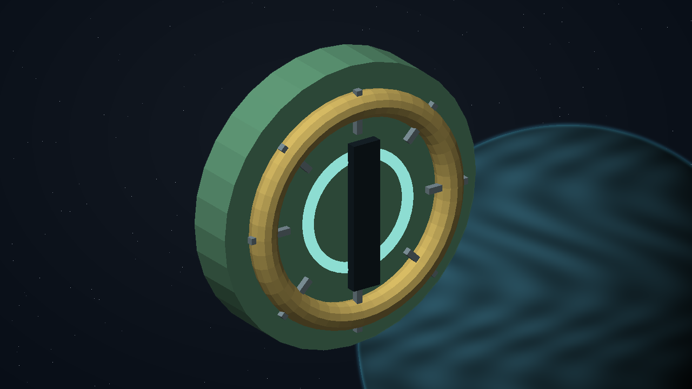

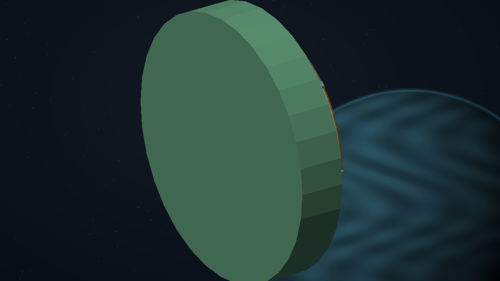

[Complete structured definition](../definitions/missions/quiet-choir.json).
