# C07 - The Still Current

[Return to the oracle contents](../README.md). This reading view is extracted from [the complete single-file oracle](../FINAL-GAME-ORACLE.md); its rules are the same.

**Mission identity:** `l337.still-current`. **Premise:** The harvesters are idle. The charge is still moving.

A mothballed orbital energy lattice near Karrakor reports no output, yet three independent utility meters show its charge reservoir growing. A maintenance tender is trapped outside an over-heated service corridor. Physicist Anja Kest suspects that conductive dust has bridged the collector isolation gaps, turning the dormant structure into an unintended capacitor. Salvage Chief Ruan Pell finds that uncrewed reclamation machinery is repeatedly reconnecting the bridges because it mistakes a stored commissioning instruction for a current work order. The commander must establish the real energy balance, rescue the technicians, position insulated baffles and revoke the obsolete work authority. The settlements then choose between a supervised community buffer and dismantling the collectors for reuse. Every step relies on measured charge, physical isolation and real receiving records.

**Offer:** At Valrator in Galaxy 2, after one completed ordinary trade, answer a utility survey notice. No combat-rank gate. The recovered charge cell and later baffle programmer each need one tonne of free hold, never both at once.

**Briefing:** KEST: These three meters cannot all be wrong in the same way. We stopped buying power from the lattice years ago. Find where the charge goes before someone reconnects a corridor full of people.

**Contacts:** Physicist Anja Kest, Salvage Chief Ruan Pell. **Story craft:** SH001 Mule, SH049 Hyena, SH061 Haflinger.

**Successful settlement:** 8,400 CR. The selected community buffer or completed material recovery remains in the local utility record. No personal ship curse, permanent equipment damage, legal-status reset or free hull. A permanent clue for The Unwritten Route: The resting arc.

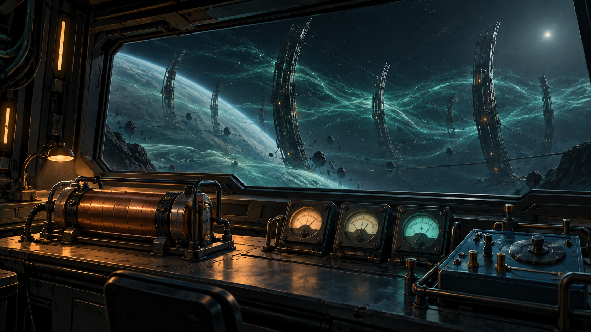

Mission-specific rules and resources:

- **Origin kind:** new-original
- **Branch policy:** Choose community-buffer or material-recovery once at choose-lattice. Revoke obsolete work authority in both routes. Commit matching proofs at the collectors and reservoir; mixed evidence cannot complete the campaign. Both routes pay 8,400 CR and award the same clue.
- **Items 1 / Id:** lattice-charge-cell
- **Items 1 / Mass tonnes:** 1
- **Items 1 / Acquire stage:** recover-cell
- **Items 1 / Consume stage:** analyse-charge
- **Items 2 / Id:** baffle-programmer
- **Items 2 / Mass tonnes:** 1
- **Items 2 / Acquire stage:** analyse-charge
- **Items 2 / Consume stage:** return-programmer
- **Interaction notes:** Use normal targeting, scan and contextual Confirm. The survey is voluntary; Esc closes a briefing without accepting, placing a device or choosing a settlement. No additional keyboard binding.; The charge-cell exchange loans the one-tonne baffle programmer atomically. Keep that tool through both collector operations and return it at Valrator before final payment.; Lattice field exposure adds cabin heat only while the ship is physically inside a clearly marked hazard volume. The normal cabin-temperature HUD and an audible warning remain available. Leaving the volume permits normal cooling; the mission never hides instruments, fires weapons, buys cargo or redirects a jump.; The array starts with 900 measured charge units and no active generation source after isolation. Account for every routed, safely discharged or recovered unit. Display the remaining charge and the actual safe work windows. Moving a baffle is not a fresh energy source.; The maintenance tender and its technicians are real identified actors. Only its arrival at the designated safe berth completes rescue. If lost, preserve casualties and arrange an actual replacement retrieval before continuing; never resurrect a named individual or clone cargo.; Automated reclamation machines are unmanned service equipment, not station hulls. A patrol kill or destroyed station cannot supply isolation evidence. Scavengers may interfere, but combat is never the energy-balance or completion predicate.; Normal pause stops simulation heat and operations. Current-format saving preserves energy allocations, baffle positions, disabled work authority, tool custody and branch evidence. There is no hidden global deadline.
- **Energy rules / Initial charge units:** 900
- **Energy rules / External input after isolation:** 0
- **Energy rules / Collector ids:** collector-port; collector-keel; collector-starboard
- **Energy rules / Baffles:** baffle-inner; baffle-middle; baffle-outer
- **Energy rules / Safe discharge limit per operation:** 90
- **Energy rules / Buffer capacity:** 600
- **Energy rules / Required local delivery units:** 300
- **Energy rules / Accounting:** Measured charge = remaining + physically delivered + safely discharged + recovered storage. No negative quantity, repeated transfer or unverified receiving endpoint.
- **Energy rules / Heat:** A named geometric work volume supplies bounded simulation-time heat through the ordinary thermal system. It is never tied to a random GUI event or commander identity.
- **Energy rules / Restoration:** A current save restores the same meter identities, actual balances and recorded baffle placements. Culled scene meshes do not change logical control or charge.
- **Terminal stage:** complete
- **Reward receipt:** l337.still-current/final-payment
- **Reward policy:** Pay credits once, atomically with the terminal receipt. Delay optional equipment fitting if incompatible; offer it again without duplicating payment. Never award kill points for non-kills or clear unrelated legal status. Commit the clue and terminal reward receipt atomically; a pending optional fitting does not delay the clue.
- **Identity policy:** Match locations by galaxy/system identity, not coordinates or displayed spelling. Match entities by mission instance and target ID, never merely ship type.
- **Persistence policy:** Every campaign starts unaccepted with its current identity and zero progress. Persist current-format stage evidence, choices, mission-item custody, reward and clue receipts. Resume these records on load; replayed events cannot duplicate rewards. No previous campaign or save format is imported.

## C07.01 - accept

**Place:** Valrator (G02-S090). **Objective:** Accept the dormant-lattice survey at Valrator.

**Story/dialogue:** KEST: We need measured values, not a rumour about haunted machinery. You can leave the survey at any safe berth; your ship will remain yours to control.

- **Event:** mission_contact_confirmed
- **Required targets:** kest-survey-commission
- **Interaction item mass tonnes:** 0
- **Next:** survey-current
- **Completion rule:** All requiredTargets must have confirmed mission-scoped evidence; consume the transition once.
- **Recovery:** Persist each completed target. Recreate an uncompleted objective after load or entity loss; duplicate scans and incidental removal cannot complete it. Escort destruction returns to the escort briefing with a replacement launch and no reward.
- **Confirmation:** Confirm accepts a transfer or choice; Esc only closes the dialog and never transfers an item, spends money or selects a branch.
- **Cargo policy:** Reserve the listed mission item separately from commodities. Require free hold before accepting it; never silently delete, sell or overwrite player cargo. Contacts hold it safely when space is unavailable.
- **Decline policy:** Offer remains available until accepted. Preparation has no deadline. Any explicitly armed incident follows its advertised simulation clock; normal game pause and current-format save/load remain available.
- **Receipt:** l337.still-current/accept
- **Item transaction:** Preview and commit the whole itemEffects batch atomically; capacity is evaluated after removals and additions together. Refusal or cancellation changes neither stage nor custody.

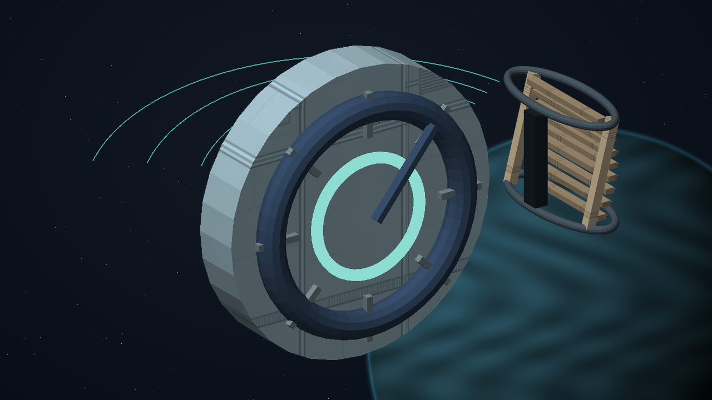

## C07.02 - survey-current

**Place:** Karrakor (G02-S174). **Objective:** Scan three utility meters around the Karrakor lattice.

**Story/dialogue:** The supply meter reads zero. The reservoir and return meters still record a growing potential difference. Their independent calibration signatures agree.

- **Event:** entity_scan_completed
- **Required targets:** meter-supply; meter-reservoir; meter-return
- **Interaction item mass tonnes:** 0
- **Next:** recover-cell
- **Completion rule:** All requiredTargets must have confirmed mission-scoped evidence; consume the transition once.
- **Recovery:** Persist each completed target. Recreate an uncompleted objective after load or entity loss; duplicate scans and incidental removal cannot complete it. Escort destruction returns to the escort briefing with a replacement launch and no reward.
- **Confirmation:** Confirm accepts a transfer or choice; Esc only closes the dialog and never transfers an item, spends money or selects a branch.
- **Cargo policy:** Reserve the listed mission item separately from commodities. Require free hold before accepting it; never silently delete, sell or overwrite player cargo. Contacts hold it safely when space is unavailable.
- **Decline policy:** Offer remains available until accepted. Preparation has no deadline. Any explicitly armed incident follows its advertised simulation clock; normal game pause and current-format save/load remain available.
- **Receipt:** l337.still-current/survey-current
- **Item transaction:** Preview and commit the whole itemEffects batch atomically; capacity is evaluated after removals and additions together. Refusal or cancellation changes neither stage nor custody.

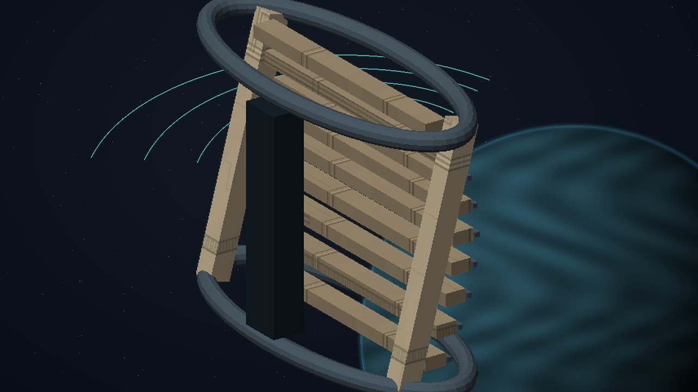

## C07.03 - recover-cell

**Place:** Karrakor (G02-S174). **Objective:** Recover the one-tonne insulated charge cell from the unmanned maintenance sled.

**Story/dialogue:** PELL: The sled is empty. Use the insulated service latch and preserve the cell; blowing up a random machine tells us nothing about the trapped charge.

- **Event:** mission_item_recovered
- **Required targets:** lattice-cell-identified
- **Interaction item mass tonnes:** 1
- **Next:** analyse-charge
- **Completion rule:** All requiredTargets must have confirmed mission-scoped evidence; consume the transition once.
- **Recovery:** Persist each completed target. Recreate an uncompleted objective after load or entity loss; duplicate scans and incidental removal cannot complete it. Escort destruction returns to the escort briefing with a replacement launch and no reward.
- **Confirmation:** Confirm accepts a transfer or choice; Esc only closes the dialog and never transfers an item, spends money or selects a branch.
- **Cargo policy:** Reserve the listed mission item separately from commodities. Require free hold before accepting it; never silently delete, sell or overwrite player cargo. Contacts hold it safely when space is unavailable.
- **Decline policy:** Offer remains available until accepted. Preparation has no deadline. Any explicitly armed incident follows its advertised simulation clock; normal game pause and current-format save/load remain available.
- **Receipt:** l337.still-current/recover-cell
- **Item effects 1 / Kind:** add
- **Item effects 1 / Item:** lattice-charge-cell
- **Item effects 1 / Mass tonnes:** 1
- **Item transaction:** Preview and commit the whole itemEffects batch atomically; capacity is evaluated after removals and additions together. Refusal or cancellation changes neither stage nor custody.

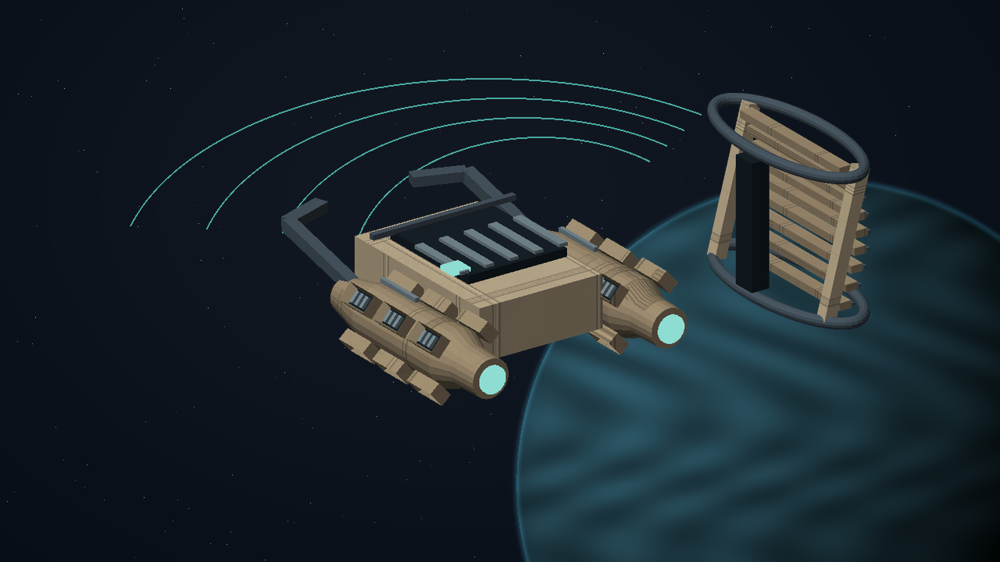

## C07.04 - analyse-charge

**Place:** Valrator (G02-S090). **Objective:** Exchange the charge cell for Kest's baffle programmer at Valrator.

**Story/dialogue:** KEST: The cell stores charge across dust bridges. The reclamation controller keeps rebuilding them from an obsolete instruction. I will keep the cell and loan you this programmer in the same hold slot.

- **Event:** mission_contact_confirmed
- **Required targets:** kest-charge-analysis
- **Interaction item mass tonnes:** 1
- **Next:** rescue-technicians
- **Completion rule:** All requiredTargets must have confirmed mission-scoped evidence; consume the transition once.
- **Recovery:** Persist each completed target. Recreate an uncompleted objective after load or entity loss; duplicate scans and incidental removal cannot complete it. Escort destruction returns to the escort briefing with a replacement launch and no reward.
- **Confirmation:** Confirm accepts a transfer or choice; Esc only closes the dialog and never transfers an item, spends money or selects a branch.
- **Cargo policy:** Reserve the listed mission item separately from commodities. Require free hold before accepting it; never silently delete, sell or overwrite player cargo. Contacts hold it safely when space is unavailable.
- **Decline policy:** Offer remains available until accepted. Preparation has no deadline. Any explicitly armed incident follows its advertised simulation clock; normal game pause and current-format save/load remain available.
- **Receipt:** l337.still-current/analyse-charge
- **Item effects 1 / Kind:** remove
- **Item effects 1 / Item:** lattice-charge-cell
- **Item effects 1 / Mass tonnes:** 1
- **Item effects 2 / Kind:** add
- **Item effects 2 / Item:** baffle-programmer
- **Item effects 2 / Mass tonnes:** 1
- **Item transaction:** Preview and commit the whole itemEffects batch atomically; capacity is evaluated after removals and additions together. Refusal or cancellation changes neither stage nor custody.

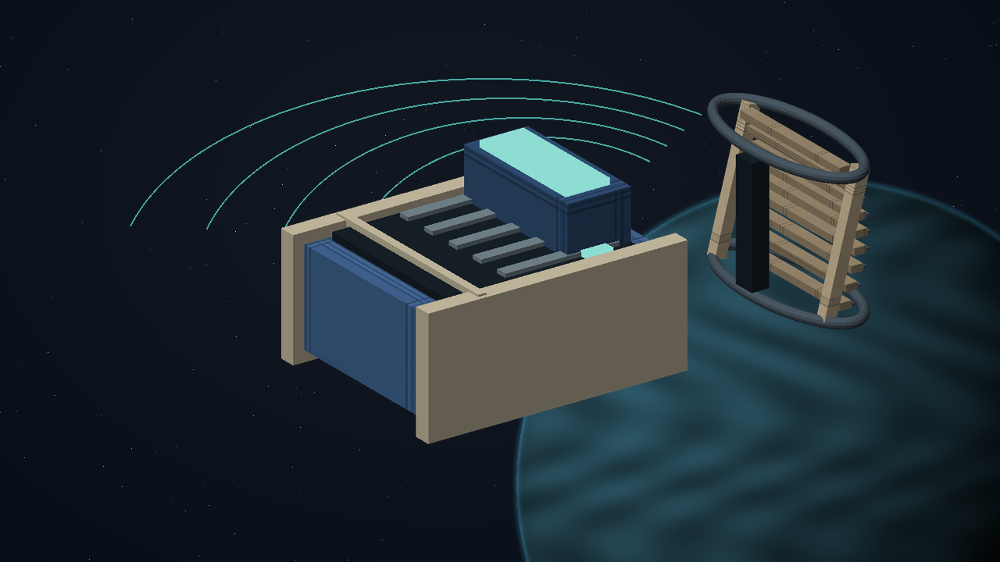

## C07.05 - rescue-technicians

**Place:** Karrakor (G02-S174). **Objective:** Escort the identified maintenance tender through the safe corridor to its reception berth.

**Story/dialogue:** PELL: The technicians are aboard this tender. Keep the clear corridor open until reception records their arrival. Do not enter the charged lattice to shorten the route.

- **Event:** escort_arrived
- **Required targets:** pell-maintenance-tender-received
- **Interaction item mass tonnes:** 1
- **Next:** map-feedlines
- **Completion rule:** All requiredTargets must have confirmed mission-scoped evidence; consume the transition once.
- **Recovery:** Persist each completed target. Recreate an uncompleted objective after load or entity loss; duplicate scans and incidental removal cannot complete it. Escort destruction returns to the escort briefing with a replacement launch and no reward.
- **Confirmation:** Confirm accepts a transfer or choice; Esc only closes the dialog and never transfers an item, spends money or selects a branch.
- **Cargo policy:** Reserve the listed mission item separately from commodities. Require free hold before accepting it; never silently delete, sell or overwrite player cargo. Contacts hold it safely when space is unavailable.
- **Decline policy:** Offer remains available until accepted. Preparation has no deadline. Any explicitly armed incident follows its advertised simulation clock; normal game pause and current-format save/load remain available.
- **Receipt:** l337.still-current/rescue-technicians
- **Item transaction:** Preview and commit the whole itemEffects batch atomically; capacity is evaluated after removals and additions together. Refusal or cancellation changes neither stage nor custody.

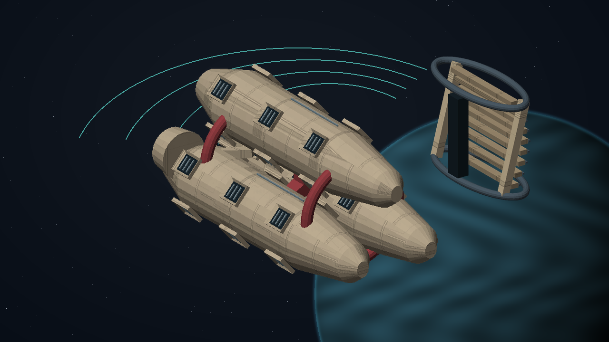

## C07.06 - map-feedlines

**Place:** Mortor (G02-S159). **Objective:** Scan the three external feedlines at Mortor and identify the obsolete work authority.

**Story/dialogue:** All three collectors are connected to the same archived work order. Revoke that authority before any branch can be safe; no living crew has consented to its renewal.

- **Event:** entity_scan_completed
- **Required targets:** feedline-port; feedline-keel; feedline-starboard
- **Interaction item mass tonnes:** 1
- **Next:** place-baffles
- **Completion rule:** All requiredTargets must have confirmed mission-scoped evidence; consume the transition once.
- **Recovery:** Persist each completed target. Recreate an uncompleted objective after load or entity loss; duplicate scans and incidental removal cannot complete it. Escort destruction returns to the escort briefing with a replacement launch and no reward.
- **Confirmation:** Confirm accepts a transfer or choice; Esc only closes the dialog and never transfers an item, spends money or selects a branch.
- **Cargo policy:** Reserve the listed mission item separately from commodities. Require free hold before accepting it; never silently delete, sell or overwrite player cargo. Contacts hold it safely when space is unavailable.
- **Decline policy:** Offer remains available until accepted. Preparation has no deadline. Any explicitly armed incident follows its advertised simulation clock; normal game pause and current-format save/load remain available.
- **Receipt:** l337.still-current/map-feedlines
- **Item transaction:** Preview and commit the whole itemEffects batch atomically; capacity is evaluated after removals and additions together. Refusal or cancellation changes neither stage nor custody.

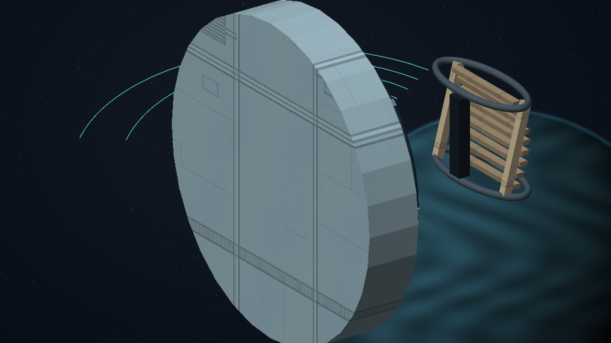

## C07.07 - place-baffles

**Place:** Karrakor (G02-S174). **Objective:** Position three insulated baffles at the marked Karrakor work points.

**Story/dialogue:** The baffles split the work volume into visible safe windows. Watch normal cabin heat and withdraw between operations if needed. The programmer records each physical lock.

- **Event:** mission_action_confirmed
- **Required targets:** baffle-inner-positioned; baffle-middle-positioned; baffle-outer-positioned
- **Interaction item mass tonnes:** 1
- **Next:** choose-lattice
- **Completion rule:** All requiredTargets must have confirmed mission-scoped evidence; consume the transition once.
- **Recovery:** Persist each completed target. Recreate an uncompleted objective after load or entity loss; duplicate scans and incidental removal cannot complete it. Escort destruction returns to the escort briefing with a replacement launch and no reward.
- **Confirmation:** Confirm accepts a transfer or choice; Esc only closes the dialog and never transfers an item, spends money or selects a branch.
- **Cargo policy:** Reserve the listed mission item separately from commodities. Require free hold before accepting it; never silently delete, sell or overwrite player cargo. Contacts hold it safely when space is unavailable.
- **Decline policy:** Offer remains available until accepted. Preparation has no deadline. Any explicitly armed incident follows its advertised simulation clock; normal game pause and current-format save/load remain available.
- **Receipt:** l337.still-current/place-baffles
- **Item transaction:** Preview and commit the whole itemEffects batch atomically; capacity is evaluated after removals and additions together. Refusal or cancellation changes neither stage nor custody.

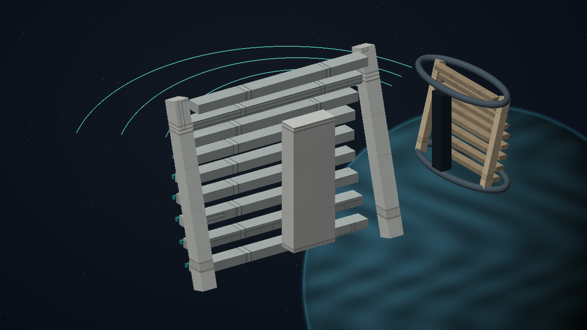

## C07.08 - choose-lattice

**Place:** Valrator (G02-S090). **Objective:** Choose the lattice's future with the local utility operators.

**Story/dialogue:** KEST: A supervised buffer can deliver stored power under local limits. Or we can empty the reservoir and reclaim the collectors. Both require the old work authority to be removed.

- **Event:** mission_choice_confirmed
- **Required targets:** lattice-settlement-choice
- **Interaction item mass tonnes:** 1
- **Choices:** Commission a bounded community energy buffer; Recover the stored energy and dismantle the collectors
- **Choice ids:** community-buffer; material-recovery
- **Next:** isolate-collectors
- **Completion rule:** All requiredTargets must have confirmed mission-scoped evidence; consume the transition once.
- **Recovery:** Persist each completed target. Recreate an uncompleted objective after load or entity loss; duplicate scans and incidental removal cannot complete it. Escort destruction returns to the escort briefing with a replacement launch and no reward.
- **Confirmation:** Confirm accepts a transfer or choice; Esc only closes the dialog and never transfers an item, spends money or selects a branch.
- **Cargo policy:** Reserve the listed mission item separately from commodities. Require free hold before accepting it; never silently delete, sell or overwrite player cargo. Contacts hold it safely when space is unavailable.
- **Decline policy:** Offer remains available until accepted. Preparation has no deadline. Any explicitly armed incident follows its advertised simulation clock; normal game pause and current-format save/load remain available.
- **Receipt:** l337.still-current/choose-lattice
- **Item transaction:** Preview and commit the whole itemEffects batch atomically; capacity is evaluated after removals and additions together. Refusal or cancellation changes neither stage nor custody.

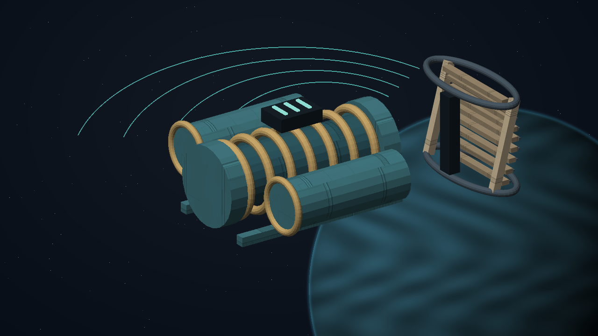

## C07.09 - isolate-collectors

**Place:** Karrakor (G02-S174). **Objective:** Revoke the obsolete work order and apply the chosen collector settlement.

**Story/dialogue:** Only the marked collector modules are involved. Their signed work-order revocation and measured isolation are separate from the nearby station.

- **Event:** mission_action_confirmed
- **Required targets:** collector-settlement-proof
- **Interaction item mass tonnes:** 1
- **Branch stage:** choose-lattice
- **Branch variants 1 / Choice id:** community-buffer
- **Branch variants 1 / Event:** mission_action_confirmed
- **Branch variants 1 / Required targets:** collector-authority-revoked; collector-quota-tested
- **Branch variants 1 / Objective:** Revoke the archived work authority and test the locally bounded collector quota.
- **Branch variants 1 / Dialog:** An order outside the consented quota is rejected. No reclaimed machine can reconnect a dust bridge by replaying the old job.
- **Branch variants 1 / Gossip:** The lattice collectors now obey locally tested utility limits.
- **Branch variants 2 / Choice id:** material-recovery
- **Branch variants 2 / Event:** campaign_target_disabled
- **Branch variants 2 / Required targets:** collector-authority-disabled; collector-bus-isolated
- **Branch variants 2 / Objective:** Disable the archived work controller and verify all collector bus links are isolated.
- **Branch variants 2 / Dialog:** The unmanned controller is isolated. Its receiving log proves the collectors cannot reconnect to the reservoir.
- **Branch variants 2 / Gossip:** The dormant collectors are isolated for controlled material recovery.
- **Completion rule:** Require every distinct proof of the persisted chosen branch at this exact mission instance and world; unrelated deaths or missing meshes prove nothing.
- **Next:** settle-reservoir
- **Recovery:** Persist each completed target. Recreate an uncompleted objective after load or entity loss; duplicate scans and incidental removal cannot complete it. Escort destruction returns to the escort briefing with a replacement launch and no reward.
- **Confirmation:** Confirm accepts a transfer or choice; Esc only closes the dialog and never transfers an item, spends money or selects a branch.
- **Cargo policy:** Reserve the listed mission item separately from commodities. Require free hold before accepting it; never silently delete, sell or overwrite player cargo. Contacts hold it safely when space is unavailable.
- **Decline policy:** Offer remains available until accepted. Preparation has no deadline. Any explicitly armed incident follows its advertised simulation clock; normal game pause and current-format save/load remain available.
- **Receipt:** l337.still-current/isolate-collectors
- **Item transaction:** Preview and commit the whole itemEffects batch atomically; capacity is evaluated after removals and additions together. Refusal or cancellation changes neither stage nor custody.

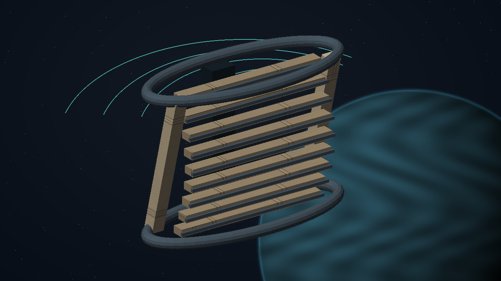

## C07.10 - settle-reservoir

**Place:** Mortor (G02-S159). **Objective:** Account for the full stored charge and complete the selected settlement at Mortor.

**Story/dialogue:** The displayed balance must reach an accounted state. Deliveries require a real receiving meter; safe discharge and recovered storage retain their own receipts.

- **Event:** mission_action_confirmed
- **Required targets:** reservoir-settlement-proof
- **Interaction item mass tonnes:** 1
- **Branch stage:** choose-lattice
- **Branch variants 1 / Choice id:** community-buffer
- **Branch variants 1 / Event:** mission_action_confirmed
- **Branch variants 1 / Required targets:** community-delivery-received; buffer-capacity-tested
- **Branch variants 1 / Objective:** Deliver 300 measured charge units to the local utility and prove the remaining 600 stay inside the bounded buffer.
- **Branch variants 1 / Dialog:** The utility has received its 300 units. The buffer holds 600 and refuses an over-capacity order.
- **Branch variants 1 / Gossip:** A measured community reserve now supports the utility without autonomous reconnection.
- **Branch variants 2 / Choice id:** material-recovery
- **Branch variants 2 / Event:** mission_action_confirmed
- **Branch variants 2 / Required targets:** recovered-storage-received; collector-material-received
- **Branch variants 2 / Objective:** Transfer all remaining charge to registered recovery storage and confirm the collectors' material delivery.
- **Branch variants 2 / Dialog:** Recovery storage and the receiving yard account for the remaining energy and dismantled components. Nothing vanished into an inventory adjustment.
- **Branch variants 2 / Gossip:** The lattice is retired; its stored energy and materials have reached the local operators.
- **Completion rule:** Require the correct chosen settlement, completed collector isolation and all actual energy/custody receipts. No count-only or mixed-branch shortcut.
- **Next:** return-programmer
- **Recovery:** Persist each completed target. Recreate an uncompleted objective after load or entity loss; duplicate scans and incidental removal cannot complete it. Escort destruction returns to the escort briefing with a replacement launch and no reward.
- **Confirmation:** Confirm accepts a transfer or choice; Esc only closes the dialog and never transfers an item, spends money or selects a branch.
- **Cargo policy:** Reserve the listed mission item separately from commodities. Require free hold before accepting it; never silently delete, sell or overwrite player cargo. Contacts hold it safely when space is unavailable.
- **Decline policy:** Offer remains available until accepted. Preparation has no deadline. Any explicitly armed incident follows its advertised simulation clock; normal game pause and current-format save/load remain available.
- **Receipt:** l337.still-current/settle-reservoir
- **Item transaction:** Preview and commit the whole itemEffects batch atomically; capacity is evaluated after removals and additions together. Refusal or cancellation changes neither stage nor custody.

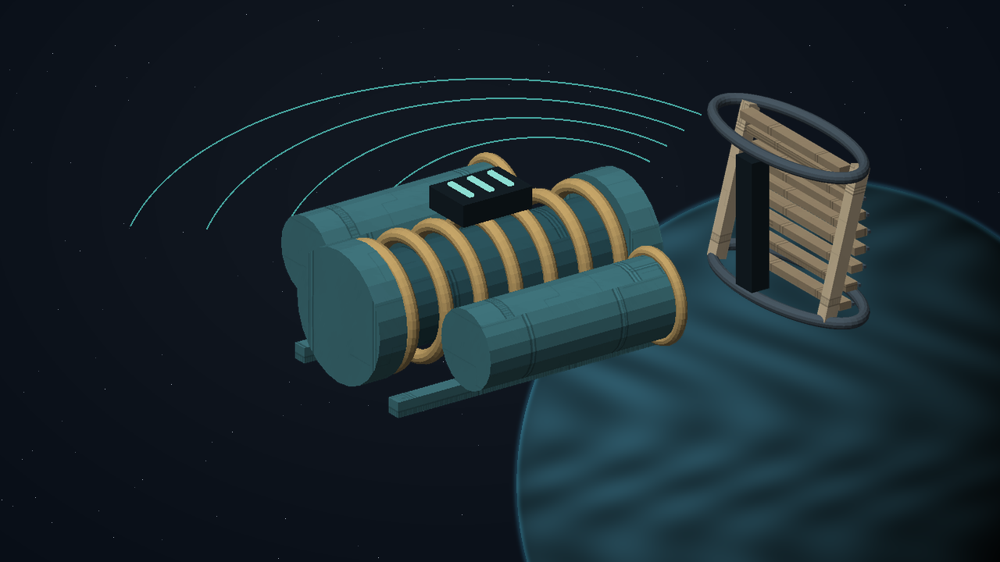

## C07.11 - return-programmer

**Place:** Valrator (G02-S090). **Objective:** Return the baffle programmer and verify the final energy balance at Valrator.

**Story/dialogue:** KEST: The meter identities, local receipts and reservoir balance agree. The work tool is returned; your readings remain with the utility record.

- **Event:** mission_contact_confirmed
- **Required targets:** kest-programmer-return
- **Interaction item mass tonnes:** 1
- **Next:** close-case
- **Completion rule:** All requiredTargets must have confirmed mission-scoped evidence; consume the transition once.
- **Recovery:** Persist each completed target. Recreate an uncompleted objective after load or entity loss; duplicate scans and incidental removal cannot complete it. Escort destruction returns to the escort briefing with a replacement launch and no reward.
- **Confirmation:** Confirm accepts a transfer or choice; Esc only closes the dialog and never transfers an item, spends money or selects a branch.
- **Cargo policy:** Reserve the listed mission item separately from commodities. Require free hold before accepting it; never silently delete, sell or overwrite player cargo. Contacts hold it safely when space is unavailable.
- **Decline policy:** Offer remains available until accepted. Preparation has no deadline. Any explicitly armed incident follows its advertised simulation clock; normal game pause and current-format save/load remain available.
- **Receipt:** l337.still-current/return-programmer
- **Item effects 1 / Kind:** remove
- **Item effects 1 / Item:** baffle-programmer
- **Item effects 1 / Mass tonnes:** 1
- **Item transaction:** Preview and commit the whole itemEffects batch atomically; capacity is evaluated after removals and additions together. Refusal or cancellation changes neither stage nor custody.

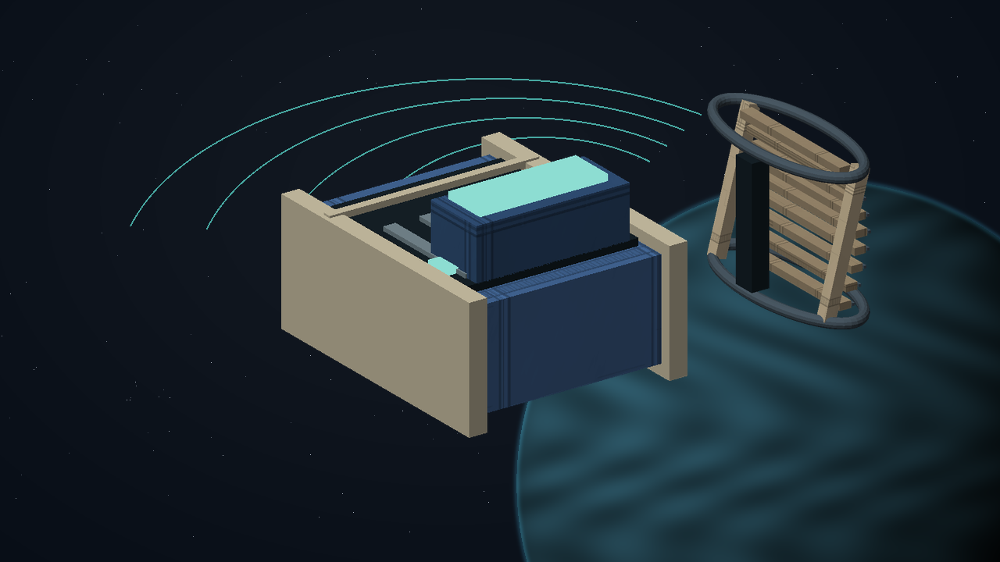

## C07.12 - close-case

**Place:** Valrator (G02-S090). **Objective:** Confirm the completed lattice settlement and collect the survey fee.

**Story/dialogue:** PELL: The technicians reached reception and the lattice is under its agreed control. Your survey fee is 8,400 CR. The recorded outcome remains part of this system.

KEST: This arc predates the lattice. It cannot be part of the dust bridge or its work order. I have copied the zero-charge phase record to your journal; PLUGH's AI may recognise it.

- **Event:** mission_contact_confirmed
- **Required targets:** lattice-final-payment
- **Interaction item mass tonnes:** 0
- **Dialog by choice 1 / Choice id:** community-buffer
- **Dialog by choice 1 / Text:** KEST: The buffer is supervised by its users. It cannot turn an old commissioning instruction into a claim on new power.
- **Dialog by choice 2 / Choice id:** material-recovery
- **Dialog by choice 2 / Text:** PELL: The collectors are safely retired and their material is received. The empty corridor can be used again.
- **Next:** complete
- **Completion rule:** All requiredTargets must have confirmed mission-scoped evidence; consume the transition once.
- **Recovery:** Persist each completed target. Recreate an uncompleted objective after load or entity loss; duplicate scans and incidental removal cannot complete it. Escort destruction returns to the escort briefing with a replacement launch and no reward.
- **Confirmation:** Confirm accepts a transfer or choice; Esc only closes the dialog and never transfers an item, spends money or selects a branch.
- **Cargo policy:** Reserve the listed mission item separately from commodities. Require free hold before accepting it; never silently delete, sell or overwrite player cargo. Contacts hold it safely when space is unavailable.
- **Decline policy:** Offer remains available until accepted. Preparation has no deadline. Any explicitly armed incident follows its advertised simulation clock; normal game pause and current-format save/load remain available.
- **Receipt:** l337.still-current/close-case
- **Item transaction:** Preview and commit the whole itemEffects batch atomically; capacity is evaluated after removals and additions together. Refusal or cancellation changes neither stage nor custody.

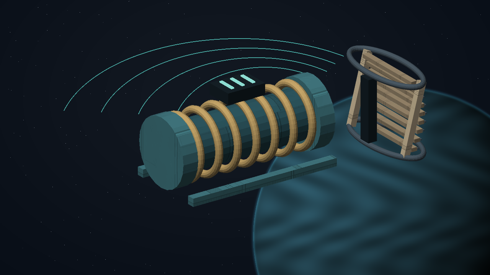

**Permanent clue:** The resting arc (`current-resting-arc`). The lattice's oldest meter records an inward arc before any collector was built. The measured charge is zero, but the phase signature still encloses a quiet centre.

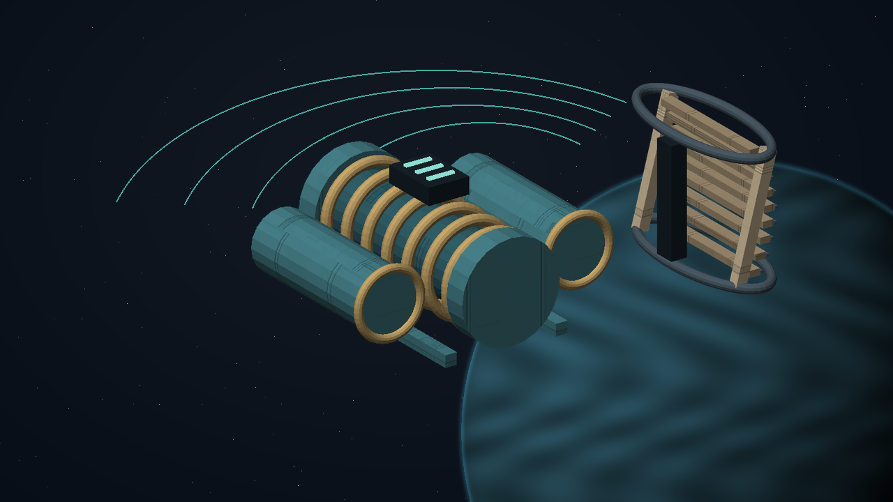

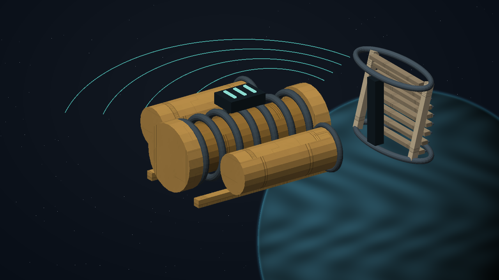

[Complete structured definition](../definitions/missions/still-current.json).
