# C08 - Wayfarer Exchange

[Return to the oracle contents](../README.md). This reading view is extracted from [the complete single-file oracle](../FINAL-GAME-ORACLE.md); its rules are the same.

**Mission identity:** `l337.wayfarer-exchange`. **Premise:** A route is only useful when someone at the other end receives what was promised.

Independent clinics, repair workshops, seed custodians and remote utility crews have reliable local suppliers but no shared way to reserve scarce transport capacity. The Wayfarer Union asks the commander to demonstrate a receiving-based dispatch service across the Avenor cluster. A refrigerated clinic delivery, a closed repair exchange, an agricultural seed transfer and a real crew recovery establish the service records. Restoring an external utility handoff makes the final route viable. The participating operators then choose either pooled route windows or protected local reservations. The commander validates the published charter and earns accreditation. Afterwards, the Exchange continues as a visible board of six original service templates, with actual consignments, declared requirements and transparent quotes.

**Offer:** At Avenor in Galaxy 1, the Wayfarer Union offers an openly advertised network-induction commission after one ordinary delivery or commodity sale. One tonne of free hold is sufficient for the serial loaned equipment. No combat-rank requirement or random rare-offer gate.

**Briefing:** SENN: We are building a service record, not a club for people with enough kills. Deliver the clinic sample, bring the repaired cassette home and show every receiving operator what you actually handed over.

**Contacts:** Dispatcher Evi Senn, Custodian Tomas Veil. **Story craft:** SH001 Mule, SH005 Bison, SH061 Haflinger.

**Successful settlement:** 7,600 CR. Accreditation opens advanced variants on the visible Wayfarer Exchange board. Six repeatable service templates remain available with separate quotes and receipts. Accreditation grants no free cargo, personal ship or unrelated legal-status reset. A permanent clue for The Unwritten Route: The unbooked window.

Mission-specific rules and resources:

- **Origin kind:** new-original
- **Branch policy:** Choose pooled-windows or protected-reservations once at choose-charter. Obtain the corresponding three service signatures at commit-charter. Both successful charters pay 7,600 CR and grant one permanent clue. Repeat contracts never award this campaign clue or its induction payment again.
- **Items 1 / Id:** clinic-cold-crate
- **Items 1 / Mass tonnes:** 1
- **Items 1 / Acquire stage:** collect-coldcrate
- **Items 1 / Consume stage:** deliver-coldchain
- **Items 2 / Id:** return-cassette
- **Items 2 / Mass tonnes:** 1
- **Items 2 / Acquire stage:** recover-cassette
- **Items 2 / Consume stage:** close-repair-loop
- **Items 3 / Id:** seed-vault-key
- **Items 3 / Mass tonnes:** 1
- **Items 3 / Acquire stage:** survey-seed-vault
- **Items 3 / Consume stage:** escort-seed-ark
- **Items 4 / Id:** crew-custody-recorder
- **Items 4 / Mass tonnes:** 1
- **Items 4 / Acquire stage:** recover-crew-log
- **Items 4 / Consume stage:** return-survivors
- **Interaction notes:** The Exchange uses the existing station contract board, arrows, contextual Confirm and Esc. Display destination, reward, hold/crew requirements, any actual deadline, perishability, risk and accepting consequences together. No extra function key, hidden rare offer or special campaign control.; The four induction items are serial one-tonne reservations. Confirm their whole custody transaction atomically. Cold-chain delivery and survivor reception need the relevant quality or live-crew receipts in addition to the named mission target.; The clinic cold crate has an independent sealed cooling unit. Its advertised integrity budget is consumed only during armed flight time after confirmed pickup; normal pause stops it and current-format save/load preserves the remaining value. A spoiled delivery is recorded honestly and can be replaced from actual clinic stock; it is never counted as successful.; The seed ark and rescue tender carry their own real cargo or crews. They are identified actors with receiving manifests. Do not require player passenger cabins for these induction escorts, copy dead personnel, create a delivery from culling or treat a generic same-type freighter as the consignment.; The board can run at most three accepted service contracts per commander. It reserves real unique consignments and the required player capacity across all active work. Closing/reopening the board or loading cannot reroll a quote, create stock, reset a deadline or duplicate an offer.; Service history shows completed, late and failed deliveries directly. Equipment and capacity gates are explained in the quote. No hidden combat quota or unexplained reputation decay gates routine work.; Signed Passage, ordinary sealed dispatch and completed Exchange induction are distinct clue sources. Each Exchange service family grants its own clue at first verified reception; subsequent jobs retain that clue and grant only their own payment and service record.; Any recovery or combat uses actual attributed events. Single-ship fire cannot destroy station hulls; utility handoffs are named external service modules. The Exchange never asks the commander to destroy a station.
- **Service policy / Board:** Existing station contract board at discovered Wayfarer service hubs
- **Service policy / Maximum active:** 3
- **Service policy / Offer generation:** A seeded current quote epoch selects only actual available consignments and reachable current-world destinations. Preserve offered quote identities until withdrawn or consumed by a real stock event.
- **Service policy / Capacity:** Preview and reserve aggregate actual hold, tool slots and any passenger requirements for every accepted instance; decline or cancellation reserves nothing.
- **Service policy / Certification:** Induction and visible equipment/route requirements unlock complex services. Routine work remains available without combat rank, a secret counter or a random company invitation.
- **Service policy / Receipts:** Each current service instance owns offer, pickup, objective and receiving/payment receipts. Persist custody, passengers, quality, simulation time, target identity, quote and paid state; no imported campaign progress.
- **Service policy / Payment:** Advertise a complete price in credits before acceptance. Pay once after actual qualifying receipt, using source/recipient identities and the exact consignment. A late/spoiled result follows its shown policy and never earns the induction clue.
- **Service policy / World:** Use only the independently authored worlds, commodities, actor fleets and current save format. Do not install external parcel-company branding, five original mission groups, source text or old mission-variable names.
- **Terminal stage:** complete
- **Reward receipt:** l337.wayfarer-exchange/final-payment
- **Reward policy:** Pay credits once, atomically with the terminal receipt. Delay optional equipment fitting if incompatible; offer it again without duplicating payment. Never award kill points for non-kills or clear unrelated legal status. Commit the clue and terminal reward receipt atomically; a pending optional fitting does not delay the clue.
- **Identity policy:** Match locations by galaxy/system identity, not coordinates or displayed spelling. Match entities by mission instance and target ID, never merely ship type.
- **Persistence policy:** Every campaign starts unaccepted with its current identity and zero progress. Persist current-format stage evidence, choices, mission-item custody, reward and clue receipts. Resume these records on load; replayed events cannot duplicate rewards. No previous campaign or save format is imported.
- **Repeatable services / Id:** l337.wayfarer-services
- **Repeatable services / Templates:** 6
- **Repeatable services / Stages:** 18
- **Repeatable services / Maximum active:** 3
- **Repeatable services / File:** definitions/original-missions/wayfarer-services.toml
- **Repeatable services / Generator:** definitions/original-missions/generate-services.py
- **Repeatable services / Generator sha256:** 06bd83a41d8feb519806df6bab144f421531a9e9131d77bcabaea0afddb7b37b
- **Repeatable services / Artwork manifest:** assets/missions/manifest.json
- **Repeatable services / Artwork sha256:** e9f85bd69c5252f233c7b71a5295727c887bf2e8b79094b74127e551fc02c068
- **Repeatable services / Source packages included:** no

## C08.01 - accept

**Place:** Avenor (G01-S007). **Objective:** Accept the Wayfarer network-induction commission at Avenor.

**Story/dialogue:** SENN: These routes belong to the clinics, workshops and crews using them. You can review every job before accepting it. The service board will explain what your ship can carry.

- **Event:** mission_contact_confirmed
- **Required targets:** senn-network-commission
- **Interaction item mass tonnes:** 0
- **Next:** collect-coldcrate
- **Completion rule:** All requiredTargets must have confirmed mission-scoped evidence; consume the transition once.
- **Recovery:** Persist completed target evidence. Restore unloaded or culled actors from saved state with their same identity; genuine destruction and casualties remain recorded. Retry an escort only through its mission-specific recovery procedure and genuinely available crew, hull and cargo. Loss or replacement earns no arrival or reward. A dead named witness cannot be replaced by a lookalike.
- **Confirmation:** Confirm accepts a transfer or choice; Esc only closes the dialog and never transfers an item, spends money or selects a branch.
- **Cargo policy:** Reserve the listed mission item separately from commodities. Require free hold before accepting it; never silently delete, sell or overwrite player cargo. Contacts hold it safely when space is unavailable.
- **Decline policy:** Offer remains available until accepted. Preparation has no deadline. Any explicitly armed incident follows its advertised simulation clock; normal game pause and current-format save/load remain available.
- **Receipt:** l337.wayfarer-exchange/accept
- **Item transaction:** Preview and commit the whole itemEffects batch atomically; capacity is evaluated after removals and additions together. Refusal or cancellation changes neither stage nor custody.

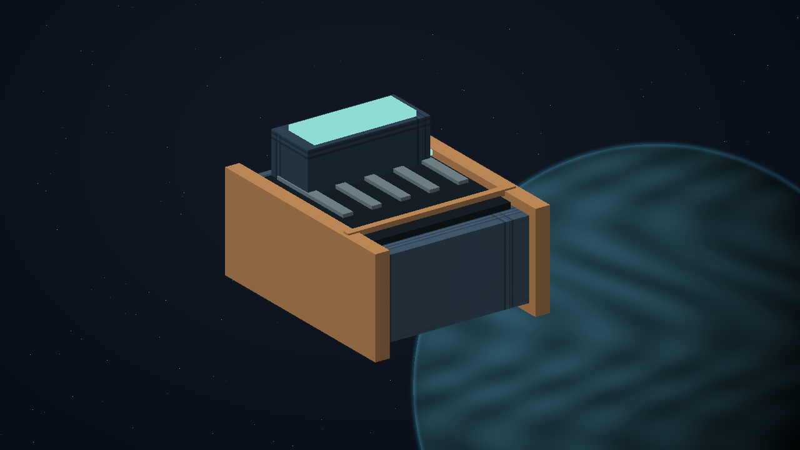

## C08.02 - collect-coldcrate

**Place:** Renas (G01-S185). **Objective:** Collect the one-tonne sealed clinic sample at Renas.

**Story/dialogue:** The clinic records the crate, its working cooling unit and its declared flight-time integrity budget. Confirm the receiving destination before committing the pickup.

- **Event:** mission_item_recovered
- **Required targets:** renas-clinic-coldcrate
- **Interaction item mass tonnes:** 1
- **Next:** deliver-coldchain
- **Completion rule:** All requiredTargets must have confirmed mission-scoped evidence; consume the transition once.
- **Recovery:** Persist completed target evidence. Restore unloaded or culled actors from saved state with their same identity; genuine destruction and casualties remain recorded. Retry an escort only through its mission-specific recovery procedure and genuinely available crew, hull and cargo. Loss or replacement earns no arrival or reward. A dead named witness cannot be replaced by a lookalike.
- **Confirmation:** Confirm accepts a transfer or choice; Esc only closes the dialog and never transfers an item, spends money or selects a branch.
- **Cargo policy:** Reserve the listed mission item separately from commodities. Require free hold before accepting it; never silently delete, sell or overwrite player cargo. Contacts hold it safely when space is unavailable.
- **Decline policy:** Offer remains available until accepted. Preparation has no deadline. Any explicitly armed incident follows its advertised simulation clock; normal game pause and current-format save/load remain available.
- **Receipt:** l337.wayfarer-exchange/collect-coldcrate
- **Item effects 1 / Kind:** add
- **Item effects 1 / Item:** clinic-cold-crate
- **Item effects 1 / Mass tonnes:** 1
- **Item transaction:** Preview and commit the whole itemEffects batch atomically; capacity is evaluated after removals and additions together. Refusal or cancellation changes neither stage nor custody.

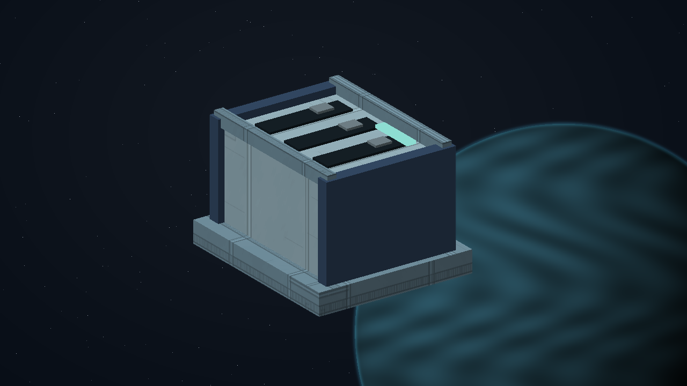

## C08.03 - deliver-coldchain

**Place:** Navidor (G01-S164). **Objective:** Deliver the intact cold crate to Navidor's registered clinic berth.

**Story/dialogue:** The receiving clinic verifies the seal and usable sample. Docking without this exact crate and its quality record is not a delivery. A spoiled consignment can be replaced from actual stock.

- **Event:** mission_item_delivered
- **Required targets:** navidor-clinic-quality-receipt
- **Interaction item mass tonnes:** 0
- **Next:** recover-cassette
- **Completion rule:** All requiredTargets must have confirmed mission-scoped evidence; consume the transition once.
- **Recovery:** Persist completed target evidence. Restore unloaded or culled actors from saved state with their same identity; genuine destruction and casualties remain recorded. Retry an escort only through its mission-specific recovery procedure and genuinely available crew, hull and cargo. Loss or replacement earns no arrival or reward. A dead named witness cannot be replaced by a lookalike.
- **Confirmation:** Confirm accepts a transfer or choice; Esc only closes the dialog and never transfers an item, spends money or selects a branch.
- **Cargo policy:** Reserve the listed mission item separately from commodities. Require free hold before accepting it; never silently delete, sell or overwrite player cargo. Contacts hold it safely when space is unavailable.
- **Decline policy:** Offer remains available until accepted. Preparation has no deadline. Any explicitly armed incident follows its advertised simulation clock; normal game pause and current-format save/load remain available.
- **Receipt:** l337.wayfarer-exchange/deliver-coldchain
- **Item effects 1 / Kind:** remove
- **Item effects 1 / Item:** clinic-cold-crate
- **Item effects 1 / Mass tonnes:** 1
- **Item transaction:** Preview and commit the whole itemEffects batch atomically; capacity is evaluated after removals and additions together. Refusal or cancellation changes neither stage nor custody.

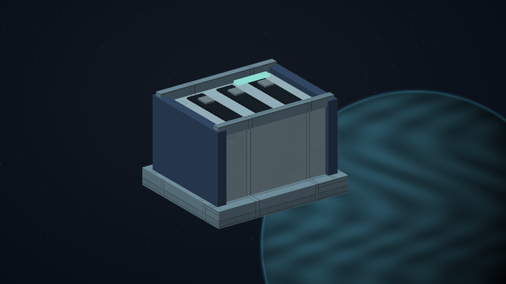

## C08.04 - recover-cassette

**Place:** Enmadan (G01-S000). **Objective:** Collect Enmadan's one-tonne failed workshop cassette for a closed repair exchange.

**Story/dialogue:** VEIL: The cassette is owned by this workshop. Return the repaired unit to its registered receiver; selling a similar commodity will not settle the exchange.

- **Event:** mission_item_recovered
- **Required targets:** enmadan-return-cassette
- **Interaction item mass tonnes:** 1
- **Next:** close-repair-loop
- **Completion rule:** All requiredTargets must have confirmed mission-scoped evidence; consume the transition once.
- **Recovery:** Persist completed target evidence. Restore unloaded or culled actors from saved state with their same identity; genuine destruction and casualties remain recorded. Retry an escort only through its mission-specific recovery procedure and genuinely available crew, hull and cargo. Loss or replacement earns no arrival or reward. A dead named witness cannot be replaced by a lookalike.
- **Confirmation:** Confirm accepts a transfer or choice; Esc only closes the dialog and never transfers an item, spends money or selects a branch.
- **Cargo policy:** Reserve the listed mission item separately from commodities. Require free hold before accepting it; never silently delete, sell or overwrite player cargo. Contacts hold it safely when space is unavailable.
- **Decline policy:** Offer remains available until accepted. Preparation has no deadline. Any explicitly armed incident follows its advertised simulation clock; normal game pause and current-format save/load remain available.
- **Receipt:** l337.wayfarer-exchange/recover-cassette
- **Item effects 1 / Kind:** add
- **Item effects 1 / Item:** return-cassette
- **Item effects 1 / Mass tonnes:** 1
- **Item transaction:** Preview and commit the whole itemEffects batch atomically; capacity is evaluated after removals and additions together. Refusal or cancellation changes neither stage nor custody.

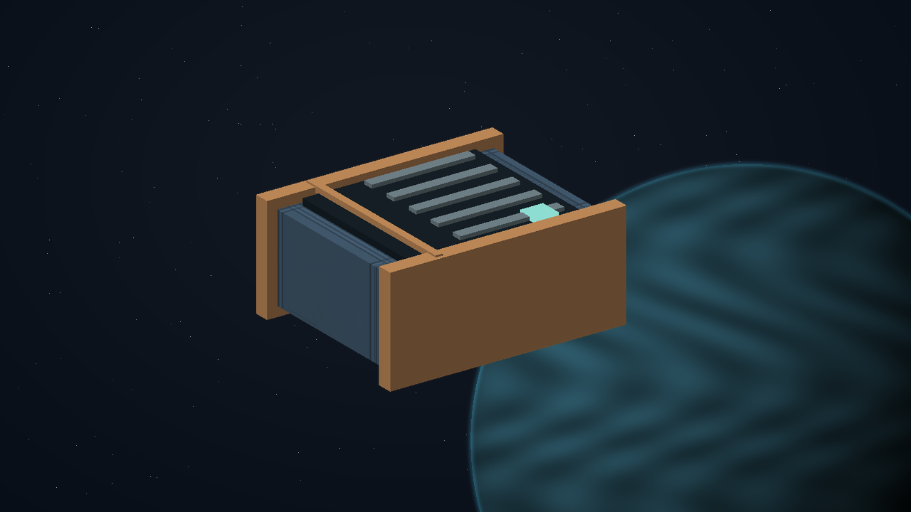

## C08.05 - close-repair-loop

**Place:** Renas (G01-S185). **Objective:** Return the cassette through the Renas repair desk and confirm its receiving record.

**Story/dialogue:** The repair desk records the original serial identity, the completed service and the owner's receipt. The transport loop is closed without manufacturing a second unit.

- **Event:** mission_item_delivered
- **Required targets:** renas-cassette-loop-closed
- **Interaction item mass tonnes:** 0
- **Next:** survey-seed-vault
- **Completion rule:** All requiredTargets must have confirmed mission-scoped evidence; consume the transition once.
- **Recovery:** Persist completed target evidence. Restore unloaded or culled actors from saved state with their same identity; genuine destruction and casualties remain recorded. Retry an escort only through its mission-specific recovery procedure and genuinely available crew, hull and cargo. Loss or replacement earns no arrival or reward. A dead named witness cannot be replaced by a lookalike.
- **Confirmation:** Confirm accepts a transfer or choice; Esc only closes the dialog and never transfers an item, spends money or selects a branch.
- **Cargo policy:** Reserve the listed mission item separately from commodities. Require free hold before accepting it; never silently delete, sell or overwrite player cargo. Contacts hold it safely when space is unavailable.
- **Decline policy:** Offer remains available until accepted. Preparation has no deadline. Any explicitly armed incident follows its advertised simulation clock; normal game pause and current-format save/load remain available.
- **Receipt:** l337.wayfarer-exchange/close-repair-loop
- **Item effects 1 / Kind:** remove
- **Item effects 1 / Item:** return-cassette
- **Item effects 1 / Mass tonnes:** 1
- **Item transaction:** Preview and commit the whole itemEffects batch atomically; capacity is evaluated after removals and additions together. Refusal or cancellation changes neither stage nor custody.

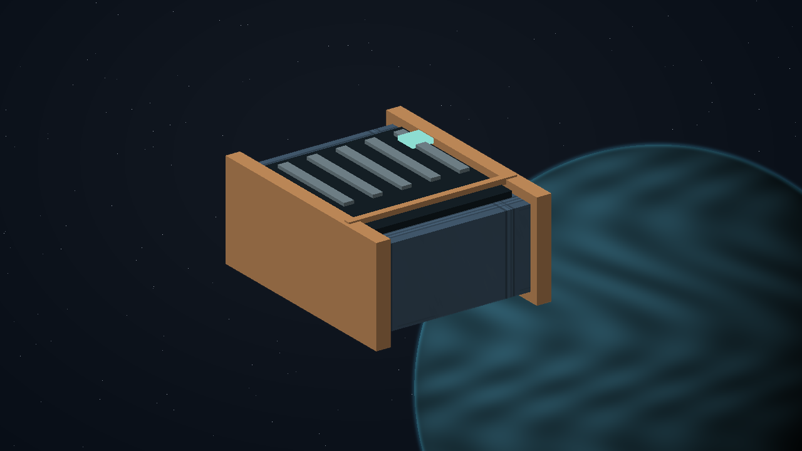

## C08.06 - survey-seed-vault

**Place:** Enlirin (G01-S162). **Objective:** Review Enlirin's seed-transfer consent and loan the one-tonne vault key.

**Story/dialogue:** VEIL: This transfer keeps two seed holdings viable. The key opens only the receiving cradle. The seed itself travels aboard the registered ark.

- **Event:** mission_contact_confirmed
- **Required targets:** enlirin-seed-consent
- **Interaction item mass tonnes:** 1
- **Next:** escort-seed-ark
- **Completion rule:** All requiredTargets must have confirmed mission-scoped evidence; consume the transition once.
- **Recovery:** Persist completed target evidence. Restore unloaded or culled actors from saved state with their same identity; genuine destruction and casualties remain recorded. Retry an escort only through its mission-specific recovery procedure and genuinely available crew, hull and cargo. Loss or replacement earns no arrival or reward. A dead named witness cannot be replaced by a lookalike.
- **Confirmation:** Confirm accepts a transfer or choice; Esc only closes the dialog and never transfers an item, spends money or selects a branch.
- **Cargo policy:** Reserve the listed mission item separately from commodities. Require free hold before accepting it; never silently delete, sell or overwrite player cargo. Contacts hold it safely when space is unavailable.
- **Decline policy:** Offer remains available until accepted. Preparation has no deadline. Any explicitly armed incident follows its advertised simulation clock; normal game pause and current-format save/load remain available.
- **Receipt:** l337.wayfarer-exchange/survey-seed-vault
- **Item effects 1 / Kind:** add
- **Item effects 1 / Item:** seed-vault-key
- **Item effects 1 / Mass tonnes:** 1
- **Item transaction:** Preview and commit the whole itemEffects batch atomically; capacity is evaluated after removals and additions together. Refusal or cancellation changes neither stage nor custody.

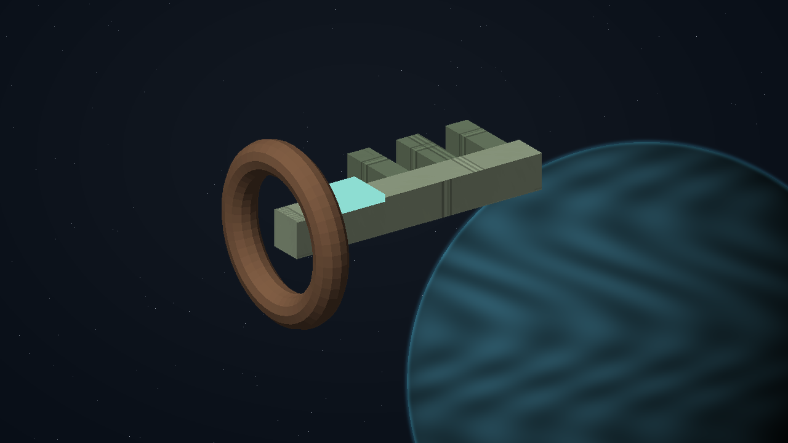

## C08.07 - escort-seed-ark

**Place:** Lareria (G01-S091). **Objective:** Escort the registered seed ark to Lareria's receiving cradle and return the vault key.

**Story/dialogue:** The cradle accepts the ark's real consignment and reclaims its key. The seed custodians retain ownership and record the receiving conditions.

- **Event:** escort_arrived
- **Required targets:** lareria-seed-ark-received
- **Interaction item mass tonnes:** 0
- **Next:** recover-crew-log
- **Completion rule:** All requiredTargets must have confirmed mission-scoped evidence; consume the transition once.
- **Recovery:** Persist completed target evidence. Restore unloaded or culled actors from saved state with their same identity; genuine destruction and casualties remain recorded. Retry an escort only through its mission-specific recovery procedure and genuinely available crew, hull and cargo. Loss or replacement earns no arrival or reward. A dead named witness cannot be replaced by a lookalike.
- **Confirmation:** Confirm accepts a transfer or choice; Esc only closes the dialog and never transfers an item, spends money or selects a branch.
- **Cargo policy:** Reserve the listed mission item separately from commodities. Require free hold before accepting it; never silently delete, sell or overwrite player cargo. Contacts hold it safely when space is unavailable.
- **Decline policy:** Offer remains available until accepted. Preparation has no deadline. Any explicitly armed incident follows its advertised simulation clock; normal game pause and current-format save/load remain available.
- **Receipt:** l337.wayfarer-exchange/escort-seed-ark
- **Item effects 1 / Kind:** remove
- **Item effects 1 / Item:** seed-vault-key
- **Item effects 1 / Mass tonnes:** 1
- **Item transaction:** Preview and commit the whole itemEffects batch atomically; capacity is evaluated after removals and additions together. Refusal or cancellation changes neither stage nor custody.

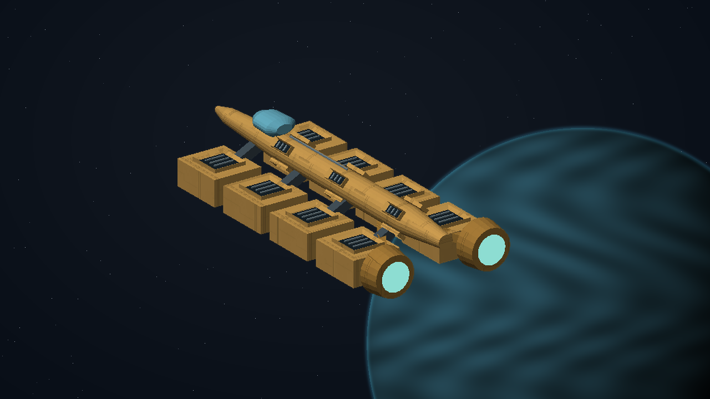

## C08.08 - recover-crew-log

**Place:** Cevilis (G01-S211). **Objective:** Recover the one-tonne custody recorder beside Cevilis's disabled service tender.

**Story/dialogue:** The tender's crew are alive in its marked rescue launch. The recorder identifies them and their receiving shelter. It is evidence, not an excuse to count a missing ship as rescued.

- **Event:** mission_item_recovered
- **Required targets:** cevilis-crew-recorder
- **Interaction item mass tonnes:** 1
- **Next:** return-survivors
- **Completion rule:** All requiredTargets must have confirmed mission-scoped evidence; consume the transition once.
- **Recovery:** Persist completed target evidence. Restore unloaded or culled actors from saved state with their same identity; genuine destruction and casualties remain recorded. Retry an escort only through its mission-specific recovery procedure and genuinely available crew, hull and cargo. Loss or replacement earns no arrival or reward. A dead named witness cannot be replaced by a lookalike.
- **Confirmation:** Confirm accepts a transfer or choice; Esc only closes the dialog and never transfers an item, spends money or selects a branch.
- **Cargo policy:** Reserve the listed mission item separately from commodities. Require free hold before accepting it; never silently delete, sell or overwrite player cargo. Contacts hold it safely when space is unavailable.
- **Decline policy:** Offer remains available until accepted. Preparation has no deadline. Any explicitly armed incident follows its advertised simulation clock; normal game pause and current-format save/load remain available.
- **Receipt:** l337.wayfarer-exchange/recover-crew-log
- **Item effects 1 / Kind:** add
- **Item effects 1 / Item:** crew-custody-recorder
- **Item effects 1 / Mass tonnes:** 1
- **Item transaction:** Preview and commit the whole itemEffects batch atomically; capacity is evaluated after removals and additions together. Refusal or cancellation changes neither stage nor custody.

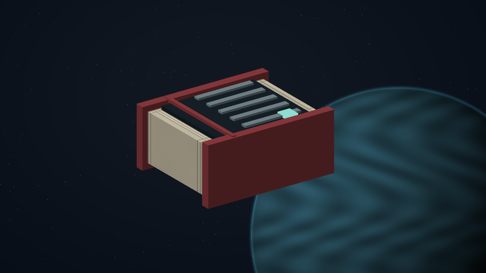

## C08.09 - return-survivors

**Place:** Enmadan (G01-S000). **Objective:** Escort the identified rescue launch to Enmadan reception and return its custody recorder.

**Story/dialogue:** Reception confirms the actual surviving crew and stores the returned recorder. Their arrival completes this service; an absent actor or an empty launch cannot substitute.

- **Event:** escort_arrived
- **Required targets:** enmadan-live-crew-received
- **Interaction item mass tonnes:** 0
- **Next:** reopen-utility-route
- **Completion rule:** All requiredTargets must have confirmed mission-scoped evidence; consume the transition once.
- **Recovery:** Persist completed target evidence. Restore unloaded or culled actors from saved state with their same identity; genuine destruction and casualties remain recorded. Retry an escort only through its mission-specific recovery procedure and genuinely available crew, hull and cargo. Loss or replacement earns no arrival or reward. A dead named witness cannot be replaced by a lookalike.
- **Confirmation:** Confirm accepts a transfer or choice; Esc only closes the dialog and never transfers an item, spends money or selects a branch.
- **Cargo policy:** Reserve the listed mission item separately from commodities. Require free hold before accepting it; never silently delete, sell or overwrite player cargo. Contacts hold it safely when space is unavailable.
- **Decline policy:** Offer remains available until accepted. Preparation has no deadline. Any explicitly armed incident follows its advertised simulation clock; normal game pause and current-format save/load remain available.
- **Receipt:** l337.wayfarer-exchange/return-survivors
- **Item effects 1 / Kind:** remove
- **Item effects 1 / Item:** crew-custody-recorder
- **Item effects 1 / Mass tonnes:** 1
- **Item transaction:** Preview and commit the whole itemEffects batch atomically; capacity is evaluated after removals and additions together. Refusal or cancellation changes neither stage nor custody.

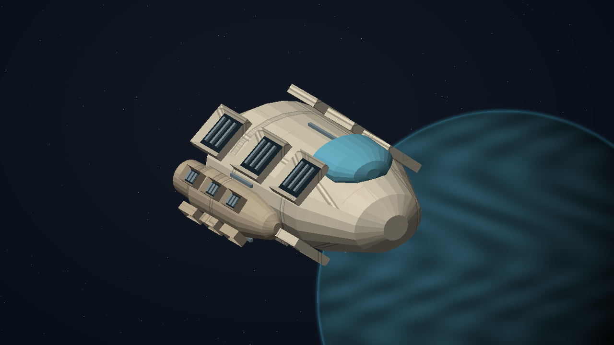

## C08.10 - reopen-utility-route

**Place:** Enron (G01-S190). **Objective:** Restore three named external service handoffs at Enron.

**Story/dialogue:** The local utility crew retains operational control. Register the physically working inlet, buffer and return. Shooting the nearby station or unrelated ships changes none of these proofs.

- **Event:** resource_node_secured
- **Required targets:** utility-handoff-inlet; utility-handoff-buffer; utility-handoff-return
- **Interaction item mass tonnes:** 0
- **Next:** choose-charter
- **Completion rule:** All requiredTargets must have confirmed mission-scoped evidence; consume the transition once.
- **Recovery:** Persist completed target evidence. Restore unloaded or culled actors from saved state with their same identity; genuine destruction and casualties remain recorded. Retry an escort only through its mission-specific recovery procedure and genuinely available crew, hull and cargo. Loss or replacement earns no arrival or reward. A dead named witness cannot be replaced by a lookalike.
- **Confirmation:** Confirm accepts a transfer or choice; Esc only closes the dialog and never transfers an item, spends money or selects a branch.
- **Cargo policy:** Reserve the listed mission item separately from commodities. Require free hold before accepting it; never silently delete, sell or overwrite player cargo. Contacts hold it safely when space is unavailable.
- **Decline policy:** Offer remains available until accepted. Preparation has no deadline. Any explicitly armed incident follows its advertised simulation clock; normal game pause and current-format save/load remain available.
- **Receipt:** l337.wayfarer-exchange/reopen-utility-route
- **Item transaction:** Preview and commit the whole itemEffects batch atomically; capacity is evaluated after removals and additions together. Refusal or cancellation changes neither stage nor custody.

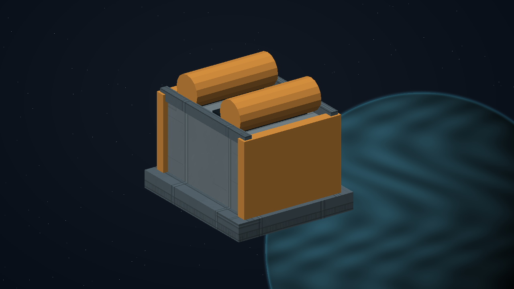

## C08.11 - choose-charter

**Place:** Avenor (G01-S007). **Objective:** Choose the Exchange's published route-allocation charter at Avenor.

**Story/dialogue:** SENN: Pool unused windows across the cluster, or protect a minimum set for each settlement. Both charters publish their limits. Choose how the service will reserve its actual capacity.

- **Event:** mission_choice_confirmed
- **Required targets:** exchange-charter-choice
- **Interaction item mass tonnes:** 0
- **Choices:** Pool unused route windows with a published local minimum; Protect local reservations and share only released capacity
- **Choice ids:** pooled-windows; protected-reservations
- **Next:** commit-charter
- **Completion rule:** All requiredTargets must have confirmed mission-scoped evidence; consume the transition once.
- **Recovery:** Persist completed target evidence. Restore unloaded or culled actors from saved state with their same identity; genuine destruction and casualties remain recorded. Retry an escort only through its mission-specific recovery procedure and genuinely available crew, hull and cargo. Loss or replacement earns no arrival or reward. A dead named witness cannot be replaced by a lookalike.
- **Confirmation:** Confirm accepts a transfer or choice; Esc only closes the dialog and never transfers an item, spends money or selects a branch.
- **Cargo policy:** Reserve the listed mission item separately from commodities. Require free hold before accepting it; never silently delete, sell or overwrite player cargo. Contacts hold it safely when space is unavailable.
- **Decline policy:** Offer remains available until accepted. Preparation has no deadline. Any explicitly armed incident follows its advertised simulation clock; normal game pause and current-format save/load remain available.
- **Receipt:** l337.wayfarer-exchange/choose-charter
- **Item transaction:** Preview and commit the whole itemEffects batch atomically; capacity is evaluated after removals and additions together. Refusal or cancellation changes neither stage nor custody.

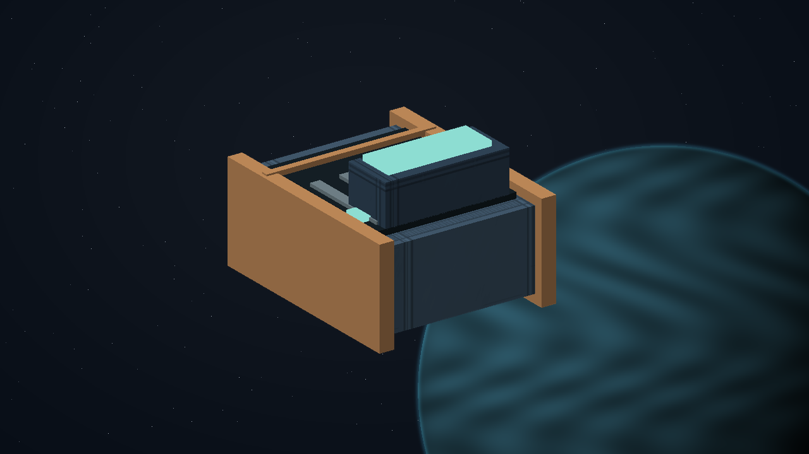

## C08.12 - commit-charter

**Place:** Avenor (G01-S007). **Objective:** Obtain three verified operator signatures for the chosen charter.

**Story/dialogue:** The clinic, workshop and seed custodians each sign the exact chosen capacity policy. A displayed selection alone is not their consent.

- **Event:** mission_action_confirmed
- **Required targets:** exchange-charter-proof
- **Interaction item mass tonnes:** 0
- **Branch stage:** choose-charter
- **Branch variants 1 / Choice id:** pooled-windows
- **Branch variants 1 / Event:** mission_action_confirmed
- **Branch variants 1 / Required targets:** clinic-pooled-signature; workshop-pooled-signature; seed-pooled-signature
- **Branch variants 1 / Objective:** Confirm all three signed pooling limits and test that the protected local minimum cannot be consumed.
- **Branch variants 1 / Dialog:** The route pool rejects a booking that would take a settlement below its published minimum.
- **Branch variants 1 / Gossip:** Wayfarer Exchange shares spare windows while protecting each settlement's minimum.
- **Branch variants 2 / Choice id:** protected-reservations
- **Branch variants 2 / Event:** mission_action_confirmed
- **Branch variants 2 / Required targets:** clinic-reserved-signature; workshop-reserved-signature; seed-reserved-signature
- **Branch variants 2 / Objective:** Confirm all three local reservations and test that only explicitly released capacity can enter the shared pool.
- **Branch variants 2 / Dialog:** The board rejects an attempt to use an unreleased reservation. Its owner retains the capacity until it chooses to release it.
- **Branch variants 2 / Gossip:** Wayfarer Exchange protects local reservations and shares only explicitly released windows.
- **Completion rule:** All signatures must belong to the current instance, correct world and persisted chosen branch. Verify the capacity test against the actual reservation ledger.
- **Next:** certify-network
- **Recovery:** Persist completed target evidence. Restore unloaded or culled actors from saved state with their same identity; genuine destruction and casualties remain recorded. Retry an escort only through its mission-specific recovery procedure and genuinely available crew, hull and cargo. Loss or replacement earns no arrival or reward. A dead named witness cannot be replaced by a lookalike.
- **Confirmation:** Confirm accepts a transfer or choice; Esc only closes the dialog and never transfers an item, spends money or selects a branch.
- **Cargo policy:** Reserve the listed mission item separately from commodities. Require free hold before accepting it; never silently delete, sell or overwrite player cargo. Contacts hold it safely when space is unavailable.
- **Decline policy:** Offer remains available until accepted. Preparation has no deadline. Any explicitly armed incident follows its advertised simulation clock; normal game pause and current-format save/load remain available.
- **Receipt:** l337.wayfarer-exchange/commit-charter
- **Item transaction:** Preview and commit the whole itemEffects batch atomically; capacity is evaluated after removals and additions together. Refusal or cancellation changes neither stage nor custody.

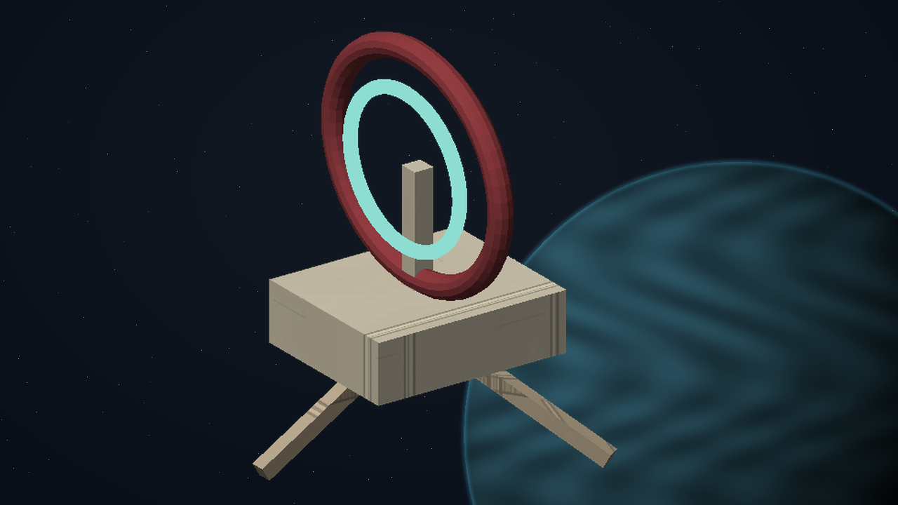

## C08.13 - certify-network

**Place:** Avenor (G01-S007). **Objective:** Verify all induction receiving records and the working utility route with Veil.

**Story/dialogue:** VEIL: The clinic sample remained usable, the cassette returned, the seed ark arrived and the surviving crew reached shelter. The utility route works and the charter signatures agree. Accreditation records those results.

- **Event:** mission_contact_confirmed
- **Required targets:** veil-network-certification
- **Interaction item mass tonnes:** 0
- **Next:** close-case
- **Completion rule:** All requiredTargets must have confirmed mission-scoped evidence; consume the transition once.
- **Recovery:** Persist completed target evidence. Restore unloaded or culled actors from saved state with their same identity; genuine destruction and casualties remain recorded. Retry an escort only through its mission-specific recovery procedure and genuinely available crew, hull and cargo. Loss or replacement earns no arrival or reward. A dead named witness cannot be replaced by a lookalike.
- **Confirmation:** Confirm accepts a transfer or choice; Esc only closes the dialog and never transfers an item, spends money or selects a branch.
- **Cargo policy:** Reserve the listed mission item separately from commodities. Require free hold before accepting it; never silently delete, sell or overwrite player cargo. Contacts hold it safely when space is unavailable.
- **Decline policy:** Offer remains available until accepted. Preparation has no deadline. Any explicitly armed incident follows its advertised simulation clock; normal game pause and current-format save/load remain available.
- **Receipt:** l337.wayfarer-exchange/certify-network
- **Item transaction:** Preview and commit the whole itemEffects batch atomically; capacity is evaluated after removals and additions together. Refusal or cancellation changes neither stage nor custody.

## C08.14 - close-case

**Place:** Avenor (G01-S007). **Objective:** Confirm accreditation, collect the induction fee and open the advanced service board.

**Story/dialogue:** SENN: Your induction fee is 7,600 CR. The service board will continue offering real work under the charter you verified. No repeated delivery can earn this induction fee or its journal clue twice.

VEIL: Every real consignment is accounted for. This older reservation names no shipment at all. Keep its curved signature in your journal; the AI at PLUGH may be able to explain the unused window.

- **Event:** mission_contact_confirmed
- **Required targets:** senn-final-accreditation
- **Interaction item mass tonnes:** 0
- **Dialog by choice 1 / Choice id:** pooled-windows
- **Dialog by choice 1 / Text:** SENN: The shared pool is open, and the local minima are protected. Every reserved consignment still has one owner and one receiver.
- **Dialog by choice 2 / Choice id:** protected-reservations
- **Dialog by choice 2 / Text:** VEIL: Each settlement keeps its reserved capacity. Only a signed release lets another service use it.
- **Next:** complete
- **Completion rule:** All requiredTargets must have confirmed mission-scoped evidence; consume the transition once.
- **Recovery:** Persist completed target evidence. Restore unloaded or culled actors from saved state with their same identity; genuine destruction and casualties remain recorded. Retry an escort only through its mission-specific recovery procedure and genuinely available crew, hull and cargo. Loss or replacement earns no arrival or reward. A dead named witness cannot be replaced by a lookalike.
- **Confirmation:** Confirm accepts a transfer or choice; Esc only closes the dialog and never transfers an item, spends money or selects a branch.
- **Cargo policy:** Reserve the listed mission item separately from commodities. Require free hold before accepting it; never silently delete, sell or overwrite player cargo. Contacts hold it safely when space is unavailable.
- **Decline policy:** Offer remains available until accepted. Preparation has no deadline. Any explicitly armed incident follows its advertised simulation clock; normal game pause and current-format save/load remain available.
- **Receipt:** l337.wayfarer-exchange/close-case
- **Item transaction:** Preview and commit the whole itemEffects batch atomically; capacity is evaluated after removals and additions together. Refusal or cancellation changes neither stage nor custody.

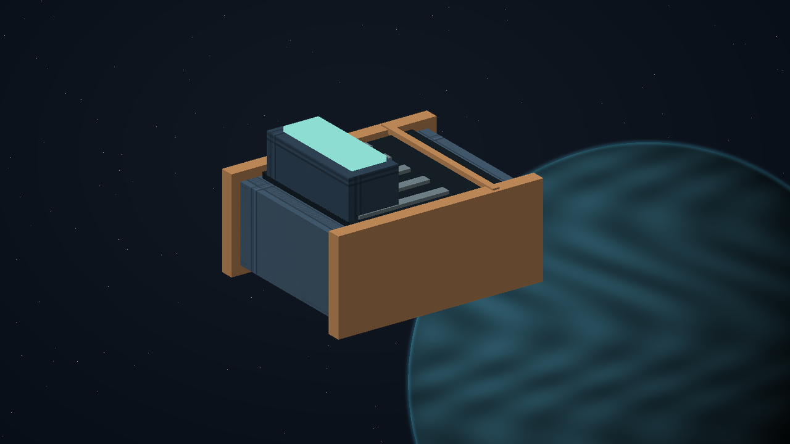

**Permanent clue:** The unbooked window (`exchange-unbooked-window`). The first signed route ledger reserves a window with no carrier, cargo or destination. Its curved boundary points inward and matches a bearing outside the published service network.

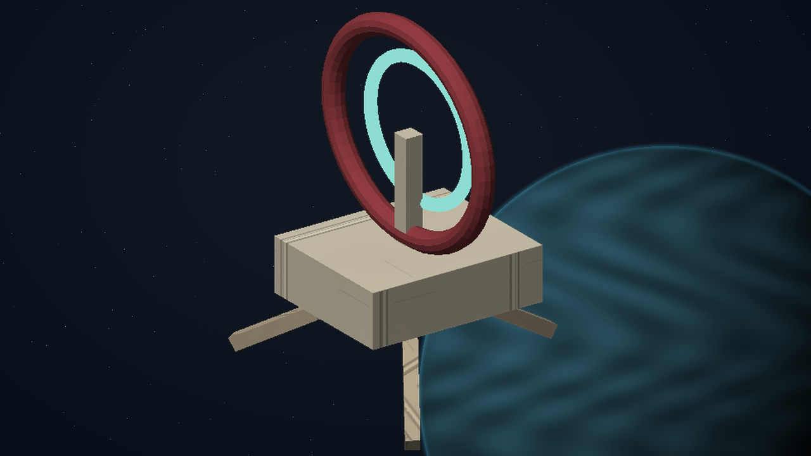

[Complete structured definition](../definitions/missions/wayfarer-exchange.json).
