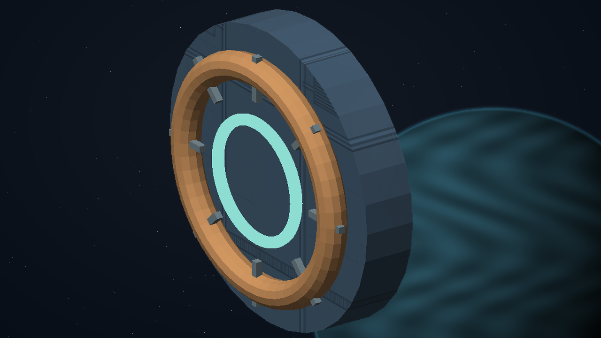

# C13 - False Colours

[Return to the oracle contents](../README.md). This reading view is extracted from [the complete single-file oracle](../FINAL-GAME-ORACLE.md); its rules are the same.

**Mission identity:** `l337.false-colours`. **Premise:** TOREN: A colour on a scanner is not a warrant. Find the original signing chain.

A lawful hauler is being mistaken for a patrol vessel because a transponder recycler issued duplicate identity keys. A frightened militia has closed the freight corridor. The commander obtains the original key chain, protects a cooperative verification flight and chooses public revocation or a supervised reissue. Attributed evidence resolves the identity dispute.

**Offer:** At Heroran in Galaxy 5, after one ordinary trade. No imported score gate or source campaign prerequisite. The reference loan needs one tonne of free hold.

**Briefing:** TOREN: A colour on a scanner is not a warrant. Find the original signing chain.

**Contacts:** Nia Toren, Captain Tamsin Holt. **Story craft:** SH001 Mule, SH061 Haflinger.

**Successful settlement:** 6,200 CR. The selected verified settlement persists in local records. No free hull, unrelated legal reset or artificial combat kills. A permanent clue for The Unwritten Route: The seal before the key.

Mission-specific rules and resources:

- **Origin kind:** new-original
- **Branch policy:** Store the selected plan-a or plan-b identity once, separately from its authored display label. Apply only that branch at apply-settlement; both distinct physical and receiving proofs are required. Both legitimate endings share one final reward and one source clue.
- **Items 1 / Id:** false-colours-reference
- **Items 1 / Mass tonnes:** 1
- **Items 1 / Acquire stage:** collect-reference
- **Items 1 / Consume stage:** return-and-audit
- **Interaction notes:** Use the existing mission log, targeting, scan, contextual Confirm and Esc. Preview all obligations before accepting; cancellation changes nothing.; Keep the reference instrument in reserved custody through the field work, witness reception and selected settlement. Returning it is part of the independent terminal audit.; Preserve actual crew and entity identities. Culling is not death or arrival. A lost unnamed tender may be replaced with a new consenting crew after real rescue handling; never resurrect a named casualty. A lost reference invalidates its old serial before a real replacement loan.; All objectives are space flight or space-station handoffs. Stations remain protected from single-ship weapons. No source world overrides, equipment budgets, hidden reputation grind or external storyline progress is required.
- **Authoring art / Prop id:** false-colours-reference
- **Authoring art / Prop form:** seal
- **Authoring art / Palette:** navy-copper
- **Authoring art / Stage objects:** false-colours-reference; false-colours-reference; false-colours-reference; false-colours-reference; SH061; false-colours-reference; false-colours-reference; false-colours-reference; false-colours-reference
- **Terminal stage:** complete
- **Reward receipt:** l337.false-colours/final-payment
- **Reward policy:** Pay credits once, atomically with the terminal receipt. Delay optional equipment fitting if incompatible; offer it again without duplicating payment. Never award kill points for non-kills or clear unrelated legal status. Commit the clue and terminal reward receipt atomically; a pending optional fitting does not delay the clue.
- **Identity policy:** Match locations by galaxy/system identity, not coordinates or displayed spelling. Match entities by mission instance and target ID, never merely ship type.
- **Persistence policy:** Every campaign starts unaccepted with its current identity and zero progress. Persist current-format stage evidence, choices, mission-item custody, reward and clue receipts. Resume these records on load; replayed events cannot duplicate rewards. No previous campaign or save format is imported.

## C13.01 - accept

**Place:** Heroran (G05-S148). **Objective:** Accept False Colours at Heroran.

**Story/dialogue:** Nia Toren: A lawful hauler is being mistaken for a patrol vessel because a transponder recycler issued duplicate identity keys. Review the complete survey, loan and receiving requirements before confirming.

- **Event:** mission_contact_confirmed
- **Required targets:** accept-verified
- **Interaction item mass tonnes:** 0
- **Next:** survey
- **Completion rule:** All requiredTargets must have confirmed mission-scoped evidence; consume the transition once.
- **Recovery:** Persist completed target evidence. Restore unloaded or culled actors from saved state with their same identity; genuine destruction and casualties remain recorded. Retry an escort only through its mission-specific recovery procedure and genuinely available crew, hull and cargo. Loss or replacement earns no arrival or reward. A dead named witness cannot be replaced by a lookalike.
- **Confirmation:** Confirm accepts a transfer or choice; Esc only closes the dialog and never transfers an item, spends money or selects a branch.
- **Cargo policy:** Reserve the listed mission item separately from commodities. Require free hold before accepting it; never silently delete, sell or overwrite player cargo. Contacts hold it safely when space is unavailable.
- **Decline policy:** Offer remains available until accepted. Preparation has no deadline. Any explicitly armed incident follows its advertised simulation clock; normal game pause and current-format save/load remain available.
- **Receipt:** l337.false-colours/accept
- **Item transaction:** Preview and commit the whole itemEffects batch atomically; capacity is evaluated after removals and additions together. Refusal or cancellation changes neither stage nor custody.

## C13.02 - survey

**Place:** Firerur (G05-S049). **Objective:** Scan three cooperative identity repeaters along the disputed freight corridor.

**Story/dialogue:** TOREN: A colour on a scanner is not a warrant. Find the original signing chain.

- **Event:** entity_scan_completed
- **Required targets:** false-colours-survey-1; false-colours-survey-2; false-colours-survey-3
- **Interaction item mass tonnes:** 0
- **Next:** collect-reference
- **Completion rule:** All requiredTargets must have confirmed mission-scoped evidence; consume the transition once.
- **Recovery:** Persist completed target evidence. Restore unloaded or culled actors from saved state with their same identity; genuine destruction and casualties remain recorded. Retry an escort only through its mission-specific recovery procedure and genuinely available crew, hull and cargo. Loss or replacement earns no arrival or reward. A dead named witness cannot be replaced by a lookalike.
- **Confirmation:** Confirm accepts a transfer or choice; Esc only closes the dialog and never transfers an item, spends money or selects a branch.
- **Cargo policy:** Reserve the listed mission item separately from commodities. Require free hold before accepting it; never silently delete, sell or overwrite player cargo. Contacts hold it safely when space is unavailable.
- **Decline policy:** Offer remains available until accepted. Preparation has no deadline. Any explicitly armed incident follows its advertised simulation clock; normal game pause and current-format save/load remain available.
- **Receipt:** l337.false-colours/survey
- **Item transaction:** Preview and commit the whole itemEffects batch atomically; capacity is evaluated after removals and additions together. Refusal or cancellation changes neither stage nor custody.

## C13.03 - collect-reference

**Place:** Heroran (G05-S148). **Objective:** Collect the identified one-tonne reference instrument from Nia Toren.

**Story/dialogue:** Nia Toren: This instrument is a loan. I retain it until your hold has room, and the final audit returns this exact serial identity.

- **Event:** mission_contact_confirmed
- **Required targets:** collect-reference-verified
- **Interaction item mass tonnes:** 1
- **Next:** field-work
- **Completion rule:** All requiredTargets must have confirmed mission-scoped evidence; consume the transition once.
- **Recovery:** Persist completed target evidence. Restore unloaded or culled actors from saved state with their same identity; genuine destruction and casualties remain recorded. Retry an escort only through its mission-specific recovery procedure and genuinely available crew, hull and cargo. Loss or replacement earns no arrival or reward. A dead named witness cannot be replaced by a lookalike.
- **Confirmation:** Confirm accepts a transfer or choice; Esc only closes the dialog and never transfers an item, spends money or selects a branch.
- **Cargo policy:** Reserve the listed mission item separately from commodities. Require free hold before accepting it; never silently delete, sell or overwrite player cargo. Contacts hold it safely when space is unavailable.
- **Decline policy:** Offer remains available until accepted. Preparation has no deadline. Any explicitly armed incident follows its advertised simulation clock; normal game pause and current-format save/load remain available.
- **Receipt:** l337.false-colours/collect-reference
- **Item effects 1 / Kind:** add
- **Item effects 1 / Item:** false-colours-reference
- **Item effects 1 / Mass tonnes:** 1
- **Item transaction:** Preview and commit the whole itemEffects batch atomically; capacity is evaluated after removals and additions together. Refusal or cancellation changes neither stage nor custody.

## C13.04 - field-work

**Place:** Norenul (G05-S222). **Objective:** Compare both duplicate keys against the independent physical seal.

**Story/dialogue:** HOLT: The seal's manufacturing trace proves a duplicate issue. Do not destroy the vessels carrying the evidence.

- **Event:** mission_action_confirmed
- **Required targets:** false-colours-work-port; false-colours-work-starboard
- **Interaction item mass tonnes:** 1
- **Next:** independent-witness
- **Completion rule:** All requiredTargets must have confirmed mission-scoped evidence; consume the transition once.
- **Recovery:** Persist completed target evidence. Restore unloaded or culled actors from saved state with their same identity; genuine destruction and casualties remain recorded. Retry an escort only through its mission-specific recovery procedure and genuinely available crew, hull and cargo. Loss or replacement earns no arrival or reward. A dead named witness cannot be replaced by a lookalike.
- **Confirmation:** Confirm accepts a transfer or choice; Esc only closes the dialog and never transfers an item, spends money or selects a branch.
- **Cargo policy:** Reserve the listed mission item separately from commodities. Require free hold before accepting it; never silently delete, sell or overwrite player cargo. Contacts hold it safely when space is unavailable.
- **Decline policy:** Offer remains available until accepted. Preparation has no deadline. Any explicitly armed incident follows its advertised simulation clock; normal game pause and current-format save/load remain available.
- **Receipt:** l337.false-colours/field-work
- **Item transaction:** Preview and commit the whole itemEffects batch atomically; capacity is evaluated after removals and additions together. Refusal or cancellation changes neither stage nor custody.

## C13.05 - independent-witness

**Place:** Seluer (G05-S200). **Objective:** Escort the accused hauler to the independent verification berth.

**Story/dialogue:** HOLT: Keep both pilot and cargo safe until the receiver records the examination.

- **Event:** escort_arrived
- **Required targets:** false-colours-witness-received
- **Interaction item mass tonnes:** 1
- **Next:** choose-settlement
- **Completion rule:** All requiredTargets must have confirmed mission-scoped evidence; consume the transition once.
- **Recovery:** Persist completed target evidence. Restore unloaded or culled actors from saved state with their same identity; genuine destruction and casualties remain recorded. Retry an escort only through its mission-specific recovery procedure and genuinely available crew, hull and cargo. Loss or replacement earns no arrival or reward. A dead named witness cannot be replaced by a lookalike.
- **Confirmation:** Confirm accepts a transfer or choice; Esc only closes the dialog and never transfers an item, spends money or selects a branch.
- **Cargo policy:** Reserve the listed mission item separately from commodities. Require free hold before accepting it; never silently delete, sell or overwrite player cargo. Contacts hold it safely when space is unavailable.
- **Decline policy:** Offer remains available until accepted. Preparation has no deadline. Any explicitly armed incident follows its advertised simulation clock; normal game pause and current-format save/load remain available.
- **Receipt:** l337.false-colours/independent-witness
- **Item transaction:** Preview and commit the whole itemEffects batch atomically; capacity is evaluated after removals and additions together. Refusal or cancellation changes neither stage nor custody.

## C13.06 - choose-settlement

**Place:** Heroran (G05-S148). **Objective:** Choose the verified settlement with the consenting operators.

**Story/dialogue:** Nia Toren: Both choices preserve the independent evidence. Choose who controls the future work; closing this dialog selects neither.

- **Event:** mission_choice_confirmed
- **Required targets:** false-colours-settlement-choice
- **Interaction item mass tonnes:** 1
- **Choices:** Publish a simultaneous revocation and safe-conduct notice; Reissue both keys under independent supervision
- **Choice ids:** plan-a; plan-b
- **Next:** apply-settlement
- **Completion rule:** All requiredTargets must have confirmed mission-scoped evidence; consume the transition once.
- **Recovery:** Persist completed target evidence. Restore unloaded or culled actors from saved state with their same identity; genuine destruction and casualties remain recorded. Retry an escort only through its mission-specific recovery procedure and genuinely available crew, hull and cargo. Loss or replacement earns no arrival or reward. A dead named witness cannot be replaced by a lookalike.
- **Confirmation:** Confirm accepts a transfer or choice; Esc only closes the dialog and never transfers an item, spends money or selects a branch.
- **Cargo policy:** Reserve the listed mission item separately from commodities. Require free hold before accepting it; never silently delete, sell or overwrite player cargo. Contacts hold it safely when space is unavailable.
- **Decline policy:** Offer remains available until accepted. Preparation has no deadline. Any explicitly armed incident follows its advertised simulation clock; normal game pause and current-format save/load remain available.
- **Receipt:** l337.false-colours/choose-settlement
- **Item transaction:** Preview and commit the whole itemEffects batch atomically; capacity is evaluated after removals and additions together. Refusal or cancellation changes neither stage nor custody.

## C13.07 - apply-settlement

**Place:** Norenul (G05-S222). **Objective:** Verify both independent proofs for the selected settlement.

**Story/dialogue:** Nia Toren: The selected plan must work in the physical system. A statement or unrelated kill cannot supply either proof.

- **Event:** mission_action_confirmed
- **Required targets:** false-colours-settlement-summary
- **Interaction item mass tonnes:** 1
- **Branch stage:** choose-settlement
- **Branch variants 1 / Choice id:** plan-a
- **Branch variants 1 / Event:** mission_action_confirmed
- **Branch variants 1 / Required targets:** false-colours-plan-a-physical-proof; false-colours-plan-a-receiving-proof
- **Branch variants 1 / Objective:** Verify the revocation receipt and militia safe-conduct acknowledgement.
- **Branch variants 1 / Dialog:** TOREN: Neither duplicate becomes guilty by being the first to answer.
- **Branch variants 1 / Gossip:** False Colours: Publish a simultaneous revocation and safe-conduct notice.
- **Branch variants 2 / Choice id:** plan-b
- **Branch variants 2 / Event:** mission_action_confirmed
- **Branch variants 2 / Required targets:** false-colours-plan-b-physical-proof; false-colours-plan-b-receiving-proof
- **Branch variants 2 / Objective:** Verify two distinct replacement identities and the retired-key ledger.
- **Branch variants 2 / Dialog:** HOLT: Both pilots must see the same retirement record.
- **Branch variants 2 / Gossip:** False Colours: Reissue both keys under independent supervision.
- **Next:** return-and-audit
- **Completion rule:** All requiredTargets must have confirmed mission-scoped evidence; consume the transition once.
- **Recovery:** Persist completed target evidence. Restore unloaded or culled actors from saved state with their same identity; genuine destruction and casualties remain recorded. Retry an escort only through its mission-specific recovery procedure and genuinely available crew, hull and cargo. Loss or replacement earns no arrival or reward. A dead named witness cannot be replaced by a lookalike.
- **Confirmation:** Confirm accepts a transfer or choice; Esc only closes the dialog and never transfers an item, spends money or selects a branch.
- **Cargo policy:** Reserve the listed mission item separately from commodities. Require free hold before accepting it; never silently delete, sell or overwrite player cargo. Contacts hold it safely when space is unavailable.
- **Decline policy:** Offer remains available until accepted. Preparation has no deadline. Any explicitly armed incident follows its advertised simulation clock; normal game pause and current-format save/load remain available.
- **Receipt:** l337.false-colours/apply-settlement
- **Item transaction:** Preview and commit the whole itemEffects batch atomically; capacity is evaluated after removals and additions together. Refusal or cancellation changes neither stage nor custody.

## C13.08 - return-and-audit

**Place:** Heroran (G05-S148). **Objective:** Return the reference instrument and confirm all physical receiving and settlement receipts.

**Story/dialogue:** Nia Toren: The loan is returned. Check the actual observations, living witness reception and both selected settlement proofs before closing the case.

- **Event:** mission_contact_confirmed
- **Required targets:** return-and-audit-verified
- **Interaction item mass tonnes:** 0
- **Next:** close-case
- **Completion rule:** All requiredTargets must have confirmed mission-scoped evidence; consume the transition once.
- **Recovery:** Persist completed target evidence. Restore unloaded or culled actors from saved state with their same identity; genuine destruction and casualties remain recorded. Retry an escort only through its mission-specific recovery procedure and genuinely available crew, hull and cargo. Loss or replacement earns no arrival or reward. A dead named witness cannot be replaced by a lookalike.
- **Confirmation:** Confirm accepts a transfer or choice; Esc only closes the dialog and never transfers an item, spends money or selects a branch.
- **Cargo policy:** Reserve the listed mission item separately from commodities. Require free hold before accepting it; never silently delete, sell or overwrite player cargo. Contacts hold it safely when space is unavailable.
- **Decline policy:** Offer remains available until accepted. Preparation has no deadline. Any explicitly armed incident follows its advertised simulation clock; normal game pause and current-format save/load remain available.
- **Receipt:** l337.false-colours/return-and-audit
- **Item effects 1 / Kind:** remove
- **Item effects 1 / Item:** false-colours-reference
- **Item effects 1 / Mass tonnes:** 1
- **Item transaction:** Preview and commit the whole itemEffects batch atomically; capacity is evaluated after removals and additions together. Refusal or cancellation changes neither stage nor custody.

## C13.09 - close-case

**Place:** Heroran (G05-S148). **Objective:** Confirm successful completion, the recorded settlement and the once-only fee.

**Story/dialogue:** Nia Toren: The independent audit is complete. Your fee is 6200 CR. The operators retain the chosen settlement and their original records.

Nia Toren: The audit has left one anomaly that belongs to neither side. An older layer in the physical seal contains a curved signature absent from every transponder issue record. It is preserved in your journal for the AI at PLUGH.

- **Event:** mission_contact_confirmed
- **Required targets:** close-case-verified
- **Interaction item mass tonnes:** 0
- **Next:** complete
- **Completion rule:** All requiredTargets must have confirmed mission-scoped evidence; consume the transition once.
- **Recovery:** Persist completed target evidence. Restore unloaded or culled actors from saved state with their same identity; genuine destruction and casualties remain recorded. Retry an escort only through its mission-specific recovery procedure and genuinely available crew, hull and cargo. Loss or replacement earns no arrival or reward. A dead named witness cannot be replaced by a lookalike.
- **Confirmation:** Confirm accepts a transfer or choice; Esc only closes the dialog and never transfers an item, spends money or selects a branch.
- **Cargo policy:** Reserve the listed mission item separately from commodities. Require free hold before accepting it; never silently delete, sell or overwrite player cargo. Contacts hold it safely when space is unavailable.
- **Decline policy:** Offer remains available until accepted. Preparation has no deadline. Any explicitly armed incident follows its advertised simulation clock; normal game pause and current-format save/load remain available.
- **Receipt:** l337.false-colours/close-case
- **Item transaction:** Preview and commit the whole itemEffects batch atomically; capacity is evaluated after removals and additions together. Refusal or cancellation changes neither stage nor custody.

**Permanent clue:** The seal before the key (`false-colours-trace`). An older layer in the physical seal contains a curved signature absent from every transponder issue record.

[Complete structured definition](../definitions/missions/false-colours.json).
