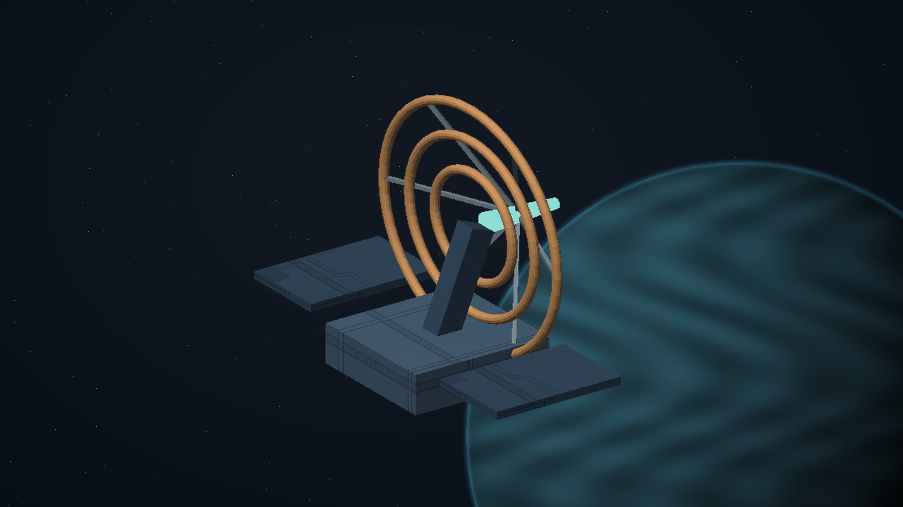
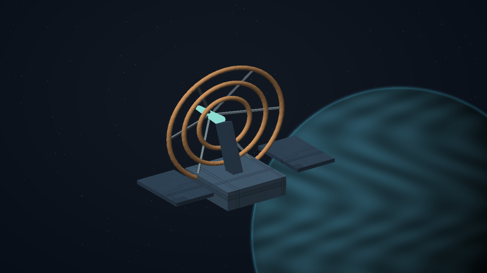
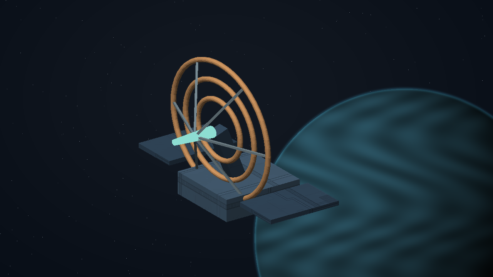
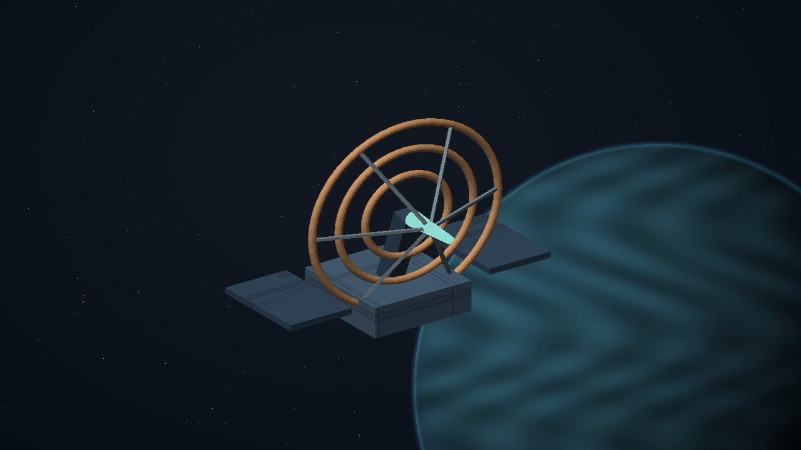
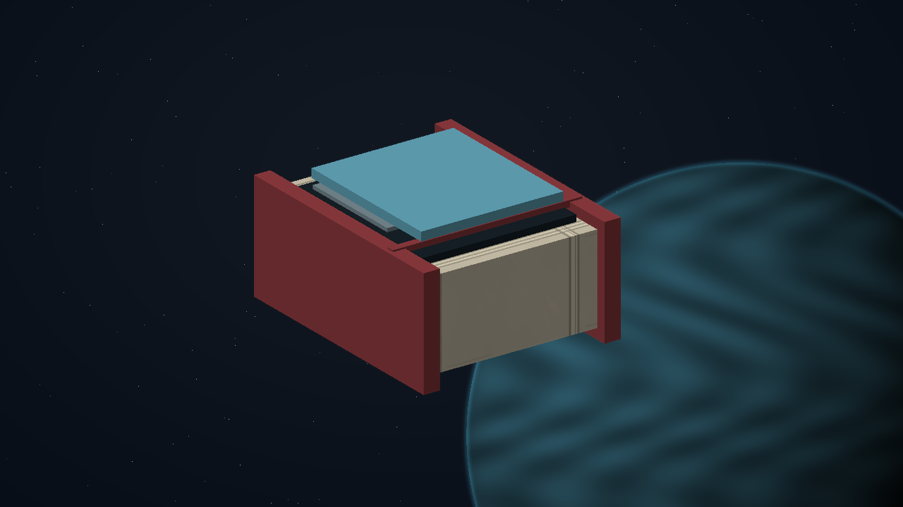

# C25 - The Memory Atlas

[Return to the oracle contents](../README.md). This reading view is extracted from [the complete single-file oracle](../FINAL-GAME-ORACLE.md); its rules are the same.

**Mission identity:** `l337.memory-atlas`. **Premise:** ORR: A beautiful memory is not a measured approach vector.

A navigation publisher has combined voluntary travel diaries with instrument surveys and now presents memories as exact route measurements. The commander revisits three disputed orbital landmarks, separates consented testimony from physical data and chooses an annotated public atlas or a custodian-held memory archive.

**Offer:** At Reris in Galaxy 1, after one ordinary trade. No imported score gate or source campaign prerequisite. The reference loan needs one tonne of free hold.

**Briefing:** ORR: A beautiful memory is not a measured approach vector.

**Contacts:** Agent Mara Vale, Geologist Jalen Orr. **Story craft:** SH001 Mule, SH061 Haflinger.

**Successful settlement:** 7,200 CR. The selected verified settlement persists in local records. No free hull, unrelated legal reset or artificial combat kills. A permanent clue for The Unwritten Route: The place nobody remembers.

Mission-specific rules and resources:

- **Origin kind:** new-original
- **Branch policy:** Store the selected plan-a or plan-b identity once, separately from its authored display label. Apply only that branch at apply-settlement; both distinct physical and receiving proofs are required. Both legitimate endings share one final reward and one source clue.
- **Items 1 / Id:** memory-atlas-reference
- **Items 1 / Mass tonnes:** 1
- **Items 1 / Acquire stage:** collect-reference
- **Items 1 / Consume stage:** return-and-audit
- **Interaction notes:** Use the existing mission log, targeting, scan, contextual Confirm and Esc. Preview all obligations before accepting; cancellation changes nothing.; Keep the reference instrument in reserved custody through the field work, witness reception and selected settlement. Returning it is part of the independent terminal audit.; Preserve actual crew and entity identities. Culling is not death or arrival. A lost unnamed tender may be replaced with a new consenting crew after real rescue handling; never resurrect a named casualty. A lost reference invalidates its old serial before a real replacement loan.; All objectives are space flight or space-station handoffs. Stations remain protected from single-ship weapons. No source world overrides, equipment budgets, hidden reputation grind or external storyline progress is required.
- **Authoring art / Prop id:** memory-atlas-reference
- **Authoring art / Prop form:** watcher
- **Authoring art / Palette:** navy-copper
- **Authoring art / Stage objects:** memory-atlas-reference; memory-atlas-reference; memory-atlas-reference; memory-atlas-reference; SH061; memory-atlas-reference; memory-atlas-reference; memory-atlas-reference; memory-atlas-reference
- **Terminal stage:** complete
- **Reward receipt:** l337.memory-atlas/final-payment
- **Reward policy:** Pay credits once, atomically with the terminal receipt. Delay optional equipment fitting if incompatible; offer it again without duplicating payment. Never award kill points for non-kills or clear unrelated legal status. Commit the clue and terminal reward receipt atomically; a pending optional fitting does not delay the clue.
- **Identity policy:** Match locations by galaxy/system identity, not coordinates or displayed spelling. Match entities by mission instance and target ID, never merely ship type.
- **Persistence policy:** Every campaign starts unaccepted with its current identity and zero progress. Persist current-format stage evidence, choices, mission-item custody, reward and clue receipts. Resume these records on load; replayed events cannot duplicate rewards. No previous campaign or save format is imported.

## C25.01 - accept

**Place:** Reris (G01-S080). **Objective:** Accept The Memory Atlas at Reris.

**Story/dialogue:** Agent Mara Vale: A navigation publisher has combined voluntary travel diaries with instrument surveys and now presents memories as exact route measurements. Review the complete survey, loan and receiving requirements before confirming.

- **Event:** mission_contact_confirmed
- **Required targets:** accept-verified
- **Interaction item mass tonnes:** 0
- **Next:** survey
- **Completion rule:** All requiredTargets must have confirmed mission-scoped evidence; consume the transition once.
- **Recovery:** Persist each completed target. Recreate an uncompleted objective after load or entity loss; duplicate scans and incidental removal cannot complete it. Escort destruction returns to the escort briefing with a replacement launch and no reward.
- **Confirmation:** Confirm accepts a transfer or choice; Esc only closes the dialog and never transfers an item, spends money or selects a branch.
- **Cargo policy:** Reserve the listed mission item separately from commodities. Require free hold before accepting it; never silently delete, sell or overwrite player cargo. Contacts hold it safely when space is unavailable.
- **Decline policy:** Offer remains available until accepted. Preparation has no deadline. Any explicitly armed incident follows its advertised simulation clock; normal game pause and current-format save/load remain available.
- **Receipt:** l337.memory-atlas/accept
- **Item transaction:** Preview and commit the whole itemEffects batch atomically; capacity is evaluated after removals and additions together. Refusal or cancellation changes neither stage nor custody.

## C25.02 - survey

**Place:** Nedasen (G01-S130). **Objective:** Record three orbital landmarks independently of the travel diaries.

**Story/dialogue:** ORR: A beautiful memory is not a measured approach vector.

- **Event:** entity_scan_completed
- **Required targets:** memory-atlas-survey-1; memory-atlas-survey-2; memory-atlas-survey-3
- **Interaction item mass tonnes:** 0
- **Next:** collect-reference
- **Completion rule:** All requiredTargets must have confirmed mission-scoped evidence; consume the transition once.
- **Recovery:** Persist each completed target. Recreate an uncompleted objective after load or entity loss; duplicate scans and incidental removal cannot complete it. Escort destruction returns to the escort briefing with a replacement launch and no reward.
- **Confirmation:** Confirm accepts a transfer or choice; Esc only closes the dialog and never transfers an item, spends money or selects a branch.
- **Cargo policy:** Reserve the listed mission item separately from commodities. Require free hold before accepting it; never silently delete, sell or overwrite player cargo. Contacts hold it safely when space is unavailable.
- **Decline policy:** Offer remains available until accepted. Preparation has no deadline. Any explicitly armed incident follows its advertised simulation clock; normal game pause and current-format save/load remain available.
- **Receipt:** l337.memory-atlas/survey
- **Item transaction:** Preview and commit the whole itemEffects batch atomically; capacity is evaluated after removals and additions together. Refusal or cancellation changes neither stage nor custody.

## C25.03 - collect-reference

**Place:** Reris (G01-S080). **Objective:** Collect the identified one-tonne reference instrument from Agent Mara Vale.

**Story/dialogue:** Agent Mara Vale: This instrument is a loan. I retain it until your hold has room, and the final audit returns this exact serial identity.

- **Event:** mission_contact_confirmed
- **Required targets:** collect-reference-verified
- **Interaction item mass tonnes:** 1
- **Next:** field-work
- **Completion rule:** All requiredTargets must have confirmed mission-scoped evidence; consume the transition once.
- **Recovery:** Persist each completed target. Recreate an uncompleted objective after load or entity loss; duplicate scans and incidental removal cannot complete it. Escort destruction returns to the escort briefing with a replacement launch and no reward.
- **Confirmation:** Confirm accepts a transfer or choice; Esc only closes the dialog and never transfers an item, spends money or selects a branch.
- **Cargo policy:** Reserve the listed mission item separately from commodities. Require free hold before accepting it; never silently delete, sell or overwrite player cargo. Contacts hold it safely when space is unavailable.
- **Decline policy:** Offer remains available until accepted. Preparation has no deadline. Any explicitly armed incident follows its advertised simulation clock; normal game pause and current-format save/load remain available.
- **Receipt:** l337.memory-atlas/collect-reference
- **Item effects 1 / Kind:** add
- **Item effects 1 / Item:** memory-atlas-reference
- **Item effects 1 / Mass tonnes:** 1
- **Item transaction:** Preview and commit the whole itemEffects batch atomically; capacity is evaluated after removals and additions together. Refusal or cancellation changes neither stage nor custody.

## C25.04 - field-work

**Place:** Cemalis (G01-S008). **Objective:** Compare two landmark instruments against the loaned reference watcher.

**Story/dialogue:** VALE: Keep consent attached to testimony and uncertainty attached to measurements.

- **Event:** mission_action_confirmed
- **Required targets:** memory-atlas-work-port; memory-atlas-work-starboard
- **Interaction item mass tonnes:** 1
- **Next:** independent-witness
- **Completion rule:** All requiredTargets must have confirmed mission-scoped evidence; consume the transition once.
- **Recovery:** Persist each completed target. Recreate an uncompleted objective after load or entity loss; duplicate scans and incidental removal cannot complete it. Escort destruction returns to the escort briefing with a replacement launch and no reward.
- **Confirmation:** Confirm accepts a transfer or choice; Esc only closes the dialog and never transfers an item, spends money or selects a branch.
- **Cargo policy:** Reserve the listed mission item separately from commodities. Require free hold before accepting it; never silently delete, sell or overwrite player cargo. Contacts hold it safely when space is unavailable.
- **Decline policy:** Offer remains available until accepted. Preparation has no deadline. Any explicitly armed incident follows its advertised simulation clock; normal game pause and current-format save/load remain available.
- **Receipt:** l337.memory-atlas/field-work
- **Item transaction:** Preview and commit the whole itemEffects batch atomically; capacity is evaluated after removals and additions together. Refusal or cancellation changes neither stage nor custody.

## C25.05 - independent-witness

**Place:** Ledanor (G01-S174). **Objective:** Escort the consenting diary custodian to the archive receiving berth.

**Story/dialogue:** VALE: The custodian decides which memories become public.

- **Event:** escort_arrived
- **Required targets:** memory-atlas-witness-received
- **Interaction item mass tonnes:** 1
- **Next:** choose-settlement
- **Completion rule:** All requiredTargets must have confirmed mission-scoped evidence; consume the transition once.
- **Recovery:** Persist each completed target. Recreate an uncompleted objective after load or entity loss; duplicate scans and incidental removal cannot complete it. Escort destruction returns to the escort briefing with a replacement launch and no reward.
- **Confirmation:** Confirm accepts a transfer or choice; Esc only closes the dialog and never transfers an item, spends money or selects a branch.
- **Cargo policy:** Reserve the listed mission item separately from commodities. Require free hold before accepting it; never silently delete, sell or overwrite player cargo. Contacts hold it safely when space is unavailable.
- **Decline policy:** Offer remains available until accepted. Preparation has no deadline. Any explicitly armed incident follows its advertised simulation clock; normal game pause and current-format save/load remain available.
- **Receipt:** l337.memory-atlas/independent-witness
- **Item transaction:** Preview and commit the whole itemEffects batch atomically; capacity is evaluated after removals and additions together. Refusal or cancellation changes neither stage nor custody.

## C25.06 - choose-settlement

**Place:** Reris (G01-S080). **Objective:** Choose the verified settlement with the consenting operators.

**Story/dialogue:** Agent Mara Vale: Both choices preserve the independent evidence. Choose who controls the future work; closing this dialog selects neither.

- **Event:** mission_choice_confirmed
- **Required targets:** memory-atlas-settlement-choice
- **Interaction item mass tonnes:** 1
- **Choices:** Publish a separated evidence-and-memory atlas; Keep the diaries with their custodians
- **Choice ids:** plan-a; plan-b
- **Next:** apply-settlement
- **Completion rule:** All requiredTargets must have confirmed mission-scoped evidence; consume the transition once.
- **Recovery:** Persist each completed target. Recreate an uncompleted objective after load or entity loss; duplicate scans and incidental removal cannot complete it. Escort destruction returns to the escort briefing with a replacement launch and no reward.
- **Confirmation:** Confirm accepts a transfer or choice; Esc only closes the dialog and never transfers an item, spends money or selects a branch.
- **Cargo policy:** Reserve the listed mission item separately from commodities. Require free hold before accepting it; never silently delete, sell or overwrite player cargo. Contacts hold it safely when space is unavailable.
- **Decline policy:** Offer remains available until accepted. Preparation has no deadline. Any explicitly armed incident follows its advertised simulation clock; normal game pause and current-format save/load remain available.
- **Receipt:** l337.memory-atlas/choose-settlement
- **Item transaction:** Preview and commit the whole itemEffects batch atomically; capacity is evaluated after removals and additions together. Refusal or cancellation changes neither stage nor custody.

## C25.07 - apply-settlement

**Place:** Cemalis (G01-S008). **Objective:** Verify both independent proofs for the selected settlement.

**Story/dialogue:** Agent Mara Vale: The selected plan must work in the physical system. A statement or unrelated kill cannot supply either proof.

- **Event:** mission_action_confirmed
- **Required targets:** memory-atlas-settlement-summary
- **Interaction item mass tonnes:** 1
- **Branch stage:** choose-settlement
- **Branch variants 1 / Choice id:** plan-a
- **Branch variants 1 / Event:** mission_action_confirmed
- **Branch variants 1 / Required targets:** memory-atlas-plan-a-physical-proof; memory-atlas-plan-a-receiving-proof
- **Branch variants 1 / Objective:** Verify independent measurement labels and each contributor's consent.
- **Branch variants 1 / Dialog:** ORR: Let readers see where testimony ends and the instrument begins.
- **Branch variants 1 / Gossip:** The Memory Atlas: Publish a separated evidence-and-memory atlas.
- **Branch variants 2 / Choice id:** plan-b
- **Branch variants 2 / Event:** mission_action_confirmed
- **Branch variants 2 / Required targets:** memory-atlas-plan-b-physical-proof; memory-atlas-plan-b-receiving-proof
- **Branch variants 2 / Objective:** Verify restricted custody and publish only measured hazard corrections.
- **Branch variants 2 / Dialog:** VALE: Privacy does not require keeping an unsafe chart in circulation.
- **Branch variants 2 / Gossip:** The Memory Atlas: Keep the diaries with their custodians.
- **Next:** return-and-audit
- **Completion rule:** All requiredTargets must have confirmed mission-scoped evidence; consume the transition once.
- **Recovery:** Persist each completed target. Recreate an uncompleted objective after load or entity loss; duplicate scans and incidental removal cannot complete it. Escort destruction returns to the escort briefing with a replacement launch and no reward.
- **Confirmation:** Confirm accepts a transfer or choice; Esc only closes the dialog and never transfers an item, spends money or selects a branch.
- **Cargo policy:** Reserve the listed mission item separately from commodities. Require free hold before accepting it; never silently delete, sell or overwrite player cargo. Contacts hold it safely when space is unavailable.
- **Decline policy:** Offer remains available until accepted. Preparation has no deadline. Any explicitly armed incident follows its advertised simulation clock; normal game pause and current-format save/load remain available.
- **Receipt:** l337.memory-atlas/apply-settlement
- **Item transaction:** Preview and commit the whole itemEffects batch atomically; capacity is evaluated after removals and additions together. Refusal or cancellation changes neither stage nor custody.

## C25.08 - return-and-audit

**Place:** Reris (G01-S080). **Objective:** Return the reference instrument and confirm all physical receiving and settlement receipts.

**Story/dialogue:** Agent Mara Vale: The loan is returned. Check the actual observations, living witness reception and both selected settlement proofs before closing the case.

- **Event:** mission_contact_confirmed
- **Required targets:** return-and-audit-verified
- **Interaction item mass tonnes:** 0
- **Next:** close-case
- **Completion rule:** All requiredTargets must have confirmed mission-scoped evidence; consume the transition once.
- **Recovery:** Persist each completed target. Recreate an uncompleted objective after load or entity loss; duplicate scans and incidental removal cannot complete it. Escort destruction returns to the escort briefing with a replacement launch and no reward.
- **Confirmation:** Confirm accepts a transfer or choice; Esc only closes the dialog and never transfers an item, spends money or selects a branch.
- **Cargo policy:** Reserve the listed mission item separately from commodities. Require free hold before accepting it; never silently delete, sell or overwrite player cargo. Contacts hold it safely when space is unavailable.
- **Decline policy:** Offer remains available until accepted. Preparation has no deadline. Any explicitly armed incident follows its advertised simulation clock; normal game pause and current-format save/load remain available.
- **Receipt:** l337.memory-atlas/return-and-audit
- **Item effects 1 / Kind:** remove
- **Item effects 1 / Item:** memory-atlas-reference
- **Item effects 1 / Mass tonnes:** 1
- **Item transaction:** Preview and commit the whole itemEffects batch atomically; capacity is evaluated after removals and additions together. Refusal or cancellation changes neither stage nor custody.

## C25.09 - close-case

**Place:** Reris (G01-S080). **Objective:** Confirm successful completion, the recorded settlement and the once-only fee.

**Story/dialogue:** Agent Mara Vale: The independent audit is complete. Your fee is 7200 CR. The operators retain the chosen settlement and their original records.

Agent Mara Vale: The audit has left one anomaly that belongs to neither side. Three unrelated diaries contain the same inward curve around a place none of their authors visited. It is preserved in your journal for the AI at PLUGH.

- **Event:** mission_contact_confirmed
- **Required targets:** close-case-verified
- **Interaction item mass tonnes:** 0
- **Next:** complete
- **Completion rule:** All requiredTargets must have confirmed mission-scoped evidence; consume the transition once.
- **Recovery:** Persist each completed target. Recreate an uncompleted objective after load or entity loss; duplicate scans and incidental removal cannot complete it. Escort destruction returns to the escort briefing with a replacement launch and no reward.
- **Confirmation:** Confirm accepts a transfer or choice; Esc only closes the dialog and never transfers an item, spends money or selects a branch.
- **Cargo policy:** Reserve the listed mission item separately from commodities. Require free hold before accepting it; never silently delete, sell or overwrite player cargo. Contacts hold it safely when space is unavailable.
- **Decline policy:** Offer remains available until accepted. Preparation has no deadline. Any explicitly armed incident follows its advertised simulation clock; normal game pause and current-format save/load remain available.
- **Receipt:** l337.memory-atlas/close-case
- **Item transaction:** Preview and commit the whole itemEffects batch atomically; capacity is evaluated after removals and additions together. Refusal or cancellation changes neither stage nor custody.

**Permanent clue:** The place nobody remembers (`memory-atlas-trace`). Three unrelated diaries contain the same inward curve around a place none of their authors visited.

[Complete structured definition](../definitions/missions/memory-atlas.json).
