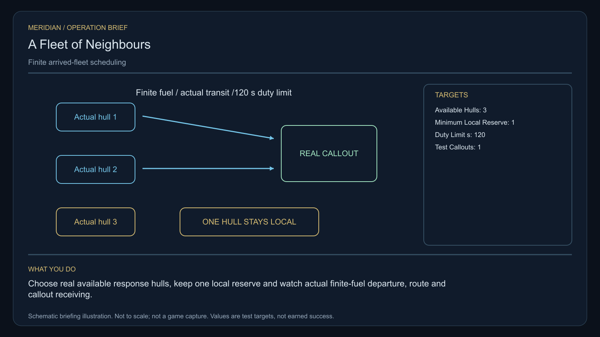

# C26 - A Fleet of Neighbours

[Oracle contents](../README.md). This is a derived reading view of [the full oracle](../FINAL-GAME-ORACLE.md). Canonical mission data and gameplay specifications are in `docs/meridian/missions/`.

**Mission identity:** `l337.fleet-of-neighbours`. **Premise:** ARLEN: A promised hull cannot protect a corridor it has not reached.

Three settlements offer civilian protection ships after pirates close a relief corridor. Their hulls and fuel are finite, and every commander wants the same escort window. The player audits actual commitments, repairs a relief lane and escorts a dispatch tender before choosing a rotating protection rota or locally retained reserve pairs. Aid comes from the ships that actually arrive.

**Offer:** At Morvasen in Galaxy 2, after one ordinary trade. No imported score gate or source campaign prerequisite. The reference loan needs one tonne of free hold. The original reference is collected here before the survey departure. The settlement choice is made with actual arrived delegates at the witness receiver; final return/audit remains at this issuer.

**Briefing:** ARLEN: A promised hull cannot protect a corridor it has not reached.

**Contacts:** Marshal Nera Voss, Captain Suri Arlen. **Story craft:** SH001, SH061.

**Successful settlement:** 9,400 CR. The selected verified settlement persists in local records. No free hull, unrelated legal reset or artificial combat kills. A permanent clue for The Unwritten Route: The formation with no centre.

Mission-specific rules and resources:

- **Origin kind:** new-original
- **Branch policy:** Store the selected plan-a or plan-b identity once, separately from its authored display label. Apply only that branch at apply-settlement; both distinct physical and receiving proofs are required. Both legitimate endings share one final reward and one source clue.
- **Items 1 / Id:** fleet-of-neighbours-reference
- **Items 1 / Mass tonnes:** 1
- **Items 1 / Acquire stage:** collect-reference
- **Items 1 / Consume stage:** return-and-audit
- **Interaction notes:** Use the existing mission log, targeting, scan, contextual Confirm and Esc. Preview all obligations before accepting; cancellation changes nothing.; Keep the reference instrument in reserved custody through the field work, witness reception and selected settlement. Returning it is part of the independent terminal audit.; Preserve actual crew and entity identities. Culling is not death or arrival. A lost unnamed tender may be replaced with a new consenting crew after real rescue handling; never resurrect a named casualty. A lost reference invalidates its old serial before a real replacement loan.; All objectives are space flight or space-station handoffs. Stations remain protected from single-ship weapons. No source world overrides, equipment budgets, hidden reputation grind or external storyline progress is required.
- **Authoring art / Prop id:** fleet-of-neighbours-reference
- **Authoring art / Prop form:** beacon
- **Authoring art / Palette:** slate-orange
- **Authoring art / Stage objects:** fleet-of-neighbours-reference; fleet-of-neighbours-reference; fleet-of-neighbours-reference; fleet-of-neighbours-reference; SH061; fleet-of-neighbours-reference; fleet-of-neighbours-reference; fleet-of-neighbours-reference; fleet-of-neighbours-reference
- **Terminal stage:** complete
- **Reward receipt:** l337.fleet-of-neighbours/final-payment
- **Reward policy:** Pay credits once, atomically with the terminal receipt. Delay optional equipment fitting if incompatible; offer it again without duplicating payment. Never award kill points for non-kills or clear unrelated legal status. Commit the clue and terminal reward receipt atomically; a pending optional fitting does not delay the clue.
- **Identity policy:** Match locations by galaxy/system identity, not coordinates or displayed spelling. Match entities by mission instance and target ID, never merely ship type.
- **Persistence policy:** Every campaign starts unaccepted with its current identity and zero progress. Persist current-format stage evidence, choices, mission-item custody, reward and clue receipts. Resume these records on load; replayed events cannot duplicate rewards. No previous campaign or save format is imported.
- **Gameplay profile ref:** ../gameplay/campaign-profiles.json#/profiles/fleet-of-neighbours
- **Oracle design revision:** review-resolution-2026-10-24-v2
- **Delegation policy:** Before launch, original principals register named living delegates and sign the exact settlement scope. Only their actual arrival at the witness receiver permits the local choice. Delegation grants no remote physical proof or access beyond that original scope.
- **Recovery policy ref:** ../gameplay/recovery-policy.json
- **Main quest continuity:** Original failure remains recorded. A successful separately scoped continuity inquiry can earn this same source clue without its original fee or reward; always requestable through the clue journal/charter orbital desk, independent of money, source stock and original station/witness survival.

**Physical gameplay profile - new project estimates:**

- **Id:** l337.design/fleet-of-neighbours/physical-v2
- **Authority:** New project design resolving the user-supplied 24 October review; values are labelled estimates, not historical recovery or implemented mechanics.
- **Parameter status:** project-estimate-needs-play-balancing
- **Primary mechanic:** finite arrived-fleet scheduling
- **Recommended tier:** advanced
- **Parameters / Available hulls:** 3
- **Parameters / Minimum local reserve:** 1
- **Parameters / Duty limit seconds:** 120
- **Parameters / Test callouts:** 1
- **Normal controls:** Normal flight, targeting and contextual Confirm/Cancel. Confirm arms a specific owned device operation; the measured native producer, not the button, issues its success receipt.
- **Loan policy:** One original 1t reference kit stays aboard and counts throughout; external test cradles/parts belong to their real source. The kit is neither consumed nor replaced by a similarly named commodity.
- **Survey / Targets:** fleet-of-neighbours-survey-1; fleet-of-neighbours-survey-2; fleet-of-neighbours-survey-3
- **Survey / Instruction:** Verify three actual offered hull manifests, crew consent, fuel and departure commitments.
- **Survey / Dwell seconds per target:** 12
- **Survey / Aim degrees:** 2
- **Survey / Surface range native units:** 250; 1500
- **Survey / Requires:** same actual target, front view and nearest unobstructed mesh; partial unfinished dwell resets on interruption/load, completed readings persist
- **Field work / Targets:** fleet-of-neighbours-work-port; fleet-of-neighbours-work-starboard
- **Field work / Instruction:** Repair the two relief-lane relays and observe the actual offered ships completing their routes.
- **Field work / Acceptance:** Only arrived living hulls count; destroyed or merely promised hulls do not become protection points.
- **Field work / Surface clearance metres:** 50; 150
- **Field work / Maximum relative speed metres per second:** 1
- **Field work / Maximum aim degrees:** 2
- **Field work / Minimum qualified work seconds:** 0
- **Field work / Credit policy:** No generic hover/work countdown. Actual ordered flight, load, arbitration, transfer or dispatch events plus the named measured functional test produce the two existing work-target receipts. Range/tool hold applies only when the actual operation needs it.
- **Field work / Work credit mode:** measured-operation-and-functional-test
- **Witness / Target:** fleet-of-neighbours-witness-received
- **Witness / Hull:** SH061
- **Witness / Operating crew:** 2
- **Witness / Delegates:** 1
- **Witness / Fitted standard cabins:** 1
- **Witness / Standard cabin places:** 4
- **Witness / Player cabins required:** 0
- **Witness / Native requirement:** Actual identified hull and people, real departure/transit/doorway/receiving with own finite fuel and source-owned cabin; any source fitting must be physically calibrated. Reusing the hull class is not their arrival.
- **Witness / Fallback:** Casualties persist. A lost witness follows the successful remedial-inquiry track; no dead person is cloned.
- **Witness / Accompaniment required:** yes
- **Witness / Scheduling:** Starts its actual source-owned journey after the survey is committed and required source permission is granted. For non-escort profiles it travels concurrently with field work; the player may observe it but no stay-near timer or artificial follow waypoint is required. It still needs actual living arrival/docking before branch choice. For escorted profiles the player explicitly joins the genuine journey and protects/reaches the actual receiver.
- **Branches / Plan-a / Targets:** fleet-of-neighbours-plan-a-physical-proof; fleet-of-neighbours-plan-a-receiving-proof
- **Branches / Plan-a / Acceptance:** The rota uses at most the actual arrived hulls and stops each duty at120s without replacing losses.
- **Branches / Plan-b / Targets:** fleet-of-neighbours-plan-b-physical-proof; fleet-of-neighbours-plan-b-receiving-proof
- **Branches / Plan-b / Acceptance:** One real local hull remains reserved and the single cross-settlement callout requires its actual departure, transit and arrival.
- **Branch receipt policy:** Both distinct targets of the selected branch must have native physical/receiving evidence. Summary target is logical only; other-branch or mixed half-completions cannot qualify.
- **Pacing / Loan before departure:** yes
- **Pacing / Choice at actual witness receiver:** yes
- **Pacing / Final audit at original issuer:** yes
- **Pacing / No hidden deadline:** yes
- **Pacing / No prior campaign gate:** yes
- **Audit:** Original loan actually returned; measured observations, exact witness or remedial outcome and the two selected branch proofs agree. Payment and the one source clue commit once.
- **Interaction style:** fleet-dispatch
- **Player action:** Choose real available response hulls, keep one local reserve and watch actual finite-fuel departure, route and callout receiving.
- **Repeat avoidance:** One fixed mission-specific challenge state persists per commander/case. Wrong settings provide legible measured feedback. No random reroll, identical click sequence or cloned cargo may substitute for the named operation.
- **Journal phases:** Obtain the instrument and establish the evidence; Perform the distinctive fleet-dispatch operation; Receive independent evidence and choose a settlement; Prove that settlement and audit the original loan
- **Presentation policy:** Nine persistent internal stages are not nine compulsory repeated dialogue screens. Group them into these mission-specific journal phases; combine already co-located briefing/loan and audit/payment transactions in one reviewable panel without bypassing their atomic receipts. Measurements and tool settings use the profile controls in space. Narration, consequence and named contacts remain mission-specific.
- **Acceptance tests / Positive:** Reach both real work targets with the advertised actual fitting, perform playerAction, pass the profile functional test and both selected branch proofs, receive actual witness and return original loan; only then settle once.
- **Acceptance tests / Negative:** wrong-world/target identity never qualifies; time near fixture without the named operation never qualifies; partial or cross-branch proof never completes; reference loan and external stock never duplicate; unsafe threshold/expired authority/occlusion refuses with reason; load repeats neither completed functional test nor cargo spend; failed witness/case preserves loss and exposes continuity inquiry
- **Operation artwork ref:** ../../assets/missions/revisions/fleet-of-neighbours-operation.png
- **Editable operation artwork ref:** ../../assets/missions/revisions/fleet-of-neighbours-operation.svg

[Controlling physical operations and recovery rules](gameplay/GAMEPLAY-SPECIFICATION.md).

## C26.01 - accept

**Place:** Morvasen (G02-S117). **Objective:** Accept A Fleet of Neighbours at Morvasen.

**Story/dialogue:** Marshal Nera Voss: Three settlements offer civilian protection ships after pirates close a relief corridor. Review the complete survey, loan and receiving requirements before confirming.

- **Event:** mission_contact_confirmed
- **Required targets:** accept-verified
- **Interaction item mass tonnes:** 0
- **Next:** collect-reference
- **Completion rule:** All requiredTargets must have confirmed mission-scoped evidence; consume the transition once.
- **Recovery:** Persist completed target evidence. Restore unloaded or culled actors from saved state with their same identity; genuine destruction and casualties remain recorded. Retry an escort only through its mission-specific recovery procedure and genuinely available crew, hull and cargo. Loss or replacement earns no arrival or reward. A dead named witness cannot be replaced by a lookalike.
- **Confirmation:** Confirm accepts a transfer or choice; Esc only closes the dialog and never transfers an item, spends money or selects a branch.
- **Cargo policy:** Reserve the listed mission item separately from commodities. Require free hold before accepting it; never silently delete, sell or overwrite player cargo. Contacts hold it safely when space is unavailable.
- **Decline policy:** Offer remains available until accepted. Preparation has no deadline. Any explicitly armed incident follows its advertised simulation clock; normal game pause and current-format save/load remain available.
- **Receipt:** l337.fleet-of-neighbours/accept
- **Item transaction:** Preview and commit the whole itemEffects batch atomically; capacity is evaluated after removals and additions together. Refusal or cancellation changes neither stage nor custody.

## C26.02 - collect-reference

**Place:** Morvasen (G02-S117). **Objective:** Collect the identified one-tonne reference instrument from Marshal Nera Voss.

**Story/dialogue:** Marshal Nera Voss: This instrument is a loan. I retain it until your hold has room, and the final audit returns this exact serial identity.

- **Event:** mission_contact_confirmed
- **Required targets:** collect-reference-verified
- **Interaction item mass tonnes:** 1
- **Next:** survey
- **Completion rule:** All requiredTargets must have confirmed mission-scoped evidence; consume the transition once.
- **Recovery:** Persist completed target evidence. Restore unloaded or culled actors from saved state with their same identity; genuine destruction and casualties remain recorded. Retry an escort only through its mission-specific recovery procedure and genuinely available crew, hull and cargo. Loss or replacement earns no arrival or reward. A dead named witness cannot be replaced by a lookalike.
- **Confirmation:** Confirm accepts a transfer or choice; Esc only closes the dialog and never transfers an item, spends money or selects a branch.
- **Cargo policy:** Reserve the listed mission item separately from commodities. Require free hold before accepting it; never silently delete, sell or overwrite player cargo. Contacts hold it safely when space is unavailable.
- **Decline policy:** Offer remains available until accepted. Preparation has no deadline. Any explicitly armed incident follows its advertised simulation clock; normal game pause and current-format save/load remain available.
- **Receipt:** l337.fleet-of-neighbours/collect-reference
- **Item effects 1 / Kind:** add
- **Item effects 1 / Item:** fleet-of-neighbours-reference
- **Item effects 1 / Mass tonnes:** 1
- **Item transaction:** Preview and commit the whole itemEffects batch atomically; capacity is evaluated after removals and additions together. Refusal or cancellation changes neither stage nor custody.

## C26.03 - survey

**Place:** Vornetor (G02-S111). **Objective:** Verify three actual offered hull manifests, crew consent, fuel and departure commitments.

**Story/dialogue:** ARLEN: A promised hull cannot protect a corridor it has not reached.

- **Event:** entity_scan_completed
- **Required targets:** fleet-of-neighbours-survey-1; fleet-of-neighbours-survey-2; fleet-of-neighbours-survey-3
- **Interaction item mass tonnes:** 0
- **Next:** field-work
- **Completion rule:** All requiredTargets must have confirmed mission-scoped evidence; consume the transition once.
- **Recovery:** Persist completed target evidence. Restore unloaded or culled actors from saved state with their same identity; genuine destruction and casualties remain recorded. Retry an escort only through its mission-specific recovery procedure and genuinely available crew, hull and cargo. Loss or replacement earns no arrival or reward. A dead named witness cannot be replaced by a lookalike.
- **Confirmation:** Confirm accepts a transfer or choice; Esc only closes the dialog and never transfers an item, spends money or selects a branch.
- **Cargo policy:** Reserve the listed mission item separately from commodities. Require free hold before accepting it; never silently delete, sell or overwrite player cargo. Contacts hold it safely when space is unavailable.
- **Decline policy:** Offer remains available until accepted. Preparation has no deadline. Any explicitly armed incident follows its advertised simulation clock; normal game pause and current-format save/load remain available.
- **Receipt:** l337.fleet-of-neighbours/survey
- **Item transaction:** Preview and commit the whole itemEffects batch atomically; capacity is evaluated after removals and additions together. Refusal or cancellation changes neither stage nor custody.

## C26.04 - field-work

**Place:** Talnevan (G02-S227). **Objective:** Repair the two relief-lane relays and observe the actual offered ships completing their routes.

**Story/dialogue:** VOSS: Keep the repair separate from the defence. A pirate kill cannot calibrate a relay.

- **Event:** mission_action_confirmed
- **Required targets:** fleet-of-neighbours-work-port; fleet-of-neighbours-work-starboard
- **Interaction item mass tonnes:** 1
- **Next:** independent-witness
- **Completion rule:** All requiredTargets must have confirmed mission-scoped evidence; consume the transition once.
- **Recovery:** Persist completed target evidence. Restore unloaded or culled actors from saved state with their same identity; genuine destruction and casualties remain recorded. Retry an escort only through its mission-specific recovery procedure and genuinely available crew, hull and cargo. Loss or replacement earns no arrival or reward. A dead named witness cannot be replaced by a lookalike.
- **Confirmation:** Confirm accepts a transfer or choice; Esc only closes the dialog and never transfers an item, spends money or selects a branch.
- **Cargo policy:** Reserve the listed mission item separately from commodities. Require free hold before accepting it; never silently delete, sell or overwrite player cargo. Contacts hold it safely when space is unavailable.
- **Decline policy:** Offer remains available until accepted. Preparation has no deadline. Any explicitly armed incident follows its advertised simulation clock; normal game pause and current-format save/load remain available.
- **Receipt:** l337.fleet-of-neighbours/field-work
- **Item transaction:** Preview and commit the whole itemEffects batch atomically; capacity is evaluated after removals and additions together. Refusal or cancellation changes neither stage nor custody.
- **Reference artwork / Id:** fleet-of-neighbours/field-work
- **Reference artwork / File:** ../../assets/missions/stages/fleet-of-neighbours/field-work.png
- **Reference artwork / Visibility:** Mission stage briefing and completed history
- **Reference artwork / Role:** Original tool/object reference; does not illustrate the complete revised operation

## C26.05 - independent-witness

**Place:** Arvek (G02-S073). **Objective:** Escort the registered civilian dispatch tender to relief reception.

**Story/dialogue:** ARLEN: Record arrivals and losses honestly. Do not recreate a destroyed helper from its promise.

- **Event:** escort_arrived
- **Required targets:** fleet-of-neighbours-witness-received
- **Interaction item mass tonnes:** 1
- **Next:** choose-settlement
- **Completion rule:** All requiredTargets must have confirmed mission-scoped evidence; consume the transition once.
- **Recovery:** Persist completed target evidence. Restore unloaded or culled actors from saved state with their same identity; genuine destruction and casualties remain recorded. Retry an escort only through its mission-specific recovery procedure and genuinely available crew, hull and cargo. Loss or replacement earns no arrival or reward. A dead named witness cannot be replaced by a lookalike.
- **Confirmation:** Confirm accepts a transfer or choice; Esc only closes the dialog and never transfers an item, spends money or selects a branch.
- **Cargo policy:** Reserve the listed mission item separately from commodities. Require free hold before accepting it; never silently delete, sell or overwrite player cargo. Contacts hold it safely when space is unavailable.
- **Decline policy:** Offer remains available until accepted. Preparation has no deadline. Any explicitly armed incident follows its advertised simulation clock; normal game pause and current-format save/load remain available.
- **Receipt:** l337.fleet-of-neighbours/independent-witness
- **Item transaction:** Preview and commit the whole itemEffects batch atomically; capacity is evaluated after removals and additions together. Refusal or cancellation changes neither stage nor custody.

## C26.06 - choose-settlement

**Place:** Arvek (G02-S073). **Objective:** At the actual witness receiving station, choose the settlement with the arrived authorised operator delegates.

**Story/dialogue:** Marshal Nera Voss: Your finite arrived-fleet scheduling evidence is ready. Our arrived delegates have the signed mandate to choose here. Either rotate arrived protection ships across settlements or retain local reserve pairs with mutual callouts. Compare the actual tests and consequences before confirming; closing this view chooses neither.

- **Event:** mission_choice_confirmed
- **Required targets:** fleet-of-neighbours-settlement-choice
- **Interaction item mass tonnes:** 1
- **Choices:** Rotate arrived protection ships across settlements; Retain local reserve pairs with mutual callouts
- **Choice ids:** plan-a; plan-b
- **Next:** apply-settlement
- **Completion rule:** All requiredTargets must have confirmed mission-scoped evidence; consume the transition once.
- **Recovery:** Persist completed target evidence. Restore unloaded or culled actors from saved state with their same identity; genuine destruction and casualties remain recorded. Retry an escort only through its mission-specific recovery procedure and genuinely available crew, hull and cargo. Loss or replacement earns no arrival or reward. A dead named witness cannot be replaced by a lookalike.
- **Confirmation:** Confirm accepts a transfer or choice; Esc only closes the dialog and never transfers an item, spends money or selects a branch.
- **Cargo policy:** Reserve the listed mission item separately from commodities. Require free hold before accepting it; never silently delete, sell or overwrite player cargo. Contacts hold it safely when space is unavailable.
- **Decline policy:** Offer remains available until accepted. Preparation has no deadline. Any explicitly armed incident follows its advertised simulation clock; normal game pause and current-format save/load remain available.
- **Receipt:** l337.fleet-of-neighbours/choose-settlement
- **Item transaction:** Preview and commit the whole itemEffects batch atomically; capacity is evaluated after removals and additions together. Refusal or cancellation changes neither stage nor custody.

## C26.07 - apply-settlement

**Place:** Talnevan (G02-S227). **Objective:** Verify both independent proofs for the selected settlement.

**Story/dialogue:** Marshal Nera Voss: The selected plan must work in the physical system. A statement or unrelated kill cannot supply either proof.

- **Event:** mission_action_confirmed
- **Required targets:** fleet-of-neighbours-settlement-summary
- **Interaction item mass tonnes:** 1
- **Branch stage:** choose-settlement
- **Branch variants 1 / Choice id:** plan-a
- **Branch variants 1 / Event:** mission_action_confirmed
- **Branch variants 1 / Required targets:** fleet-of-neighbours-plan-a-physical-proof; fleet-of-neighbours-plan-a-receiving-proof
- **Branch variants 1 / Objective:** Verify the arrived-hull rota and each crew's consented duty limit.
- **Branch variants 1 / Dialog:** VOSS: Duty changes only when the actual replacement arrives.
- **Branch variants 1 / Gossip:** A Fleet of Neighbours: Rotate arrived protection ships across settlements.
- **Branch variants 2 / Choice id:** plan-b
- **Branch variants 2 / Event:** mission_action_confirmed
- **Branch variants 2 / Required targets:** fleet-of-neighbours-plan-b-physical-proof; fleet-of-neighbours-plan-b-receiving-proof
- **Branch variants 2 / Objective:** Verify both local reserves and a real cross-settlement callout.
- **Branch variants 2 / Dialog:** ARLEN: A reserve is a living ship, not an accounting entry.
- **Branch variants 2 / Gossip:** A Fleet of Neighbours: Retain local reserve pairs with mutual callouts.
- **Next:** return-and-audit
- **Completion rule:** All requiredTargets must have confirmed mission-scoped evidence; consume the transition once.
- **Recovery:** Persist completed target evidence. Restore unloaded or culled actors from saved state with their same identity; genuine destruction and casualties remain recorded. Retry an escort only through its mission-specific recovery procedure and genuinely available crew, hull and cargo. Loss or replacement earns no arrival or reward. A dead named witness cannot be replaced by a lookalike.
- **Confirmation:** Confirm accepts a transfer or choice; Esc only closes the dialog and never transfers an item, spends money or selects a branch.
- **Cargo policy:** Reserve the listed mission item separately from commodities. Require free hold before accepting it; never silently delete, sell or overwrite player cargo. Contacts hold it safely when space is unavailable.
- **Decline policy:** Offer remains available until accepted. Preparation has no deadline. Any explicitly armed incident follows its advertised simulation clock; normal game pause and current-format save/load remain available.
- **Receipt:** l337.fleet-of-neighbours/apply-settlement
- **Item transaction:** Preview and commit the whole itemEffects batch atomically; capacity is evaluated after removals and additions together. Refusal or cancellation changes neither stage nor custody.

## C26.08 - return-and-audit

**Place:** Morvasen (G02-S117). **Objective:** Return the reference instrument and confirm all physical receiving and settlement receipts.

**Story/dialogue:** Marshal Nera Voss: The loan is returned. Check the actual observations, living witness reception and both selected settlement proofs before closing the case.

- **Event:** mission_contact_confirmed
- **Required targets:** return-and-audit-verified
- **Interaction item mass tonnes:** 0
- **Next:** close-case
- **Completion rule:** All requiredTargets must have confirmed mission-scoped evidence; consume the transition once.
- **Recovery:** Persist completed target evidence. Restore unloaded or culled actors from saved state with their same identity; genuine destruction and casualties remain recorded. Retry an escort only through its mission-specific recovery procedure and genuinely available crew, hull and cargo. Loss or replacement earns no arrival or reward. A dead named witness cannot be replaced by a lookalike.
- **Confirmation:** Confirm accepts a transfer or choice; Esc only closes the dialog and never transfers an item, spends money or selects a branch.
- **Cargo policy:** Reserve the listed mission item separately from commodities. Require free hold before accepting it; never silently delete, sell or overwrite player cargo. Contacts hold it safely when space is unavailable.
- **Decline policy:** Offer remains available until accepted. Preparation has no deadline. Any explicitly armed incident follows its advertised simulation clock; normal game pause and current-format save/load remain available.
- **Receipt:** l337.fleet-of-neighbours/return-and-audit
- **Item effects 1 / Kind:** remove
- **Item effects 1 / Item:** fleet-of-neighbours-reference
- **Item effects 1 / Mass tonnes:** 1
- **Item transaction:** Preview and commit the whole itemEffects batch atomically; capacity is evaluated after removals and additions together. Refusal or cancellation changes neither stage nor custody.

## C26.09 - close-case

**Place:** Morvasen (G02-S117). **Objective:** Confirm successful completion, the recorded settlement and the once-only fee.

**Story/dialogue:** Marshal Nera Voss: The independent audit is complete. Your fee is 9400 CR. The operators retain the chosen settlement and their original records.

Marshal Nera Voss: The audit has left one anomaly that belongs to neither side. An early dispatch diagram curves around an empty central formation slot with no assigned vessel. It is preserved in your journal for the AI at PLUGH.

- **Event:** mission_contact_confirmed
- **Required targets:** close-case-verified
- **Interaction item mass tonnes:** 0
- **Next:** complete
- **Completion rule:** All requiredTargets must have confirmed mission-scoped evidence; consume the transition once.
- **Recovery:** Persist completed target evidence. Restore unloaded or culled actors from saved state with their same identity; genuine destruction and casualties remain recorded. Retry an escort only through its mission-specific recovery procedure and genuinely available crew, hull and cargo. Loss or replacement earns no arrival or reward. A dead named witness cannot be replaced by a lookalike.
- **Confirmation:** Confirm accepts a transfer or choice; Esc only closes the dialog and never transfers an item, spends money or selects a branch.
- **Cargo policy:** Reserve the listed mission item separately from commodities. Require free hold before accepting it; never silently delete, sell or overwrite player cargo. Contacts hold it safely when space is unavailable.
- **Decline policy:** Offer remains available until accepted. Preparation has no deadline. Any explicitly armed incident follows its advertised simulation clock; normal game pause and current-format save/load remain available.
- **Receipt:** l337.fleet-of-neighbours/close-case
- **Item transaction:** Preview and commit the whole itemEffects batch atomically; capacity is evaluated after removals and additions together. Refusal or cancellation changes neither stage nor custody.

**Permanent clue:** The formation with no centre (`fleet-of-neighbours-trace`). An early dispatch diagram curves around an empty central formation slot with no assigned vessel.

**Failure follow-up:** [Source-specific funded recovery](gameplay/recovery-policy.json) under `l337.fleet-of-neighbours`. Original loss and original fee receipts remain unchanged.

[Complete structured definition](definitions/fleet-of-neighbours.json).
