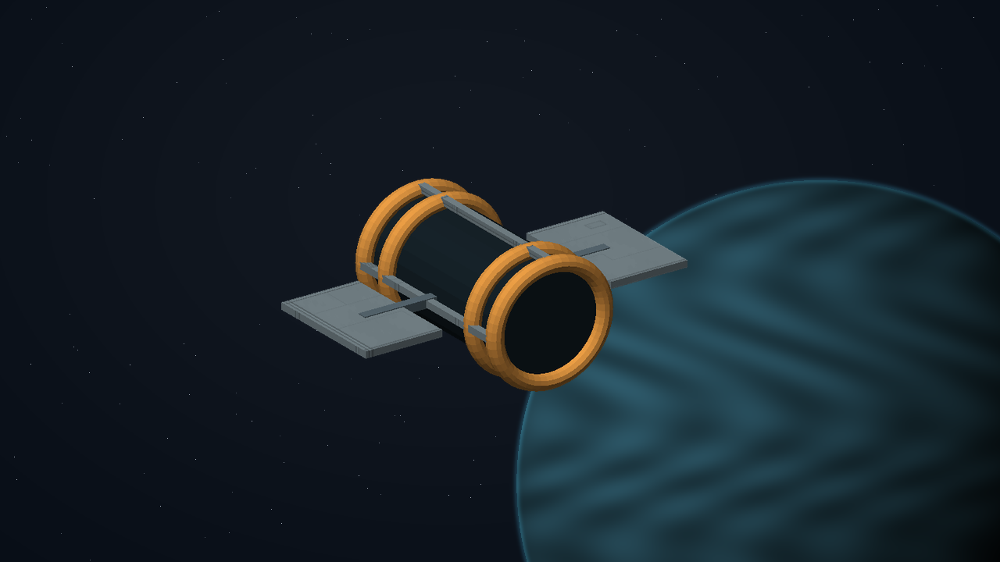
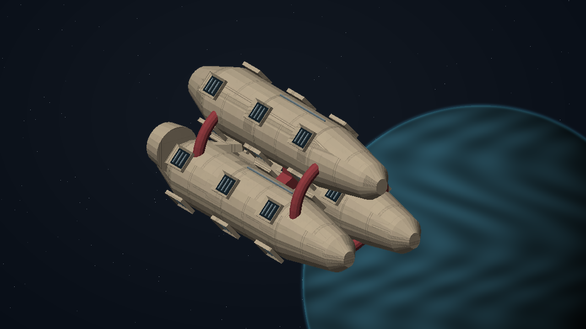
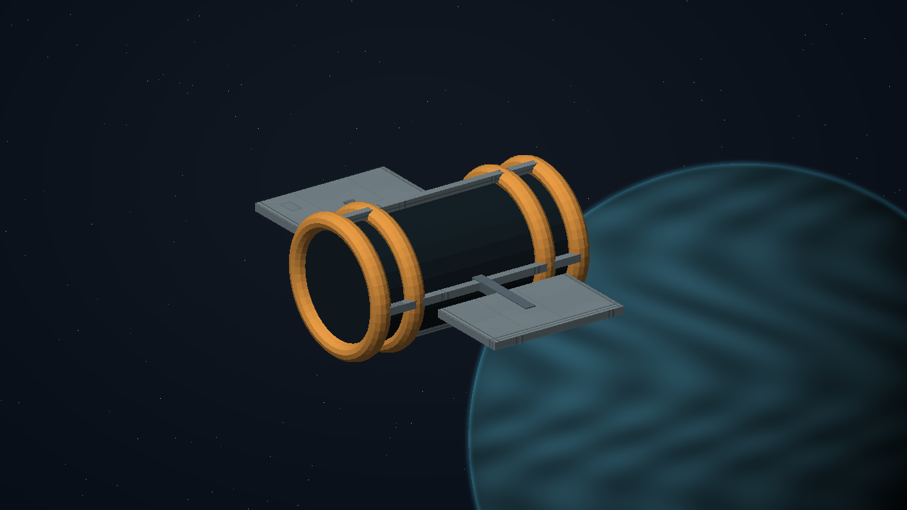
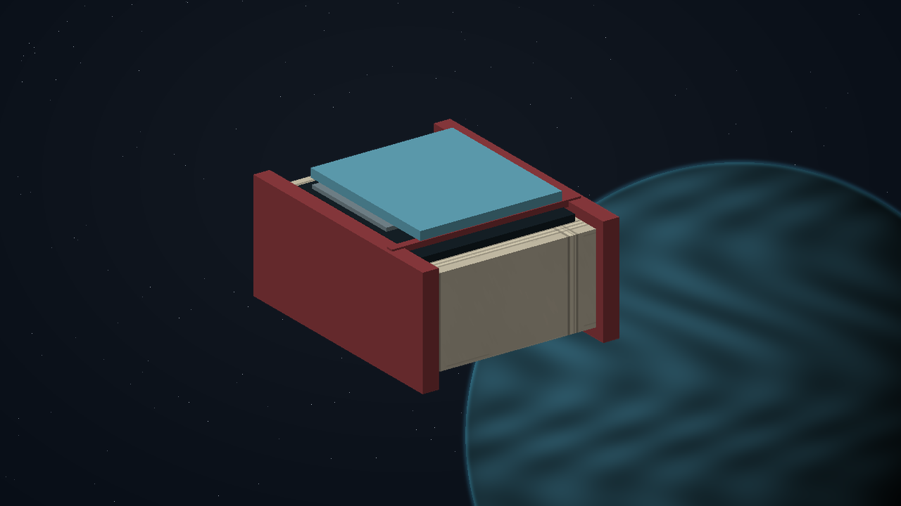
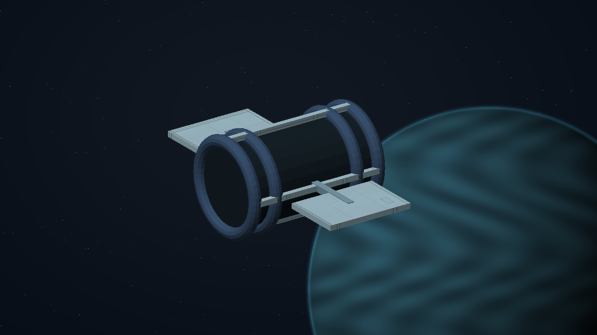

# C26 - A Fleet of Neighbours

[Return to the oracle contents](../README.md). This reading view is extracted from [the complete single-file oracle](../FINAL-GAME-ORACLE.md); its rules are the same.

**Mission identity:** `l337.fleet-of-neighbours`. **Premise:** ARLEN: A promised hull cannot protect a corridor it has not reached.

Three settlements offer civilian protection ships after pirates close a relief corridor. Their hulls and fuel are finite, and every commander wants the same escort window. The player audits actual commitments, repairs a relief lane and escorts a dispatch tender before choosing a rotating protection rota or locally retained reserve pairs. Aid comes from the ships that actually arrive.

**Offer:** At Morvasen in Galaxy 2, after one ordinary trade. No imported score gate or source campaign prerequisite. The reference loan needs one tonne of free hold.

**Briefing:** ARLEN: A promised hull cannot protect a corridor it has not reached.

**Contacts:** Marshal Nera Voss, Captain Suri Arlen. **Story craft:** SH001 Mule, SH061 Haflinger.

**Successful settlement:** 9,400 CR. The selected verified settlement persists in local records. No free hull, unrelated legal reset or artificial combat kills. A permanent clue for The Unwritten Route: The formation with no centre.

Mission-specific rules and resources:

- **Origin kind:** new-original
- **Branch policy:** Store the selected plan-a or plan-b identity once, separately from its authored display label. Apply only that branch at apply-settlement; both distinct physical and receiving proofs are required. Both legitimate endings share one final reward and one source clue.
- **Items 1 / Id:** fleet-of-neighbours-reference
- **Items 1 / Mass tonnes:** 1
- **Items 1 / Acquire stage:** collect-reference
- **Items 1 / Consume stage:** return-and-audit
- **Interaction notes:** Use the existing mission log, targeting, scan, contextual Confirm and Esc. Preview all obligations before accepting; cancellation changes nothing.; Keep the reference instrument in reserved custody through the field work, witness reception and selected settlement. Returning it is part of the independent terminal audit.; Preserve actual crew and entity identities. Culling is not death or arrival. A lost unnamed tender may be replaced with a new consenting crew after real rescue handling; never resurrect a named casualty. A lost reference invalidates its old serial before a real replacement loan.; All objectives are space flight or space-station handoffs. Stations remain protected from single-ship weapons. No source world overrides, equipment budgets, hidden reputation grind or external storyline progress is required.
- **Authoring art / Prop id:** fleet-of-neighbours-reference
- **Authoring art / Prop form:** beacon
- **Authoring art / Palette:** slate-orange
- **Authoring art / Stage objects:** fleet-of-neighbours-reference; fleet-of-neighbours-reference; fleet-of-neighbours-reference; fleet-of-neighbours-reference; SH061; fleet-of-neighbours-reference; fleet-of-neighbours-reference; fleet-of-neighbours-reference; fleet-of-neighbours-reference
- **Terminal stage:** complete
- **Reward receipt:** l337.fleet-of-neighbours/final-payment
- **Reward policy:** Pay credits once, atomically with the terminal receipt. Delay optional equipment fitting if incompatible; offer it again without duplicating payment. Never award kill points for non-kills or clear unrelated legal status. Commit the clue and terminal reward receipt atomically; a pending optional fitting does not delay the clue.
- **Identity policy:** Match locations by galaxy/system identity, not coordinates or displayed spelling. Match entities by mission instance and target ID, never merely ship type.
- **Persistence policy:** Every campaign starts unaccepted with its current identity and zero progress. Persist current-format stage evidence, choices, mission-item custody, reward and clue receipts. Resume these records on load; replayed events cannot duplicate rewards. No previous campaign or save format is imported.

## C26.01 - accept

**Place:** Morvasen (G02-S117). **Objective:** Accept A Fleet of Neighbours at Morvasen.

**Story/dialogue:** Marshal Nera Voss: Three settlements offer civilian protection ships after pirates close a relief corridor. Review the complete survey, loan and receiving requirements before confirming.

- **Event:** mission_contact_confirmed
- **Required targets:** accept-verified
- **Interaction item mass tonnes:** 0
- **Next:** survey
- **Completion rule:** All requiredTargets must have confirmed mission-scoped evidence; consume the transition once.
- **Recovery:** Persist each completed target. Recreate an uncompleted objective after load or entity loss; duplicate scans and incidental removal cannot complete it. Escort destruction returns to the escort briefing with a replacement launch and no reward.
- **Confirmation:** Confirm accepts a transfer or choice; Esc only closes the dialog and never transfers an item, spends money or selects a branch.
- **Cargo policy:** Reserve the listed mission item separately from commodities. Require free hold before accepting it; never silently delete, sell or overwrite player cargo. Contacts hold it safely when space is unavailable.
- **Decline policy:** Offer remains available until accepted. Preparation has no deadline. Any explicitly armed incident follows its advertised simulation clock; normal game pause and current-format save/load remain available.
- **Receipt:** l337.fleet-of-neighbours/accept
- **Item transaction:** Preview and commit the whole itemEffects batch atomically; capacity is evaluated after removals and additions together. Refusal or cancellation changes neither stage nor custody.

## C26.02 - survey

**Place:** Vornetor (G02-S111). **Objective:** Verify three real relief-escort manifests and their available fuel.

**Story/dialogue:** ARLEN: A promised hull cannot protect a corridor it has not reached.

- **Event:** entity_scan_completed
- **Required targets:** fleet-of-neighbours-survey-1; fleet-of-neighbours-survey-2; fleet-of-neighbours-survey-3
- **Interaction item mass tonnes:** 0
- **Next:** collect-reference
- **Completion rule:** All requiredTargets must have confirmed mission-scoped evidence; consume the transition once.
- **Recovery:** Persist each completed target. Recreate an uncompleted objective after load or entity loss; duplicate scans and incidental removal cannot complete it. Escort destruction returns to the escort briefing with a replacement launch and no reward.
- **Confirmation:** Confirm accepts a transfer or choice; Esc only closes the dialog and never transfers an item, spends money or selects a branch.
- **Cargo policy:** Reserve the listed mission item separately from commodities. Require free hold before accepting it; never silently delete, sell or overwrite player cargo. Contacts hold it safely when space is unavailable.
- **Decline policy:** Offer remains available until accepted. Preparation has no deadline. Any explicitly armed incident follows its advertised simulation clock; normal game pause and current-format save/load remain available.
- **Receipt:** l337.fleet-of-neighbours/survey
- **Item transaction:** Preview and commit the whole itemEffects batch atomically; capacity is evaluated after removals and additions together. Refusal or cancellation changes neither stage nor custody.

## C26.03 - collect-reference

**Place:** Morvasen (G02-S117). **Objective:** Collect the identified one-tonne reference instrument from Marshal Nera Voss.

**Story/dialogue:** Marshal Nera Voss: This instrument is a loan. I retain it until your hold has room, and the final audit returns this exact serial identity.

- **Event:** mission_contact_confirmed
- **Required targets:** collect-reference-verified
- **Interaction item mass tonnes:** 1
- **Next:** field-work
- **Completion rule:** All requiredTargets must have confirmed mission-scoped evidence; consume the transition once.
- **Recovery:** Persist each completed target. Recreate an uncompleted objective after load or entity loss; duplicate scans and incidental removal cannot complete it. Escort destruction returns to the escort briefing with a replacement launch and no reward.
- **Confirmation:** Confirm accepts a transfer or choice; Esc only closes the dialog and never transfers an item, spends money or selects a branch.
- **Cargo policy:** Reserve the listed mission item separately from commodities. Require free hold before accepting it; never silently delete, sell or overwrite player cargo. Contacts hold it safely when space is unavailable.
- **Decline policy:** Offer remains available until accepted. Preparation has no deadline. Any explicitly armed incident follows its advertised simulation clock; normal game pause and current-format save/load remain available.
- **Receipt:** l337.fleet-of-neighbours/collect-reference
- **Item effects 1 / Kind:** add
- **Item effects 1 / Item:** fleet-of-neighbours-reference
- **Item effects 1 / Mass tonnes:** 1
- **Item transaction:** Preview and commit the whole itemEffects batch atomically; capacity is evaluated after removals and additions together. Refusal or cancellation changes neither stage nor custody.

## C26.04 - field-work

**Place:** Talnevan (G02-S227). **Objective:** Repair two external relief-lane relays with the loaned dispatch beacon.

**Story/dialogue:** VOSS: Keep the repair separate from the defence. A pirate kill cannot calibrate a relay.

- **Event:** mission_action_confirmed
- **Required targets:** fleet-of-neighbours-work-port; fleet-of-neighbours-work-starboard
- **Interaction item mass tonnes:** 1
- **Next:** independent-witness
- **Completion rule:** All requiredTargets must have confirmed mission-scoped evidence; consume the transition once.
- **Recovery:** Persist each completed target. Recreate an uncompleted objective after load or entity loss; duplicate scans and incidental removal cannot complete it. Escort destruction returns to the escort briefing with a replacement launch and no reward.
- **Confirmation:** Confirm accepts a transfer or choice; Esc only closes the dialog and never transfers an item, spends money or selects a branch.
- **Cargo policy:** Reserve the listed mission item separately from commodities. Require free hold before accepting it; never silently delete, sell or overwrite player cargo. Contacts hold it safely when space is unavailable.
- **Decline policy:** Offer remains available until accepted. Preparation has no deadline. Any explicitly armed incident follows its advertised simulation clock; normal game pause and current-format save/load remain available.
- **Receipt:** l337.fleet-of-neighbours/field-work
- **Item transaction:** Preview and commit the whole itemEffects batch atomically; capacity is evaluated after removals and additions together. Refusal or cancellation changes neither stage nor custody.

## C26.05 - independent-witness

**Place:** Arvek (G02-S073). **Objective:** Escort the registered civilian dispatch tender to relief reception.

**Story/dialogue:** ARLEN: Record arrivals and losses honestly. Do not recreate a destroyed helper from its promise.

- **Event:** escort_arrived
- **Required targets:** fleet-of-neighbours-witness-received
- **Interaction item mass tonnes:** 1
- **Next:** choose-settlement
- **Completion rule:** All requiredTargets must have confirmed mission-scoped evidence; consume the transition once.
- **Recovery:** Persist each completed target. Recreate an uncompleted objective after load or entity loss; duplicate scans and incidental removal cannot complete it. Escort destruction returns to the escort briefing with a replacement launch and no reward.
- **Confirmation:** Confirm accepts a transfer or choice; Esc only closes the dialog and never transfers an item, spends money or selects a branch.
- **Cargo policy:** Reserve the listed mission item separately from commodities. Require free hold before accepting it; never silently delete, sell or overwrite player cargo. Contacts hold it safely when space is unavailable.
- **Decline policy:** Offer remains available until accepted. Preparation has no deadline. Any explicitly armed incident follows its advertised simulation clock; normal game pause and current-format save/load remain available.
- **Receipt:** l337.fleet-of-neighbours/independent-witness
- **Item transaction:** Preview and commit the whole itemEffects batch atomically; capacity is evaluated after removals and additions together. Refusal or cancellation changes neither stage nor custody.

## C26.06 - choose-settlement

**Place:** Morvasen (G02-S117). **Objective:** Choose the verified settlement with the consenting operators.

**Story/dialogue:** Marshal Nera Voss: Both choices preserve the independent evidence. Choose who controls the future work; closing this dialog selects neither.

- **Event:** mission_choice_confirmed
- **Required targets:** fleet-of-neighbours-settlement-choice
- **Interaction item mass tonnes:** 1
- **Choices:** Rotate arrived protection ships across settlements; Retain local reserve pairs with mutual callouts
- **Choice ids:** plan-a; plan-b
- **Next:** apply-settlement
- **Completion rule:** All requiredTargets must have confirmed mission-scoped evidence; consume the transition once.
- **Recovery:** Persist each completed target. Recreate an uncompleted objective after load or entity loss; duplicate scans and incidental removal cannot complete it. Escort destruction returns to the escort briefing with a replacement launch and no reward.
- **Confirmation:** Confirm accepts a transfer or choice; Esc only closes the dialog and never transfers an item, spends money or selects a branch.
- **Cargo policy:** Reserve the listed mission item separately from commodities. Require free hold before accepting it; never silently delete, sell or overwrite player cargo. Contacts hold it safely when space is unavailable.
- **Decline policy:** Offer remains available until accepted. Preparation has no deadline. Any explicitly armed incident follows its advertised simulation clock; normal game pause and current-format save/load remain available.
- **Receipt:** l337.fleet-of-neighbours/choose-settlement
- **Item transaction:** Preview and commit the whole itemEffects batch atomically; capacity is evaluated after removals and additions together. Refusal or cancellation changes neither stage nor custody.

## C26.07 - apply-settlement

**Place:** Talnevan (G02-S227). **Objective:** Verify both independent proofs for the selected settlement.

**Story/dialogue:** Marshal Nera Voss: The selected plan must work in the physical system. A statement or unrelated kill cannot supply either proof.

- **Event:** mission_action_confirmed
- **Required targets:** fleet-of-neighbours-settlement-summary
- **Interaction item mass tonnes:** 1
- **Branch stage:** choose-settlement
- **Branch variants 1 / Choice id:** plan-a
- **Branch variants 1 / Event:** mission_action_confirmed
- **Branch variants 1 / Required targets:** fleet-of-neighbours-plan-a-physical-proof; fleet-of-neighbours-plan-a-receiving-proof
- **Branch variants 1 / Objective:** Verify the arrived-hull rota and each crew's consented duty limit.
- **Branch variants 1 / Dialog:** VOSS: Duty changes only when the actual replacement arrives.
- **Branch variants 1 / Gossip:** A Fleet of Neighbours: Rotate arrived protection ships across settlements.
- **Branch variants 2 / Choice id:** plan-b
- **Branch variants 2 / Event:** mission_action_confirmed
- **Branch variants 2 / Required targets:** fleet-of-neighbours-plan-b-physical-proof; fleet-of-neighbours-plan-b-receiving-proof
- **Branch variants 2 / Objective:** Verify both local reserves and a real cross-settlement callout.
- **Branch variants 2 / Dialog:** ARLEN: A reserve is a living ship, not an accounting entry.
- **Branch variants 2 / Gossip:** A Fleet of Neighbours: Retain local reserve pairs with mutual callouts.
- **Next:** return-and-audit
- **Completion rule:** All requiredTargets must have confirmed mission-scoped evidence; consume the transition once.
- **Recovery:** Persist each completed target. Recreate an uncompleted objective after load or entity loss; duplicate scans and incidental removal cannot complete it. Escort destruction returns to the escort briefing with a replacement launch and no reward.
- **Confirmation:** Confirm accepts a transfer or choice; Esc only closes the dialog and never transfers an item, spends money or selects a branch.
- **Cargo policy:** Reserve the listed mission item separately from commodities. Require free hold before accepting it; never silently delete, sell or overwrite player cargo. Contacts hold it safely when space is unavailable.
- **Decline policy:** Offer remains available until accepted. Preparation has no deadline. Any explicitly armed incident follows its advertised simulation clock; normal game pause and current-format save/load remain available.
- **Receipt:** l337.fleet-of-neighbours/apply-settlement
- **Item transaction:** Preview and commit the whole itemEffects batch atomically; capacity is evaluated after removals and additions together. Refusal or cancellation changes neither stage nor custody.

## C26.08 - return-and-audit

**Place:** Morvasen (G02-S117). **Objective:** Return the reference instrument and confirm all physical receiving and settlement receipts.

**Story/dialogue:** Marshal Nera Voss: The loan is returned. Check the actual observations, living witness reception and both selected settlement proofs before closing the case.

- **Event:** mission_contact_confirmed
- **Required targets:** return-and-audit-verified
- **Interaction item mass tonnes:** 0
- **Next:** close-case
- **Completion rule:** All requiredTargets must have confirmed mission-scoped evidence; consume the transition once.
- **Recovery:** Persist each completed target. Recreate an uncompleted objective after load or entity loss; duplicate scans and incidental removal cannot complete it. Escort destruction returns to the escort briefing with a replacement launch and no reward.
- **Confirmation:** Confirm accepts a transfer or choice; Esc only closes the dialog and never transfers an item, spends money or selects a branch.
- **Cargo policy:** Reserve the listed mission item separately from commodities. Require free hold before accepting it; never silently delete, sell or overwrite player cargo. Contacts hold it safely when space is unavailable.
- **Decline policy:** Offer remains available until accepted. Preparation has no deadline. Any explicitly armed incident follows its advertised simulation clock; normal game pause and current-format save/load remain available.
- **Receipt:** l337.fleet-of-neighbours/return-and-audit
- **Item effects 1 / Kind:** remove
- **Item effects 1 / Item:** fleet-of-neighbours-reference
- **Item effects 1 / Mass tonnes:** 1
- **Item transaction:** Preview and commit the whole itemEffects batch atomically; capacity is evaluated after removals and additions together. Refusal or cancellation changes neither stage nor custody.

## C26.09 - close-case

**Place:** Morvasen (G02-S117). **Objective:** Confirm successful completion, the recorded settlement and the once-only fee.

**Story/dialogue:** Marshal Nera Voss: The independent audit is complete. Your fee is 9400 CR. The operators retain the chosen settlement and their original records.

Marshal Nera Voss: The audit has left one anomaly that belongs to neither side. An early dispatch diagram curves around an empty central formation slot with no assigned vessel. It is preserved in your journal for the AI at PLUGH.

- **Event:** mission_contact_confirmed
- **Required targets:** close-case-verified
- **Interaction item mass tonnes:** 0
- **Next:** complete
- **Completion rule:** All requiredTargets must have confirmed mission-scoped evidence; consume the transition once.
- **Recovery:** Persist each completed target. Recreate an uncompleted objective after load or entity loss; duplicate scans and incidental removal cannot complete it. Escort destruction returns to the escort briefing with a replacement launch and no reward.
- **Confirmation:** Confirm accepts a transfer or choice; Esc only closes the dialog and never transfers an item, spends money or selects a branch.
- **Cargo policy:** Reserve the listed mission item separately from commodities. Require free hold before accepting it; never silently delete, sell or overwrite player cargo. Contacts hold it safely when space is unavailable.
- **Decline policy:** Offer remains available until accepted. Preparation has no deadline. Any explicitly armed incident follows its advertised simulation clock; normal game pause and current-format save/load remain available.
- **Receipt:** l337.fleet-of-neighbours/close-case
- **Item transaction:** Preview and commit the whole itemEffects batch atomically; capacity is evaluated after removals and additions together. Refusal or cancellation changes neither stage nor custody.

**Permanent clue:** The formation with no centre (`fleet-of-neighbours-trace`). An early dispatch diagram curves around an empty central formation slot with no assigned vessel.

[Complete structured definition](../definitions/missions/fleet-of-neighbours.json).
