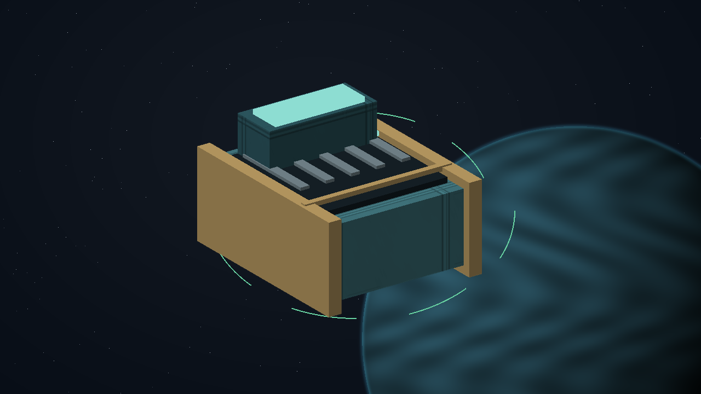
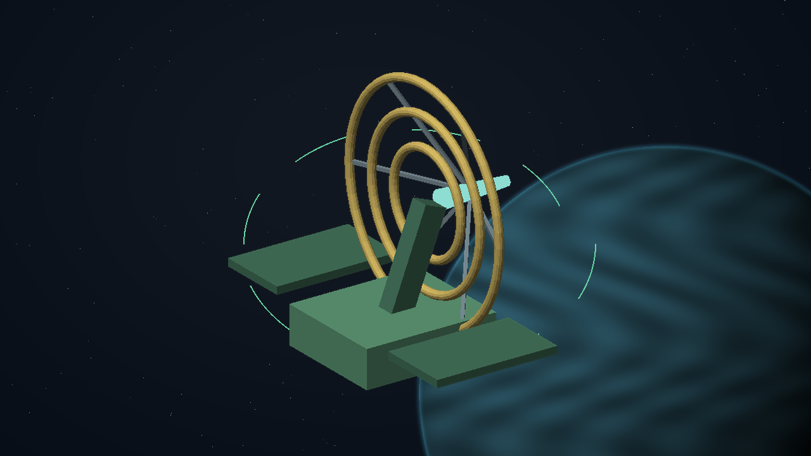
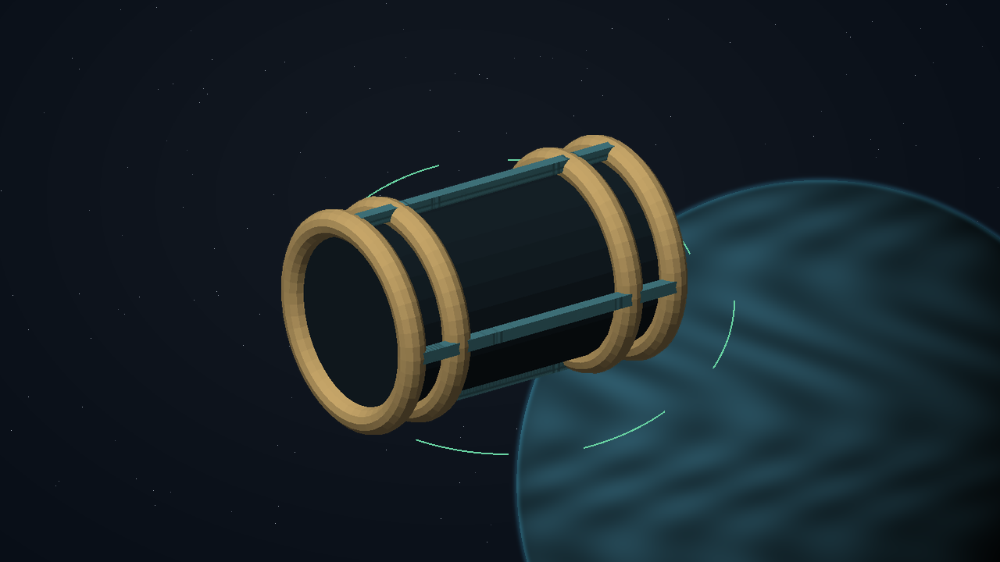
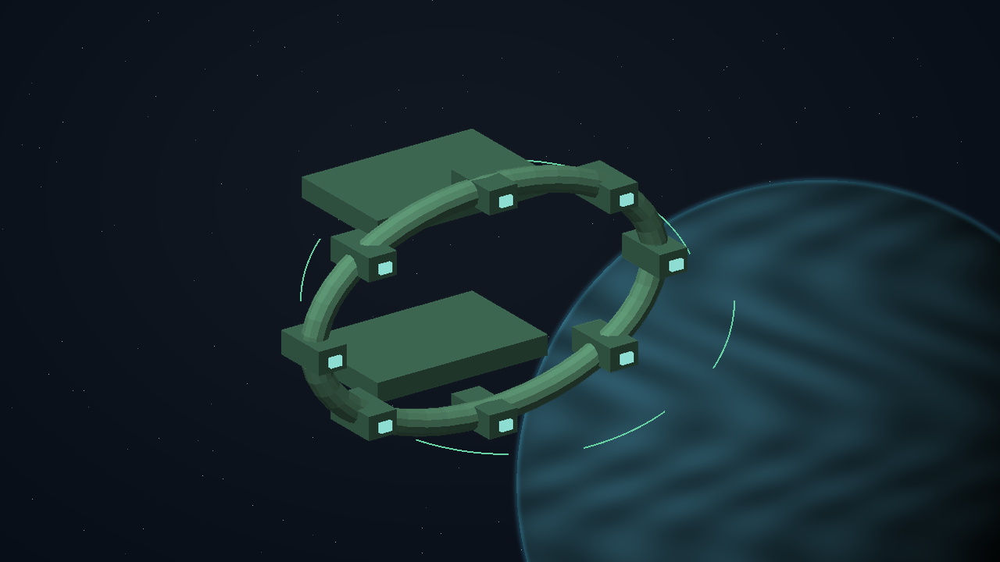
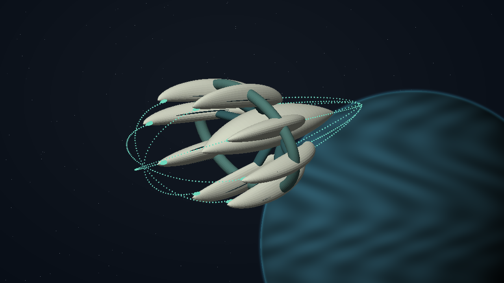
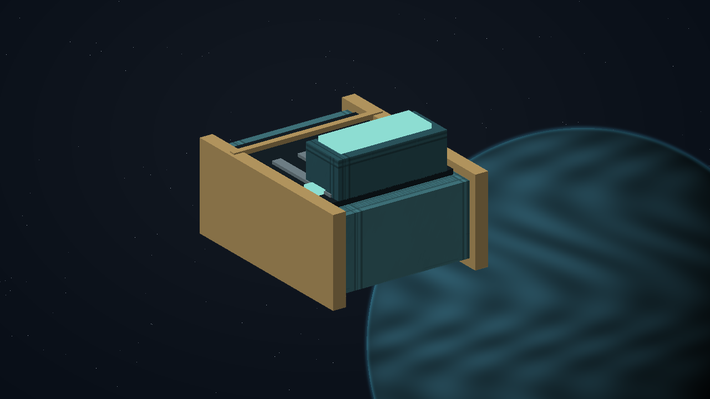

# The Unwritten Route - complete finale

[Oracle contents](../README.md). This is a derived reading view of [the full oracle](../FINAL-GAME-ORACLE.md). Canonical mission data and gameplay specifications are in `docs/meridian/missions/`.

The final mystery connects the whole career. All 39 campaigns, 15 general contract families, six Wayfarer families and four tutorials contribute exactly 64 distinct first-success clues. Every legitimate successful campaign branch supplies that campaign's clue. Failure, abandonment, sub-payments, repeat jobs, browsing the gallery and cheats do not manufacture missing sources. Clues have zero cargo mass and remain in the commander's journal.

- **Id:** l337.unwritten-route
- **Title:** The Unwritten Route
- **Required clue set:** l337.base-missions
- **Required sources:** l337.glass-meridian; l337.quiet-choir; l337.hollow-manifest; l337.guiding-light; l337.courier; l337.borrowed-voice; l337.shattered-wake; l337.tithe-of-worlds; l337.still-current; l337.wayfarer-exchange; l337.quiet-nursery; l337.borrowed-dawn; l337.open-shadow; l337.harbour-without-orders; l337.false-colours; l337.rubble-covenant; l337.garden-in-transit; l337.warrant-ledger; l337.measure-of-care; l337.long-return; l337.unfinished-map; l337.blue-reservoir; l337.mutual-shelter; l337.listening-frontier; l337.assembly-of-orbits; l337.under-tow; l337.memory-atlas; l337.fleet-of-neighbours; l337.uncounted-names; l337.honest-circuit; l337.small-lights; l337.passengers-horizon; l337.kind-distance; l337.cold-reserve; l337.magnetic-orchard; l337.open-measure; l337.shared-pulse; l337.witness-window; l337.public-record; l337.contract/sealed-dispatch; l337.contract/consented-freight; l337.contract/bonded-freight; l337.contract/cabin-journey; l337.contract/orbital-outlook; l337.contract/verified-warrant; l337.contract/corridor-defence; l337.contract/custody-rescue; l337.contract/identified-salvage; l337.contract/consented-survey; l337.contract/isolation-work; l337.contract/measured-extraction; l337.contract/mutual-contribution; l337.contract/orbital-evacuation; l337.contract/hostile-larvaal-defence; l337.training/flight-reception; l337.training/safe-gunnery; l337.training/defensive-flight; l337.training/navigation-trade; l337.wayfarer-service/cold-chain; l337.wayfarer-service/repair-loop; l337.wayfarer-service/seed-transfer; l337.wayfarer-service/field-relief; l337.wayfarer-service/record-recovery; l337.wayfarer-service/convoy-watch
- **Completion evidence / Id:** convergent-heart
- **Completion evidence / Label:** The convergent heart
- **Completion evidence / Source:** l337.unwritten-route
- **Completion evidence / Award stage:** fabricate-at-plugh
- **Completion evidence / Mass tonnes:** 0
- **Completion evidence / Required for own unlock:** no
- **Completion evidence / Text:** The completed PLUGH reconstruction resolves the collected inward traces into Medusa's living convergent structure. This is the mystery's epilogue evidence, not a prerequisite for itself.
- **Required clue ids:** meridian-offset; choir-silent-voice; manifest-hidden-imprint; lantern-extra-echo; courier-empty-destination; voice-unclaimed-channel; wake-before-impact; tithe-unclaimed-reserve; current-resting-arc; exchange-unbooked-window; quiet-nursery-trace; borrowed-dawn-trace; open-shadow-trace; harbour-without-orders-trace; false-colours-trace; rubble-covenant-trace; garden-in-transit-trace; warrant-ledger-trace; measure-of-care-trace; long-return-trace; unfinished-map-trace; blue-reservoir-trace; mutual-shelter-trace; listening-frontier-trace; assembly-of-orbits-trace; under-tow-trace; memory-atlas-trace; fleet-of-neighbours-trace; uncounted-names-trace; honest-circuit-trace; small-lights-trace; passengers-horizon-trace; kind-distance-trace; cold-reserve-trace; magnetic-orchard-trace; open-measure-trace; shared-pulse-trace; witness-window-trace; public-record-trace; sealed-dispatch-family-trace; consented-freight-family-trace; bonded-freight-family-trace; cabin-journey-family-trace; orbital-outlook-family-trace; verified-warrant-family-trace; corridor-defence-family-trace; custody-rescue-family-trace; identified-salvage-family-trace; consented-survey-family-trace; isolation-work-family-trace; measured-extraction-family-trace; mutual-contribution-family-trace; orbital-evacuation-family-trace; hostile-larvaal-defence-family-trace; flight-reception-family-trace; safe-gunnery-family-trace; defensive-flight-family-trace; navigation-trade-family-trace; exchange-service-cold-chain; exchange-service-repair-loop; exchange-service-seed-transfer; exchange-service-field-relief; exchange-service-record-recovery; exchange-service-convoy-watch
- **Ship id:** SH171
- **Clue storage:** Permanent commander journal records; zero cargo mass, retained after escape, ship trade, load and pack upgrade.
- **Set policy:** All commanders use the same current 64-clue base set. Every original campaign, repeatable family and tutorial contributes at its verified successful terminal, once per source. Future optional paid packs may add collectible evidence without becoming prerequisites for this base-game mystery.
- **Plugh access:** The final required clue provides a normal navigation beacon for the local PLUGH station. Use existing PLUGH knowledge if already discovered. This reveals no Medusa location and does not enable XYZZY. Persist the revealed PLUGH entry position so it does not move on reload.
- **Discovery policy:** No SH171 random, faction, wanted-list, ambient, scripted, misjump or XYZZY encounter before every required clue is decoded and all four trail objectives are completed in order. The only normal spawn is this quest's unique Medusa at the Ashor outer cradle. Redact its catalogue identity and design until the legitimate encounter.
- **Destruction policy:** Require actual destruction of the quest-instance Medusa credited to the player by the authoritative combat system, including the player's weapons. Targeting, culling, escape, NPC kills and generic SH171 kills do not grant the record. An uncredited loss permits a replacement encounter at the same unlocked checkpoint.
- **Blueprint policy:** Automatically preserve a zero-mass reconstruction record on the valid kill. Full rendering becomes visible, but every purchase/fabrication path remains locked until a later PLUGH AI confirmation.
- **Fabrication policy:** After reconstruction at any PLUGH station, permit ordinary paid Medusa purchase at PLUGH stations only. Retain the independent hull price and standard trade-in, capacity, fitting, confirmation and save rules. The quest grants fabrication access, not a free ship.
- **Xyzzy policy:** XYZZY convenience settings do not bypass this quest's discovery or fabrication gates. Isolated developer test fixtures may arrange state explicitly without changing a real commander's progress.
- **Persistence policy:** Save current clue receipts, decoder and ordered trail evidence, encounter identity, player kill record and fabrication entitlement in the current format. Restore normal play from those records; duplicate events cannot grant repeated rewards. Every new commander starts with no mystery progress or Medusa entitlement.
- **Spawn rule / Requires decoded clues:** yes
- **Spawn rule / Required trail receipts:** l337.unwritten-route/step/wake-the-listener; l337.unwritten-route/step/read-the-ring; l337.unwritten-route/step/align-the-lanterns; l337.unwritten-route/step/open-the-cradle
- **Spawn rule / Galaxy:** 4
- **Spawn rule / System:** 84
- **Spawn rule / Site:** ashor-outer-cradle
- **Spawn rule / Unique per commander:** yes
- **Fabrication rule / Requires all clues:** yes
- **Fabrication rule / Requires full trail:** yes
- **Fabrication rule / Requires player kill record:** yes
- **Fabrication rule / Requires subsequent plugh aiconfirmation:** yes
- **Fabrication rule / Station kind:** plugh
- **Fabrication rule / System id:** 256
- **Fabrication rule / Ship id:** SH171
- **Fabrication rule / Purchase policy:** plughQuestFabrication
- **Fabrication rule / Free ship:** no

## Q01.01 - decode-at-plugh

- **Id:** decode-at-plugh
- **Kind:** plugh-ai-confirmation
- **Location:** any-plugh
- **Instruction:** Take the complete clue collection to the AI at any PLUGH station and choose Decode the collected traces.
- **Dialog:** PLUGH AI: These traces are different views of the same route. Together they describe a moving lens. Begin at Corur in Amber Divide, Galaxy 5. A dormant listener waits above the dark hemisphere. Scan it and bring the missing instant into phase.
- **Order:** 0
- **Receipt:** l337.unwritten-route/step/decode-at-plugh
- **Visibility:** Show only this unlocked instruction and completed history in the player journal; keep later instructions hidden.
- **Next:** wake-the-listener

## Q01.02 - wake-the-listener

- **Id:** wake-the-listener
- **Kind:** scan
- **Galaxy index (0-based):** 4
- **System:** 83
- **Targets:** corur-dormant-listener
- **Instruction:** At Corur, scan the dormant listener above the planet's dark hemisphere.
- **Dialog:** The listener unfolds a narrow arc of green points. Its timing matches the missing instant. The arc bends towards the ringed industrial world of Berilir.
- **Order:** 1
- **Receipt:** l337.unwritten-route/step/wake-the-listener
- **Visibility:** Show only this unlocked instruction and completed history in the player journal; keep later instructions hidden.
- **Location key:** G05-S083
- **Location name:** Corur
- **Next:** read-the-ring

## Q01.03 - read-the-ring

- **Id:** read-the-ring
- **Kind:** scan
- **Galaxy index (0-based):** 4
- **System:** 250
- **Targets:** berilir-inner-echo; berilir-middle-echo; berilir-outer-echo
- **Instruction:** At Berilir, scan three marked echoes along the asteroid ring to complete the listener's pattern.
- **Dialog:** Each echo answers one part of the silent voice. Together they trace an inward curve. The next bearing crosses the green world of Ranenor, where the extra lantern is reflected after local nightfall.
- **Order:** 2
- **Receipt:** l337.unwritten-route/step/read-the-ring
- **Visibility:** Show only this unlocked instruction and completed history in the player journal; keep later instructions hidden.
- **Location key:** G05-S250
- **Location name:** Berilir
- **Next:** align-the-lanterns

## Q01.04 - align-the-lanterns

- **Id:** align-the-lanterns
- **Kind:** mission-action
- **Galaxy index (0-based):** 4
- **System:** 115
- **Targets:** ranenor-lantern-port; ranenor-lantern-starboard
- **Instruction:** At Ranenor, align the two orbital lanterns from the marked observation waypoint. Confirm each alignment when its reflected trace meets the inward mark.
- **Dialog:** The two traces meet around an empty centre. The watermark now reads as a direction: the uncharted outer cradle at Ashor. Its entrance will answer only the complete pattern.
- **Order:** 3
- **Receipt:** l337.unwritten-route/step/align-the-lanterns
- **Visibility:** Show only this unlocked instruction and completed history in the player journal; keep later instructions hidden.
- **Location key:** G05-S115
- **Location name:** Ranenor
- **Next:** open-the-cradle

## Q01.05 - open-the-cradle

- **Id:** open-the-cradle
- **Kind:** mission-action
- **Galaxy index (0-based):** 4
- **System:** 84
- **Targets:** ashor-outer-cradle
- **Instruction:** Reach the marked outer-cradle waypoint at Ashor and transmit the complete decoded pattern.
- **Dialog:** The cradle's green traces converge. Something has been following the same route from the other side. The AI identifies its returning signature: MEDUSA. Its propulsion organs open and turn towards your ship.
- **Order:** 4
- **Receipt:** l337.unwritten-route/step/open-the-cradle
- **Visibility:** Show only this unlocked instruction and completed history in the player journal; keep later instructions hidden.
- **Location key:** G05-S084
- **Location name:** Ashor
- **Next:** destroy-medusa

## Q01.06 - destroy-medusa

- **Id:** destroy-medusa
- **Kind:** player-credited-ship-destruction
- **Galaxy index (0-based):** 4
- **System:** 84
- **Targets:** unwritten-route-medusa
- **Instruction:** Destroy the revealed Medusa. Your combat record must credit the destruction of this specific vessel.
- **Dialog:** MEDUSA DESTROYED. Its final emission completes the missing structure in the inward mark. The reconstruction record is secure in your journal. Return to a PLUGH station so its AI can decode the fabrication pattern.
- **Order:** 5
- **Receipt:** l337.unwritten-route/step/destroy-medusa
- **Visibility:** Show only this unlocked instruction and completed history in the player journal; keep later instructions hidden.
- **Location key:** G05-S084
- **Location name:** Ashor
- **Next:** fabricate-at-plugh

## Q01.07 - fabricate-at-plugh

- **Id:** fabricate-at-plugh
- **Kind:** plugh-ai-confirmation
- **Location:** any-plugh
- **Instruction:** Return to any PLUGH station and ask its AI to reconstruct the Medusa from the destruction record.
- **Dialog:** PLUGH AI: The final emission completes the design. I can now grow the Medusa's hull and reproduce its systems. Fabrication access is available at PLUGH stations. Select Medusa in the shipyard to review the price and trade-in quote.
- **Order:** 6
- **Receipt:** l337.unwritten-route/step/fabricate-at-plugh
- **Visibility:** Show only this unlocked instruction and completed history in the player journal; keep later instructions hidden.
- **Next:** complete

## The 64-source clue register

| Source | Clue identity | Clue and journal meaning |
| --- | --- | --- |
| The Glass Meridian | meridian-offset | The missing instant: The recovered timing standard contains an interval that none of the lane clocks measured. Inside that interval, a curved trace repeats eight times. |
| A Choir Beneath the Static | choir-silent-voice | The silent voice: The restored Larvaal call contains a reply from beyond the gathering. Its pauses describe a curve, but no Larvaal vessel claims the voice. |
| The Hollow Manifest | manifest-hidden-imprint | The inward mark: Beneath the recalled seal's ordinary signature is a second imprint: loops around an empty centre, with each loop pointing inward. |
| The Guiding Light | lantern-extra-echo | The extra lantern: The verified winter relay record preserves one extra inward-moving lantern phase absent from the physical array. |
| Signed Passage | courier-empty-destination | The empty destination: An early receiving receipt has an inward-curved watermark for a destination absent from all freight charts. |
| The Borrowed Voice | voice-unclaimed-channel | The unclaimed channel: The independent verifier recorded a reply before its verification challenge could have transmitted. Its curved phase trace folds around a quiet centre, as though the receiver were inside a larger listening ring. |
| The Shattered Wake | wake-before-impact | The curve before the fall: Before the mass driver restarted, the orbital recorder traced a loop of inward-facing points around a quiet centre. The curve passes through the same absence described by the other collected traces. |
| The Tithe of Worlds | tithe-unclaimed-reserve | The unclaimed reserve: The acquisition ledger contains a reserve entry with no owner, quantity or destination. Its inward-curving phase marks form a ring around an unallocated centre; the signature predates Tithe's creation. |
| The Still Current | current-resting-arc | The resting arc: The lattice's oldest meter records an inward arc before any collector was built. The measured charge is zero, but the phase signature still encloses a quiet centre. |
| Wayfarer Exchange | exchange-unbooked-window | The unbooked window: The first signed route ledger reserves a window with no carrier, cargo or destination. Its curved boundary points inward and matches a bearing outside the published service network. |
| The Quiet Nursery | quiet-nursery-trace | The breath between readings: The unaveraged pressure trace includes a quiet inward curl that no nursery valve produces. |
| Borrowed Dawn | borrowed-dawn-trace | The unlit interval: A photometer records a curved shadow during an interval when no physical reflector crosses its view. |
| The Open Shadow | open-shadow-trace | The shadow with no hull: The passive comparison contains an inward-moving phase shadow without an associated vessel or identity record. |
| Harbour Without Orders | harbour-without-orders-trace | The unsigned berth: The allocator's oldest signed audit describes an empty central berth enclosed by a curved approach boundary. |
| False Colours | false-colours-trace | The seal before the key: An older layer in the physical seal contains a curved signature absent from every transponder issue record. |
| The Rubble Covenant | rubble-covenant-trace | The hollow mass: One old trajectory record curves around an empty centre as though the missing mass had a boundary of its own. |
| A Garden in Transit | garden-in-transit-trace | The dormant season: The archive contains a circular season boundary that encloses no named climate or world. |
| The Warrant Ledger | warrant-ledger-trace | The unwritten warrant: Beneath the reused evidence lies a curved jurisdiction mark naming neither a person nor an issuing world. |
| The Measure of Care | measure-of-care-trace | The temperature of silence: A reference recorder shows a stable curved boundary during a period with no recorded thermal source. |
| The Long Return | long-return-trace | The passenger never booked: The oldest rendezvous record reserves a curved empty space with no passenger, mass or destination. |
| The Unfinished Map | unfinished-map-trace | The margin beyond the map: The archive's untouched margin carries an inward arc outside every surveyed coordinate frame. |
| The Blue Reservoir | blue-reservoir-trace | The dry current: The oldest flow recorder traces an inward curve through a channel that contains no water. |
| Mutual Shelter | mutual-shelter-trace | The ownerless reserve: An early shelter ledger reserves an inward-shaped volume that has never been assigned a hull or creditor. |
| The Listening Frontier | listening-frontier-trace | The voice outside the channel: A quiet-window listener receives an inward-curved phase trace from outside both recognised transmission bands. |
| An Assembly of Orbits | assembly-of-orbits-trace | The absent seat: The oldest assembly diagram encloses an empty central seat with a curved boundary absent from all membership lists. |
| Under Tow | under-tow-trace | The coupling without a vessel: An old interface calibration defines a curved inward contact surface with no compatible hull in its register. |
| The Memory Atlas | memory-atlas-trace | The place nobody remembers: Three unrelated diaries contain the same inward curve around a place none of their authors visited. |
| A Fleet of Neighbours | fleet-of-neighbours-trace | The formation with no centre: An early dispatch diagram curves around an empty central formation slot with no assigned vessel. |
| Uncounted Names | uncounted-names-trace | The unnamed entry: The oldest register has an inward-curved entry naming no person, cargo or owner. |
| The Honest Circuit | honest-circuit-trace | The tick outside the circuit: A reference timebase records a curved phase mark between two valid circuit ticks. |
| Small Lights | small-lights-trace | The light before the fault: An old utility lantern records an inward pulse before any of the neighbourhood's equipment was installed. |
| The Passenger's Horizon | passengers-horizon-trace | The horizon without a world: A viewing reference encloses an inward-curved horizon that belongs to none of the surveyed planets. |
| The Kind Distance | kind-distance-trace | The reply with no sender: A dormant relay preserves an inward-curved reply predating every registered household key. |
| Cold Reserve | cold-reserve-trace | The unused order: An expired dispatch order defines an inward route to a receiving volume that has never existed in the reserve. |
| The Magnetic Orchard | magnetic-orchard-trace | The root without a stem: The magnetic reference shows an inward-curved root enclosing a quiet centre absent from the visible living structure. |
| Open Measure | open-measure-trace | The reference without a load: A reference instrument preserves an inward-curved response while its test cradle is verifiably empty. |
| The Shared Pulse | shared-pulse-trace | The pulse before the reply: A passive trace shows an inward curve before either known participant transmits. |
| The Witness Window | witness-window-trace | The frame nobody recorded: Between two authentic recording frames is an inward-shaped phase imprint with no camera source. |
| Public Record | public-record-trace | The unreported frequency: The independent recorder captures a curved phase boundary outside the cargo controllers' published operating bands. |
| Sealed dispatch | sealed-dispatch-family-trace | The sealed dispatch trace: The first verified sealed dispatch record contains a distinct inward-curved phase imprint that predates this job and its participating equipment. |
| Consented freight supply | consented-freight-family-trace | The consented freight trace: The first verified consented freight supply record contains a distinct inward-curved phase imprint that predates this job and its participating equipment. |
| Bonded freight passage | bonded-freight-family-trace | The bonded freight trace: The first verified bonded freight passage record contains a distinct inward-curved phase imprint that predates this job and its participating equipment. |
| Consented cabin journey | cabin-journey-family-trace | The cabin journey trace: The first verified consented cabin journey record contains a distinct inward-curved phase imprint that predates this job and its participating equipment. |
| Orbital outlook journey | orbital-outlook-family-trace | The orbital outlook trace: The first verified orbital outlook journey record contains a distinct inward-curved phase imprint that predates this job and its participating equipment. |
| Verified hostile warrant | verified-warrant-family-trace | The verified warrant trace: The first verified verified hostile warrant record contains a distinct inward-curved phase imprint that predates this job and its participating equipment. |
| Registered corridor defence | corridor-defence-family-trace | The corridor defence trace: The first verified registered corridor defence record contains a distinct inward-curved phase imprint that predates this job and its participating equipment. |
| Consented custody rescue | custody-rescue-family-trace | The custody rescue trace: The first verified consented custody rescue record contains a distinct inward-curved phase imprint that predates this job and its participating equipment. |
| Identified salvage return | identified-salvage-family-trace | The identified salvage trace: The first verified identified salvage return record contains a distinct inward-curved phase imprint that predates this job and its participating equipment. |
| Consented orbital survey | consented-survey-family-trace | The consented survey trace: The first verified consented orbital survey record contains a distinct inward-curved phase imprint that predates this job and its participating equipment. |
| External isolation work | isolation-work-family-trace | The isolation work trace: The first verified external isolation work record contains a distinct inward-curved phase imprint that predates this job and its participating equipment. |
| Measured asteroid extraction | measured-extraction-family-trace | The measured extraction trace: The first verified measured asteroid extraction record contains a distinct inward-curved phase imprint that predates this job and its participating equipment. |
| Mutual relief contribution | mutual-contribution-family-trace | The mutual contribution trace: The first verified mutual relief contribution record contains a distinct inward-curved phase imprint that predates this job and its participating equipment. |
| Registered orbital evacuation | orbital-evacuation-family-trace | The orbital evacuation trace: The first verified registered orbital evacuation record contains a distinct inward-curved phase imprint that predates this job and its participating equipment. |
| Designated hostile Larvaal defence | hostile-larvaal-defence-family-trace | The hostile larvaal defence trace: The first verified designated hostile larvaal defence record contains a distinct inward-curved phase imprint that predates this job and its participating equipment. |
| Flight and reception practice | flight-reception-family-trace | The flight reception trace: The first verified flight and reception practice record contains a distinct inward-curved phase imprint that predates this job and its participating equipment. |
| Safe gunnery practice | safe-gunnery-family-trace | The safe gunnery trace: The first verified safe gunnery practice record contains a distinct inward-curved phase imprint that predates this job and its participating equipment. |
| Defensive flight practice | defensive-flight-family-trace | The defensive flight trace: The first verified defensive flight practice record contains a distinct inward-curved phase imprint that predates this job and its participating equipment. |
| Navigation and trade practice | navigation-trade-family-trace | The navigation trade trace: The first verified navigation and trade practice record contains a distinct inward-curved phase imprint that predates this job and its participating equipment. |
| Cold-chain clinic service | exchange-service-cold-chain | The cold chain trace: The first verified cold-chain clinic service receiving record carries a distinct inward-curved phase mark predating this consignment. |
| Closed repair exchange | exchange-service-repair-loop | The repair loop trace: The first verified closed repair exchange receiving record carries a distinct inward-curved phase mark predating this consignment. |
| Seed-bank transfer | exchange-service-seed-transfer | The seed transfer trace: The first verified seed-bank transfer receiving record carries a distinct inward-curved phase mark predating this consignment. |
| Remote utility relief | exchange-service-field-relief | The field relief trace: The first verified remote utility relief receiving record carries a distinct inward-curved phase mark predating this consignment. |
| Crew record recovery | exchange-service-record-recovery | The record recovery trace: The first verified crew record recovery receiving record carries a distinct inward-curved phase mark predating this consignment. |
| Registered convoy watch | exchange-service-convoy-watch | The convoy watch trace: The first verified registered convoy watch receiving record carries a distinct inward-curved phase mark predating this consignment. |
