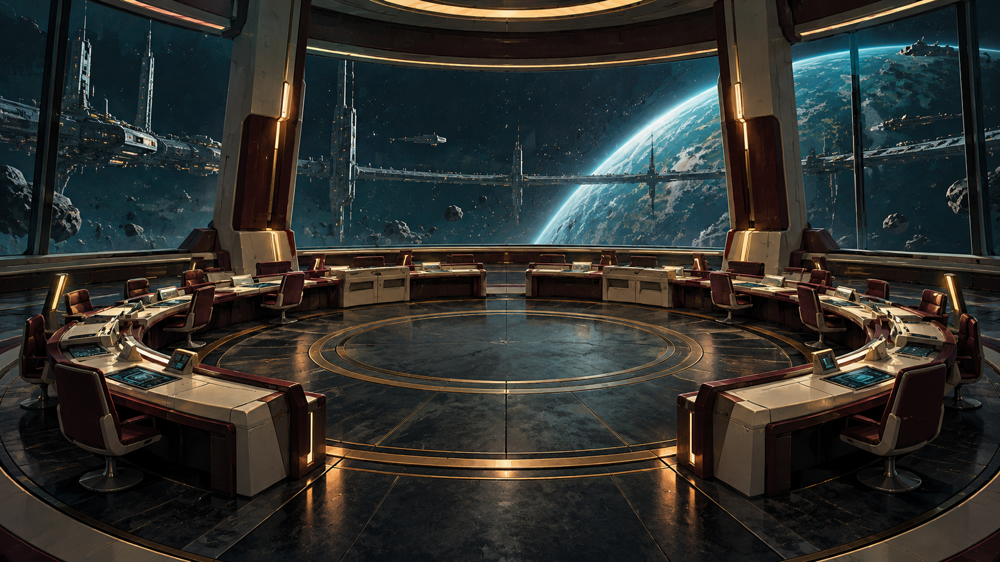

# An Assembly of Orbits

Private L337 proposal. Original story and design data; not installed or playable in the current app.

VOSS: A share certificate cannot stand in for the people on the next shift.

A cluster of orbital homes must share a single transfer corridor during a maintenance season. Old voting records count property shares but omit the crews who keep the corridor open. The commander verifies real occupancy and operating work, escorts delegates and establishes either rotating worker stewardship or publicly bounded berth representation.

## Offer and reward

At Irkenan in Galaxy 7, after one ordinary trade. No imported score gate or source campaign prerequisite. The reference loan needs one tonne of free hold.

Payment: 7,700 CR, once on successful completion. The selected verified settlement persists in local records. No free hull, unrelated legal reset or artificial combat kills. A permanent clue for The Unwritten Route: The absent seat.

## Briefing

VOSS: A share certificate cannot stand in for the people on the next shift.

## Stages and dialogue

### 1. Irkenan: accept

Accept An Assembly of Orbits at Irkenan.

Marshal Nera Voss: A cluster of orbital homes must share a single transfer corridor during a maintenance season. Review the complete survey, loan and receiving requirements before confirming.

### 2. Darik: survey

Compare three consented occupancy and corridor-work registers.

VOSS: A share certificate cannot stand in for the people on the next shift.

### 3. Irkenan: collect-reference

Collect the identified one-tonne reference instrument from Marshal Nera Voss.

Marshal Nera Voss: This instrument is a loan. I retain it until your hold has room, and the final audit returns this exact serial identity.

### 4. Brekudek: field-work

Run two independent corridor-capacity tests with the loaned assembly console.

DAIN: Show every group the same limits before asking it to choose.

### 5. Kagakon: independent-witness

Escort the consenting delegate tender to the neutral assembly berth.

VOSS: The hearing requires received delegates, not an empty passenger manifest.

### 6. Irkenan: choose-settlement

Choose the verified settlement with the consenting operators.

Marshal Nera Voss: Both choices preserve the independent evidence. Choose who controls the future work; closing this dialog selects neither.

Choices:

- Rotate corridor stewardship among working crews
- Use bounded public berth representation

### 7. Brekudek: apply-settlement

Verify both independent proofs for the selected settlement.

Marshal Nera Voss: The selected plan must work in the physical system. A statement or unrelated kill cannot supply either proof.

**plan-a:** Verify the rota and each crew's stop authority.

DAIN: Rotation needs a safe handover, not a race to the controls.

Gossip: An Assembly of Orbits: Rotate corridor stewardship among working crews.

**plan-b:** Verify the published representation register and capacity cap.

VOSS: No vote can create more corridor than the measured envelope.

Gossip: An Assembly of Orbits: Use bounded public berth representation.

### 8. Irkenan: return-and-audit

Return the reference instrument and confirm all physical receiving and settlement receipts.

Marshal Nera Voss: The loan is returned. Check the actual observations, living witness reception and both selected settlement proofs before closing the case.

### 9. Irkenan: close-case

Confirm successful completion, the recorded settlement and the once-only fee.

Marshal Nera Voss: The independent audit is complete. Your fee is 7700 CR. The operators retain the chosen settlement and their original records.

Marshal Nera Voss: The audit has left one anomaly that belongs to neither side. The oldest assembly diagram encloses an empty central seat with a curved boundary absent from all membership lists. It is preserved in your journal for the AI at PLUGH.

## Completion clue

The absent seat: The oldest assembly diagram encloses an empty central seat with a curved boundary absent from all membership lists.

Every successful terminal grants this same permanent, zero-mass clue. All commanders collect the same 64 clues before decoding the trail at PLUGH.

## Interaction and recovery

Use the normal target and scan controls, contextual Confirm actions and mission contacts. Esc closes a dialog without accepting a transfer or choosing a branch. The mission log shows the current destination, target and next action. No special mission keyboard binding is introduced.

Use the existing mission log, targeting, scan, contextual Confirm and Esc. Preview all obligations before accepting; cancellation changes nothing.

Keep the reference instrument in reserved custody through the field work, witness reception and selected settlement. Returning it is part of the independent terminal audit.

Preserve actual crew and entity identities. Culling is not death or arrival. A lost unnamed tender may be replaced with a new consenting crew after real rescue handling; never resurrect a named casualty. A lost reference invalidates its old serial before a real replacement loan.

All objectives are space flight or space-station handoffs. Stations remain protected from single-ship weapons. No source world overrides, equipment budgets, hidden reputation grind or external storyline progress is required.

Persist each completed target. Recreate an uncompleted objective after load or entity loss; duplicate scans and incidental removal cannot complete it. Escort destruction returns to the escort briefing with a replacement launch and no reward.

Store the selected plan-a or plan-b identity once, separately from its authored display label. Apply only that branch at apply-settlement; both distinct physical and receiving proofs are required. Both legitimate endings share one final reward and one source clue.

Every campaign starts unaccepted with its current identity and zero progress. Persist current-format stage evidence, choices, mission-item custody, reward and clue receipts. Resume these records on load; replayed events cannot duplicate rewards. No previous campaign or save format is imported.

## Implementation boundary

The TOML describes mission events, branch variants and receipts for future integration. [Engine contracts](ENGINE-CONTRACT.md) define the required event, item, escort and save behaviour. [Authorship record](ORIGINALITY.md) keeps the external research candidate separate from this original proposal.

## Artwork

[Complete artwork gallery](https://github.com/stephenlclarke/elite/tree/6552b68f7a146ceb79b4376d33cc8afd3f987399). Every stage binds its own scene in the campaign TOML. Character portraits, evidence equipment and outcome images use the same current asset manifest.

- **Marshal Nera Voss:** [Portrait](../../../assets/missions/portraits/nera-voss.png)
- **Coordinator Sera Dain:** [Portrait](../../../assets/missions/portraits/sera-dain.png)
