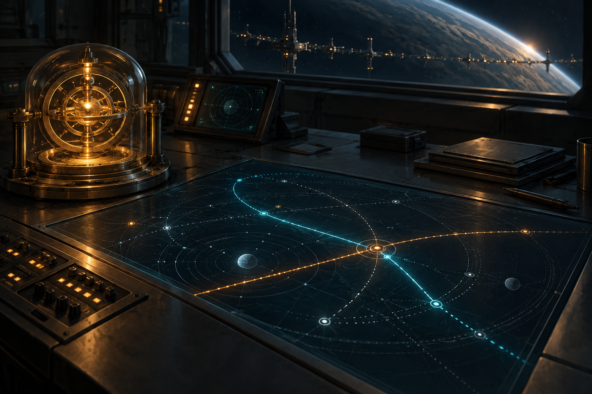

# The Glass Meridian

Private L337 proposal. Original story and design data; not installed or playable in the current app.

Someone is selling the same safe passage to two ships at once.

Avenor has recorded three near-collisions on a supposedly certified medical freight lane. Its navigation buoys agree about position but disagree about time. A missing civilian surveyor is being blamed. The real fault is a contractor selling duplicate reservations and disguising the conflict as pilot error. The commander must recover the survey record, rebuild the timing chain and guide a clinic ship through a corrected lane before deciding how to release the evidence.

## Offer and reward

Dock at Avenor after visiting three different systems and identifying two ship types. No kill-count gate or dependency on another campaign.

Payment: 4,800 CR, once on successful completion. A public lane-safety commendation and the selected evidence outcome in regional gossip. No fabricated combat points or automatic ship blueprint. A permanent clue for The Unwritten Route: The missing instant.

## Briefing

Captain Elara Venn: Our clinic convoy cannot launch while two ships can hold the same reservation. Read the beacons at Renas. Look for the surveyor at Navidor. Bring back evidence before deciding who is at fault.

## Stages and dialogue

### 1. Avenor: accept

Accept the lane investigation at Avenor.

VENN: Three crews nearly died without either pilot making a navigation error. I need measurements, not a convenient suspect. Your ship can carry the survey data without occupying the hold.

### 2. Renas: compare-clocks

Scan both certified navigation beacons at Renas.

The beacons mark the same corridor as vacant at two overlapping times. Their signed reservation counters differ by exactly one booking.

### 3. Navidor: recover-surveyor

Locate the disabled Harrier and recover its flight recorder at Navidor.

SOREL: I parked my Harrier after the guidance lights sent a freighter across my bow. The recorder is in the service buoy beside me. Please do not turn a rescue into a shooting incident.

### 4. Enmadan: audit-reservations

Dock at Enmadan and compare the recorder with the convoy booking ledger.

SOREL: These are two paid reservations with one certificate number. The contractor copied the signature, then offset the beacon clocks to hide the overlap.

### 5. Enlirin: recover-standard

Recover the one-tonne timing standard from the abandoned maintenance cradle at Enlirin.

The cradle contains a sealed timing standard. A damaged support arm blocks the automated tug; a close, slow recovery will free the crate.

### 6. Lareria: rebuild-lane

Use the standard to recalibrate three relay nodes at Lareria.

Each relay accepts the same independent clock. The conflicting bookings now appear as two distinct tracks instead of one hidden collision.

### 7. Lareria: escort-clinic

Escort the clinic tender from the maintenance cradle to Lareria main station.

SOREL: We will follow the corrected lane. Stay near the tender until station control confirms its berth. Fast arrivals are less useful than everyone arriving.

### 8. Avenor: release-evidence

Return to Avenor and choose how to release the booking evidence.

VENN: A public report warns every pilot immediately. A sealed arbitration submission protects the crews while their compensation is assessed. Both preserve the complete ledger.

Choices:

- Publish the full safety report
- Submit the ledger to crew arbitration

### 9. Avenor: close-case

Confirm the completed lane-safety report and collect payment.

VENN: The reservations have been separated, the surveyor has been cleared by evidence, and the clinic tender is safe. Your fee is 4,800 CR. Your chosen report is now part of the regional record.

VENN: There is one detail the inquiry could not explain: a curved trace in the timing standard, written between the clock ticks. I have copied it to your journal. PLUGH's AI may be able to read it.

## Completion clue

The missing instant: The recovered timing standard contains an interval that none of the lane clocks measured. Inside that interval, a curved trace repeats eight times.

Every successful terminal grants this same permanent, zero-mass clue. All commanders collect the same 64 clues before decoding the trail at PLUGH.

## Interaction and recovery

Use the normal target and scan controls, contextual Confirm actions and mission contacts. Esc closes a dialog without accepting a transfer or choosing a branch. The mission log shows the current destination, target and next action. No special mission keyboard binding is introduced.

Mission equipment has its own reserved hold allocation and explicit acquire/return stage. Contacts retain the equipment when a transfer cannot proceed. Data evidence and completion clues occupy no hold space.

Persist each completed target. Recreate an uncompleted objective after load or entity loss; duplicate scans and incidental removal cannot complete it. Escort destruction returns to the escort briefing with a replacement launch and no reward.

Record the selected evidence/protocol outcome in pack state and gossip. Branches reconverge at the next stage and share the advertised base payment.

Every campaign starts unaccepted with its current identity and zero progress. Persist current-format stage evidence, choices, mission-item custody, reward and clue receipts. Resume these records on load; replayed events cannot duplicate rewards. No previous campaign or save format is imported.

## Implementation boundary

The TOML describes mission events, branch variants and receipts for future integration. [Engine contracts](ENGINE-CONTRACT.md) define the required event, item, escort and save behaviour. [Authorship record](ORIGINALITY.md) keeps the external research candidate separate from this original proposal.

## Artwork

[Complete artwork gallery](https://github.com/stephenlclarke/elite/tree/6552b68f7a146ceb79b4376d33cc8afd3f987399). Every stage binds its own scene in the campaign TOML. Character portraits, evidence equipment and outcome images use the same current asset manifest.

- **Captain Elara Venn:** [Portrait](../../../assets/missions/portraits/elara-venn.png)
- **Captain Orin Sorel:** [Portrait](../../../assets/missions/portraits/orin-sorel.png)
