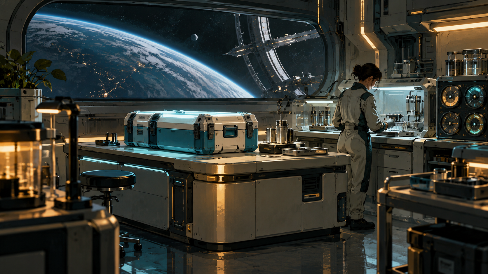

# The Measure of Care

Private L337 proposal. Original story and design data; not installed or playable in the current app.

DAIN: We need the equipment's history, not a stranger's diagnosis.

Two orbital clinics report incompatible storage readings for the same treatment. Miscalibrated refrigeration references have created an apparent shortage. The commander preserves a consented diagnostic sample, tests each cold chain and helps the clinics choose local reference standards or a jointly maintained calibration service.

## Offer and reward

At Veron in Galaxy 1, after one ordinary trade. No imported score gate or source campaign prerequisite. The reference loan needs one tonne of free hold.

Payment: 5,900 CR, once on successful completion. The selected verified settlement persists in local records. No free hull, unrelated legal reset or artificial combat kills. A permanent clue for The Unwritten Route: The temperature of silence.

## Briefing

DAIN: We need the equipment's history, not a stranger's diagnosis.

## Stages and dialogue

### 1. Veron: accept

Accept The Measure of Care at Veron.

Physicist Anja Kest: Two orbital clinics report incompatible storage readings for the same treatment. Review the complete survey, loan and receiving requirements before confirming.

### 2. Almadan: survey

Read three signed cold-chain monitors without opening patient records.

DAIN: We need the equipment's history, not a stranger's diagnosis.

### 3. Veron: collect-reference

Collect the identified one-tonne reference instrument from Physicist Anja Kest.

Physicist Anja Kest: This instrument is a loan. I retain it until your hold has room, and the final audit returns this exact serial identity.

### 4. Envesen: field-work

Run the sealed reference sample through the two external calibration cradles.

KEST: Keep temperature exposure and capsule identity together. A new label cannot repair a spoiled sample.

### 5. Betaven: independent-witness

Escort the clinic service crew to the independent test berth.

DAIN: Their arrival is verified by the receiving clinic. A crate alone cannot prove care happened.

### 6. Veron: choose-settlement

Choose the verified settlement with the consenting operators.

Physicist Anja Kest: Both choices preserve the independent evidence. Choose who controls the future work; closing this dialog selects neither.

Choices:

- Keep independent clinic calibration references
- Establish a shared clinical calibration service

### 7. Envesen: apply-settlement

Verify both independent proofs for the selected settlement.

Physicist Anja Kest: The selected plan must work in the physical system. A statement or unrelated kill cannot supply either proof.

**plan-a:** Verify both reference calibrations and independent custody records.

KEST: Independence needs measured agreement, not identical software.

Gossip: The Measure of Care: Keep independent clinic calibration references.

**plan-b:** Verify the shared service limit and each clinic's stop authority.

DAIN: Either clinic must be able to stop unsafe transfers.

Gossip: The Measure of Care: Establish a shared clinical calibration service.

### 8. Veron: return-and-audit

Return the reference instrument and confirm all physical receiving and settlement receipts.

Physicist Anja Kest: The loan is returned. Check the actual observations, living witness reception and both selected settlement proofs before closing the case.

### 9. Veron: close-case

Confirm successful completion, the recorded settlement and the once-only fee.

Physicist Anja Kest: The independent audit is complete. Your fee is 5900 CR. The operators retain the chosen settlement and their original records.

Physicist Anja Kest: The audit has left one anomaly that belongs to neither side. A reference recorder shows a stable curved boundary during a period with no recorded thermal source. It is preserved in your journal for the AI at PLUGH.

## Completion clue

The temperature of silence: A reference recorder shows a stable curved boundary during a period with no recorded thermal source.

Every successful terminal grants this same permanent, zero-mass clue. All commanders collect the same 64 clues before decoding the trail at PLUGH.

## Interaction and recovery

Use the normal target and scan controls, contextual Confirm actions and mission contacts. Esc closes a dialog without accepting a transfer or choosing a branch. The mission log shows the current destination, target and next action. No special mission keyboard binding is introduced.

Use the existing mission log, targeting, scan, contextual Confirm and Esc. Preview all obligations before accepting; cancellation changes nothing.

Keep the reference instrument in reserved custody through the field work, witness reception and selected settlement. Returning it is part of the independent terminal audit.

Preserve actual crew and entity identities. Culling is not death or arrival. A lost unnamed tender may be replaced with a new consenting crew after real rescue handling; never resurrect a named casualty. A lost reference invalidates its old serial before a real replacement loan.

All objectives are space flight or space-station handoffs. Stations remain protected from single-ship weapons. No source world overrides, equipment budgets, hidden reputation grind or external storyline progress is required.

Persist each completed target. Recreate an uncompleted objective after load or entity loss; duplicate scans and incidental removal cannot complete it. Escort destruction returns to the escort briefing with a replacement launch and no reward.

Store the selected plan-a or plan-b identity once, separately from its authored display label. Apply only that branch at apply-settlement; both distinct physical and receiving proofs are required. Both legitimate endings share one final reward and one source clue.

Every campaign starts unaccepted with its current identity and zero progress. Persist current-format stage evidence, choices, mission-item custody, reward and clue receipts. Resume these records on load; replayed events cannot duplicate rewards. No previous campaign or save format is imported.

## Implementation boundary

The TOML describes mission events, branch variants and receipts for future integration. [Engine contracts](ENGINE-CONTRACT.md) define the required event, item, escort and save behaviour. [Authorship record](ORIGINALITY.md) keeps the external research candidate separate from this original proposal.

## Artwork

[Complete artwork gallery](https://github.com/stephenlclarke/elite/tree/6552b68f7a146ceb79b4376d33cc8afd3f987399). Every stage binds its own scene in the campaign TOML. Character portraits, evidence equipment and outcome images use the same current asset manifest.

- **Physicist Anja Kest:** [Portrait](../../../assets/missions/portraits/anja-kest.png)
- **Coordinator Sera Dain:** [Portrait](../../../assets/missions/portraits/sera-dain.png)
