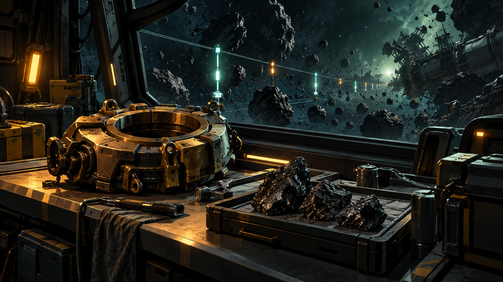

# The Rubble Covenant

Private L337 proposal. Original story and design data; not installed or playable in the current app.

ORR: Ownership does not change momentum. We need both records before a tug may move anything.

A ring-mining cooperative wants to reopen a debris corridor but rival insurers classify every unclaimed rock as someone else's property. The commander maps the actual masses, attaches verified tug anchors and escorts a survey crew before choosing pooled clearance or individually bonded salvage. Safe passage depends on verified clearance and an agreed ownership charter.

## Offer and reward

At Leiven in Galaxy 6, after one ordinary trade. No imported score gate or source campaign prerequisite. The reference loan needs one tonne of free hold.

Payment: 6,600 CR, once on successful completion. The selected verified settlement persists in local records. No free hull, unrelated legal reset or artificial combat kills. A permanent clue for The Unwritten Route: The hollow mass.

## Briefing

ORR: Ownership does not change momentum. We need both records before a tug may move anything.

## Stages and dialogue

### 1. Leiven: accept

Accept The Rubble Covenant at Leiven.

Geologist Jalen Orr: A ring-mining cooperative wants to reopen a debris corridor but rival insurers classify every unclaimed rock as someone else's property. Review the complete survey, loan and receiving requirements before confirming.

### 2. Noaraena: survey

Measure three named debris masses and their actual drift vectors.

ORR: Ownership does not change momentum. We need both records before a tug may move anything.

### 3. Leiven: collect-reference

Collect the identified one-tonne reference instrument from Geologist Jalen Orr.

Geologist Jalen Orr: This instrument is a loan. I retain it until your hold has room, and the final audit returns this exact serial identity.

### 4. Irasaori: field-work

Attach two identified tug anchors to the registered clearance bodies.

PENN: Keep anchor identity tied to the rock's conserved mass. A fragment is not a second claim.

### 5. Loaliel: independent-witness

Escort the survey tender through the proven clearance corridor.

PENN: The corridor is open only when the living survey crew receives it.

### 6. Leiven: choose-settlement

Choose the verified settlement with the consenting operators.

Geologist Jalen Orr: Both choices preserve the independent evidence. Choose who controls the future work; closing this dialog selects neither.

Choices:

- Pool the clearance work under the cooperative
- Bond individual salvage sections

### 7. Irasaori: apply-settlement

Verify both independent proofs for the selected settlement.

Geologist Jalen Orr: The selected plan must work in the physical system. A statement or unrelated kill cannot supply either proof.

**plan-a:** Verify the shared mass ledger and a witnessed tug release.

ORR: All recovered material stays on the same conservation ledger.

Gossip: The Rubble Covenant: Pool the clearance work under the cooperative.

**plan-b:** Verify section boundaries and the independent exclusion-zone test.

PENN: A private claim cannot reach across a neighbour's safe corridor.

Gossip: The Rubble Covenant: Bond individual salvage sections.

### 8. Leiven: return-and-audit

Return the reference instrument and confirm all physical receiving and settlement receipts.

Geologist Jalen Orr: The loan is returned. Check the actual observations, living witness reception and both selected settlement proofs before closing the case.

### 9. Leiven: close-case

Confirm successful completion, the recorded settlement and the once-only fee.

Geologist Jalen Orr: The independent audit is complete. Your fee is 6600 CR. The operators retain the chosen settlement and their original records.

Geologist Jalen Orr: The audit has left one anomaly that belongs to neither side. One old trajectory record curves around an empty centre as though the missing mass had a boundary of its own. It is preserved in your journal for the AI at PLUGH.

## Completion clue

The hollow mass: One old trajectory record curves around an empty centre as though the missing mass had a boundary of its own.

Every successful terminal grants this same permanent, zero-mass clue. All commanders collect the same 64 clues before decoding the trail at PLUGH.

## Interaction and recovery

Use the normal target and scan controls, contextual Confirm actions and mission contacts. Esc closes a dialog without accepting a transfer or choosing a branch. The mission log shows the current destination, target and next action. No special mission keyboard binding is introduced.

Use the existing mission log, targeting, scan, contextual Confirm and Esc. Preview all obligations before accepting; cancellation changes nothing.

Keep the reference instrument in reserved custody through the field work, witness reception and selected settlement. Returning it is part of the independent terminal audit.

Preserve actual crew and entity identities. Culling is not death or arrival. A lost unnamed tender may be replaced with a new consenting crew after real rescue handling; never resurrect a named casualty. A lost reference invalidates its old serial before a real replacement loan.

All objectives are space flight or space-station handoffs. Stations remain protected from single-ship weapons. No source world overrides, equipment budgets, hidden reputation grind or external storyline progress is required.

Persist each completed target. Recreate an uncompleted objective after load or entity loss; duplicate scans and incidental removal cannot complete it. Escort destruction returns to the escort briefing with a replacement launch and no reward.

Store the selected plan-a or plan-b identity once, separately from its authored display label. Apply only that branch at apply-settlement; both distinct physical and receiving proofs are required. Both legitimate endings share one final reward and one source clue.

Every campaign starts unaccepted with its current identity and zero progress. Persist current-format stage evidence, choices, mission-item custody, reward and clue receipts. Resume these records on load; replayed events cannot duplicate rewards. No previous campaign or save format is imported.

## Implementation boundary

The TOML describes mission events, branch variants and receipts for future integration. [Engine contracts](ENGINE-CONTRACT.md) define the required event, item, escort and save behaviour. [Authorship record](ORIGINALITY.md) keeps the external research candidate separate from this original proposal.

## Artwork

[Complete artwork gallery](https://github.com/stephenlclarke/elite/tree/6552b68f7a146ceb79b4376d33cc8afd3f987399). Every stage binds its own scene in the campaign TOML. Character portraits, evidence equipment and outcome images use the same current asset manifest.

- **Geologist Jalen Orr:** [Portrait](../../../assets/missions/portraits/jalen-orr.png)
- **Tug Lead Mira Penn:** [Portrait](../../../assets/missions/portraits/mira-penn.png)
