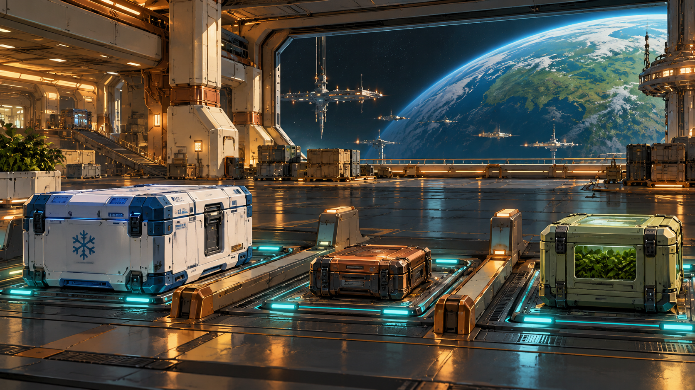

# Wayfarer Exchange

Private L337 proposal. Original story and design data; not installed or playable in the current app.

A route is only useful when someone at the other end receives what was promised.

Independent clinics, repair workshops, seed custodians and remote utility crews have reliable local suppliers but no shared way to reserve scarce transport capacity. The Wayfarer Union asks the commander to demonstrate a receiving-based dispatch service across the Avenor cluster. A refrigerated clinic delivery, a closed repair exchange, an agricultural seed transfer and a real crew recovery establish the service records. Restoring an external utility handoff makes the final route viable. The participating operators then choose either pooled route windows or protected local reservations. The commander validates the published charter and earns accreditation. Afterwards, the Exchange continues as a visible board of six original service templates, with actual consignments, declared requirements and transparent quotes.

## Offer and reward

At Avenor in Galaxy 1, the Wayfarer Union offers an openly advertised network-induction commission after one ordinary delivery or commodity sale. One tonne of free hold is sufficient for the serial loaned equipment. No combat-rank requirement or random rare-offer gate.

Payment: 7,600 CR, once on successful completion. Accreditation opens advanced variants on the visible Wayfarer Exchange board. Six repeatable service templates remain available with separate quotes and receipts. Accreditation grants no free cargo, personal ship or unrelated legal-status reset. A permanent clue for The Unwritten Route: The unbooked window.

## Briefing

SENN: We are building a service record, not a club for people with enough kills. Deliver the clinic sample, bring the repaired cassette home and show every receiving operator what you actually handed over.

## Stages and dialogue

### 1. Avenor: accept

Accept the Wayfarer network-induction commission at Avenor.

SENN: These routes belong to the clinics, workshops and crews using them. You can review every job before accepting it. The service board will explain what your ship can carry.

### 2. Renas: collect-coldcrate

Collect the one-tonne sealed clinic sample at Renas.

The clinic records the crate, its working cooling unit and its declared flight-time integrity budget. Confirm the receiving destination before committing the pickup.

### 3. Navidor: deliver-coldchain

Deliver the intact cold crate to Navidor's registered clinic berth.

The receiving clinic verifies the seal and usable sample. A landing without this exact crate and its quality record is not a delivery. A spoiled consignment can be replaced from actual stock.

### 4. Enmadan: recover-cassette

Collect Enmadan's one-tonne failed workshop cassette for a closed repair exchange.

VEIL: The cassette is owned by this workshop. Return the repaired unit to its registered receiver; selling a similar commodity will not settle the exchange.

### 5. Renas: close-repair-loop

Return the cassette through the Renas repair desk and confirm its receiving record.

The repair desk records the original serial identity, the completed service and the owner's receipt. The transport loop is closed without manufacturing a second unit.

### 6. Enlirin: survey-seed-vault

Review Enlirin's seed-transfer consent and loan the one-tonne vault key.

VEIL: This transfer keeps two seed holdings viable. The key opens only the receiving cradle. The seed itself travels aboard the registered ark.

### 7. Lareria: escort-seed-ark

Escort the registered seed ark to Lareria's receiving cradle and return the vault key.

The cradle accepts the ark's real consignment and reclaims its key. The seed custodians retain ownership and record the receiving conditions.

### 8. Cevilis: recover-crew-log

Recover the one-tonne custody recorder beside Cevilis's disabled service tender.

The tender's crew are alive in its marked rescue launch. The recorder identifies them and their receiving shelter. It is evidence, not an excuse to count a missing ship as rescued.

### 9. Enmadan: return-survivors

Escort the identified rescue launch to Enmadan reception and return its custody recorder.

Reception confirms the actual surviving crew and stores the returned recorder. Their arrival completes this service; an absent actor or an empty launch cannot substitute.

### 10. Enron: reopen-utility-route

Restore three named external service handoffs at Enron.

The local utility crew retains operational control. Register the physically working inlet, buffer and return. Shooting the nearby station or unrelated ships changes none of these proofs.

### 11. Avenor: choose-charter

Choose the Exchange's published route-allocation charter at Avenor.

SENN: Pool unused windows across the cluster, or protect a minimum set for each settlement. Both charters publish their limits. Choose how the service will reserve its actual capacity.

Choices:

- Pool unused route windows with a published local minimum
- Protect local reservations and share only released capacity

### 12. Avenor: commit-charter

Obtain three verified operator signatures for the chosen charter.

The clinic, workshop and seed custodians each sign the exact chosen capacity policy. A displayed selection alone is not their consent.

**pooled-windows:** Confirm all three signed pooling limits and test that the protected local minimum cannot be consumed.

The route pool rejects a booking that would take a settlement below its published minimum.

Gossip: Wayfarer Exchange shares spare windows while protecting each settlement's minimum.

**protected-reservations:** Confirm all three local reservations and test that only explicitly released capacity can enter the shared pool.

The board rejects an attempt to use an unreleased reservation. Its owner retains the capacity until it chooses to release it.

Gossip: Wayfarer Exchange protects local reservations and shares only explicitly released windows.

### 13. Avenor: certify-network

Verify all induction receiving records and the working utility route with Veil.

VEIL: The clinic sample remained usable, the cassette returned, the seed ark arrived and the surviving crew reached shelter. The utility route works and the charter signatures agree. Accreditation records those results.

### 14. Avenor: close-case

Confirm accreditation, collect the induction fee and open the advanced service board.

SENN: Your induction fee is 7,600 CR. The service board will continue offering real work under the charter you verified. No repeated delivery can earn this induction fee or its journal clue twice.

VEIL: Every real consignment is accounted for. This older reservation names no shipment at all. Keep its curved signature in your journal; the AI at PLUGH may be able to explain the unused window.

**pooled-windows:** SENN: The shared pool is open, and the local minima are protected. Every reserved consignment still has one owner and one receiver.

**protected-reservations:** VEIL: Each settlement keeps its reserved capacity. Only a signed release lets another service use it.

## Completion clue

The unbooked window: The first signed route ledger reserves a window with no carrier, cargo or destination. Its curved boundary points inward and matches a bearing outside the published service network.

Every successful terminal grants this same permanent, zero-mass clue. All commanders collect the same 64 clues before decoding the trail at PLUGH.

## Interaction and recovery

Use the normal target and scan controls, contextual Confirm actions and mission contacts. Esc closes a dialog without accepting a transfer or choosing a branch. The mission log shows the current destination, target and next action. No special mission keyboard binding is introduced.

The Exchange uses the existing station contract board, arrows, contextual Confirm and Esc. Display destination, reward, hold/crew requirements, any actual deadline, perishability, risk and accepting consequences together. No extra function key, hidden rare offer or special campaign control.

The four induction items are serial one-tonne reservations. Confirm their whole custody transaction atomically. Cold-chain delivery and survivor reception need the relevant quality or live-crew receipts in addition to the named mission target.

The clinic cold crate has an independent sealed cooling unit. Its advertised integrity budget is consumed only during armed flight time after confirmed pickup; normal pause stops it and current-format save/load preserves the remaining value. A spoiled delivery is recorded honestly and can be replaced from actual clinic stock; it is never counted as successful.

The seed ark and rescue tender carry their own real cargo or crews. They are identified actors with receiving manifests. Do not require player passenger cabins for these induction escorts, copy dead personnel, create a delivery from culling or treat a generic same-type freighter as the consignment.

The board can run at most three accepted service contracts per commander. It reserves real unique consignments and the required player capacity across all active work. Closing/reopening the board or loading cannot reroll a quote, create stock, reset a deadline or duplicate an offer.

Service history shows completed, late and failed deliveries directly. Equipment and capacity gates are explained in the quote. No hidden combat quota or unexplained reputation decay gates routine work.

Signed Passage, ordinary sealed dispatch and completed Exchange induction are distinct clue sources. Each Exchange service family grants its own clue at first verified reception; subsequent jobs retain that clue and grant only their own payment and service record.

Any recovery or combat uses actual attributed events. Single-ship fire cannot destroy station hulls; utility handoffs are named external service modules. The Exchange never asks the commander to destroy a station.

Persist each completed target. Recreate an uncompleted objective after load or entity loss; duplicate scans and incidental removal cannot complete it. Escort destruction returns to the escort briefing with a replacement launch and no reward.

Choose pooled-windows or protected-reservations once at choose-charter. Obtain the corresponding three service signatures at commit-charter. Both successful charters pay 7,600 CR and grant one permanent clue. Repeat contracts never award this campaign clue or its induction payment again.

Every campaign starts unaccepted with its current identity and zero progress. Persist current-format stage evidence, choices, mission-item custody, reward and clue receipts. Resume these records on load; replayed events cannot duplicate rewards. No previous campaign or save format is imported.

## Implementation boundary

The TOML describes mission events, branch variants and receipts for future integration. [Engine contracts](ENGINE-CONTRACT.md) define the required event, item, escort and save behaviour. [Authorship record](ORIGINALITY.md) keeps the external research candidate separate from this original proposal.

## Artwork

[Complete artwork gallery](https://github.com/stephenlclarke/elite/tree/6552b68f7a146ceb79b4376d33cc8afd3f987399). Every stage binds its own scene in the campaign TOML. Character portraits, evidence equipment and outcome images use the same current asset manifest.

- **Dispatcher Evi Senn:** [Portrait](../../../assets/missions/portraits/evi-senn.png)
- **Custodian Tomas Veil:** [Portrait](../../../assets/missions/portraits/tomas-veil.png)

## Continuing service board

[Six original repeatable service templates](wayfarer-services.md)

Existing station contract board at discovered Wayfarer service hubs

A seeded current quote epoch selects only actual available consignments and reachable current-world destinations. Preserve offered quote identities until withdrawn or consumed by a real stock event.

Preview and reserve aggregate actual hold, tool slots and any passenger requirements for every accepted instance; decline or cancellation reserves nothing.

Induction and visible equipment/route requirements unlock complex services. Routine work remains available without combat rank, a secret counter or a random company invitation.

Each current service instance owns offer, pickup, objective and receiving/payment receipts. Persist custody, passengers, quality, simulation time, target identity, quote and paid state; no imported campaign progress.

Advertise a complete price in credits before acceptance. Pay once after actual qualifying receipt, using source/recipient identities and the exact consignment. A late/spoiled result follows its shown policy and never earns the induction clue.

Use only the independently authored worlds, commodities, actor fleets and current save format. Do not install external parcel-company branding, five original mission groups, source text or old mission-variable names.
