# Graphics for revised missions

The revised original missions retain all 758 original graphics. This update adds 40 assets: 31 C09-C39 operation diagrams, one original-recorder custody diagram, five shared continuity-inquiry stage diagrams and three cinematic narrative illustrations. Total mission-art inventory:798 logical assets. The 37 diagrams also have PNG exports, so there are 835 physical mission-graphic files in total. All 40 new assets have runtime-ready PNG primaries; 37 also retain editable SVG source. These are briefing/reference assets, not game captures or evidence that the mechanics are implemented.

[Full artwork manifest](../../assets/missions/manifest.json), [exact revision index and hashes](artwork/artwork-revision-index.json), [final image-generation prompts](artwork/artwork-prompts.json).

## Coverage and selection

Every C09-C39 field-work stage now points to its own operation diagram, with limits sourced from its current physical profile. Prior simple object renders remain object references. C01 final receiving points to the new single-recorder archive scene plus exact custody diagram. C36's diagram explains the pre-offer preservation hold. All 64 continuity sources reuse the same five stage diagrams and two narrative illustrations, gated by actual accepted case/stage; they do not acquire extra clues. No other existing briefing, portrait, clue or ship reference needed replacement.

Diagrams show design targets and example traces, not completed objectives. Captions and accessible SVG titles/descriptions explain their purpose. They use editable source and restrained mint/cyan/amber colours consistent with the existing clue graphics. Cinematic images use the existing dark orbital interiors, worn metal and warm/cool lighting. No reference ship geometry was replaced or invented.

## New narrative illustrations

### A new inquiry, not an erased failure

Continuity inquiry request and independent receiving narrative illustration.

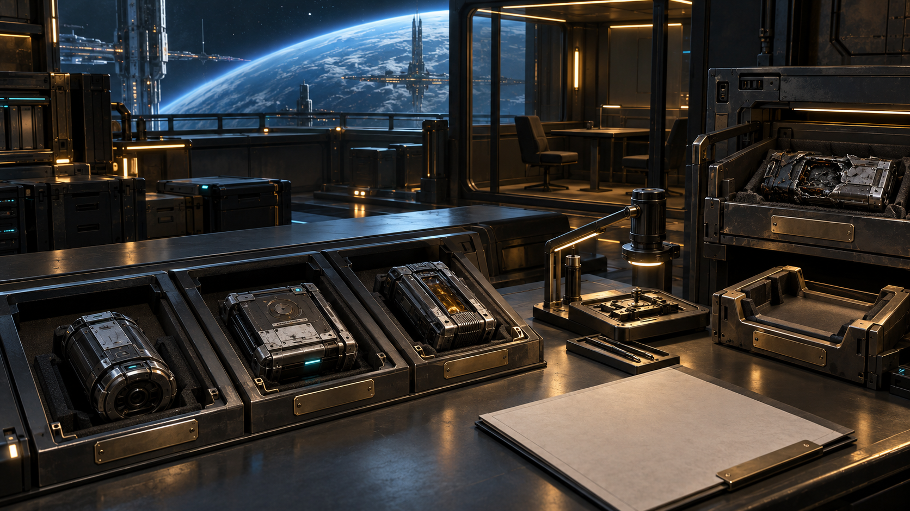

### Independent reference measurements

Continuity inquiry measurement and model-test narrative illustration.

### The original recorder reaches its archive

Glass Meridian final recorder receiving narrative illustration.

## Distinct operation and custody diagrams

### The Quiet Nursery - quiet-nursery-operation

Pressure-waveform comparison Select and latch each of two real pulse dampers after comparing cycle minima; confirm a three-cycle live pressure trace.

[Editable SVG source](../../assets/missions/revisions/quiet-nursery-operation.svg)

### Borrowed Dawn - borrowed-dawn-operation

Reflector stop and thermal cutoff Steer the two source-owned reflectors with directional controls; release controls at the actual illumination stop and test the thermal trip.

[Editable SVG source](../../assets/missions/revisions/borrowed-dawn-operation.svg)

### The Open Shadow - open-shadow-operation

Privacy and collision-channel separation Fly the volunteer crossing through three actual approach lanes while measuring collision warning and identity disclosure separately.

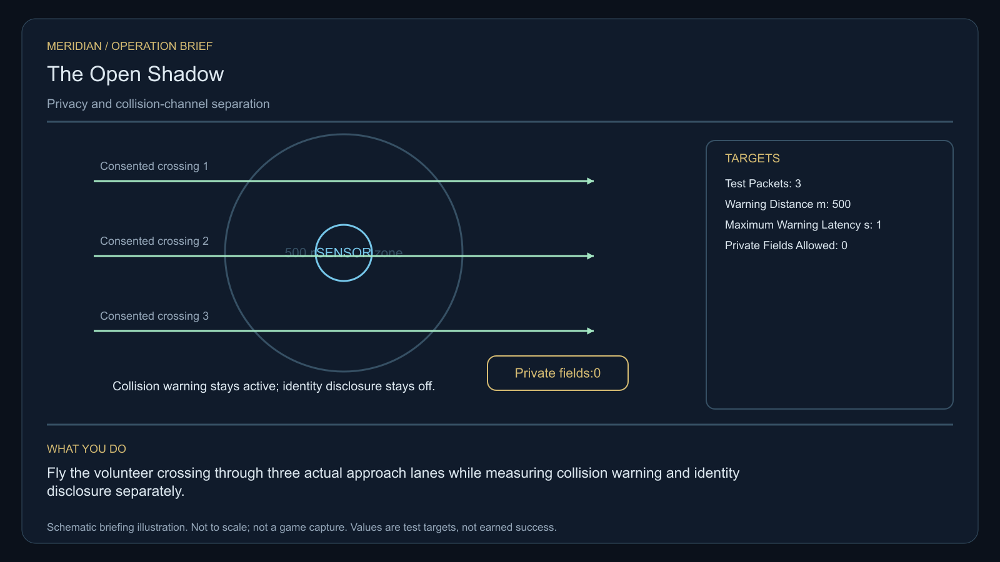

[Editable SVG source](../../assets/missions/revisions/open-shadow-operation.svg)

### Harbour Without Orders - harbour-without-orders-operation

Simultaneous berth-allocation exclusion Submit two simultaneous real berth claims to one allocator; revoke the losing lease and physically prove mutual exclusion.

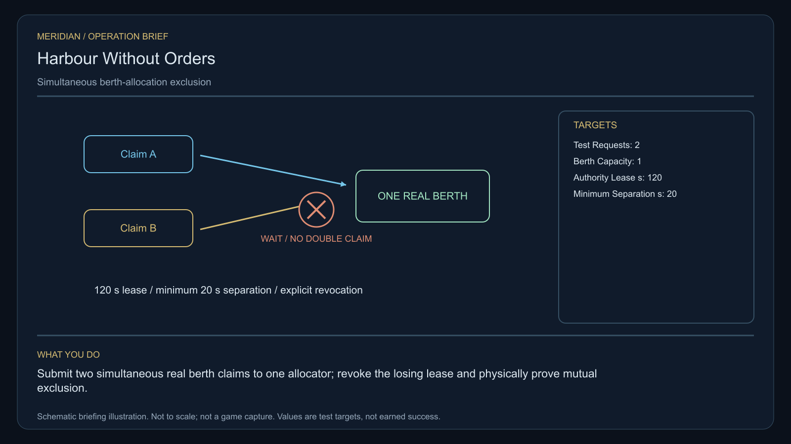

[Editable SVG source](../../assets/missions/revisions/harbour-without-orders-operation.svg)

### False Colours - false-colours-operation

Identity-key revocation and reissue Challenge each actual transmitter with new nonces, revoke the retired key and replay its signed old packet to prove rejection.

[Editable SVG source](../../assets/missions/revisions/false-colours-operation.svg)

### The Rubble Covenant - rubble-covenant-operation

Mass and drift-vector clearance Assign actual source-owned tug thrust to three registered fragments; measure their drift and clear the shared corridor while conserving mass and momentum.

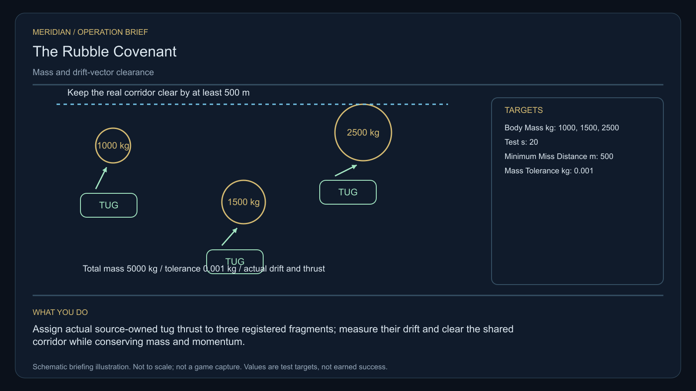

[Editable SVG source](../../assets/missions/revisions/rubble-covenant-operation.svg)

### A Garden in Transit - garden-in-transit-operation

Quarantine and climate compatibility Adjust two actual sealed cradle climate controls; route the live tender only after both receiving environments pass the stability window.

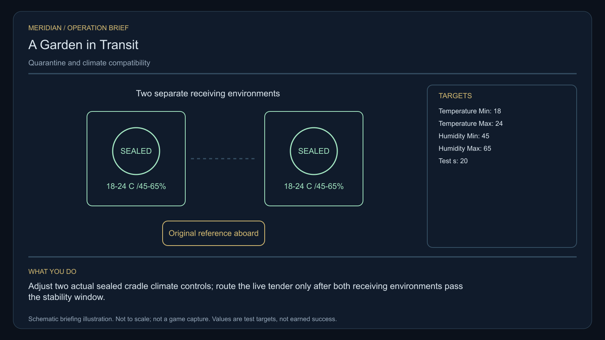

[Editable SVG source](../../assets/missions/revisions/garden-in-transit-operation.svg)

### The Warrant Ledger - warrant-ledger-operation

Conflicting-evidence adjudication Trace the three signed issuer records, present the two independent victim challenges and reject reused evidence before revocation/reissue.

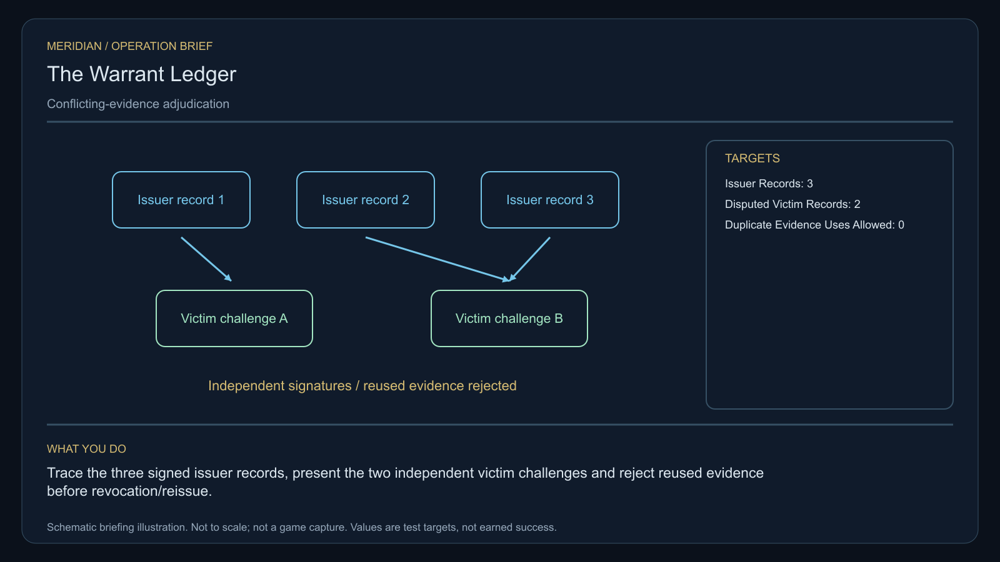

[Editable SVG source](../../assets/missions/revisions/warrant-ledger-operation.svg)

### The Measure of Care - measure-of-care-operation

Cold-chain calibration against references Set the actual reference controller and sample three independent sealed thermometer channels within the published tolerance.

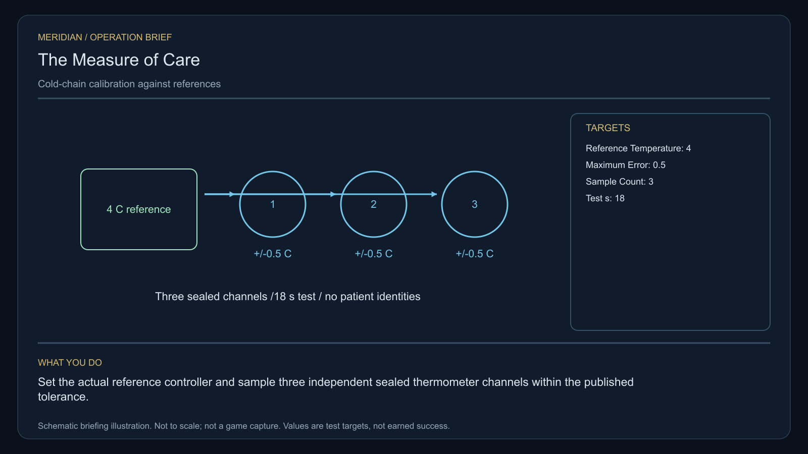

[Editable SVG source](../../assets/missions/revisions/measure-of-care-operation.svg)

### The Long Return - long-return-operation

Live multi-carrier handoff Fly between the three real carriers and perform two atomic source/receiver transfers while validating continuing consent.

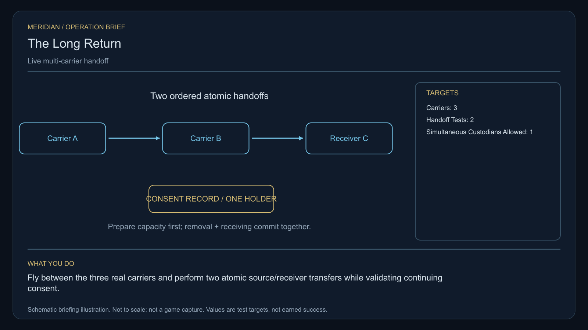

[Editable SVG source](../../assets/missions/revisions/long-return-operation.svg)

### The Unfinished Map - unfinished-map-operation

Uncertainty envelope surveying Take two separated measurement baselines at three actual landmarks and compare the resulting uncertainty envelope.

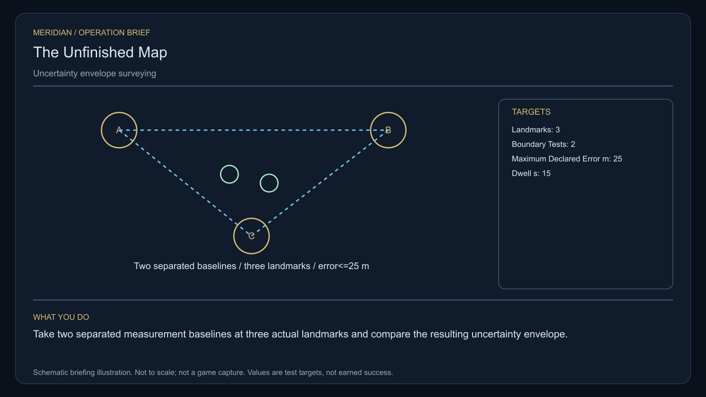

[Editable SVG source](../../assets/missions/revisions/unfinished-map-operation.svg)

### The Blue Reservoir - blue-reservoir-operation

Closed fluid-flow balancing Open/close the two source-owned sealed bypass valves; preserve total water while reaching oxygen and minimum-flow targets.

[Editable SVG source](../../assets/missions/revisions/blue-reservoir-operation.svg)

### Mutual Shelter - mutual-shelter-operation

Finite emergency-capacity stress test Reserve two real shelter berths, present the third competing claim, verify its honest refusal and then release a real reservation.

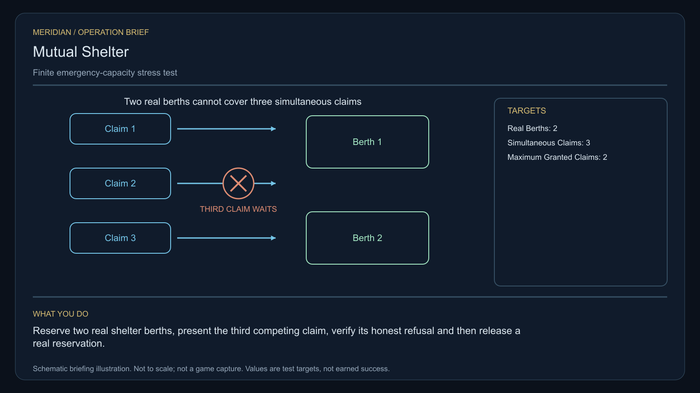

[Editable SVG source](../../assets/missions/revisions/mutual-shelter-operation.svg)

### The Listening Frontier - listening-frontier-operation

Reciprocal quiet-window timing Tune and leave the channel silent through human/Larvaal/quiet windows, then send only in the actual allocated reply window.

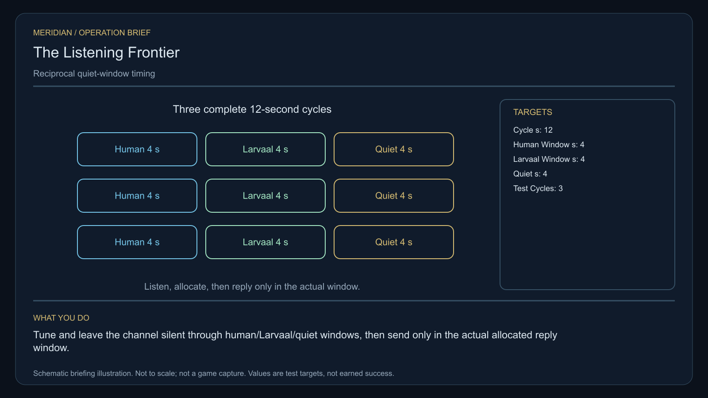

[Editable SVG source](../../assets/missions/revisions/listening-frontier-operation.svg)

### An Assembly of Orbits - assembly-of-orbits-operation

Corridor-capacity and stop-authority allocation Allocate five real requests across four physical corridor slots while preserving one protected free slot and crew consent.

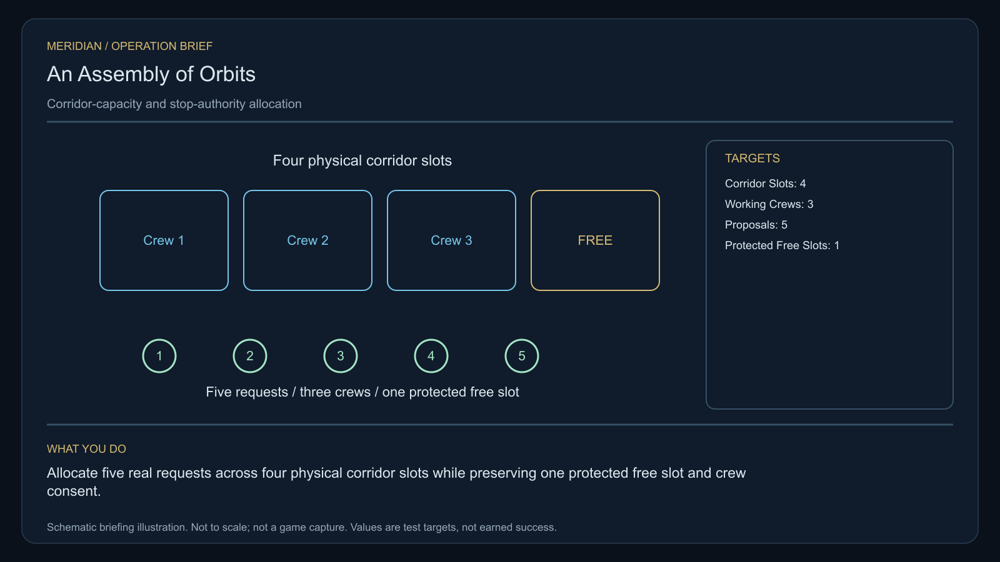

[Editable SVG source](../../assets/missions/revisions/assembly-of-orbits-operation.svg)

### Under Tow - under-tow-operation

Coupler geometry and load testing Direct two real source-owned couplers/tugs into engagement; apply measured test load, verify release above the limit, and conduct actual tow reception.

[Editable SVG source](../../assets/missions/revisions/under-tow-operation.svg)

### The Memory Atlas - memory-atlas-operation

Measurement and testimony separation Fly separated baselines and reconcile physical landmarks against measured error; private diary text cannot count as coordinates.

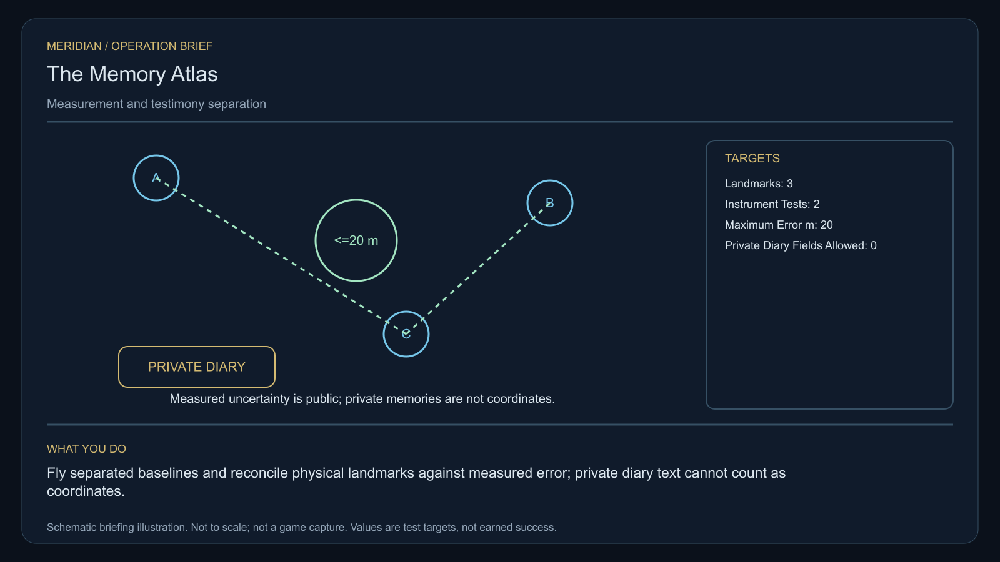

[Editable SVG source](../../assets/missions/revisions/memory-atlas-operation.svg)

### A Fleet of Neighbours - fleet-of-neighbours-operation

Finite arrived-fleet scheduling Choose real available response hulls, keep one local reserve and watch actual finite-fuel departure, route and callout receiving.

[Editable SVG source](../../assets/missions/revisions/fleet-of-neighbours-operation.svg)

### Uncounted Names - uncounted-names-operation

Personhood and receiving-permission correction Obtain three actual peoples separate permissions and apply only their chosen access grants; test denial without exporting their identities.

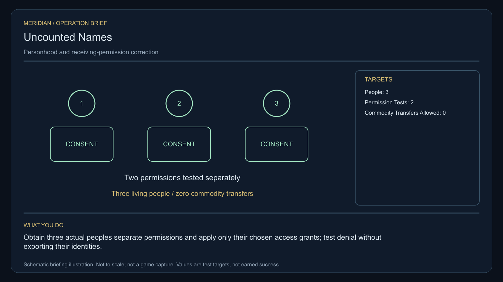

[Editable SVG source](../../assets/missions/revisions/uncounted-names-operation.svg)

### The Honest Circuit - honest-circuit-operation

Fuel-accounted flight certification Fly both ordered physical gates at5-30m/s with real traffic separation; an unsafe approach aborts the trial without refunding spent fuel.

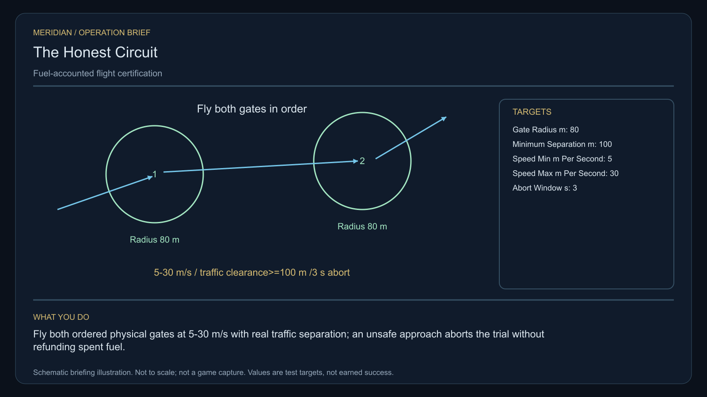

[Editable SVG source](../../assets/missions/revisions/honest-circuit-operation.svg)

### Small Lights - small-lights-operation

Dependency fault isolation and response Isolate the actual dependency fault, fit exactly two real repair kits, then run either the timed callout or separately stocked reserve drill.

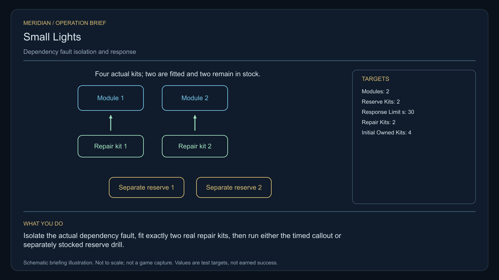

[Editable SVG source](../../assets/missions/revisions/small-lights-operation.svg)

### The Passenger's Horizon - passengers-horizon-operation

Accessible boarding and viewing clearance Adjust the two real boarding interfaces with directional controls while consenting volunteers test sightline, clearance and independent stop controls.

[Editable SVG source](../../assets/missions/revisions/passengers-horizon-operation.svg)

### The Kind Distance - kind-distance-operation

Revocable anonymous reply protocol Relay two independently consented invitations; revoke a live reply lease and prove neither private address nor forced meeting is exposed.

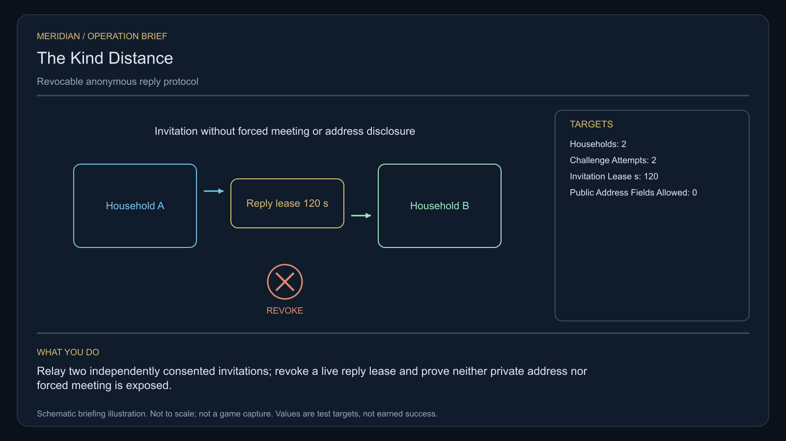

[Editable SVG source](../../assets/missions/revisions/kind-distance-operation.svg)

### Cold Reserve - cold-reserve-operation

Autonomous dispatch isolation and stock custody Challenge the two expired dispatch orders against the real12-unit reserve; prove refusal before physically authorising conversion or dismantling.

[Editable SVG source](../../assets/missions/revisions/cold-reserve-operation.svg)

### The Magnetic Orchard - magnetic-orchard-operation

Non-destructive field-boundary release Fly the low-field approach and direct the two human tether releases only inside the measured safe field window.

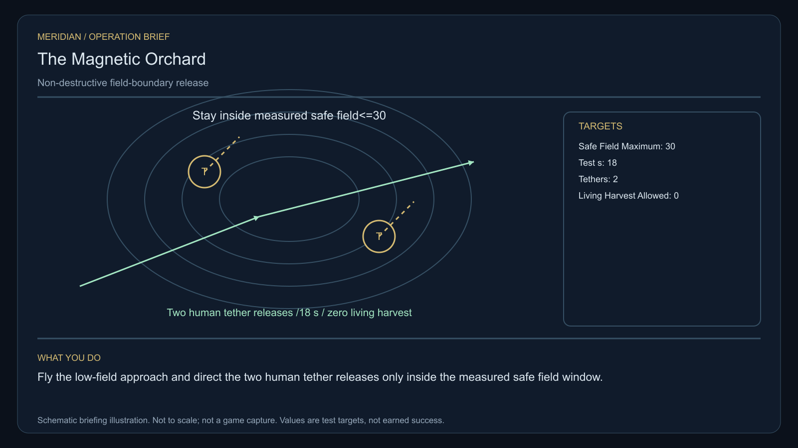

[Editable SVG source](../../assets/missions/revisions/magnetic-orchard-operation.svg)

### Open Measure - open-measure-operation

Independent tolerance and fit verification Apply the known reference load to both actual component mounts; compare fit and tolerance before publishing their calibrated specification.

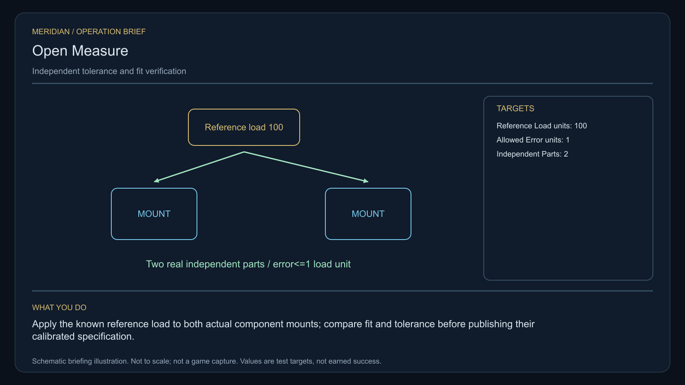

[Editable SVG source](../../assets/missions/revisions/open-measure-operation.svg)

### The Shared Pulse - shared-pulse-operation

Bounded acknowledgement and feedback cutoff Set the two real reply cutoffs and follow three live cycles with exactly one reply each and the full quiet window.

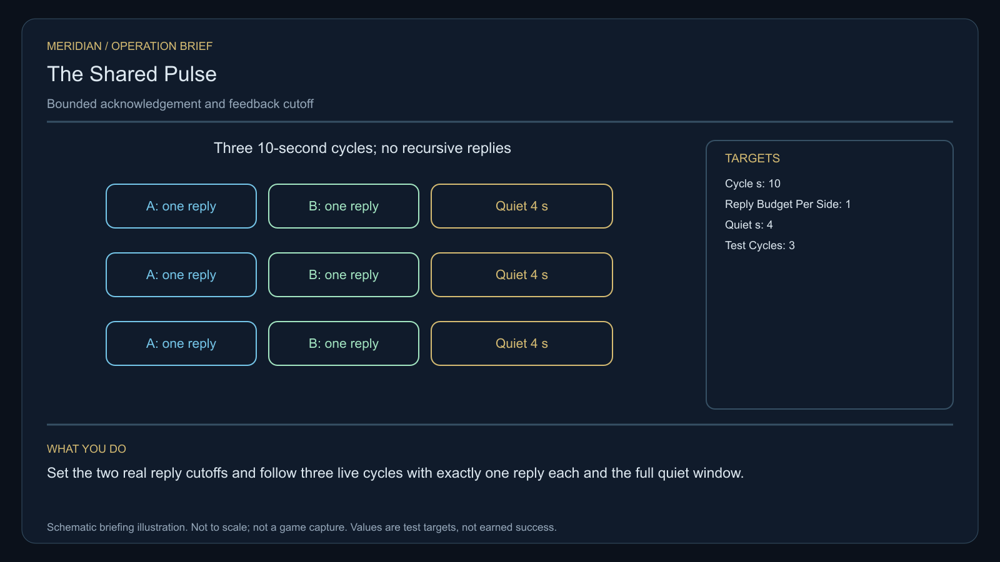

[Editable SVG source](../../assets/missions/revisions/shared-pulse-operation.svg)

### The Witness Window - witness-window-operation

Evidence escrow and privacy-preserving release Compare the three consented archive copies, challenge the two independent keys and verify the sealed or anonymised receiving outcome.

[Editable SVG source](../../assets/missions/revisions/witness-window-operation.svg)

### Public Record - public-record-operation

Right-of-reply without evidence mutation Test three genuine publication routes and two independent challenges; explicitly arm a right-of-reply trial without modifying the preserved evidence.

[Editable SVG source](../../assets/missions/revisions/public-record-operation.svg)

### Signed Passage - courier-operation

Physical release-before-receive interlock Meet two real carriers, prepare exact crate receiving capacity and atomically commit each actual handoff in order.

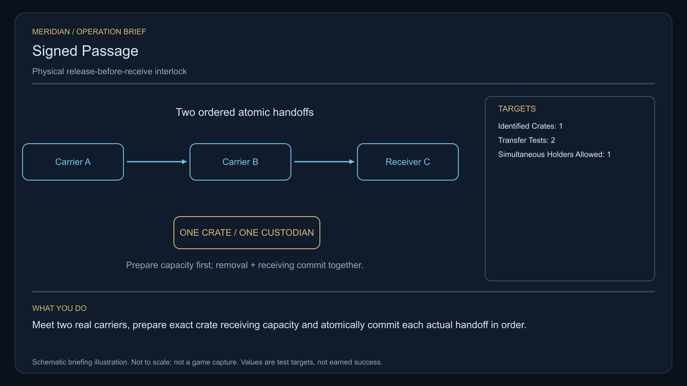

[Editable SVG source](../../assets/missions/revisions/courier-operation.svg)

### The Guiding Light - guiding-light-operation

Shadow sight-line and overlapping beacon coverage Fly the three lantern sightlines, align two winter relays and verify a lit safe receiving path through the current actual shadow geometry.

[Editable SVG source](../../assets/missions/revisions/guiding-light-operation.svg)

### The Glass Meridian - meridian-recorder-custody

Retain through the audit; archive the original at the final receiving. Keep the original recorder through the booking audit and later stages. At final receiving, transfer that same serial into Venns archive and release0.008t exactly once.

[Editable SVG source](../../assets/missions/revisions/meridian-recorder-custody.svg)

### Continuity inquiry - continuity-request-case

Request case At the orbital desk, open a new source-linked inquiry and obtain a zero-mass signed survey mandate and three archive measurement challenges.

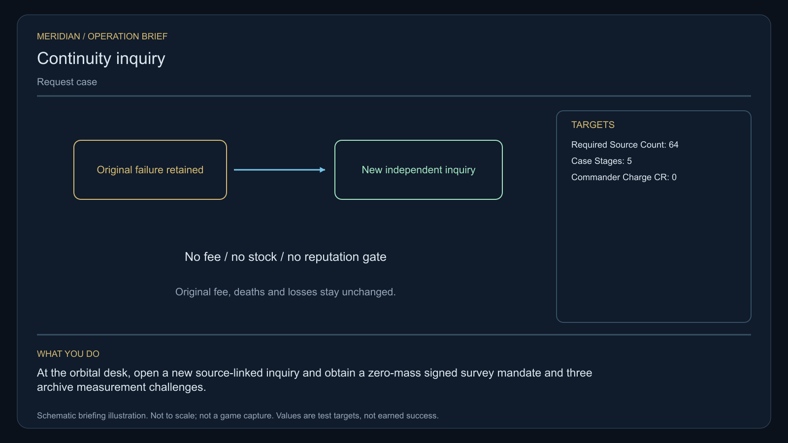

[Editable SVG source](../../assets/missions/revisions/continuity-request-case.svg)

### Continuity inquiry - continuity-measure-source-trace

Measure source trace Fly to three registered non-consumable external reference beacons in the current ordinary system; perform source-specific measurements and reconcile them with the independent archived observations.

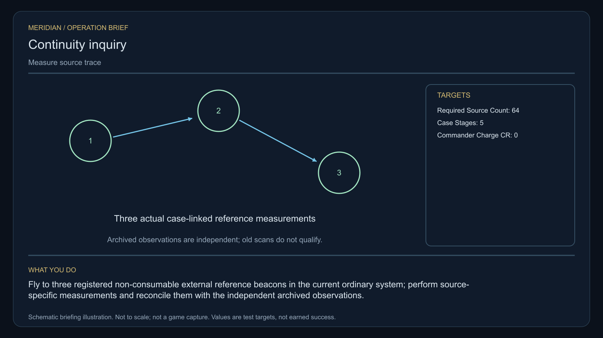

[Editable SVG source](../../assets/missions/revisions/continuity-measure-source-trace.svg)

### Continuity inquiry - continuity-test-corrective-model

Test corrective model Operate a source-specific physical test arrangement on those beacons and pass its measurable consistency/safety test.

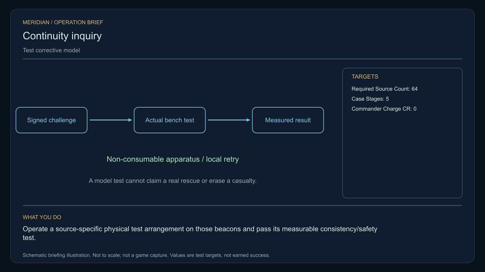

[Editable SVG source](../../assets/missions/revisions/continuity-test-corrective-model.svg)

### Continuity inquiry - continuity-independent-audit

Independent audit Bring the signed measured results to a different authorised desk operator. Reconcile at least two independently corroborated records and explicitly record the original loss/outcome.

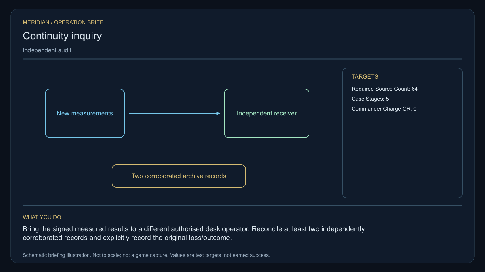

[Editable SVG source](../../assets/missions/revisions/continuity-independent-audit.svg)

### Continuity inquiry - continuity-close-inquiry

Close inquiry Commit the new verified inquiry outcome and the same source clue receipt once.

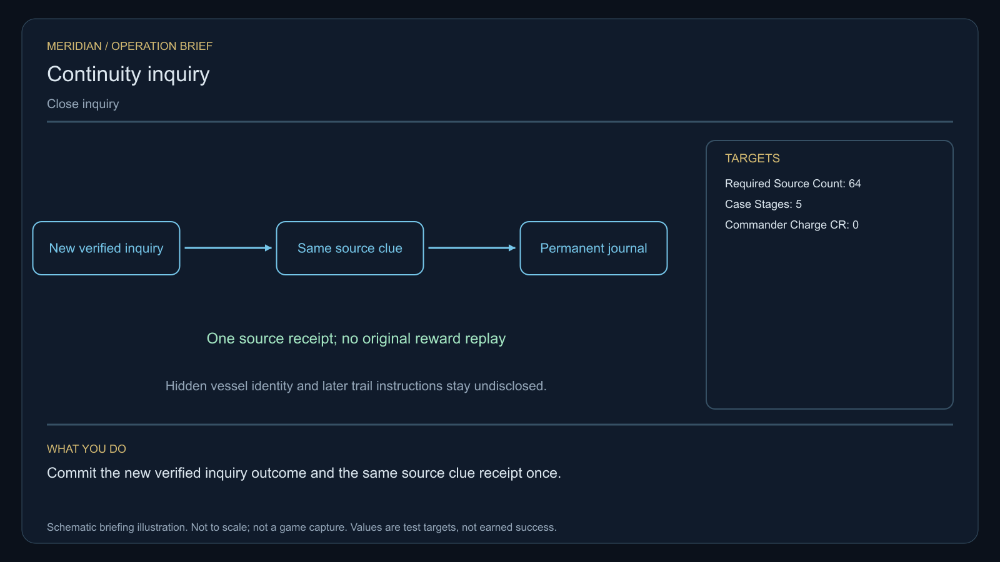

[Editable SVG source](../../assets/missions/revisions/continuity-close-inquiry.svg)
