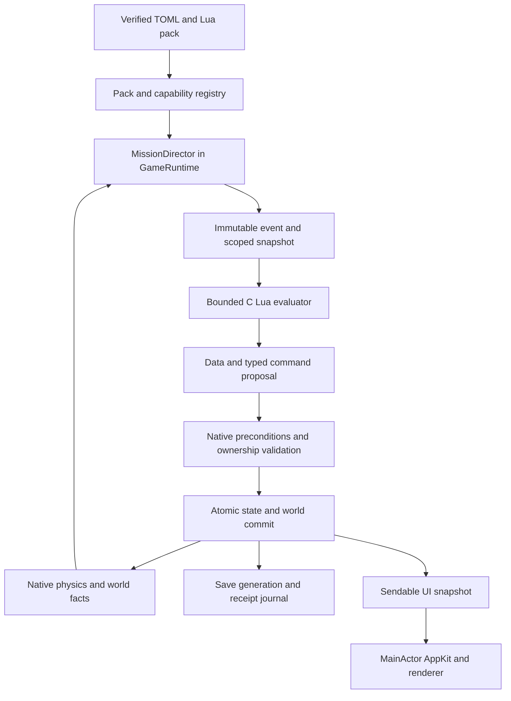

# Scriptable mission engine design

Design v1,14October2026. Requested by the owner after a mission-research checkpoint, with research to resume afterwards. **This is an implementation design, not a claim that the engine exists.** The Maenes packet was completed/delivered as research packet40before this design. The current default build still contains three playable bundled campaigns; delivered research and installed playable missions remain separate.

## Decision and intended result

Extend the existing TOML system with **Lua mission logic and a typed native mission API**. TOML describes identity, versions, dependencies, source profiles, objectives, resources, capability requirements, dialogue and Gallery scenarios. Lua expresses branches, generators, procedures, event reactions, coordination and mission-specific AI decisions. Swift remains responsible for physical simulation, authoritative facts, ownership, money, equipment, people, persistence and rendering.

The intended result is that a new researched campaign can be authored, installed, validated, played, saved and demonstrated in the Gallery without writing a new Swift mission class. Adding a genuinely new physics or UI primitive still requires engine work. Existing three campaigns and schema1packs continue through their current compatible path. This expands the previous TOML-only coordination boundary explicitly; research specifications remain authoritative for content, editions and labelled adaptations.

Recommend pinning **Lua5.5.1**, source archive SHA256 `1c4b4068d67061f2a2231ad2b5422e77acea1487ea9890f6320af614f4373dce`; the official download page identifies that release and hash. Vendor the reviewed C source into a dedicated SwiftPM C target during implementation, rather than depending on a system-installed interpreter. Lua uses the MIT license; include its copyright/license in distribution notices. This recommendation was verified14October2026 and is a design choice, not an installed dependency. [Official download](https://www.lua.org/download.html), [license](https://www.lua.org/license.html).

## Current code and compatibility boundary

Inspected HEAD/main is0d64f3dd9199eb7b4e60d51411650506d100ec0f. [GameRuntime](https://github.com/stephenlclarke/elite/tree/6552b68f7a146ceb79b4376d33cc8afd3f987399) is already the simulation actor; [mission models](https://github.com/stephenlclarke/elite/tree/6552b68f7a146ceb79b4376d33cc8afd3f987399), [runtime](https://github.com/stephenlclarke/elite/tree/6552b68f7a146ceb79b4376d33cc8afd3f987399), [transactions](https://github.com/stephenlclarke/elite/tree/6552b68f7a146ceb79b4376d33cc8afd3f987399), [validation](https://github.com/stephenlclarke/elite/tree/6552b68f7a146ceb79b4376d33cc8afd3f987399) and [Gallery](https://github.com/stephenlclarke/elite/tree/6552b68f7a146ceb79b4376d33cc8afd3f987399) provide useful foundations. [Schema1](https://github.com/stephenlclarke/elite/tree/6552b68f7a146ceb79b4376d33cc8afd3f987399) has five capabilities and external dock/contact/clock events; encounter bindings remain bundled-only. Current mission progress stores stage/flags/receipts/payloads, and the commander save has a4MiBceiling. These structures alone cannot persist Iron Raven's whole fleet, independent station jobs, people and transactional supply.

Proposed schema2/missionAPI2 and minimum mission-engine contract2.0.0 are reserved design versions, separate from the application's marketing version. Keep schema1readers, state IDs, saved legacy mirrors and the Constrictor/Plans/Blackjack bindings intact. Route v1and v2through a common native fact/transaction layer as capabilities become available. Do not automatically reinterpret old flags as physical receipts, rename existing mission IDs or replay old rewards. Each migration is explicit, versioned and tested against an unchanged copy of the old save.

[Architecture evidence and requirement map](https://github.com/stephenlclarke/elite/tree/6552b68f7a146ceb79b4376d33cc8afd3f987399) pin ten current local files and the source requirements. All proposed capability names and API examples below require implementation/registration; none are newly supported by merely appearing in this document.

## Ownership and execution architecture

GameRuntime owns MissionDirector, mission instances, world entities, clock services, random streams and committed receipts. AppKit receives value snapshots and sends intents such as selecting an offer, choosing a dialogue answer or confirming a ship swap. It never executes scripts or mutates mission facts. Lua VM handles and C pointers stay private to the actor; they must not enter Game's Sendable snapshot or cross to AppKit.

Each script dispatch is synchronous and non-reentrant within an actor phase. No await occurs during VM evaluation or in-memory transaction validation. Async asset/preparation work returns immutable results; the actor revalidates revisions before commit. Physical asset allocation, world admission, durable ownership and UI success are distinct states.

Use a small C shim for interpreter entry, budgets, input decoding and result encoding. All error-capable Lua operations and interpreter-to-host functions remain inside C protected frames; **Lua error unwinding must never cross a Swift callback frame**. The shim reads snapshot data and appends bounded command records; it does not call Swift to mutate the world. On normal/error return, Swift copies results and performs native validation. The official API provides an allocator, instruction hooks, protected calls and text-mode loading; Lua5.5's lua_newstate also takes a string-hash seed. Pin that API rather than using an older prototype. [Lua API manual](https://www.lua.org/manual/5.5/manual.html#lua_newstate), [protected-call implementation](https://www.lua.org/source/5.5/lapi.c.html), [error machinery](https://www.lua.org/source/5.5/ldo.c.html).

Create a fresh execution environment for each dispatch. Recreate module closures from verified source or a host-generated cache tied to exact source/runtime/build hashes. Do not persist hidden Lua globals, upvalues, stacks or coroutines. Persistent mission data is explicit, validated value data returned by the handler. This makes load/replay independent of an interpreter heap and prevents accidental hidden state from changing a resumed story. Named handlers/timers/jobs provide continuation across events.

## Pack format and installation

A v2pack is an immutable directory or archive containing manifest.toml, scripts, declared text catalogues, encounter/AI descriptors, optional licensed assets, source/provenance metadata and Gallery scenarios. The [illustrative manifest](https://github.com/stephenlclarke/elite/tree/6552b68f7a146ceb79b4376d33cc8afd3f987399) and [Lua module](https://github.com/stephenlclarke/elite/tree/6552b68f7a146ceb79b4376d33cc8afd3f987399) demonstrate the proposed API; they are not an installable complete Maenes pack and current schema1must reject them.

The manifest declares stable pack/campaign/mission IDs, semantic version, content digest, API/runtime requirement, exact dependency identities, declared capabilities, instance type, source-edition profile, allowed space/orbital environments, handler/module map, data schema, objective/milestone definitions, reward/custody policies, resource ceilings and migrations. Scripts refer to declared dialogue keys, hull/fitting profiles, station-service IDs and local encounter aliases. Edition mappings never collapse different weapons/rewards/branches into one undocumented default.

Install through the existing Commander menu. Validate the exact bytes that will be installed: canonical relative paths, no symlinks/path escape, duplicate IDs, digest/dependencies, module graph, syntax, state schemas, named resources, capability implementations, scope/text catalogue and asset terms. Installation and activation are separate. A pack may be retained as a clearly unavailable reference if requirements are missing; its jobs cannot be accepted or its encounters run. Existing user authorization to install a selected pack is sufficient; do not add repeated per-handler approval prompts.

Use a new per-pack subdirectory under the existing ~/.xyzzy/elite/mission-packs root. Keep v1single TOML files loadable. Store multiple immutable versions when active saves need them. An update changes the active version only through a declared successful migration or after no live instance depends on the old digest. Module imports are declared pack-local names loaded by the host; no runtime downloads or external native modules.

## Mission instances, campaigns and author API

Separate **definition**, **instance**, **owned world resources** and **presentation**. Definition IDs identify authored content. Each accepted/generated job has a distinct instanceUUID, even when it uses the same template. A campaign has its own instance and child receipts. World actor/person/item IDs remain stable through system changes, role changes, docking, wreckage, custody and save. Display names and roles are selectors, never identity.

A handler receives an immutable native event envelope, a scoped read snapshot and a copy of its persisted data. It returns new data and a typed command batch. Host-authoritative facts cannot be changed by editing a Lua table or copying an event. Example command families below are proposed API names; actual Swift types and capability registration are implementation deliverables.

| Family | Author can express | Native authority and result |
| --- | --- | --- |
| Facts/query | Location, genuine docking/person arrival, actual fit, owned targets, receipts, quotes, route candidates. | Scoped snapshot and stable IDs; bounded queries, explicit absent/pending results. |
| Story/dialogue | Branches, procedures, choices, journal pages, markers, objective changes. | Declared text keys, typed substitutions, revalidated choice/Confirm receipt. |
| Encounter | Prepare/admit a finite cohort, adopt this instance's actors, reserve clear placements/components. | Durable plan, actual world admission receipt or readable pending denial; no partial quota. |
| AI/flight | Follow, steer, attack, hold, escort, dock, scoop, flee, navigate and enter a real wormhole. | Actual physics, fitting/energy/target/world constraints; requests are distinct from completion. |
| Combat/fitting | Declared own-NPC fits, weapons/muzzles/turrets, saved stock and permitted plot behaviours. | Source-profile adapter/native integrator, real shots/hits/ECM/ownership/cooldowns; player fitting transactions separate. |
| Clocks/jobs | Flight/calendar/local-world/transit clocks, named timers and persistent station jobs. | Explicit clock/policy/owner, due/fired receipts and saved callback counters. |
| Economy | Quote/charge/reward/refund/debt and partial paid deliveries. | Integer amounts/units, actual balance/quote/custody preconditions and once-only receipts. |
| Cargo/people | Consignments, exact lots, capsules, berths, medical transfers and failed return care. | Real item/person ownership, life support and capacity; no people in equipment storage. |
| Equipment/ships | Quest issue/return, transfer/stow/refit, compatible hull changes and supply allocations. | Unique gear, actual pylon/slot/cabin/hold fit, preserved stock/property and atomic transactions. |
| Board/campaign | Stable offers, repeatable instances, parent joins, exclusive choices and shared services. | Actual completion receipts, station/offer revision and dependency gates. |
| Gallery/testing | Isolated scenarios/checkpoints, scripted choices and expected milestones. | Separate commander/world/RNG/receipt namespace; production restrictions still apply. |

A native capability registry includes version, read/event/command types, required subsystem/assets, quota model and acceptance evidence. A method name or parsed descriptor is not a capability implementation. Proposed groups include script-lua-v1, world-actors-v1, encounter-admission-v1, flight-ai-v1, combat-events-v1, wormhole-transit-v1, world-clocks-v1, custody-v1, fitting-storage-v1, contracts-v1, campaigns-v1 and gallery-world-v1. Refine names during implementation without silently dropping a researched behaviour.

Generic Lua logic can use loops, functions, tables, comparisons and calculations. Native actions remain typed: a script may ask a ship to attack, then observe genuine hits/death; it cannot manufacture the corresponding engine event. Ordinary narrative-only choices can progress through their real choice receipts. Objectives that claim physical outcomes require the corresponding native facts before milestone/completion/reward commit.

## Events, ordering and deduplication

The bus covers accepted/refused offer, dialogue choice/Confirm, genuine station docking/undocking and person transfer, system entry, actor admission/removal reason/destruction, target acquisition, real damage/hits/weapon fire/ECM, cargo scoop/transfer, wormhole admission/arrival/expiry, clock/timer/job events, fitting/hull changes, parent/child receipts and explicit abandonment. Emit only the necessary scoped event data; subscriptions filter by instance/owned cohort/actual location and event kind. No author callback runs per render frame.

Every envelope has an engine-issued eventID, logical sequence, worldID/epoch, authoritative actor/person/item/receipt IDs, clock stamps, cause and revisions. Separate true destruction from unload/GC, role change, docking, transit, derelict conversion and capsule collection. True hull identity/tombstone persists when a captain escapes or a ship changes role. Any-attacker mission criteria and actual player last-hit/bounty are independent.

Use a native causal queue. Admission precedes all events for the admitted body. At a same-time boundary, physical destruction/person/station facts are settled before timer outcomes; genuine docking/person arrivals precede report evaluation; an explicit Confirm revalidates the resulting state. Retain the source-selected tie policy where a documented edition differs. Sort eligible handler dispatches by logical event sequence, pack priority/ID and instanceID, with stable local handler order. Commands commit at a defined boundary; derived events enqueue afterwards without recursive execution inside the current handler. Bound each work cycle and defer remaining work in order.

Exactly-once effects use instanceID, authoritative event/quote/lot identity, operationID and persistent receipts. A duplicate delivered event cannot repay a reward. A repeated operation for a *new genuine partial lot* is allowed; do not reuse schema1's once-per-transition limitation for repeatable courier batches. Preserve exact claim/tombstone membership when archiving old journal segments. A script-authored signal is local story input and cannot masquerade as a physical engine envelope.

## Atomic command and confirmation contract

Evaluate against revisionR; validate proposed data types, rights, resources, references and all preconditions. Build one staged transaction over mission/campaign state, RNG/plan references, credits/debt, cargo/people, unique equipment/storage/hull, station/supply inventory and world-admission changes. Either the whole batch commits, or none of these proposed changes does. Physical facts already committed by the engine are not rolled back because a script handler fails.

Confirm uses a native token containing instance/offer/page, station/person/quote and relevant revisions. Recheck current location, phase, price, capacity, custody, rights and available source evidence at commit. Back is read-only. Stale offers/quotes produce an updated readable offer and no debit/claim. Expected denials return typed results; scripts choose wait/refuse/alternate branches without catching interpreter exceptions. Host-issued action results arrive as later events and cannot be guessed from a returned request ID.

Encounter preparation stores a durable plan and random choices once. It does not mean actors exist. Admission reserves and validates the full real cohort/components/geometry/resources before a batch becomes world-visible and its objective ledger is installed. Allocation, denied spawn and partial batch are not kills. Constructors/AI/audio/loot side effects do not leak from an uncommitted candidate. Retry uses the saved plan; no reroll, quota shrink, heal or replenishment. Actual admission results and death tombstones are native-owned even if Lua processing is delayed.

Use integer decicredits and explicit mass/quantity units, checked overflow and source-declared rounding. Price/loan/refund actions use actual quotes and ownership. Failed/late outcomes may legitimately include a source-authorized incoming payment, such as [RRS pilot transport](https://github.com/stephenlclarke/elite/tree/6552b68f7a146ceb79b4376d33cc8afd3f987399); terminal failed never universally means zero payment. Successful/failed terminal instances cannot restart/reward again. Living return-only care and world-owned jobs continue under separate native owners/rights; they cannot revive mission success.

## Clocks and persistent world jobs

| Domain | Meaning | Pausing/unloading policy |
| --- | --- | --- |
| Flight elapsed | Selected active flight/stage duration. | Explicit source pause/dock/panel semantics; preserve v1behaviour for v1packs. |
| Local world | Loaded physical AI/grid/trial simulation. | Continues docked/read-only when unpaused; freezes offline/explicit pause/unloaded uncaptured local. |
| Commander calendar | Source-selected day/time with travel/service adjustments. | Typed source conversion and strict/equality boundary, never silently stageSeconds. |
| Transit | Actually admitted wormhole/ship movement between worlds. | Uses established admitted-transit clock; unavailable locals do not become fictional arrivals. |

Timer descriptors specify owner, domain, firstDue, interval, hasBeenRun, policy, counter and named handler. Support fixed-delay, named one-shot, source pulse-counter/skipped-interval and explicit elapsed-deadline policies. Policies are selected per source; do not replay missed Oolite callback ticks to advance a battle faster. Save nominal due and actual firing separately. No real-system wall clock or random UI visits affect progression unless an explicit project profile calls for it.

Maenes is a required proof: first due0/interval1, opening285nominal284seconds, eighth-transport pending reset then15/65/120actual pulses, all-nine final reset then10actual pulses. Independent grid repair survives early victory/report/abandonment. A station job has a world-resource owner and named content handler distinct from a terminal mission's reward rights. Missing station cancels actual repair without rebuilding it; zero batteries produces a truthful outcome. Local unload freezes it, and content mismatch preserves it for valid resumption. The [complete Maenes specification](https://github.com/stephenlclarke/elite/tree/6552b68f7a146ceb79b4376d33cc8afd3f987399) takes precedence over this abbreviated example.

## Actors, flight, combat and identity

Provide persistent scene/world storage and owned encounter ledgers with actual body/component/person/cargo links. A mission can adopt only explicitly eligible existing actors, with a real ownership transfer receipt and preserved condition/stock/RNG. Foreign same-role actors do not suppress or complete a mission. Hull wrecks, salvage, pods and abstract staff remain distinct resources.

Reusable AI primitives execute through native physics: navigation/steering intents, formation/following, target selection, attack/defence, dock requests/ports, genuine scooping and wormhole exit/entry. Lua decision handlers use bounded sensor snapshots at declared think cadence and may compose state machines/procedures; native integration preserves source/calibrated profile envelopes and real firing/energy/heat. A high desired-speed factor is an intent interpreted by its selected physics adapter, not a teleport. World positions cannot be reassigned to fake travel completion.

Weapon descriptors cover facing masks versus fitted guns, controller/emitter relationships, muzzle transforms, turret arcs/scaling, source laser costs/cadence, missile types/current stock/reload/ECM/blast, physical projectiles, collision and real owner attribution. Plot NPC nonfatal repair/refuel rules are explicit owned-NPC behaviours with receipts; no fatal resurrection or player refill is inferred. Source NPC zeros and player minimum baseline rules stay separate. Maintained ship TOMLs and calibration/economics remain authoritative; scripts select declared source/profile adaptations and do not overwrite the global catalogue.

Ordinary world law, police launch/fit/capacity, friendly/collateral damage, source main-station protection and player kill/Right on Commander rules are native. A mission may count an allied kill of its actual target without granting player bounty. Narrative claims that a fleet arrived, a pilot boarded or a weapon hit are not those receipts. Actual missing/denied world support yields pending/suspended state rather than a contact-shaped substitute.

## Crew, passengers, cargo, equipment and hull switching

Implement one fit/custody service used by mission acceptance, contract boards, equipment changes, station transfers, supply and shipyards. It accounts for operating crew/intrinsic quarters, real fitted/occupied/free passenger berths, usable hold, equipment units, pylons/stock, unique gear, protected mission lots/pods and docking envelopes. The [existing crew contract](https://github.com/stephenlclarke/elite/tree/6552b68f7a146ceb79b4376d33cc8afd3f987399) supplies the source/estimate rules; a normal optional berth costs5tonnes and1equipment unit. A genuine occupied standard escape pod uses its specified1tonne/life support rather than silently becoming a charter cabin. No hiring/wage UI is introduced for abstract assigned operating crew.

Personal equipment has unique IDs, condition, modifications and current ammunition. Hull change builds a deterministic compatible transfer proposal; surplus eligible empty gear goes to persistent commander storage, and can later be reused exactly once. Occupied cabins, people and mission cargo require real destination fit; insufficient capacity blocks confirmation. Starter baseline outfit is issued once under its own receipt, not every showroom visit. Source-zero player hold remains zero unless an explicitly selected refit changes it.

Reuse the [shipyard design](https://github.com/stephenlclarke/elite/tree/6552b68f7a146ceb79b4376d33cc8afd3f987399): docked ship selection,3Dinspection through360degrees in every plane, aligned side-by-side capability/weapons/crew/fit comparison and one shared quaternion/direction/plane for both previews. Preview changes orientation and proposal only. Native Confirm transfers hull/gear/storage while preserving missions, calendar/jobs, owned actors, people, cargo, debts, legal state and actual spent stock. Missions receive the true committed hull-change event, never progress from a preview.

## Contract boards and compound campaigns

A board is a real station service with stable station/offer identities and saved generation revision/seed. Lua can generate bounded offers and parameter choices using a declared generator; native validation freezes the actual offer, quote, duration semantics, resource requirements and custody. Show fit-blocked offers with the exact reason; only implemented/enabled/safe profiles are actionable. Preserve [RRS headquarters and waystation support](https://github.com/stephenlclarke/elite/tree/6552b68f7a146ceb79b4376d33cc8afd3f987399). Closing a board, changing hull or reloading does not regenerate rewards/targets/deadlines.

Acceptance creates a distinct job instance, anchors acceptance-relative durations once and commits any actual deposit/fit/reservation. Repeatable instances and partial deliveries have their own source/lot/action receipts. Existing active jobs retain their original return station and actual payload. Expiry, late full-pay failed outcomes, refunds and care are explicit source policies.

Campaigns join **actual child completion receipts**, not installed-pack dependencies or arbitrary phase flags. Preserve exclusive branches, pending choices, shared dossiers/contact familiarity/loans and immutable historical evidence. Four Iron Raven investigations can progress independently; the shared follow-up selection commits one actual branch once. Parent/submission markers and journal snapshots are transactionally consistent. Reading a book does not create a contact, payment, capture or finished investigation.

## Persistence, recovery and determinism

Introduce a v2save package with immutable generations: commander header, mission/campaign data, world chunks, actual actor/people/item ledgers, timers/jobs, RNG, event/receipt segments and exact pack/profile digests. Write candidate files and hashes into a new generation, validate, then atomically publish a small CURRENTpointer; keep the prior complete generation until publication succeeds. Never overwrite parts of the live generation. Preserve the v1JSONimport path and its limits; do not cram a fleet/world into the old4MiBcommander record or silently drop state when it grows.

Mission data permits finite booleans, strings, signed64-bit integers, finite doubles, arrays and bounded string-key maps. Reject functions, pointers, userdata, cycles and nonfinite values. Stable references resolve through native ID registries. Pending pages/choices, actual quotes, clocks, counts, owned actors/stock/condition, custody, grants, partial lots and failed care restore without constructor/RNG/reward replay. Missing/different content suspends the intact instance for explicit migration; unsupported world assets lock the affected saved scene until restored/migrated. No guessed stage or discarded passenger.

GameRuntime prepares immutable save candidates for a writer actor. For a durable user transaction, gate authoritative mutation/ticks behind a transaction barrier while publication is pending; actor reentrancy may serve read snapshots but cannot mutate the reserved world. Queue/coalesce input intents with bounded memory and preserve the defined simulation-time policy. After durable success publish the candidate to memory/UI; on write failure discard candidate/reservations and retain the prior authoritative state. Explicit ordinary saves may persist a coherent point-in-time snapshot while later play continues, with its recorded revision. Do not await I/O and then overwrite unrelated newer simulation state.

Use engine-owned, versioned random streams and stored encounter/offer plans. Lua has no independent random generator or time seed. Every committed draw is associated with its owning instance/plan; retries, previews and source constructors cannot reroll old equipment/ammo/people. A failed transaction does not consume a new stream position; accepted preparation can durably save its plan before physical admission. Gallery gets a cloned stream. Stable sort/numeric/rounding adapters yield reproducible mission decisions for the same event log/input/seed; this is not a promise of bit-identical cross-architecture continuous physics. Record engine/build/physics-profile versions with replay evidence.

## Execution limits and error recovery

Build the script environment from an allowlist. Expose bounded value/query/command helpers and deterministic numeric utilities. Do not expose filesystem/network/process/native module loading, debug access, arbitrary runtime loading, global mutation hooks, wall time or independent math.random. Restrict text/array helpers to bounded native work; instruction hooks alone do not bound an expensive C library operation. User-supplied binary chunks are rejected. Only the host's exact-build verified source cache can be used internally.

Initial **provisional profiling budgets**, subject to measured tuning:50,000Lua instructions per business handler, hook every1,000instructions,8MiBVMheap,32MiBtotal allocation work per dispatch,256KiBexplicit state per instance and256command records per batch. Host calls charge query/output/byte/operation budgets too. Bound call depth and output nesting. Compiler/module initialization is also protected and budgeted. Treat quota exhaustion as a stable diagnostic, not a partial commit or automatic restart. Measure representative full campaign workloads before freezing these limits; do not truncate source fleet/objectives to fit an arbitrary default.

Do not expose Lua pcall/xpcall/coroutine resume or metatable/debug mechanisms that could catch and endlessly evade a host budget abort. Expected game denials use typed return data. The outer C protected call owns the failure boundary; hooks/allocator/callbacks are C-only. Fresh dispatch state prevents retained handlers from altering later interpreter setup. Audit all exposed native helper paths and apply sanitizer/fuzz tests; an interpreter API allowlist is an application boundary, not a claim of operating-system process isolation.

Encounter quotas are declared/reserved against real native budgets. Maenes requires82roots/56components/up to702missile-plus-plasma bodies before normal margins; the engine must admit those real counts or leave deployment pending. No silent count scaling or fake admission. Maintain fair event dispatch and bounded queries so one pack cannot starve input/world updates. New AI think handlers use declared native cadence, not per-pixel/render callbacks.

On handler syntax/runtime/budget/state-validation error, discard its proposed data/actions, retain all previously committed world facts/receipts, and suspend the instance with a concise player-facing reason plus developer diagnostics. Do not retry indefinitely or restart progress. Native safe AI/life-support/custody continues where support remains valid; accumulate authoritative physical facts without pretending Lua acknowledged them. World-owned repair/care jobs have explicit content/safety policies. Missing assets/content needed for a saved scene preserve that scene locked rather than simulate fictional offscreen events. Recovery reprocesses unacknowledged facts once under the same pinned version or a validated migration.

## Dialogue, journal, Gallery and authoring tools

Provide generic native layouts for paragraphs, choices, tables, contact directories, log/book pages, HUD counters/markers and renderer-backed3Dcraft previews. Lua selects declared text keys and typed substitutions; AppKit renders snapshots. Queue overlapping contact/world notifications, preserve confirmed/pending pages and rendered journal outcomes, and revalidate Confirm. Back/preview is read-only. Technical schema/error traces stay in author tools, not normal player flows. Profile-scoped source-key overrides cannot globally rewrite another campaign's shared dialogue.

Gallery offers overview/source/estimate labels, prerequisites, aligned milestones and explicitly locked/available/active/complete/failed states. Each pack supplies scenario descriptors: initial native checkpoint, seed, real actor/resource setup, player intents, expected receipts and success/failure examples. Running a scenario creates a separate commander/world/mission/storage/RNG namespace and cannot issue real gear/payments, reset loans or advance a live save. Unimplemented capabilities remain a readable reference entry, not a playable simulation. Test that the three existing campaigns still display correctly.

Proposed tooling extends existing Makefile workflows: syntax/manifest validation, capability/dependency/source/asset report, isolated scenario runner, event/transaction trace, deterministic replay from a save, migration dry-run, scoped hot reload in an isolated Gallery world and author documentation. Production active saves keep their pinned digest. Lua traces identify module/handler/instance/event/denial/receipt and budget use; redact unrelated player/filesystem data. Store per-scenario duration and exact build/profile fingerprints. A parser pass or mocked action is not native acceptance.

## Implementation sequence and completion gate

| Phase | Concrete deliverable | Evidence required before calling it complete |
| --- | --- | --- |
| 1: host and compatibility | C Lua shim/budgets, actor director, typed events/transactions, v2loader/state, v1adapter and save generations. | Three legacy campaigns unchanged; syntax/loop/recursion/allocation/output errors contained; failed atomic transactions and crash/load boundaries preserve state. |
| 2: physical world | Persistent actors/components/admission, owned groups, AI/flight/dock/wormhole/weapon/real death facts. | Genuine full-cohort admission/denial; real shots/ECM/collateral; same-person two-world travel and no teleport/constructor refill. |
| 3: custody and contracts | Crew/cabins/pods/cargo/gear/storage/hull-fit/quotes/partial delivery/board instances. | RRS pilot transport and medical supply source profiles, actual blocked fit/stale offer/partial lot/late failed payment, linked shipyard comparison/gear reuse. |
| 4: campaigns and clocks | Source timer policies, persistent world jobs, compound parent receipts, exclusive branches/shared services. | Finance loan/partial shipment and Maenes full9target order/grid/timer/report/custody/supply/source-law scenarios through actual native simulation/reload. |
| 5: authoring and rollout | Complete Gallery/scenario/replay/migration tools, documentation and capability readiness reports. | Author installs a new full space mission without Swift mission changes; source parameter/branch audit and isolated rendered success/failure evidence; each enabled capability has native acceptance. |

Use the [requirement matrix](https://github.com/stephenlclarke/elite/tree/6552b68f7a146ceb79b4376d33cc8afd3f987399) as the detailed completion checklist. All24requirements require direct implementation evidence or an explicitly retained unsupported state. Implement coherent vertical phases and complete make ci, coverage, address/thread sanitizer and leak gates at the relevant immutable checkpoints, including the C target. Exercise meaningful new transaction/save/world/VM cases, not tests that just repeat a proposed implementation. Profile real Maenes-size scenes and representative concurrent contracts. README media remains game-renderer output through make readme-media; ship catalogue changes use the authoritative ship workflow. Publish Sonar only from committed main with exact SHA as projectVersion.

The engine is **fully scriptable for this retained space-mission scope** only when physical/custody/clock/contract/campaign capabilities can express and execute the researched profiles without bespoke per-mission Swift branches, with real saves and isolated Gallery acceptance. A working Lua courier, green parser, declared capability list, static stage screenshot or more installed packs alone does not satisfy that gate. Unknown mission research remains unknown content, not an engine feature to invent.

## Handoff and continuation

Send this design, the requirement map, examples and current-code/source limits to Elite Coder for implementation planning. This is a separate architecture handoff and does not increase the mission research packet count beyond40. Track design delivery and engine implementation independently. After this design checkpoint, resume P19common epilogue/awards and alternate intelligence-source research, then the remaining P07/P15/P29/P45campaigns, expansion ships/fullcrew/dedup and final source/scope/readiness audits. No research permission or accepted shipyard/storage/crew/scope contract is revoked by this temporary change of focus.
